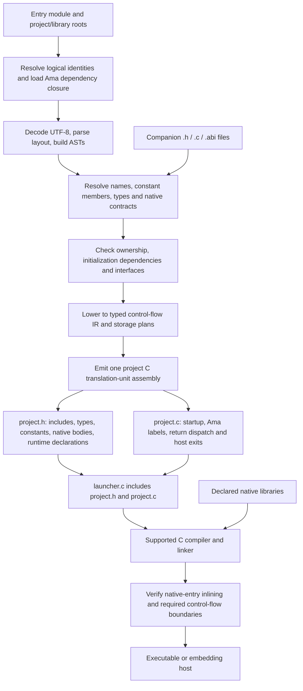

# Ama: Technical Specification for a New Implementation

Version: design baseline, 2026-11-11.

## Contents

- [1. Purpose and status](#1-purpose-and-status)
  - [1.1 Minimal, stable language core](#11-minimal-stable-language-core)
    - [Native foundations and composition](#native-foundations-and-composition)
    - [Reading an Ama program](#reading-an-ama-program)
  - [1.2 Decision boundaries and completion discipline](#12-decision-boundaries-and-completion-discipline)
  - [1.3 Terminology](#13-terminology)
    - [Modules, declarations, and values](#modules-declarations-and-values)
    - [Ownership, references, and collections](#ownership-references-and-collections)
    - [Execution and runtime storage](#execution-and-runtime-storage)
    - [Native code, lifecycle, and errors](#native-code-lifecycle-and-errors)
    - [Compiler and verification](#compiler-and-verification)
- [2. Deliverables](#2-deliverables)
- [3. Source model and identity](#3-source-model-and-identity)
  - [3.1 Files and namespaces](#31-files-and-namespaces)
  - [3.2 Internal names and debugging](#32-internal-names-and-debugging)
- [4. Layout and module structure](#4-layout-and-module-structure)
- [5. Types, declarations, and literal data](#5-types-declarations-and-literal-data)
  - [5.1 Uniform declarations](#51-uniform-declarations)
  - [5.2 Literals](#52-literals)
  - [5.3 Instance storage and shared constants](#53-instance-storage-and-shared-constants)
- [6. Values, references, and copying](#6-values-references-and-copying)
- [7. Invocation, reading, and control flow](#7-invocation-reading-and-control-flow)
  - [7.1 Three distinct operations](#71-three-distinct-operations)
  - [7.2 Acquisition failure](#72-acquisition-failure)
  - [7.3 Branches, loops, and completion](#73-branches-loops-and-completion)
- [8. Suspension and explicit continuation copying](#8-suspension-and-explicit-continuation-copying)
- [9. Lists and index contracts](#9-lists-and-index-contracts)
- [10. Runtime storage and state machine](#10-runtime-storage-and-state-machine)
  - [10.1 Per-module pools](#101-per-module-pools)
  - [10.2 Execution directly over instance storage](#102-execution-directly-over-instance-storage)
  - [10.3 Return links and resumption positions](#103-return-links-and-resumption-positions)
  - [10.4 Root execution and host control](#104-root-execution-and-host-control)
- [11. Native C interface and stackless backend](#11-native-c-interface-and-stackless-backend)
  - [11.1 Generated project organization](#111-generated-project-organization)
  - [11.1.1 Overall translation to C](#1111-overall-translation-to-c)
  - [11.2 Native modules and representations](#112-native-modules-and-representations)
  - [11.2.1 Symbolic protocol registration in `.abi`](#1121-symbolic-protocol-registration-in-abi)
  - [11.2.2 Complete lifecycle and cleanup protocol](#1122-complete-lifecycle-and-cleanup-protocol)
  - [11.3 Mandatory inlining and verification](#113-mandatory-inlining-and-verification)
  - [11.4 Error reporting and execution traces](#114-error-reporting-and-execution-traces)
- [12. Compiler architecture](#12-compiler-architecture)
  - [12.1 Connecting dependencies written in Ama](#121-connecting-dependencies-written-in-ama)
  - [12.2 Compiler components form a source tree](#122-compiler-components-form-a-source-tree)
  - [12.3 Exact algorithms and formal justification](#123-exact-algorithms-and-formal-justification)
- [13. Standard library contracts](#13-standard-library-contracts)
- [14. Tests, tooling, and contributor requirements](#14-tests-tooling-and-contributor-requirements)
- [15. Acceptance matrix](#15-acceptance-matrix)
- [16. Implementation plan from zero](#16-implementation-plan-from-zero)
  - [Stage 0: Freeze backend and native-ABI artifacts](#stage-0-freeze-backend-and-native-abi-artifacts)
  - [Stage 1: Source, identity, and syntax](#stage-1-source-identity-and-syntax)
  - [Stage 2: Types, ownership, and explicit IR](#stage-2-types-ownership-and-explicit-ir)
  - [Stage 3: Minimal stackless execution slice](#stage-3-minimal-stackless-execution-slice)
  - [Stage 4: Native integration and lifecycle specialization](#stage-4-native-integration-and-lifecycle-specialization)
  - [Stage 5: Yield, resume, and explicit continuation copy](#stage-5-yield-resume-and-explicit-continuation-copy)
  - [Stage 6: Lists and complete library surface](#stage-6-lists-and-complete-library-surface)
  - [Stage 7: Release hardening](#stage-7-release-hardening)
- [17. Design closure and implementation work](#17-design-closure-and-implementation-work)
  - [17.1 Status of the agreed design packages](#171-status-of-the-agreed-design-packages)
  - [17.2 Engineering tasks, not open language questions](#172-engineering-tasks-not-open-language-questions)
  - [17.3 Document maintenance](#173-document-maintenance)
- [Appendix A. EBNF](#appendix-a-ebnf)

## 1. Purpose and status

This document specifies a new implementation of the Ama programming language:
its source model, compiler, standard library boundary, generated C representation,
runtime, tests, and acceptance criteria. It defines the implementation to build
from Ama source files.

The goal is a small, international, explicitly stateful language for composing
typed native operations in explicit namespaces. Programs should read as a sequence
of understandable operations. Modules define both behavior
and the types of state on which that behavior operates. Instances own data;
references identify instances without owning them. Execution uses explicit
control transfers rather than C function calls between Ama modules.
Project-specific terms are defined in the [terminology glossary](#13-terminology).

This specification is the source of truth for the language and its implementation.
[EBNF.md](EBNF.md) maintains the grammar derived from these requirements;
[README.md](README.md), [VALUE_ABI.md](VALUE_ABI.md),
[CONTRIBUTORS.md](CONTRIBUTORS.md), and [TODO.md](TODO.md) provide the overview,
native contract, contributor guidance, and implementation backlog respectively.
If a derivative document conflicts with this specification, correct that document.
Change this specification only at the user's explicit request; implementation
work does not authorize changing requirements to match existing code.

The specification defines acceptance requirements, not a claim that every feature
is implemented. There is no backward-compatibility obligation for documentation
or implementation. Remove obsolete proposals and descriptions rather than retain
alternative language rules or obsolete APIs.

**MUST** denotes an acceptance requirement. **SHOULD** denotes a preferred
engineering choice whose replacement requires a documented reason. Examples using
library paths such as `.std.integer`, `.std.text`, or `.jobs.task` illustrate types
and syntax; they do not reserve those paths or specify existing library interfaces.
Numbered requirements and their explanatory paragraphs are normative unless
explicitly marked as examples or implementation choices. A grammar production
describes syntax; passing it does not bypass static or runtime requirements.
Requirement identifiers are stable cross-references, not a required numeric order.

The requirements below specify one synchronous execution thread. Parallel
execution, distributed instances, garbage collection, and an implicit scheduler
are outside the agreed language scope; their absence does not reserve new syntax.
This scope does not permit substituting an implicit message queue for the specified synchronous invocation semantics.

### 1.1 Minimal, stable language core

**CORE-01.** Ama aims for a minimal but powerful, coherent language core, not a
sequence of deliberately incomplete language versions. Implementing the agreed
language in stages is an engineering plan, not a promise to keep extending its
syntax or observable semantics after each stage.

**CORE-02.** New domain capabilities belong in libraries built from modules,
instances, references, collections, and native C interfaces. Prefer library
composition over new keywords, operators, special built-in types, or context-specific
syntax. The documented condition/index mappings are explicit core contracts,
not permission for libraries to redefine parsing or silently alter core behavior.

**CORE-03.** Resolve remaining design questions as parts of one consistent core.
Do not justify an arbitrary restriction by assuming a later syntax expansion.
A core change requires an independently demonstrated need that the existing
library mechanisms cannot adequately express, with grammar, semantics, diagnostics,
and tests reviewed together. This does not prohibit correcting specification bugs.

#### Native foundations and composition

**CORE-04.** Native modules provide the trusted foundations of Ama. Treat each
native operation as a contract: typed inputs and outputs, preconditions,
postconditions, permitted state/resource effects, and failure behavior. Ama adds
qualified identities, typed composition, explicit ownership and control flow
around those operations. Library growth adds operations and types within this
contract; it does not add grammar productions or alter existing operators.

The analogy with mathematical proofs is compositional: if each primitive meets
its contract and each composition rule preserves the required invariants, the
composition satisfies those invariants. A native declaration is an assumption
about C, not a proof of its implementation. The Ama compiler checks declarations,
types, capabilities and generated uses; it does not prove arbitrary C free of
undefined behavior, resource leaks or nontermination. Native implementation and
toolchain obligations must remain explicit in every correctness argument.

**CORE-05.** Ama's core fixes naming, storage forms, lifecycle, typed transfer,
invocation, control flow and the six native protocols. A library may interpret
literal bytes and implement domain behavior, but cannot change indentation,
parsing, assignment, reference validity, acquisition, or error propagation.
There is no open-ended operator or parser registry, implicit conversion, general expression
language, or execution selected by searching for a conveniently named C function.

#### Reading an Ama program

Read a declaration as **name and storage form → module type → initial contents**.
An output receiver may instead declare its first-occurring name and storage form,
with its module type supplied by the selected result under TYPE-06.
Read an assignment as **destination → source**. Read a call as **target and mode
→ input bindings → output bindings → optional refusal alternative**. A dotted
path is a type/constant namespace; a declared name selects state. The distinction
must remain visible without consulting native implementation details.

| Visible form | Meaning |
|---|---|
| `item` / `target&` / `items[]` / `targets&[]` | Owned value / reference / owning list / reference list |
| `&item` in source position | Form a non-owning checked reference |
| `destination` followed by indented `source` | Typed transfer; no declaration or implicit cast |
| `worker!` | Execute from entry, preparing a fresh interface |
| `worker%` | Resume saved execution without resetting the interface |
| `worker` followed by `>>` | Read retained results without executing the target |
| `.module` followed by `>>` | Copy shared constants, without an executable target |
| `%` as a statement / `%source` as a source | Yield / explicitly copy saved positions with owned data |
| Named condition followed by `?` or `{` | Branch or condition-controlled loop |
| `:` / `^` / standalone `>` | Local alternative / loop exit / invocation completion |

`!` and suffix `%` announce execution that may change target state. A read has
no execution suffix, although transferring its results changes its receivers.
Symbols have the meanings assigned to their grammatical positions; their payload
occurrences after `|` are data. The complete syntax is in [EBNF.md](EBNF.md).

### 1.2 Decision boundaries and completion discipline

Language decisions determine what source means and which programs are valid.
Native contracts determine how C participates without changing that meaning.
Backend choices implement those contracts: label numbering, C helper spelling,
block sizes, integer widths for bookkeeping, and file organization do not require
new language features or repeated user-level semantic decisions.

A design package is complete when it specifies successful behavior, refusal/error
behavior, state/ownership effects, and acceptance evidence together. Implementation
tasks may discover defects, but must not reopen settled semantics merely because
an internal data structure or C declaration has not yet been written. Section 17
records the closure of the design packages and separates that from engineering
work; checklist size alone must not be used as a measure of completeness.

### 1.3 Terminology

This glossary defines how terms are used in this specification. Detailed
requirements in the referenced sections govern their behavior; the glossary
does not add language features or substitute for the detailed contracts.

#### Modules, declarations, and values

| Term | Meaning in Ama |
|---|---|
| Module | A source unit identified by its full project/library path. An executable module defines an instance type and shared code; it may also declare shared constants. A constants-only module provides immutable shared declarations without executable instances. |
| Module path | A qualified source identity such as `.shop.item`, corresponding to `shop/item`. It names a type or constants namespace, not an executable object. |
| Type | A module-defined contract for values/state and permitted operations. Types determine compatibility; matching binary layouts alone do not make values interchangeable. |
| Instance / object | One independently identified state of an executable module type. Many instances share the module's code but have separate fields and runtime metadata. |
| Value | The contents represented by typed storage. Owned-value copying constructs independent owned data; reference-value copying copies a checked target identity. |
| Declaration | An explicit name/storage-form line, module-type path line, and optional initializers, or a first-occurring output receiver whose type is inferred under TYPE-06. Standalone assignment does not implicitly declare a variable. |
| Result-inferred declaration | A simple output receiver that is the first textual occurrence of its local base name; it declares persistent caller storage with the selected result's module type and matching explicit storage suffixes. |
| Base name | An identifier before storage suffixes. `item`, `item&`, `item[]`, and `item&[]` share one base name and cannot coexist as declarations in one module. |
| Storage form | Whether a declaration is an owned value, reference, owned list, or reference list, as marked by the absence/presence of `&` and `[]` on its name. |
| Parameter | Interface storage declared in `@<`, reinitialized at entry-start from its default or supplied typed input; explicit literal inputs use CALL-07. |
| Result | Interface storage declared in `@>`, retained after execution and obtainable through `>` on execution or `>>` on a nonexecuting read. |
| Persistent state | Body-declared instance fields initialized once at creation, including declarations nested in branches/loops. They survive ordinary calls and resumption. |
| Shared constant | An immutable declaration in the first optional `@=` section, shared by all instances and excluded from instance ownership, reset, and copying. |
| Enumeration | A library-defined type with a finite set of accepted values, exposed through named `@=` constants. Different enumeration module types are incompatible; no special enum declaration operator is required. |
| Literal | Raw UTF-8 payload after `\|` in a declaration initializer or entry-call input, interpreted by the destination's declared type. It has no quoting, escaping, or multiline continuation. |
| Qualified constant source | A logical module path followed by the constant name, such as `.std.list.append`, used directly as a typed value source without a local alias or executable module call. |
| Initializer | A declaration's optional source or literal specifying initial contents. It is distinct from executable assignment. |
| Draft | A UTF-8 source file with none of `@=`, `@!`, or `@C`. It is excluded from compilation and may contain unfinished declarations; it cannot be used as a type or entry. |
| Constants-only module | A complete file containing only the `@=` section and layout. It has no executable implementation, instance pool, or callable singleton. |

See sections 3 through 5 for source identity, declarations, and storage duration.

#### Ownership, references, and collections

| Term | Meaning in Ama |
|---|---|
| Ownership | Responsibility for the lifetime and destruction of an instance or native resource. Owning a child differs from merely holding a reference to it. |
| Ownership tree | An instance and its recursively owned descendants, including owned list elements. Non-owning references may form a separate graph and do not extend this tree. |
| Reference / handle | A non-owning, checked identity of a target instance: its slot and generation, with the target type statically known or explicitly carried. It is not a raw C address. |
| Empty reference | A handle with generation zero, including an all-zero handle, that selects no instance. |
| Stale reference | A previously issued handle whose target has been deleted or whose generation no longer matches. It must never resolve to a later replacement object. |
| Generation | A nonzero incarnation number for a live pool slot. Reuse advances it without wraparound; exhaustion permanently retires the slot. |
| List | An ordered, dynamically sized contiguous array of instance handles, with length and capacity. Instance payloads remain in their module pools. |
| Owning list | A list that owns its element instances. Removal destroys an element subject to access/lifecycle checks. |
| Reference list | A list owning only its handle entries, not their targets. Removing an entry does not destroy the referenced instance. |
| Position / index | A zero-based place in current list order. It may change after insertion/removal; it is not an object's stable identity or pool-slot number. |
| Length | The number of current list entries. It differs from allocated list capacity and from the number of live objects in an element-type pool. |
| Capacity | Allocated storage available before growth is required. Reserved capacity does not itself create live elements or instances. |
| Ordinary copy | Independent owned-data copying with internal-reference remapping and no copied resume positions. Reference-only assignment copies identity instead. |
| Continuation copy | Explicit `%source` copying of owned data and saved positions throughout the copy boundary, without busy flags or outstanding return links. |
| Copy boundary | The source ownership tree, or all owned elements/descendants in a whole owning-list copy. References to objects inside it follow the clones; external targets remain unchanged. |
| Clone context | Temporary runtime source-to-destination identity mapping used to construct a copy and redirect compiler-visible internal references. Native payload hooks do not inspect this graph. |

See sections 6 and 9 for copy/identity rules and the list interface.

#### Execution and runtime storage

| Term | Meaning in Ama |
|---|---|
| Runtime | Generated program machinery for pools, current-instance selection, access checks, lifecycle, control transfers, host outcomes, and diagnostics. It is distinct from the compiler. |
| Pool | Per-executable-module-type heap storage for instances, allocated in blocks with stable live-slot addresses. It does not encode user list order or imply default objects. |
| Pool slot | Storage/identity location for one possible instance. Slot identity, liveness, and generation are distinct from the payload's contents. |
| Free list | Runtime chain of unused pool slots, linked through metadata in free slots for reuse before allocating more blocks. It is not a user-level list. |
| Refusal context | Empty initial status; own refusal saved before `:`; successful/reader calls do not clear it; nested-instance refusal does not overwrite caller; next own refusal replaces it; copied status remains unchanged; owned clones start with empty service context |
| Acquisition | Protected runtime access to a selected instance/collection for an operation, preventing conflicting access or destruction until release. Forming a reference with prefix `&` does not hold such protection. |
| Busy | An instance is running or waiting for an outstanding nested invocation; conflicting entry/resume/read is refused. |
| Waiting instance | A still-busy caller whose callee has not returned. Its data stays in its heap slot and its pending return chain remains active. |
| Yielded instance | An available instance with a saved position after `%` and no outstanding caller connection from the yielded invocation. It may be explicitly resumed. |
| Entry-start | An `instance!` operation that reinitializes the interface under STATE-02/CALL-07 and runs from body entry while preserving permanent state. |
| Resumption | An `instance%` operation that executes from the saved position without input bindings or an interface reset. |
| Retained-result read | An unmarked instance target followed by `>>` requests. It copies stored results without executing/resetting the target. |
| Return link | Service metadata identifying the outstanding invocation's caller instance and return continuation. It is not an owning reference or a saved C activation. |
| Return continuation | A compiler-generated control location to which a callee returns, selected using explicit runtime metadata and labels. |
| Resume position | The next execution/control location saved by `%`, including information needed to continue inside branches/loops. It is separate from an outstanding return link. |
| Root instance | The one executable entry instance created by the host startup rule. It has no caller in Ama. |
| Host / launcher | The C program entering generated execution and receiving completed, yielded, or failed outcomes. The standard standalone launcher is one such host. |
| Stackless execution | Ama module invocation/return through labels and explicit instance metadata rather than C activations per module call. It does not prohibit stack use inside native C. |
| Positional placeholder | An empty argument line `<` or `>` that consumes an input/output position while keeping its input default or skipping result transfer. |

See sections 7, 8, and 10 for invocation, suspension, access, and host behavior.

#### Native code, lifecycle, and errors

| Term | Meaning in Ama |
|---|---|
| Native module | An Ama interface selecting `@C`, with a handwritten companion implementation and checked generated C entry. |
| Native payload | Opaque per-instance C state owning native resources only. It must not hide persistent Ama references, instance addresses, or runtime control links. |
| Borrowed view | Temporary typed access to generated storage during an authorized native operation. It does not transfer ownership and cannot escape into retained native state or callbacks. |
| ABI | Application binary interface: the contract joining generated code and native implementations, including representations, signatures, lifetimes, and status handling. |
| `.abi` companion | A fixed UTF-8 binding table mapping the six symbols `+`, `-`, `\|`, `=`, `?`, and `[]` to C functions. It is not executable Ama source. |
| Native protocol | A fixed native capability/lifecycle contract: default creation, destruction, literal construction, cloning, condition conversion, or index conversion. |
| Constructor | A selected native `+`, `\|`, or `=` operation over fresh payload storage. Ama has no constructor section or implicit execution of child bodies. |
| Destruction / finalization | Ending resource ownership and lifetime through native `-` and generated child cleanup. It is distinct from normal completion of a module invocation. |
| Copy preparation | Construction and validation of an unpublished replacement and its reference fixups, before destroying the old destination. Failure preserves the old destination. |
| Replacement commit | The phase beginning with destruction of the old destination. Destruction errors are terminal and do not roll back a partly destroyed value. |
| Native status | The common C code/message/byte-length record. It reports technical results separately from declared Ama application results; code zero means success. |
| Acquisition refusal | Inability to start an entry, resume, or retained read, such as a missing/busy target. An attached `:` may handle it. |
| Operation refusal | An expected post-entry list outcome, such as invalid mutation position or a busy owned deletion target, returned as ordinary list results. It does not select call `:`. |
| Technical failure | A failure such as allocation, native construction/cloning, or cleanup failure that ends current Ama execution with diagnostics and a failed host outcome, without exceptions. |
| Execution trace | The active Ama operation and caller-site chain rendered using source names/locations before return links are cleaned up. It is not object history or an automatic C backtrace. |

See section 11 for native boundaries, lifecycle ordering, and diagnostic contracts.

#### Compiler and verification

| Term | Meaning in Ama |
|---|---|
| AST | Abstract syntax tree preserving parsed source constructs and spans before execution/storage lowering. |
| Typed IR | Intermediate representation with resolved types and explicit lifecycle, acquisition, result-transfer, continuation, and control-flow operations. |
| Source span | A source identity and location/range retained for precise diagnostics and mappings from generated operations to original code. |
| Backend | The compiler stage that emits checked C types, interfaces, storage, labels, dispatch, and debugging mappings from validated plans. |
| Qualified identity | A full module/member/category identity used for deterministic collision-checked hashing rather than a basename alone. |
| Acceptance criterion | Required observable behavior or invariant with evidence from implementation checks/tests. A documented target feature is not automatically implemented. |

See sections 12 and 14 through 17 for compiler boundaries, tests, and completion.

## 2. Deliverables

The implementation MUST provide:

1. A compiler accepting a project root, an entry module, and output destinations.
2. A source reader, parser, AST, semantic analysis, typed intermediate
   representation, and C backend with separable responsibilities.
3. Generated C containing all project types, native implementation bodies,
   pool/runtime declarations, Ama control flow, and runtime bookkeeping.
4. A runtime providing per-module instance pools, checked references, ownership,
   lifecycle operations, acquisition, suspension, and explicit return links.
5. Standard library contracts for scalar values, literal interpretation,
   conditions, indices, and collection operations.
6. A documented native C interface and contributor guide.
7. Recursive Makefiles and C unit/integration tests, including failure cases.
8. Reproducible examples, diagnostic documentation, and a conformance report
   identifying supported features and unresolved limitations.

The compiler MAY reuse independently tested source-management, hashing, layout,
and ownership components from the existing project. Reuse must not preserve
obsolete source semantics or introduce a nonconforming execution mechanism.

## 3. Source model and identity

### 3.1 Files and namespaces

**SRC-01.** One extensionless source file defines one module. Its logical path
relative to the project/library namespace determines identity under the physical
mapping in SRC-05.
For example, `shop/item` is named `.shop.item`. A companion C implementation is
`shop/item.c`. An active `@C` module requires companions `shop/item.h` for its
native declarations/layout, `shop/item.c` for implementation, and `shop/item.abi`
for protocol bindings. The optional capabilities are optional records, not
permission to omit mandatory lifecycle metadata. Ama implementations and
constants-only namespaces do not require native companions. `.abi` files are
compiler inputs describing native contracts, not executable Ama modules.

**SRC-05.** A module's submodules live in a sibling directory named after its
source file with the ASCII suffix `+`. The marker belongs to filesystem layout,
not to a logical identifier. For example:

```text
shop/
    item
    item.c
    item.h
    item.abi
    item+/
        validate
        calculate
        names
        validate+/
            details
```

| Physical module source | Logical module path |
|---|---|
| `shop/item` | `.shop.item` |
| `shop/item+/validate` | `.shop.item.validate` |
| `shop/item+/calculate` | `.shop.item.calculate` |
| `shop/item+/names` | `.shop.item.names` |
| `shop/item+/validate+/details` | `.shop.item.validate.details` |

Ordinary directories such as `shop/` group namespace components. A `name+/`
directory marks submodules of its sibling extensionless `name` module file; that
file must exist, although normal draft rules still determine whether the parent
itself participates in compilation. Nesting does not implicitly import or execute
the parent, inherit its declarations, or establish runtime instance ownership.
A parent may be a constants-only module, executable module, or an unused draft;
a referenced child must independently satisfy active-module rules.

Strip exactly the structural trailing `+` from each such directory component
when deriving logical identity. Use the full logical identity for type checking,
hashes, and duplicate detection; reject conflicting physical sources instead of
preferring a search path. `+` is not added to module-path grammar. Source maps,
`#line`, includes and filesystem diagnostics retain actual physical paths.

Derive native companions from the physical source filename, so the implementation
for `.shop.item.validate` is `shop/item+/validate.c`, with `.h` and `.abi` beside it.
The convention lets an extensionless parent file and its child directory coexist
without changing existing top-level companion names.

**SRC-04.** A module path identifies a type, not a callable object. Executable module types
have no implicit/default live instances. A module's `@=` section is shared
immutable storage, not an implicit executable instance. Ordinary source-level execution,
resumption, and retained-result reads must select an explicit instance through
an owned name, a reference, or an indexed element. A whole-list operation selects
a declared collection under its collection contract, not a type. Instance and
collection declarations may be explicit or result-inferred under TYPE-06.

**SRC-02.** Duplicate module paths across project and imported library roots
MUST be rejected. Filesystem aliases must not create two conflicting identities.
Module lookup must diagnose missing modules and executable references to drafts.
The compiler must define which directory entries are source candidates and must
not treat generated outputs or companion `.c`, `.h`, or `.abi` files as Ama modules.

**SRC-03.** Ama source and native `.abi` companions must be well-formed UTF-8.
Decode Unicode scalar values, rejecting malformed sequences instead of treating
arbitrary bytes above 0x7F as letters. Module and variable names are case-sensitive
and compared byte-for-byte, without normalization, transliteration, or case folding.
An identifier starts with `_` or a Unicode `XID_Start` character and continues
with `_` or `XID_Continue` characters, using the identifier properties defined by
[Unicode UAX #31](https://unicode.org/reports/tr31/). These rules support international
alphabets, including Chinese, without requiring C-compatible names.

Use Unicode 17.0.0 identifier properties and record that edition with the compiler
source. Identifier acceptance must not depend on the host locale or a silently
updated system Unicode library. Generating/vendoring those tables is an
implementation task; changing the accepted property edition is a reviewed source
contract change, not an implicit library upgrade.

Each component of a module path uses the same identifier rule. Filesystem lookup
must preserve a one-to-one mapping between source spelling and the module file.
Adapt native path encoding explicitly without normalizing or merging identities.
Reject a project whose distinct source paths the platform cannot distinguish,
including case/normalization aliases; do not silently rename or combine modules.
A path/name that cannot be represented unambiguously on the platform is diagnosed
as an unsupported path, not reinterpreted under the host locale.

### 3.2 Internal names and debugging

**NAME-01.** Compiler-owned generated C names MUST use deterministic hashes of
complete qualified identities, with separate categories for types, shared constants,
state members, interface members, labels, and runtime metadata. A basename alone is insufficient. Hash inputs
must have unambiguous component boundaries and a versioned encoding.
Handwritten native symbols use the module-prefix facility in NAME-05; they are
not discovered or rewritten by hashing a C source file.

**NAME-02.** The compiler MUST retain the original identity alongside each hash
and reject collisions between distinct identities. A collision must never merge
types, storage, labels, or values. Hash uniqueness does not replace type checks,
instance selection, or reference generation checks.

Use a length-delimited, domain-separated identity encoding. Specify the hash
algorithm, encoding version and output width, and cover them with stable test
vectors, including Unicode names.

**NAME-03.** Generated code MUST carry `#line` mappings to the original source
paths and lines. Unicode paths must remain recognizable in diagnostics; quoting,
backslashes, and control characters require correct C directive escaping.
Additional metadata SHOULD map hashed entities to source names and spans.
Do not change module identity merely to make it a C identifier.

**NAME-04.** Each module has one declaration namespace covering shared constants,
parameters, results, and persistent body declarations, including declarations
inside branches/loops and result-inferred declarations under TYPE-06.
A base identifier may be declared only once in that module. `item`, `item&`,
`item[]`, and `item&[]` share the base name `item` and cannot coexist as separate
declarations. Storage suffixes express kind, not separate name namespaces.
Nested blocks do not introduce shadowing. Different modules may reuse base names.

Resolve uses within this module namespace, require matching storage form, and
retain declaration-order initialization. Name visibility does not authorize use
of an uninitialized source or cyclic initialization. Duplicate-name diagnostics
identify both declarations and their storage forms. No suffix may silently select
a different declaration when a use is missing or mistyping its storage marker.

**NAME-05.** The generated assembly MUST also provide a module-qualified naming
facility for handwritten native C. In a companion's generated inclusion context,
`AMA_NATIVE(local_name)` denotes a C identifier formed from a collision-checked
module prefix and that local C identifier. The module prefix is derived from the
full logical identity in a separate native-symbol category. Prefix encoding and
concatenation must be injective over the accepted module/local-name pairs.
Identical local names in different module companions therefore remain distinct.

Native authors use this facility for module-owned file-scope functions, types,
tags, enumeration constants and objects that require isolation. The `.abi`
identifier names a function in this module context, for example:

```c
/* Included in the declaring module's generated naming context. */
static AmaStatus AMA_NATIVE(initialize)(AMA_NATIVE(State) *state);
```

```text
+ initialize
```

This record binds that module's `AMA_NATIVE(initialize)`, not a global function
selected by basename. The generator establishes the same prefix for its `.h`
and `.c` and generated typed uses, and removes the temporary naming context
after each inclusion. The prefix is independent of file discovery/include order.
Shared ABI declarations such as `AmaStatus` have one documented runtime namespace.

This mechanism qualifies authored identifiers; it does not parse or rewrite
arbitrary C. The preprocessor's macro namespace is still shared: companion macros
and include guards must be uniquely named or contained/undefined by their author;
`AMA_NATIVE(...)` is not a macro-name rewriting mechanism for `#define`/`#ifdef`.
External C dependencies retain their public names and ordinary C linkage rules.
Unqualified conflicting C definitions, leaked macros or incompatible declarations
are build errors, never permission to bind one module's hook to another's.

## 4. Layout and module structure

**SYN-01.** Ama uses one space per nesting level. Tabs cannot serve as indentation
or ordinary code whitespace. LF and CRLF are supported; a lone CR is invalid.
Blank lines are formatting and MUST NOT delimit sections.
The last physical line need not have a line ending. For grammar recognition only,
treat a nonempty unterminated final line as terminated by one virtual LF; it is
not a source byte or part of a literal. Empty files remain empty. Preserve actual
bytes and positions for literals and diagnostics. Comment text may contain
tabs after `#`; blank lines contain spaces only. `.abi` files use their stricter
tab rule in PROTO-11.

**SYN-02.** `#` introduces a comment outside literal payload. A comment inside a
literal is data. The parser must preserve literal trailing spaces and distinguish
structural indentation from payload bytes.

| Annotation | Meaning |
|---|---|
| `@=` | Shared immutable constant declarations |
| `@<` | Parameter declarations |
| `@>` | Result declarations |
| `@!` | Executable Ama body |
| `@C` | Native companion implementation |

**SYN-03.** Annotations occur at indentation zero. The section order is optional
`@=`, optional `@<`, optional `@>`, then one implementation selector, `@!` or `@C`.
`@=` is a declaration section, not an implementation selector; it may accompany
either implementation. Repeated, unknown, or out-of-order annotations in an active
file are errors. `@!` may introduce an empty body. Only layout follows `@C`;
constant declarations follow `@=` until the next section or end of file.

A file containing only `@=` and its constant declarations/layout is a complete
constants-only module, with no executable implementation or instance pool.
An empty `@=` section is allowed. Parameter/result sections require `@!` or `@C`;
adding `@=` must not make an unfinished interface without implementation valid.

**SYN-04.** A file with none of `@=`, `@!`, or `@C` is a draft excluded from
compilation. It may contain unfinished declarations without full parsing, name
binding, or type checking. UTF-8 decoding and recognition of genuine zero-indent
section markers still apply; text inside literal payload/comments cannot activate
a file. Companion files cannot make a draft executable or trigger layout/stub
output.

Using a draft as a type or program entry is an error identifying the file and
referring location. Adding `@!`/`@C`, or `@=` for a constants-only file, activates
full validation. An incomplete constant declaration then fails rather than being
ignored as a draft. Constants-only files are valid dependencies, but cannot be
program entries or invocation/resumption targets. They do not create a hidden
executable instance. Typed enumeration values and selection follow CONST-01
through CONST-05. Editor draft checks do not change
build status. An intentional empty executable body uses `@!`.

**SYN-05.** Only the section annotations specified above are accepted. There are
no alternate implementation selectors or separate constructor section.

## 5. Types, declarations, and literal data

### 5.1 Uniform declarations

**TYPE-01.** Every variable has a module-defined type. A declaration contains a
name line, a module-path line at the same indentation, and optional initializer
lines one space deeper, except for a result-inferred declaration under TYPE-06,
which has no separate type line or initializer. Storage markers occur on the
declaration name, never on a module-path line.

| Declaration name | Storage meaning |
|---|---|
| `item` | Owned instance/value |
| `target&` | Non-owning typed reference |
| `items[]` | Dynamic list owning its elements |
| `targets&[]` | Dynamic list containing non-owning references |

```text
item
.shop.item

target&
.shop.item
 &item

items[]
.shop.item

targets&[]
.shop.item
 &item
```

**TYPE-02.** Scalars permit at most one initializer; lists permit multiple
initializers, one per element. Whole-list initialization is not implicit splicing
or nested-list construction. Sources must already be initialized and have
compatible types. Initialization follows declaration order.
For persistent body fields, that order is lexical source order, traversing nested
branch/loop bodies at their written location; both branch alternatives contribute
fields unconditionally. A result-inferred declaration contributes its field at
the receiver's source location, with ordinary default initialization under
TYPE-06. Blocks never make construction conditional on execution.

**TYPE-03.** There is no privileged language-level `size_t`, machine integer,
raw address, or universal truth value. Integers, bytes, text, and other data
representations belong to modules and their library contracts. Compiler-internal
indices, counters, sizes, and continuation selectors may use C integer types.

**TYPE-04.** Owned state is initialized according to its type, including recursively
owned children, without executing their module bodies. Lists start empty unless
initialized. Infinite eager ownership cycles are invalid; a reference or empty
dynamic list does not itself require recursively allocating its target type.
Unsupported default construction must be diagnosed or fail through the defined
lifecycle protocol.

For eager construction, form a type edge for every owned scalar field and for
every owning-list field with one or more element initializers. Reference fields,
reference-list fields and initially empty owning lists add no eager edge. Reject
a cycle in this eager-construction graph: every such edge requires at least one
child construction before its owner can finish. Check initializer value
dependencies separately; absence of an eager cycle does not authorize reading
an uninitialized source. Module loading and clone-capability graphs have different
edges and must not be substituted for this graph.

**TYPE-05.** Type compatibility is nominal: the same complete module identity is
required, together with the storage-form rules below. Matching layouts, similar
names or a C cast do not make different Ama types compatible. There is no implicit
reference formation, dereference, scalar/list conversion, list splicing or subtype
conversion.

| Destination storage | Accepted ordinary source of the same module type | Effect |
|---|---|---|
| Owned scalar | Owned scalar access or scalar constant | Independent owned copy |
| Reference scalar | Reference access or prefix `&` of an owned scalar access | Copy/form a non-owning handle |
| Owning list | Whole owning list or owning constant list | Independent whole-list copy |
| Reference list | Whole reference list | Copy handle entries, without cloning targets |

An indexed owned element is scalar storage; an indexed reference-list entry is
reference storage. An ordinary reference source such as `target&` cannot implicitly
clone its referent into owned storage. Explicit `%target&` instead requests the
continuation clone in CONT-04. `%` of an owned or reference scalar may construct
or replace distinct owned scalar storage only; it does not produce a reference
or whole list. Clone capability and overlap rules still apply.

Each list initializer creates one element: apply the scalar rule for that list's
ownership form. A whole-list source is not one element. Declaration literals and
CALL-07 input literals construct owned scalars using the destination's `|`
capability; they cannot initialize reference storage. These rules also govern
parameter binding and result transfer. An indexed access in target position
selects an instance to execute/read; that is distinct from transferring a handle.

**TYPE-06.** A simple output receiver may declare a new persistent field without
a separate module-type line. This applies to `>` bindings on entry-start/resume
calls and `>>` bindings on retained-result reads, including whole-list operations,
and on shared-constant reads. Existing named/positional and operation-mode rules
still apply; whole-list operations remain positional and have no resume. The
receiving name must be one of `name`, `name&`, `name[]`, or `name&[]`; an indexed receiver cannot declare
its collection or index. Empty output placeholders declare nothing. No other
operand position, including standalone assignment, implicitly declares storage.

Classify declarations by this exact source-order algorithm, independently of
execution, module-loading order, and later explicit declarations:

1. Parse the module's syntax without consulting declared-name lookup. Visit all
   local variable-name occurrences in increasing source-byte order, including
   explicit declaration names, operands, call targets, receivers, and names
   within indices. Traverse every branch and loop in written order. Track the
   set of base identifiers already encountered, treating all four storage forms
   as one base name under NAME-04.
2. Module-path components, qualified constant member names, callee-side binding
   labels, comments, and literal payloads are not local variable-name occurrences
   and do not enter that set. A local constant used by its unqualified name does.
3. If an occurrence is a simple output receiver and its base name has not been
   encountered, record a result-inferred declaration at that receiver. Otherwise
   record an ordinary use or explicit declaration according to its syntax. Add
   every encountered local base name to the set, including unresolved uses.
4. Collect the complete module namespace and resolve explicit module-type paths.
   Process recorded result-inferred declarations in receiver source order:
   resolve the operation target and selected interface position/label, then
   take exactly the selected result's declared full module identity. A static
   constant read uses the selected `@=` declaration; a whole-list operation uses
   the fixed typed result interface in LIST-04. Neither runtime values nor
   analysis of the callee's body participates in type inference.
5. Require the receiver's explicit storage form to match the selected result
   exactly, then apply all namespace, initialization, ownership, capability,
   and transfer checks. Missing or mismatching `&`/`[]` is an error, not a request
   to insert suffixes, dereference, form a reference, or convert a list/scalar.
   A later explicit declaration of an inferred base name is a duplicate, even
   if its type and suffixes match. A use preceding an output receiver prevents
   inference there; do not repair that use by inventing a later declaration.
   A valid later explicit declaration may still resolve ordinary uses under the
   existing visibility rules; a later output receiver cannot supply one.
   An invalid first occurrence never triggers a search for another declaration
   site or a different result type.

After any scanned prefix, the encountered-name set is exactly the set of local
base names occurring in that prefix; a receiver declares storage if and only if
it is simple and its base name is absent immediately before that occurrence.
This invariant makes the classification unique and independent of control flow
or symbol-resolution success. It does not change existing visibility rules for
explicit declarations or permit forward/cyclic initializer dependencies.

The target's type must be supplied by an explicit declaration or an earlier
result-inferred declaration. Interface declarations in `@>`/`@=` have explicit
module types; fixed list-result types are supplied by the library contract.
They do not depend on inferred caller fields. Among inferred fields in one
module, the only type-inference dependencies are through operation targets;
each target precedes its output bindings. These edges strictly decrease local
declaration positions and end at explicit types or fixed interfaces, making
inference well-founded. Existing cross-module loading and eager-construction
checks remain separate. A missing target type is an error, not permission to
guess a type or infer backward from later uses.

The inferred field belongs to the caller's module-wide namespace, not to the
callee or a branch-local scope. It is constructed once with the enclosing
instance, in body-field declaration order: an owned scalar uses its type's
default construction, and references/lists start empty. The output binding is
an executable transfer into that already live field, not its creation-time
initializer. A later declaration initializer can observe only that field's
creation-time value, never a future call result. Repeated calls, loop iterations,
and later receiver occurrences update the same field. Acquisition refusal leaves
it unchanged, including its default/empty value before the first successful
transfer. Inferred owned fields participate in TYPE-04's eager-construction graph
and all normal lifecycle/copy-capability checks; inference cannot bypass them.

For example, assume `worker` has been declared and its results are, in order,
an owned scalar, a reference scalar, an owning list, and a reference list:

```text
worker!
 > value
 > target&
 > values[]
 > targets&[]
```

If these four base names have no earlier local occurrences, the receivers
declare four fields with the corresponding result types. A later `> value`
uses the existing field. In `result > result`, the left `result` is a callee
label and does not prevent the right `result` from declaring a local field.

### 5.2 Literals

**LIT-01.** A literal begins with `|` in a declaration initializer or immediately
after the spaces separating an entry-call input marker `<` from its operand.
Everything after that character to the physical line ending is literal payload.
`|` alone is empty; `||text` starts with a literal vertical bar. There are no
quotes, escapes, multiline literals, or interpolation rules.

```text
count
.std.integer
 |255

lines[]
.std.text
 |First line
 |
 |Quotes "and" # characters remain data
```

**LIT-02.** The declared module interprets literal payload. The literal interchange
contract is immutable UTF-8 bytes with an explicit length, excluding the marker
and physical newline. It must preserve embedded payload spaces and must not
require NUL termination or host-dependent `wchar_t`.

**LIT-03.** Numeric literals are not a separate expression category. Literal
payload is permitted in declaration initialization and explicit entry-call inputs
under CALL-07. Assignments, conditions and indices still use named sources. Bare
`255` is not an argument expression: `< |255` supplies uninterpreted bytes to the
parameter type. The compiler MUST NOT introduce hidden numeric variables or infer
a numeric type from the payload.

**LIT-04.** Each native-backed literal type must define accepted bytes, binary
representation, initialization errors, ownership, and cleanup. Literal bytes
cannot forge a checked instance reference. The `|` constructor receives an
immutable byte view and reports status when construction is attempted. Invalid
literal construction is a technical failure with declaration or call/binding
context; a compiler may diagnose it earlier only through a documented, equivalent validation mechanism,
not by executing arbitrary native constructors during compilation. C byte-view
typedef spelling is an implementation task, not a different literal semantics.

### 5.3 Instance storage and shared constants

**STATE-01.** Body declarations describe permanent instance state, including
ones inferred at output receivers and ones written inside branches or loops.
Their initialization runs once at instance creation, not whenever execution
reaches the declaration's source location.
Assignments are executable operations and may update that state on every call.

**STATE-02.** Parameters and results are interface storage. An entry-start call
reinitializes them for the invocation before running the body. Install parameters
in declaration order, choosing each supplied source/literal or its declared
default, then initialize results in declaration order under CALL-08. A later
default observes the already installed earlier fields, including supplied inputs.
Do not default-construct a supplied parameter and then overwrite it. Their final
values are retained after completion or suspension. Before the first call,
results have their declared initial values. A retained-result read exposes only
results, not parameters or private body fields.

**STATE-03.** `@=` declares one shared immutable part of a module, usable alongside
parameters/results and either Ama or native implementation. Its values belong to
the module identity, not to any executable instance. They are initialized once before
root creation/execution under CONST-01 through CONST-05, never once per instance
or invocation. Earlier constants in the same module may be used by name in later
constant/interface/body initializers.

Shared constants are excluded from instance layouts, interface reset, ownership
trees, ordinary copying, and `%` continuation copying. Creating, copying, or
resuming an instance cannot duplicate or mutate them. They have no busy state,
slot generation, caller link, or execution position. They cannot be assignment
receivers or sources of mutable references. Shared storage is not an instance
pool or a callable singleton.

A constants-only module provides the shared part without executable instances.
It requires no pool and cannot run as the root. A module path followed by `>>`
reads shared constants under CONST-03, never an instance's retained results.

**CONST-01.** Constants are immutable, independently copyable values, including
library numbers, text, and enumeration values. They cannot carry mutable-object
references or identities of open external resources such as files, sockets, or
devices. Reference/reference-list declarations are not permitted in `@=`.
Native storage must not hide prohibited links/resources. Constant-capable types
must support independent copying and construction without executing module bodies
or observing/changing mutable external state. Native constructors for constants
must not perform external I/O; internal allocation of value storage is permitted.
These are native/library contract obligations, not a new ABI capability symbol.

Reading or using a constant as a value source copies its value into compatible
receiver storage; it never grants mutable access to shared storage. Constants
cannot be execution/resume targets or reference-acquisition operands. Copying an
ordinary instance excludes the module's shared section as before; explicitly
copying a constant's value is a different, permitted operation.

**CONST-02.** Initialize constants once before root initialization, following
declaration order and initialized dependencies. The compiler checks visible
construction/initializer dependencies and rejects cycles or use-before-initialization.
Declaration initializers may use literals, previously initialized local constant
sources, or qualified constant sources under CONST-05. Include cross-module
constant dependencies in initialization planning; preserve declaration order
within each module and reject cycles. Qualifying a local forward reference does
not bypass that ordering. Required constant dependencies initialize first, before
the root can start.
Native construction must not introduce hidden initialization dependencies.
Do not execute an Ama module body or arbitrary native constructors at compiler
time. Build-time validation is allowed only through an explicitly equivalent,
documented validation mechanism. A runtime initialization failure identifies the
module/declaration and prevents root startup; clean completed constants and partial
construction through the lifecycle protocol. Dispose successful shared storage
once after executable instances, in reverse initialization order.

Plan initialization over individual constant declarations, not over a graph that
merely says one module mentions another's type. Add an ordering edge from each
constant to the preceding constant in its own module, and a dependency edge to
each constant value its construction reads, including declared owned-field
initializers. Reject cycles in this graph. Choose the next dependency-ready
declaration deterministically by the bytewise full module path, then declaration
ordinal. A module declaring constants of its own executable value type is not
thereby cyclic: shared `@=` storage is not an owned field of that type. Eager
owned-state construction cycles are checked independently under TYPE-04.

**CONST-03.** Read constants of another module with a module-path target and
ordinary saved-read bindings:

```text
.std.list
 append >> action
```

The compiler statically resolves the module and the requested `@=` members.
Named requests use constant declaration names; positional requests follow their
order in `@=`. Existing read rules require at least one `>>` with a receiver,
consistent named/positional mode, and no `<`, `>`, `!`, or `%`. This is a static
constant read, not entry/resume, an instance acquisition, or a computed getter.
A path cannot expose parameters, body fields, or instance results. Missing modules
or members, draft sources, incompatible types and mutable receivers in shared
storage are compile-time errors. Runtime value-copy failure remains technical.
An instance target with `>>` continues to expose only its retained `@>` results,
not constants. Local constants are available directly by their declared names.

**CONST-04.** An enumeration is a normal library-defined value type with a finite
set of accepted values and named constants. Its native literal constructor
interprets symbols/bytes and rejects unknown representations; `=` provides
independent value copying. It does not add an integer-literal category, automatic
numbering, or an `enum` keyword. Value compatibility follows the full module type,
not equality of internal numeric tags. Define action/outcome constants in the
shared section beside the using module's behavior, or in a constants-only namespace.
That set exists once without an instance pool; selecting a value does not execute
or copy the namespace. Public tag mappings are library contracts.

For example, the list library may expose action values as follows:

```text
@=
append
.std.list.action
 |+

remove
.std.list.action
 |-

@C
```

A caller declares compatible storage and obtains one value before using the fixed
list-call interface:

```text
@!
action
.std.list.action

items[]
.shop.item

.std.list
 append >> action

items[]!
 < action
```

Paths/member names here are illustrative library names, not reserved English
words. `+` and `-` inside literals are interpreted by the library type, not new
source operators. This rule applies uniformly to all permitted value-source positions.

**CONST-05.** A qualified constant may be used directly wherever a copy source is
accepted: a declaration initializer, an assignment source, or an entry-call input.
Its spelling is the full logical module path followed by `.` and the constant's
declaration name, for example `.std.list.append`. The final component is always
the constant name; all preceding components form the exact module path. For a
constant collection the member's existing `[]` storage suffix is retained, with
ordinary collection compatibility/cardinality rules. No longest-prefix lookup,
implicit import, wildcard search, or fallback to an executable module is allowed.

Resolve the namespace and `@=` member statically, then copy the value under its
declared type directly into the existing destination or interface storage.
No implicit Ama variable, local alias, hidden instance, body execution, or new
literal category is introduced. A type-path line in a declaration remains a type
path; source position determines qualified-constant interpretation. Namespace
loading uses the same project/library/submodule mapping and collision checks.
Missing namespaces/members, draft namespaces, incompatible types, and incorrect
storage forms are source-located compile-time errors.

Qualified constants are read-only sources, not receivers, invocation/resumption
targets, mutable-reference acquisition operands, or `%` continuation-copy sources.
Literal entry inputs follow CALL-07 independently of qualified constant copying.
Named/indexed condition syntax is unchanged. Existing explicit path-plus-`>>` constant reads remain available,
including when a program deliberately wants a local value to reuse or modify.
Argument ordering, named/positional consistency, `%` input prohibition and empty
positional placeholders remain unchanged.

Examples using illustrative library identities:

```text
# Supply an action without declaring a local alias.
items[]!
 < .std.list.append
 <
 < &sample

# Initialize a declared value from a qualified constant.
action
.std.list.action
 .std.list.append

# Assign a different named value later.
action
 .std.list.remove
```

A qualified source in `@=` adds an explicit initialization dependency. It never
turns module initialization into an executable call or permits dependency cycles.

## 6. Values, references, and copying

**REF-01.** `&item` obtains a checked reference to owned instance storage.
`target&` reads a reference variable. `&target&` is invalid: references to
references are not supported. The trailing ampersand remains part of reference
variable access, including named interface labels.

**REF-02.** A reference identifies a module type, pool slot, and slot generation.
The type may be statically known rather than stored in every handle. A reference
is not an exposed C address and does not keep its target alive. Generation zero
is reserved for empty references; zero-initialized handle fields represent an
empty handle, regardless of whether slot zero is otherwise valid. Live instances
use nonzero generations starting at one. An internal generic handle may carry
the type identity explicitly; a statically typed handle need not repeat it.

**REF-03.** Assignment places the receiver on one line and one compatible source
one indentation level below it:

```text
destination
 source

target&
 &item

other&
 target&
```

Compatibility and transfer effects are exactly TYPE-05's table. Resolve the
receiver location first, then the source, once each. An invalid standalone
selection is a technical failure; assignment has no attached `:`. Transferring
into reference storage changes the stored handle, not its target's state.

**COPY-01.** Ordinary owned-value copying produces independent owned children
and lists. References stored inside the copy that point into the copied ownership
tree follow their corresponding new instances. References to objects outside that
tree retain their existing targets. Copying a reference variable alone copies
identity only and does not clone or redirect its target. A native resource that
cannot be cloned independently must report unsupported copying; it must not
silently become shared ownership.

**COPY-02.** Construction and clone failure before destructive replacement
preserves the source and old destination and releases all partial new resources.
After a complete replacement has been prepared, destruction of the old value
begins the nonrollback commit phase. A destruction error is terminal and cleanup
continues under PROTO-10; the partly destroyed destination is not restored or
exposed as live. Self-assignment and overlap follow COPY-06. Explicit continuation
copy requires distinct source and destination storage.

**COPY-03.** Ordinary owned copying copies data but no saved execution positions
or outstanding invocations anywhere in the copy boundary. The destination root
and all copied owned descendants, including owned list elements, have no resume
position. Replacing a distinct destination discards its previous continuation
state; ordinary self-assignment remains the no-op specified in COPY-06. Reference
assignment does not modify any referenced instance's execution state.

**COPY-04.** The copy boundary is the source owned instance and all instances
recursively owned by it, including owned list elements. Shared `@=` constants
are outside every instance ownership/copy boundary. The source root itself
is included: an internal reference to that root points to the destination root
after copying. All checked references stored in the copied data, including
reference-list entries, use the same rule. The original objects and references
held outside the copy are never rewritten.

For example, if an object owns `item` and its `selected&` points to that item,
copying the object creates a new item and makes the copied `selected&` point to
that new item. Copying only `selected&` preserves its original target. No additional
copy mode or source syntax is introduced.

A whole owning-list copy treats all its owned elements and their descendants as
one copy boundary, so references between elements follow the new elements.
Copying one element alone does not include its siblings; references to those
siblings remain external. Copying a reference list alone does not own or clone
its targets and therefore preserves their identities.

**COPY-05.** Implement this as one operation-scoped clone context: record the
source-to-destination identity mapping for the complete ownership tree, then
resolve copied checked references against that mapping before publishing the
copy. This handles forward references, references to ancestors, and non-owning
reference cycles without recursively cloning referenced targets. Destination
replacement preserves the destination root's existing identity. Temporary mappings
and new children must be cleaned up on preparation failure, leaving the source
and previous destination unchanged. Only generated Ama storage contains persistent
Ama references; the compiler/runtime performs every corresponding reference fixup.
Native clone hooks copy their own native payload only and do not walk Ama handles.
Destruction errors after commit begins follow COPY-02 and PROTO-10.
The rule applies equally to ordinary value copying and `%` continuation copying;
execution-position handling remains governed by COPY-03 and CONT-04 through CONT-05.

**COPY-06.** Ordinary assignment to the exact same owned instance or collection
is a no-op. It does not clone, allocate, destroy resources, or clear a saved
execution position. Reference-variable self-assignment likewise leaves the
handle unchanged. Explicit `%` copying to the same instance is invalid: it
requires an independent destination. Identity checks use resolved runtime
identity, not merely equality of source spellings.

Copying owned state between an ancestor and its owned descendant is forbidden
in either direction, including ownership through lists. Distinct instances with
neither owning the other may be copied, including sibling elements of one list,
subject to normal type, availability, and lifecycle checks. Non-owning reference
links between source and destination do not themselves make ownership overlap.
Collection operations must also reject overlapping owned source/destination
boundaries; the self-assignment no-op is not permission to overwrite an ancestor
with its descendant.

Diagnose statically provable violations during compilation. Where identities or
ownership relationships are known only at runtime, validate them before changing
data, invoking clone hooks, or destroying destination resources. A runtime
violation is a technical copy failure under the explicit-status/diagnostic
protocol, not an assignment `:` alternative. Do not silently introduce temporary
snapshots to make forbidden overlap work. These rules apply to ordinary and `%`
copying and require no additional syntax or selectable copy modes.

**COPY-07.** For both ordinary owned copying and `%` continuation copying,
validate availability across the complete source ownership tree before replacing
or modifying the destination. Refuse if any included instance is running or
waiting for a nested invocation. Keep the validated source protected for the
operation so native clone hooks cannot invalidate that check through reentry.
A self-assignment no-op does not initiate tree cloning. Destination access and
replacement remain subject to the existing acquisition/lifecycle rules.

The validation walks ownership edges only. External reference targets are not
cloned, need not be available for this copy, and do not contribute execution
positions or return links. Copying their handles still follows the normal checked
reference rules. No pending invocation chain is cloned, regardless of copy form.

**REF-04.** Deletion makes the slot non-live immediately; before reuse its
generation advances without wraparound. Validation requires a nonempty handle,
the expected type, a live slot, and an exact generation match, followed by the
operation's availability check. Empty handles and stale handles never select an
instance. Deleting busy or acquired instances is forbidden. Destruction order
must release owned children exactly once. Reference cycles do not create
ownership cycles and do not prevent deletion.

**REF-05.** Generation counters never wrap, reset, or reuse a previously issued
slot/generation identity. After deletion of an instance at the maximum generation,
permanently retire that slot instead of putting it back on the free list. Allocate
another slot if possible; identity-space exhaustion is an explicit technical
failure, not permission to wrap. Counter width is an internal ABI choice; tests
must exercise exhaustion with a reduced-width counter rather than rely on it
being practically unlikely. Retired slots must not become live again when a
block is reclaimed and later reallocated.

**REF-06.** Reclaiming payload blocks must preserve generation history and retired
slot information outside the freed storage, or permanently retire the released
slot identities and issue fresh ones. The invariant is absolute: an old handle
must never resolve to a different future object. Growth, shrinking, zero-filled
allocation, and free-list reconstruction cannot reset this history. Protection
covers Ama references within one runtime lifetime; handles are not a persistence
format or permission to reuse references across destroyed runtime instances.

**REF-07.** Reference formation and runtime acquisition are different operations.
Prefix `&` forms a typed identity for existing owned scalar storage; it neither
locks that object beyond the current operation nor extends its lifetime.
Copying reference storage copies its identity, including an empty or stale handle,
without acquiring, cloning or reviving its target. Selecting an indexed reference
entry still checks the containing list and position. Target liveness, generation
and availability are checked when an operation resolves that handle for access.

**REF-08.** Before any normal destruction, removal, reset or replacement can
destroy owned state, preflight the entire affected ownership subtree, not only
its root. No included running, waiting or incompatibly acquired descendant may
be destroyed. Protect the validated tree through the operation. The operation's
own authorized acquisition is not a conflicting acquisition. Non-owning reference
edges do not extend the destruction boundary. Clear preflights all its owned
element subtrees before any destruction. Invocation target refusal follows
CALL-04; post-entry list refusal follows LIST-10; other dynamic access violations
are technical failures. Cleanup after execution has already failed first releases
active links/acquisitions under LIFE-05, then destroys owned state.

## 7. Invocation, reading, and control flow

### 7.1 Three distinct operations

| Source form | Operation | Executes body | Entry reset |
|---|---|---|---|
| `worker!` | Start from module entry | Yes | Parameters/results |
| `worker%` | Resume saved execution | Yes | No implicit reset |
| `worker` with indented `>>` | Read retained results | No | None |

**CALL-01.** All entry-start invocations require the suffix `!`, including
zero-argument invocations. Targets must select declared instance or collection
storage, whether explicitly declared or inferred under TYPE-06. Direct module-path
targets such as `.shop.item!`, `.shop.item%` are invalid; lookup must not create or
select a default instance.
A path followed by `>>` is a separate constant read under CONST-03, not an
invocation or retained-instance read. Parameters and requested results appear on separate
indented lines. Inputs precede outputs. An operation uses named or positional
arguments consistently; positional order follows interface declaration order.

```text
worker!
 input < source
 output > destination
```

**CALL-02.** Input values use ordinary type-defined value semantics; reference
inputs copy checked handles. Omitted inputs use their declared defaults for
entry-start execution. Requested results are transferred on completion or yield;
unrequested results remain stored. Repeated identical inputs still execute the
body repeatedly. Reactivity and deduplication are application decisions.

Every requested result, including one received into a TYPE-06 inferred field,
transfers its complete value state by TYPE-05 and COPY-01 through COPY-07. An
owned scalar copies any native payload, parameters, retained results, persistent
fields, and recursively owned children/lists; compiler-visible internal references
follow the copied ownership tree. A whole owning list copies all elements in one
copy boundary. A reference scalar copies only its checked identity, and a reference
list copies its handle entries, without cloning their targets. The source remains
unchanged and no module body executes as part of copying. Native resources require
independent clone capability; copying is not raw-byte duplication or shared ownership.

This is ordinary value copying: subject to COPY-06's exact self-assignment no-op,
COPY-03 clears saved positions throughout a copied owned tree and never copies
active invocations, caller links, busy flags, or source pool identities. A reference
copy leaves its target's execution state unchanged.
The new field has no special continuation-copy behavior; preserving saved positions
requires a separate explicit `%source` operation allowed by CONT-04, not a new
output-receiver form. Inference changes how storage is declared, not result-transfer
semantics or the existing self-assignment rules.

**CALL-07.** An entry-start input accepts a line literal in positional or named
form. The receiving declaration determines its type; the caller does not specify
another type or create a hidden Ama variable/instance.

```text
writer!
 < |Hello # this is data

writer!
 message < |Hello
```

There must be at least one ASCII space between `<` and `|`, and between a named
label and `<`. Everything after `|` through the physical line ending is payload,
including leading/trailing spaces, tabs, `#`, quotes and further bars. No trailing
comment is recognized on such a line. LF/CRLF and optional final newline have the
same meaning as for declaration literals. `< |` supplies an empty literal;
`<` alone remains an omitted positional input selecting its default. Each literal
binding consumes exactly one input position. Existing input-before-output and
named/positional consistency rules apply.

Resolve the bound parameter first. It must be a single owned value, not reference
storage or a whole-list parameter, and its type must support native literal
construction through `|`. This operation does not initialize a list element,
splice a list, create a referenced temporary, or forge a handle. Pass reference
and collection variables normally. Named literals for unknown parameters, excess
positional literals, incompatible storage and missing literal capability are
source-located compile-time errors.

Validate the complete call before acquiring/resetting its target. After successful
acquisition, prepare the supplied literal value using the receiving parameter's
type and its ordinary owned-field construction rules. Select the literal payload
constructor over fresh native storage exactly once, without first constructing
that parameter's default payload. Replace the previous parameter value under the
normal preparation/commit/cleanup protocol. Unbound parameters and results retain
their specified reset/default behavior. Compiler storage used for preparation is
implementation bookkeeping, not an implicit source-level object or numeric value.
Do not execute the target body until all inputs are successfully installed.

Construct on every entry call, even for identical payload bytes. Literal failure
is a technical failure with the call site, binding and parameter declaration/type
context; `:` does not handle it. Release acquisitions and partial resources under
the existing lifecycle rules. There is no new rollback guarantee for an entire
interface reset; each replacement obeys the existing preparation/commit contract.
Native constructors are not executed by the compiler to guess validity. `%`
resumption and `>>` reads accept no input bindings, including literals. Literal
sources remain forbidden in assignment, conditions, indices and output bindings.

**CALL-03.** Retained reads omit `!` and `%`, require at least one `>>`, accept no
inputs, and use `>>` for every requested output. They do not execute a computed
getter or freeze objects identified by reference results.

```text
sensor
 measurement >> latest
 error >> last_error
```

A bare unmarked target is invalid. Combining `!` or `%` with `>>`, mixing `>` and
`>>`, or supplying `<` to an unmarked read is invalid. Validate the complete
operation before resetting storage or executing any target code.

A dependency is declared once with a local name and then invoked by that name:

```text
@!
item
.shop.item

item!
```

The declaration creates owned state once when its enclosing instance is created;
it does not execute the child body. `item!` executes that particular child.
Acquiring `&item` likewise refers to the declared object, not its module type.

**CALL-06.** A positional input line may contain only `<`, with no source;
a positional output line may contain only `>`, with no receiver. Each consumes
one position in its respective parameter or result sequence. A skipped entry
input keeps its declared default after the normal `!` reset; it does not retain
a previous invocation's input. A skipped output causes no result copy or hidden
receiver allocation, while the target still computes and retains that result.
Input and output position counters are independent and follow interface order.

For an interface with three parameters and three results:

```text
worker!
 < first
 <
 < third
 >
 > selected
 >
```

This binds parameters one and three, leaves parameter two at its default, and
receives only result two. Omitted trailing input/output lines remain allowed;
explicit trailing placeholders are also valid within the declared interface size.
Every placeholder counts toward argument arity, so an extra empty line beyond
the interface is a compile-time error. Input lines, including empty ones, must
precede output lines. Spaces and an optional trailing comment after a marker do
not supply an operand.

These forms belong to positional mode only. Named bindings still require their
source/receiver; mixing a positional placeholder with named arguments violates
the existing consistent-mode rule. `%` resumption may use output placeholders,
but no input lines, including an empty `<`. A retained read still uses `>>` with
an explicit receiver; this change does not admit `>` or an empty `>>` in that mode.
An empty `>` at call-argument indentation skips a result; standalone `>` at body
statement indentation remains early return. Validate the whole argument list
before acquiring/resetting/mutating the target.

**CALL-08.** Invocation has a fixed evaluation order, independent of module loading
and of whether bindings are named or positional:

1. Statically resolve and validate the entire operation: target mode, binding
   labels, input/output order, arity, storage forms, types and capabilities.
   Classify and type result-inferred declarations under TYPE-06 before runtime;
   all their receiver fields already exist when the operation begins.
   A named parameter or result label may occur at most once in its respective
   sequence. Different bindings may name the same caller-side receiver.
2. For an instance/list operation, evaluate the target selection once and acquire
   it. A static constant read instead resolves its namespace without acquisition.
   Only refusal to acquire this selected target (including invalid indexed target
   or absent resume position) may select the attached `:`. A technical index-conversion failure
   remains fatal. Do not reset data or assign requested results on refusal.
3. For entry-start, resolve supplied ordinary input sources and their indexed
   selections in binding text order in the caller context, before resetting
   target storage. Protect any state needed for copying until it is consumed;
   merely copying a reference handle does not acquire its referent. Invalid
   source selection or conflicting replacement is a technical failure, not `:`.
4. For entry-start only, install parameters in declaration order. For each, choose
   exactly one construction path: copy the supplied source, construct the supplied literal,
   or use its declared initializer/default when omitted. Construct over fresh
   replacement storage under LIFE-01 through LIFE-04. Do not construct the default
   and then overwrite a supplied value. Later defaults see already installed
   earlier parameters. Then reinitialize results in declaration order, so result
   defaults also see the installed parameters. No target body runs before success.
5. For entry-start/resume only, record the return connection and execute. Resume
   skips steps 3 and 4 and jumps to its saved position. Retained and constant
   reads skip steps 3 through 5 and proceed to output transfer without an
   outstanding invocation, body execution or reset.
6. On completion/yield, or during a nonexecuting read, transfer requested outputs
   in binding text order. Resolve each receiver, including its current index,
   when that binding transfers. A previous transfer may therefore update an
   index used by the next binding or a receiver written again later. Each
   transfer uses TYPE-05 and the replacement protocol; it is not simultaneous
   assignment. An omitted `>` consumes a position without resolving a receiver.
7. Release protected access after transfers/cleanup and continue the caller.

This order does not permit a source to be invalidated by reset: reject conflicting
ownership/acquisition before destructive commit rather than silently snapshotting
it. Interface preparation and output transfers are individually failure-safe
replacements, not a transaction over the whole call. Earlier committed transfers,
target execution and external effects are not rolled back after a later failure.
An acquisition refusal leaves receivers unchanged; a later technical failure
need not. Standalone assignment uses the order in REF-03.

### 7.2 Acquisition failure

**CALL-04.** Entry, resume, and retained-read operations acquire their target
instance. Missing, deleted, stale, busy, or invalid indexed targets are refused;
resume without a saved position is also refused. Access remains protected through
all requested result transfers. Failed acquisition must not assign results.

```text
target&!
 input < source
:
 unavailable_handler!
```

**CALL-05.** Attached `:` handles inability to begin the operation. It is not a
catch-all handler for errors after execution begins, decoder errors, or arbitrary
assignment failures. An unhandled acquisition refusal reports a diagnostic with
an active Ama execution trace and ends execution with a failed host outcome.
Before dispatching the alternative, the runtime saves the refusal's `AmaStatus`
in the caller's service context under ERROR-06. Static type incompatibility
remains a compile-time error.

A library reader module obtains that saved status through the existing native
runtime-access contract and returns it as an ordinary declared result. No special
binding syntax, magic variable, additional error ABI, or exception object is
introduced. For example:

```text
@!
target&
.shop.item

failure
.sys.error.status

read_failure
.sys.error

report_failure
.sys.diagnostic

target&!
:
 read_failure!
  > failure

 report_failure!
  < failure
```

The example deliberately leaves `target&` empty, so acquisition fails before
execution. `.sys.error`, `.sys.error.status` and `.sys.diagnostic` are illustrative
library paths, not reserved words or claims of existing implementation. The reader
uses the context of its immediate calling Ama instance, not its own previous
failure slot. `failure` receives a value snapshot that later operations cannot
silently replace. The reporter accepts this value through normal parameter binding.

### 7.3 Branches, loops, and completion

**FLOW-01.** A named owned condition followed by `?` selects a branch; `:` is its
optional alternative. The condition and marker have equal indentation. Comments
may intervene, but blank lines may not.

**FLOW-02.** A named condition followed by `{` begins a condition-controlled loop;
`}` ends it. The condition is reevaluated each iteration. `^` exits the innermost
loop and is invalid outside a loop. A standalone `>` completes the current
invocation early; reaching the body end also completes it.

**FLOW-03.** Truth and index conversions use explicit standard library contracts
mapped by the compiler. Their signatures and host-size conversions must be
checked. No universal nonzero-integer truth rule is built into the language.
The condition/index operand is a named owned scalar access, possibly an indexed
owned element. Its own native type must bind `?`/`[]` respectively. These
capabilities are not implicitly inherited from an owned field. An Ama composition
can call library operations and use their typed results as operands; it does not
gain another truth/index protocol or a general expression evaluator.

## 8. Suspension and explicit continuation copying

**CONT-01.** `%` alone in an Ama body records the position immediately after
itself in the instance, transfers requested results, and returns to the caller
without relocating its data. The instance becomes available and yielded. Its old caller connection is released.

```text
prepare!
%
process!
%
finish!
```

The first entry-start call reaches the first yield; successive resume calls
continue with `process!` and then `finish!`. A fresh `!` always starts at entry,
preserves permanent data, reinitializes the interface under STATE-02/CALL-07, and discards the old position.

**CONT-02.** A saved position includes all control information required to resume
inside branches and loops. It cannot depend on a live C activation, automatic
local address, or return address on the C stack. Completion clears the position.
Resumption without a position must not silently execute from entry.

**CONT-03.** Resumption accepts no input bindings: `<` is forbidden under `%`.
It may request results through `>` only, or have no arguments. It preserves the
suspended interface and permanent state without an entry reset. Reject all input
bindings before acquiring or modifying the target. This is the language contract,
not a temporary limitation awaiting an expanded resume syntax. `>>` remains
exclusive to nonexecuting retained-result reads.

**CONT-04.** Prefix `%` on a copy source explicitly clones data and its saved
position into a distinct owned instance of the same type:

```text
continuation
.jobs.task
 %original

continuation%
 output > destination
```

The copy does not execute. It clones owned descendants and collections according
to lifecycle contracts, redirects internal references under COPY-04 through
COPY-05, and preserves external reference targets. It does not
inherit slot identity, generation, busy flags, outstanding caller links, or
return selectors. Replacing an existing destination preserves that destination's
identity. Saved execution positions are copied for the complete ownership tree:
the root and each owned descendant retain their respective saved positions,
including descendants in owned lists. An included source with no saved position
produces a corresponding destination with no saved position. A root without a
position may therefore own resumable children, but cannot itself be resumed.

**CONT-05.** A continuation-copy source and all its owned descendants must be
consistently available under COPY-07. Any running or waiting instance in that
tree causes refusal, even if the root itself is available. External references
do not extend this boundary. Active invocations and their return links cannot
be silently duplicated.
Unsupported resource cloning must fail without partially replacing the destination.
Failures of standalone copy/declaration operations use the lifecycle error
protocol, not an invented assignment form of `:`.

**CONT-06.** Yield is permitted only at Ama statement boundaries. Native C code
cannot yield from inside its function body. A waiting caller remains busy;
a yielded instance has no outstanding invocation and is available. These are
different runtime states.

Application code may use owned lists or references to build explicit queues,
work stacks, or collections of continuations. The runtime must not silently
create a separate heap activation for every call to make busy reentry succeed.

## 9. Lists and index contracts

**LIST-01.** Lists are language-level dynamically sized typed collections.
`items[]` owns elements; `targets&[]` stores references. Their storage is distinct
from the runtime pool of all instances of an element type.

**LIST-02.** Indexed access uses a named index: `items[position]` or
`targets&[position]`. Brackets select storage and do not execute it. Element
invocation uses `items[position]!`; retained reads omit `!`. Whole-list invocation
forms are `items[]!` and `targets&[]!`. Resuming an entire list is not defined.

Positions are zero-based. For a list of length `n`, access, replacement, and
removal require `0 <= position < n`. Insertion permits `0 <= position <= n`;
position `n` appends at the end. An empty list has no accessible/removable
position, but permits insertion at position zero. Validate bounds before
mutation or dereference. Protocol `[]` supplies the zero-based position directly,
without an implicit offset or subtraction.

**LIST-03.** A list stores a contiguous ordered array of checked instance
identifiers, together with length and capacity. Instance states stay in their
module's stable-address pool; they are not embedded in the list buffer. Lists
must not use linked occupied-slot chains to represent ordinary positional order.
Growing or reordering the identifier array must not move instance payloads.

Use geometric capacity growth for amortized constant-time append; the exact
factor is an implementation choice, not a language guarantee. Check size arithmetic
and allocation failures. No allocation is required for a separate node on each
append; allocate list capacity and pool slots in batches. Native-owned resources
may still require their own allocations.

**LIST-05.** An index denotes a current position, not a permanent pool-slot
identity. Access by position is O(1); append is amortized O(1). Insertion or
order-preserving removal from the middle or beginning may move O(n) identifiers.
Swapping two positions is O(1). These bounds exclude type lifecycle costs.
Removal preserves the relative order of remaining elements, whose positions may
change. References to remaining instances stay valid and follow the objects,
not their previous list positions.

**LIST-06.** Removing an element from an owning list destroys its instance and
invalidates existing references through the generation protocol. Removing an
entry from a reference list removes only that handle and does not destroy its
target. An owned instance with any busy or incompatibly acquired instance in its
destruction subtree cannot be removed/destroyed under REF-08; refuse
the operation before changing the list or destroying state. Expected refusals
are reported through the positional result contract below. Buffer reallocation and shifts
invalidate borrowed addresses into the identifier array; those addresses are not
instance references. Retained-result and indexed operations must protect their
selected instances and validate positions under the acquisition contract.

**LIST-07.** Frequent removal from the beginning is a queue workload. Libraries
may provide a circular-buffer queue using the same instance handles and pools,
without adding language syntax or changing ordinary list semantics. A linked
ordering structure is not required to optimize this separate workload.

**LIST-04.** Whole-list entry calls use one fixed positional interface. Parameter
and result names are not reserved English words; positions define this contract.
Actions and operation outcomes are typed library enumeration values, not strings
parsed by list calls or arbitrary untyped integers. Their declaration/selection
spelling follows CONST-01 through CONST-05, including direct qualified sources. The terms in the
tables below explain semantics, not required source identifiers or new operators.

| Input position | Meaning | Default |
|---|---|---|
| 1 | Action enumeration value | Inspect without changing the collection |
| 2 | Primary zero-based position | Zero |
| 3 | Typed reference to a source element | Empty reference |
| 4 | Secondary zero-based position | Zero |

| Result position | Meaning |
|---|---|
| 1 | Current length, as a library index value |
| 2 | Whether the requested action completed, as a library condition value |
| 3 | Operation outcome enumeration: success or expected-refusal reason |

Length/index and condition values use explicit library types implementing `[]`
and `?`; their public module identities must be documented by the library, not
hard-coded English syntax. The source reference is specialized to the list's
element module type. Empty positional `<`/`>` lines use CALL-06: they consume
positions, preserve input defaults, or skip copying results. There are four input
positions and three output positions, irrespective of the selected action.

**LIST-08.** The action set and relevant inputs are:

| Action | Inputs used besides the action | Behavior |
|---|---|---|
| Inspect | None | Report current length without structural mutation |
| Append | Source reference | Append one element |
| Insert | Primary position, source reference | Insert before that position; length means append |
| Remove | Primary position | Remove one entry, preserving relative order |
| Clear | None | Remove all entries |
| Swap | Primary and secondary positions | Exchange two entries without cloning or moving states |

Unused positions are still bound normally (or use defaults when omitted), but
their values are not interpreted by that action.
All supplied arguments must still satisfy the interface's static type/arity rules.
List entry execution performs one requested action, not implicit iteration over
the element bodies. A call with no inputs executes Inspect. A standalone whole-list
resume remains invalid. Existing indexed calls, assignment and `%` copying handle
element execution/replacement/continuation copying; no extra list action is needed.

**LIST-09.** Append/Insert into an owning list constructs a new element in the pool.
An empty source reference requests its type's initial state, without executing
its body. A nonempty source requests an ordinary independent clone, recursively
clearing saved positions and remapping internal references under the copy rules.
Source ownership is not transferred. Noncopyable elements can be default-created;
copy-producing requests remain subject to static clone-capability checks.

To make this check static, supplying input position three in an owning-list call
requires clone capability for the element type, regardless of the runtime action
or whether the supplied handle happens to be empty. Omit that input or use its
empty positional placeholder to default-create a noncopyable element. Do not
infer a capability from runtime emptiness or execute action constructors during
compilation. Reference-list calls do not require target clone capability.

Append/Insert into a reference list stores the supplied handle, including an
empty handle, without creating, cloning or acquiring ownership of its target.
Removing/Clearing such entries does not destroy or require availability of targets.
Whole-list value copying remains governed by the separate ordinary copy contract.

**LIST-10.** Position bounds are LIST-02's zero-based bounds. Invalid positions,
a busy/acquired instance in an owned deletion subtree, or an unavailable nonempty
owned-copy source are expected operation refusals. They produce false in result
two, the specific outcome in result three, and the unchanged length in result one.
Successful actions produce true and the success outcome. Reordering identities
does not itself clone or destroy instances. Swap of an entry with itself succeeds
without structural change; Clear on an empty list and Inspect succeed as well.

Preflight every owned element affected by Clear before destroying any of them;
preflight position/source/access requirements for other actions before mutation.
Subtree availability follows REF-08, including busy descendants of an available
element root; an owned-copy source is checked over COPY-07's whole copy boundary.
An expected refusal leaves order, ownership and element state unchanged, although
the list's interface results are updated. All resource preparation for insertion
must finish before publishing the new entry. Allocation/constructor/clone failures
are technical errors, not ordinary operation outcomes. Once destruction begins,
a destroy error follows the terminal cleanup protocol rather than a promised
list rollback. No technical error is silently converted to false or ignored.

An attached call `:` handles inability to acquire/start the list operation, not
these outcomes after entry. It does not replace checking result two/three.

**LIST-11.** Every successful structural operation updates stored length. Expected
refusals and Inspect also report actual current length; a newly initialized list
already has its correct stored length, true completion and the success outcome,
as for an Inspect of its initialized contents. Ordinary whole-list copying copies
the last completion/outcome values with the contents and establishes the copied
length; it inherits no active acquisition or refusal-service history. Retained
reads through `>>` copy these
stored results without executing list code. Results two/three describe the last
whole-list operation, not an automatic status of later element-body invocations.
Indexed updates do not change length or rerun the list action.

**LIST-12.** Examples below assume declared, compatible action enumeration values,
positions and receiver variables; they do not introduce a spelling for selecting
an enumeration member. The English variable names are arbitrary example names,
not mandatory library labels.

```text
# Append a default-created element.
items[]!
 < append_action

# Append an independent ordinary copy of an existing instance.
items[]!
 < append_action
 <
 < &sample

# Insert a copy before a named position.
items[]!
 < insert_action
 < position
 < &sample

# Remove and receive only the completion indicator.
items[]!
 < remove_action
 < position
 >
 > completed

# Swap positions; omit the unused source reference.
items[]!
 < swap_action
 < first_position
 <
 < second_position

# Inspect, then read retained length without execution.
items[]!
 > count
items[]
 >> count
```

Traversal uses the existing named-position condition-controlled loop, indexed
access and library index/condition operations. It does not allocate a hidden
iterator or add `foreach` syntax. Positions denote current order: deletion shifts
later entries, and application code must account for that when advancing a cursor.
A reference acquired to an element continues to identify that element rather than
following a shifted position. Concrete library traversal examples and scalar
helpers are library implementation/documentation tasks under these fixed rules.

## 10. Runtime storage and state machine

### 10.1 Per-module pools

**RT-01.** Startup creates a dynamic heap pool for each participating executable
module type. Shared `@=` storage has one representation per module identity,
outside all instance pools. Constants-only modules have no instance pool.
Capacity, live instance count, and the set of available slots are separate values.
Allocating initial capacity does not initialize every slot or require executing
module bodies. Pool existence never implies a default live instance. Apart from
the root described below, live objects are created through explicit ownership,
collection, and copy operations. The exact initial capacity remains an
implementation policy, independent of object creation.

**RT-11.** After shared constants have initialized successfully, program startup
selects one executable entry module and creates one root
instance of its type, initializes its owned state and interface defaults, and
starts it at entry. This is a host startup rule, not permission to execute a type
path in Ama source. Initialize owned children recursively without executing their
bodies; lists without initializers are empty and references without initializers
are empty handles. Initialization failure must clean up constructed resources
without starting the root body. Returning from the root reaches the runtime root
sentinel. Root completion, yield, and failure return control to the host under
RT-14 through RT-16; startup does not introduce an implicit scheduler.
The initial root entry uses the interface just constructed; it does not reset
or construct that interface a second time before executing its first statement.

**RT-02.** A slot stores its permanent data, retained interface values, identity
metadata, acquisition state, saved resume position, and service control fields.
Pools must preserve logical slot identities across growth. Use independently
allocated blocks with stable slot addresses: growing the block directory must
not relocate live instance payloads. Raw C addresses must not escape as Ama
references; references remain checked slot/generation identities.

**RT-12.** Free slots form an intrusive free list: pool metadata stores its head,
and an unused slot stores the next free slot identifier. Reuse a free slot before
allocating another block. Free-list order need not follow increasing slot number;
lowest-address reuse is not a language guarantee. Occupied-slot identity and user
list order are independent. Allocation must establish a valid generation and
initialized state before publishing the new instance.

**RT-13.** Pool memory may be reclaimed from fully free trailing blocks only;
no live payload is compacted or moved. A partly occupied block cannot be released
merely because half its slots are free. Remove reclaimed slots from free-list
links before releasing a block. Preserve sufficient generation/identity metadata,
or permanently retire released identities under REF-05 through REF-06, so
reallocation of a trailing block never makes a previously stale handle valid again.
Never return generation-exhausted slots to the free list. Reclamation timing,
block size, and free-list strategy are implementation policies. Allocation,
removal, and reclamation must not silently introduce per-instance heap allocation
for ordinary slot storage.

**RT-03.** Use explicit acquisition to prevent deletion or conflicting mutation
while storage is accessed. Single-threaded execution still requires protection
against nested operations. Pool growth may allocate blocks and move directory
entries, but must not move existing instances. Resolve checked handles before
access; stable addresses do not make a deleted or reused slot valid. List buffer
addresses have separate lifetimes and must not be mistaken for stable slot addresses.

The following states describe required behavior, not a mandatory C enum layout:

| State | Meaning | External entry/resume/read |
|---|---|---|
| Free | No live instance in slot | Refuse |
| Ready/completed | Available, no saved position | Entry/read; refuse resume |
| Running | Currently executing | Refuse |
| Waiting | Suspended for a nested invocation, still busy | Refuse |
| Yielded | Available with saved position | Entry/resume/read |
| Acquired for transfer/destruction | Temporarily protected | Refuse conflicting access |

**RT-04.** Availability belongs to an instance, not its module type. A second
available instance of the same module may execute while the first is waiting.
The same busy instance is refused. The language needs no manual `busy` field
checked by every programmer before invocation.

### 10.2 Execution directly over instance storage

**RT-05.** Instance data stays in its heap slot during execution. Generated Ama
code accesses permanent fields, parameters, and retained results directly through
the selected instance. There is no separate working area per module type and no
set of global variables mirroring every field of every module. The runtime needs
pool metadata, a current-instance identity, typed access pointers where useful,
and explicit control metadata, not duplicate copies of instance state.

**RT-06.** Before a nested invocation, acquire the target, record the caller
identity and return selector in the callee's service fields, and mark the caller
waiting/busy. Select the callee and jump to its code. Neither caller nor callee
payload is copied, moved, swapped, saved, or loaded as part of this control
transfer. Input binding and interface reset are separate semantic operations.
The caller's fields remain in its slot while another instance executes, including
when both instances have the same module type.

**RT-07.** On completion or yield, preserve the caller identity and return selector,
select the caller, and deliver requested results from the callee's retained
interface to the caller's declared receivers. Keep the callee acquired until
result transfer and required cleanup finish; selecting the caller does not make
the callee available prematurely. Then release the completed return connection,
update availability, and jump to the caller continuation. Release acquisition on
supported error paths as well. Result value cloning/reference copying follows
the type contract; returning does not restore or relocate a caller payload.

Typed access pointers are implementation conveniences, not stored ownership or
Ama references. Reselect or reconstruct them from the current checked identity
at control-transfer boundaries; do not depend on C automatic locals surviving a
nested invocation. Ordinary cloning and explicit `%` continuation copying remain
separate operations and are never implicit consequences of invocation or return.

### 10.3 Return links and resumption positions

**RT-08.** Service fields record the caller instance and a compiler-generated
return continuation selector. The resulting explicit return chain is allowed.
It does not use C stack activations and must not be confused with an independent
implicit activation stack. The entry invocation terminates at a root sentinel.

**RT-09.** A return continuation belongs to an outstanding invocation; a saved
resume position belongs to a yielded computation. Store and validate them
separately. Yield releases the former and keeps the latter. A `%` copy inherits
only the allowed resume information, never a pending return chain.

**RT-10.** Normal completion, early return, yield, acquisition refusal, initialization
failure, and shutdown must leave ownership, busy states, and control links
consistent. A failure path must not leave an instance permanently busy.
Execution failures follow the explicit-status and diagnostic protocol below,
not exception unwinding. Destruction of an available yielded root follows RT-15;
active-instance destruction is forbidden, and synchronous execution disposal
follows LIFE-05. No asynchronous cancellation interface is specified.

### 10.4 Root execution and host control

**RT-14.** The host-facing execution interface distinguishes three outcomes:
completed, yielded, and failed. Reaching `%` in the root stores its next position,
marks it yielded/available, and returns control to the launching C program. It
neither completes the root nor automatically resumes it. No active native C call
or C stack activation is preserved for later resumption; all continuation data
lives in explicit instance/runtime storage. Returning to and reentering the host
interface is a program boundary, not a C call per Ama module invocation.

**RT-15.** After a yielded outcome, the host may explicitly resume the same root
or destroy it and release its owned state. Resume continues after the saved `%`
without resetting interface values or accepting new input bindings. A completed
root has no resume position. A failed execution cannot be resumed as though it
had yielded. The host interface must prevent concurrent/reentrant execution of a
busy root and preserve instance pools and identities between explicit resumes.
Destroying a yielded root performs normal ownership cleanup, not continuation
execution. An explicit host may inspect retained results under the usual access
contract before deciding what to do next. Concrete C API names remain an ABI
implementation detail.

**RT-16.** The standard standalone launcher maps completion to successful process
exit and failure to a diagnostic plus unsuccessful exit. A root yield without an
explicitly configured host handler is a diagnosed unsupported host outcome and
also exits unsuccessfully after cleanup; it must not silently succeed, spin,
or resume in a hidden loop. A custom host may handle yielded outcomes explicitly.
Technical failures terminate the current Ama execution and return failed status
to that host after diagnostic reporting and supported cleanup. This is not a
recoverable Ama exception or permission to continue a failed computation.

## 11. Native C interface and stackless backend

### 11.1 Generated project organization

**GEN-01.** Generate one C translation unit per project, using either a standalone
`.c` or a coordinated `.h`/`.c` pair included by a launcher. Do not create separate
C functions for ordinary Ama modules or compile independent module C translation
units whose boundaries defeat mandatory inlining.

The required logical order is external declarations and required forward types,
native representation/generated type definitions, shared-constant
declarations/storage, native inline bodies, pool/runtime declarations, and then
the Ama control-flow/runtime body. A possible
include-based organization is:

```c
/* launcher.c: compile this translation unit. */
#include "project.h" /* Dependencies, types, native bodies, pool/runtime declarations. */

int main(void) {
    #include "project.c" /* Generated statements and labels inside this body. */
}
```

Here `project.c` is a generated include fragment, not another translation unit.
File names and launcher customization are engineering choices; the ordering and
single translation-unit execution contract are requirements.

Generated native interface headers and authoring scaffolds under CABI-06 are
additional declaration/authoring artifacts. Checking them independently does not
make native modules separate program translation units; the executable still
uses the single project assembly required here.

**GEN-02.** Ordinary Ama modules become labeled blocks inside one C execution
function. Entry uses direct jumps; return dispatch uses a validated continuation
selector and standard C `switch`/`goto` branches. Emit each ordinary module body
once. Do not rely on C recursion, computed-goto extensions, an indirect function
pointer dispatcher, or optimizer tail-call elimination to satisfy stacklessness.

**GEN-03.** All values needed across control transfers, nested execution, and yield
must occupy instance or explicit runtime control storage; shared `@=` values
occupy separate immutable module storage. C automatic temporaries are
allowed only when their lifetime cannot cross a transfer and their addresses
cannot escape. Compiler transformations must preserve source evaluation order
and failure behavior.

### 11.1.1 Overall translation to C

The implementation must preserve the following separation between compile-time
work, generated project contents, C toolchain work, and runtime execution:



`project.h`/`project.c` name the include-based organization in GEN-01. A standalone
output `.c` may combine those roles. Extra handwritten/native source inputs are
included into this generated assembly where required; they do not turn Ama
modules into separately called C translation units. Dependency declarations must
be available before their uses. The build invokes the C compiler for the launcher
translation unit, not once for each Ama module or again for the project fragment.
Declared external native libraries may be linked normally under the native C
execution boundary. The Ama compiler parses `.abi` metadata and tracks companion
files; it does not need a C parser for handwritten `.h`/`.c` contents. Their
signatures/declarations are checked through generated uses by the C compiler.

| Ama construct | Generated C representation |
|---|---|
| Module type and fields | Collision-checked generated types/layouts and source metadata |
| Shared `@=` value | Once-initialized shared value storage, outside instance pools |
| Owned instance | Checked pool slot and its in-place data |
| Reference | Typed slot/generation handle, resolved under acquisition |
| List | Ordered handle array, length/capacity, and its specified service/interface data |
| Literal initializer | Immutable UTF-8 bytes/length passed to the type's native constructor |
| Qualified constant source | Statically resolved typed value copy into existing destination storage |
| `instance!` | Validate/acquire, protect input sources, construct the interface from supplied/default values under CALL-08, set return metadata, jump to module entry |
| `instance%` | Validate/acquire and jump to stored position without input reset/binding |
| Instance `>>` | Copy stored results without body execution |
| Path `>>` | Copy statically resolved shared constant values |
| Nested invocation/return | Change selected instance and dispatch labels using explicit return links |
| `%` statement | Record next position, release invocation connection, return to caller/host |
| Native `@C` body | Required-inline entry with ordinary C helpers allowed inside |
| Refusal and `:` | Save caller status and select the local alternative before target entry |

**GEN-04.** Code generation follows the resolved IR, not the text order of module
loading. Emit each shared Ama module body once, even when many source modules
depend on its type. Generate unique call-site continuations and instance selection;
code reuse must not imply shared mutable state or a singleton object. Includes
only assemble C declarations/definitions; labels and return dispatch implement
Ama invocation. Preserve `#line` paths and operation/source maps through all stages.

A schematic generated execution fragment illustrates the control structure:

```c
/* Conceptual labels/fields only: not a public runtime API or runnable fixture. */
ama_root_entry:
    /* Acquire child; prepare inputs/interface under CALL-08; record return site. */
    /* Mark root waiting, select child; neither payload is moved. */
    goto ama_child_entry;

ama_child_entry:
    /* Operate on the selected child's fields; inline native entry bodies. */
    goto ama_return_dispatch;

ama_return_dispatch:
    /* Transfer results while acquired; recover caller and its return selector. */
    switch (runtime_return_selector) {
        case RETURN_TO_ROOT_AFTER_CHILD:
            goto ama_root_after_child;
        default:
            goto ama_runtime_failure;
    }

ama_root_after_child:
    /* Continue with the selected root's in-place state. */
    goto ama_host_completed;
```

Actual emission supplies initialization, validation, failure edges, multiple
instances/callers, suspension labels, cleanup, and host outcomes. The schematic
must not be implemented as a hidden C call per Ama invocation.

### 11.2 Native modules and representations

**CABI-01.** `@C` selects the companion C implementation. Its declared Ama
parameters/results define the interface; the generator supplies collision-safe
C types and declarations. C parameters receive the corresponding C types;
results are written through typed output storage. A native implementation has
no Ama-visible C return value. Exact adapter spelling is an ABI decision.

**CABI-02.** Type interpretation must follow declared module identity and its
registered representation, not an unchecked guess based on a parameter's name.
Native modules may use `void *` internally for opaque resources, but such a
pointer is not a general Ama reference, arithmetic value, or freely castable
language-level universal value.

**CABI-03.** Native representation follows the declared module type; no universal
raw-word cast substitutes for type checking. The compiler applies owned-value
copying or reference-handle copying when binding Ama interface storage. A native
entry then receives the declared C value or a typed borrowed view of that already
bound storage; the view must not turn a value argument into an alias of its
caller's original owned object. Typed output views refer to target result storage.
The literal constructor separately receives immutable UTF-8 bytes and length.
A reference view is resolved from a checked handle for the permitted access and
cannot be retained after the native operation returns. Exact generated adapter
prototypes are engineering artifacts derived from these value/lifetime rules.

**CABI-04.** Native type contracts cover layout/alignment, construction, decoding,
cloning, destruction, optional conversions, and failure cleanup. Mutable C globals
must not substitute for instance state. The layout or address of a live native
payload is not implicitly moved during Ama invocation or pool growth. Internal
replacement storage may require a typed transfer implementation that preserves
native resource invariants; it is not permission to relocate live pool slots.

**CABI-05.** There are two explicit state domains:

| Domain | Persistent contents | Ownership and copy authority |
|---|---|---|
| Compiler-visible Ama fields | Owned instances/lists, reference variables/lists, interface values, execution/control metadata | Compiler/runtime |
| Opaque native payload | Native scalars, buffers, file/socket/device handles, and other native-owned resources | Native lifecycle hooks |

All persistent ownership of Ama instances and all persistent Ama references MUST
be represented by declared Ama fields. An opaque payload must not hide Ama handles,
addresses of instances or fields, list-buffer addresses, caller connections, or
saved execution positions. Encoding such identities as integers or bytes does
not exempt them from this rule. Raw `void *` is permitted only for native resources
under their lifecycle contract, not as an untracked Ama reference or owner.

Native code may access compiler-visible fields and explicitly supplied typed
views during the current operation. Such views and handles are borrowed and may
not escape into opaque state, C globals, callbacks retained by external libraries,
or asynchronous work. To retain a relationship, store a checked reference in a
declared Ama reference field through the generated access contract. Native code
must not edit generation/busy/return metadata or bypass acquisition checks.

The runtime clones and fixes up the visible ownership/reference graph. Native
`=` copies only native payload; it never receives a graph-walking or Ama-handle
fixup responsibility. There is no additional tracing protocol for hidden references.
This boundary applies equally to default values, parameters/results, list elements,
ordinary clones, and `%` copies. C remains capable of arbitrary operations, but
violating this native contract is unsupported native code, not defined Ama behavior.

**CABI-06.** Provide an explicit native-scaffolding command that derives a native
interface header and an optional companion `.c` skeleton from the validated Ama
interface and native ABI contracts. The `.c` skeleton MUST directly include its
generated interface header. That header MUST be self-contained: including it as
the first project header in a C translation unit supplies all declarations and
definitions needed for the native entry signature and permitted typed access to
parameters, results, state and ABI services. It explicitly includes required
standard, native representation and generated dependency headers. Complete type
definitions must be available wherever C value passing or permitted field access
requires them; forward declarations suffice only where the declared opaque/view
contract permits them. This does not expose resource internals beyond the native
module's declared C representation/view contract.

The author MUST NOT have to copy generated declarations, discover missing type
headers, include the final project assembly, or rely on a previous include or
forced include to obtain those types. Arrange forward declarations, type
definitions and guarded dependency headers so legal module-reference cycles do
not create incomplete-type uses or recursive inclusion failures. Declaration
headers must not pull in Ama companion `.c` files, native entry/hook bodies or
project runtime/storage definitions; their reuse in the project assembly must
not duplicate types, objects or bodies. Inline utilities supplied by required
standard/external C headers remain ordinary dependencies.

Generated authoring contexts MUST establish the required NAME-05 prefix for the
header and the skeleton body under both independent C checking and final assembly,
with identical module-qualified identities. A header cleans up its temporary
naming context after inclusion; the skeleton establishes the context for its body
explicitly instead of relying on macros leaked by that header. Each contribution
performs NAME-05's prescribed cleanup before another module's context begins.
Native representation headers remain authored C inputs checked by the C compiler;
this requirement does not require the Ama compiler to parse C or infer missing
declarations.

Generation MUST also provide machine-readable C-tooling configuration for the
scaffold, including its working directory, include search paths, required defines
and language/toolchain flags; a compilation database is an acceptable format.
With those settings, a C language service can analyze the scaffold without the
execution backend or a prebuilt final project assembly. No guarantee is made for
editors without the relevant C-analysis support. Normal generation refreshes
owned headers/configuration; creating or replacing handwritten companions follows
COMP-04's explicit-request and output-ownership rules.

Acceptance requires an isolated C syntax check with the generated interface header
as the first project include, a syntax check of the untouched generated `.c`
skeleton using the supplied tooling settings, and a composed project check proving
agreement of types, names and include ordering. Exercise transitive types, equal
native helper basenames in different modules, supported reference cycles, repeat
inclusion and temporary naming-context cleanup. These are declaration/scaffold
checks, not permission to link native modules separately or relax native-entry
inlining.

### 11.2.1 Symbolic protocol registration in `.abi`

**PROTO-01.** Native type contracts use six fixed symbolic bindings. Every native
type must provide `+` and `-`; the other four capabilities are optional. Its
companion `.abi` file explicitly binds a symbol to a native C function. A binding both declares support and supplies its
implementation; no separate support flag or runtime registration is needed.

| Binding symbol | Meaning | Successful result |
|---|---|---|
| `+` | Create initial native state | Initialized destination state |
| `-` | Destroy native state and release resources | Finalized state, with any cleanup error reported |
| `\|` | Initialize native state from literal bytes | Initialized destination state |
| `?` | Convert current state to a condition | `bool` |
| `[]` | Convert current state to a list position | `size_t` |
| `=` | Independently clone native owned data | Constructed destination state |

For example, `stdlib/modules/integer.abi` may contain:

```text
+ initialize
- destroy
| from_literal
= clone
? to_condition
[] to_index
```

Function names are chosen by the library author and must be valid identifiers
under the supported C toolchain. The fixed protocol symbols are language-neutral;
English words such as `condition` or `index` are not reserved Ama names. The
`.abi` extension is the selected technical file suffix. Each function
identifier is local to its declaring native module and names
`AMA_NATIVE(identifier)` under NAME-05. Equal helper basenames in unrelated
companions cannot cross-bind. Native definitions use that naming facility;
wrapping conflicting unqualified definitions in adapters is not isolation.

**PROTO-02.** The compiler reads these declarations directly, without parsing C
or discovering registrations through macros or name conventions. It validates
supported symbols, duplicate bindings, the associated native type, and uses of
its capabilities. Missing `+` or `-` is a compile-time error, including a missing
`.abi` file for a native type. Using an optional operation without its binding
is a compile-time error, not a runtime capability search. Unknown or duplicate protocol bindings are errors; the file is not an
open-ended syntax/plugin registry. The complete companion-file layout is
specified in PROTO-11.

C declarations remain in the native/generated header contract and definitions
in the companion `.c`. The generator emits typed uses so the C compiler verifies
that each bound function has the required state, output, and status signature.
An `.abi` file contains no C bodies and must not duplicate the native state layout.

**PROTO-03.** Conceptual C signatures are:

```c
AmaStatus AMA_NATIVE(to_condition)(const AMA_NATIVE(State) *state, bool *result);
AmaStatus AMA_NATIVE(to_index)(const AMA_NATIVE(State) *state, size_t *result);
```

`State` is an illustrative native-author local name for the payload representation;
`AMA_NATIVE` qualifies it and the hook names with the module prefix under NAME-05.
`AmaStatus` is the common code/message/length status defined in ERROR-03 through
ERROR-05. These are conversion helper signatures, not the void-return entry
interface of a native Ama module. On success the helper initializes its
output. On failure the output is not consumed.

**PROTO-04.** Conversions inspect current state without modifying it, executing
the Ama module body, resetting its interface, or reading a potentially stale
cached `@>` result. They must not cause observable side effects or retain borrowed
pointers. Runtime access follows the acquisition/lifetime rules; an internal read
of the current executing instance must not attempt external busy-instance reentry.
Conditions request `?` when evaluated, including before every loop iteration.
Indexed access requests `[]` when selecting a position. Ordinary result reads
through `>>` retain their existing nonexecuting stored-result semantics.

**PROTO-05.** Index conversion must reject values that cannot represent a valid
nonnegative host position, including negatives and values above `SIZE_MAX`.
The list runtime separately checks the converted position against list length
using the zero-based bounds in LIST-02, without an index-origin adjustment. An invalid indexed invocation/read is an
acquisition refusal eligible for its attached `:`; standalone invalid access
uses its operation's failure protocol. A technical helper failure is not silently
converted into false or a valid position. The explicit status ABI must distinguish
invalid-index refusal from technical failure. `bool` and `size_t` are native
transport types only, not built-in Ama types. No integer type automatically gains
truth semantics; a library must explicitly bind `?` if it wants that behavior.

**PROTO-06.** The `=` binding explicitly supplies independent native data cloning:

```text
= clone
```

Without this binding, a native type does not support owned copying. There is no
separate prohibition flag, implicit `memcpy` fallback, or inferred clone support
from a similarly named C function. An absent `.abi` file also supplies no clone
capability, and also fails the mandatory lifecycle-binding checks. For example,
a file-resource type may omit `=` while an integer type
binds `= clone`. The binding is metadata, not a new assignment operator
in Ama source and not an equality-comparison protocol.

The helper constructs independent destination native payload from a read-only
source and reports explicit success/failure. It must obey the fresh-storage and
failure-cleanup protocol in LIFE-01 through LIFE-05. It does not contain, clone,
or redirect persistent Ama handles; COPY-05 handles generated Ama fields only.
The runtime handles saved execution positions separately; ordinary and `%` copying
invoke the same data-clone contract, not different native clone modes.

**PROTO-07.** For Ama-defined types, owned-copy capability is derived from all
owned fields and recursively owned element types. References and reference-list
entries do not require their target types to support cloning. An owning list
requires clone support for its element type; temporary emptiness does not imply
a different static capability. Known unsupported owned copying is a compile-time
error, including an unsupported nested native field. Pure reference copying stays
valid even when the target resource cannot be cloned. The no-op self-assignment
rule in COPY-06 does not invoke native cloning.

Derive capability over the finite resolved type graph. Add an edge `T → U` for
each owned scalar or owning-list field of `T` whose element type is `U`, including
parameters, results and persistent fields, but excluding shared constants and
all non-owning edges. Initially mark every executable type as potentially
copyable. Remove each native type lacking `=`, then repeatedly remove any type
with an owned edge to a removed type, until no change occurs. The remaining set
is the greatest fixed point of “native payload is copyable and every owned
dependency is copyable”. This terminates after at most one removal per type.
A cycle through owning lists is not itself a reason to reject cloning: finite
instance trees of a recursive type remain copyable when no owned dependency
reaches a noncopyable native type. Eager allocation cycles remain a separate
TYPE-04 check. There is no inference from current list length.

A supported clone may still fail at runtime, for example on allocation. Clean up
partially created native/owned data and clone-context metadata, preserve the
source and previous destination, then follow the technical-failure diagnostic
protocol. Never silently share an owned external resource to make cloning succeed.
A registered clone must implement genuine independent data semantics; shared
access is expressed through reference storage instead.

**PROTO-08.** `+` initializes fresh native storage without executing the module
body. `|` constructs a value from immutable UTF-8 bytes and an explicit length;
it is required only when literal initialization is used. Default construction,
literal construction, and cloning are distinct construction paths over fresh
native storage, as specified in LIFE-01 through LIFE-05; a value is not initialized
twice. Construction failures release partial resources and leave no
published partially live value. The compiler-generated lifecycle combines native
hooks with owned-field construction/cleanup; hooks must not double-destroy fields
owned by that generated lifecycle.

`-` finalizes the native state without executing the Ama body or yielding.
The runtime invokes it automatically on deletion, destination replacement,
owner/runtime cleanup, and finalized shared constant value storage. Types with no native resource still provide a valid no-op
destroy hook; all successfully constructed initial states must be destroyable.
Owned-field ordering and failed-constructor responsibilities are fixed in
LIFE-01 through LIFE-05.

**PROTO-09.** All native operations use one explicit technical-status/error
contract: default initialization, literal decoding, cloning, condition/index
conversion, destruction, and native module execution. The contract distinguishes
success from failure and carries a reason code plus optional diagnostic context.
The runtime supplies Ama source location and execution-path context. The status
uses the code/message/length representation and immutable-message lifetime in
ERROR-03 through ERROR-05. Full code allocation and operation-specific parameter
placement remain ABI details; no extra `.abi` error symbol or separate
per-operation error mechanism is introduced.

Each bound helper reports status through that contract. A native module entry
retains its void-return/output-parameter interface and reports the same technical
status through a generated service output, separate from declared Ama results.
Application-level failures remain ordinary declared results. Expected invalid
index refusal must remain distinguishable from an unrelated technical conversion
failure. Native functions return normally before the runtime handles errors;
no exceptions or extra `:` behavior are introduced.

**PROTO-10.** An error reported by `-` does not cancel overall cleanup. Continue
releasing other owned resources, retaining the primary error and recording
subsequent cleanup errors as additional diagnostics. Do not overwrite the original
cause or recursively abort cleanup on each new failure. Diagnostic fallbacks must
remain usable without successful heap allocation.

The type contract must define the disposition of each native resource after a
failed destroy. Automatic destruction is attempted at most once for that state;
the runtime must not retry blindly or expose a partly destroyed value as live.
A failed external release may leave an external resource unreleased, which must
be reported rather than represented as successful cleanup. The slot ceases to
be live under the generation rules. Error reporting cannot promise recovery or
rollback of external side effects.

Construct and validate a replacement before destroying the old value, so clone
or construction failure preserves the old destination. Once old-value destruction
begins, a destructor error is a terminal technical failure, not a transactional
rollback: never resume use of the partly destroyed destination. Keep enough
construction-state bookkeeping to finalize remaining old and newly constructed
resources exactly once on this failure path.

**PROTO-11.** The `.abi` file is a UTF-8, line-oriented binding table. Each
record starts at column one and contains exactly one supported symbol, one or
more ASCII spaces, and one module-local C-function identifier under NAME-05.
The supported symbols are
`+`, `-`, `|`, `=`, `?`, and the contiguous token `[]`. Function identifiers must
be valid under the supported C toolchain; the compiler does not infer capabilities
from their spelling. Function signatures and expressions are not written here.

Records may appear in any order. Blank lines, comment-only lines, trailing spaces,
and trailing comments are allowed. `#` begins a comment through the physical line
ending; it cannot occur within a function identifier. LF and CRLF are supported,
and the final newline is optional. Tabs, a lone CR, indented records, and extra
non-comment tokens after the identifier are invalid. Leading spaces may appear
on blank and comment-only lines but carry no structure.

Each symbol occurs at most once. Unknown symbols, duplicate symbols, malformed
records, and missing mandatory `+` or `-` are compile-time errors with companion
file/line/column diagnostics. Records do not declare sections, nesting, includes,
macros, conditional registration, or executable code. This fixed table is a native
interface description, not a second programming language or an extensible parser.

Example:

```text
# Native integer operations; record order has no meaning.
+ initialize
- destroy

| from_literal
= clone
? to_condition  # Optional condition support.
[] to_index
```

### 11.2.2 Complete lifecycle and cleanup protocol

**LIFE-01.** Native storage is fresh, constructing, live, or finalized; compiler
bookkeeping records which owned fields and native payloads are live. Fresh means
suitably aligned storage whose resource representation has not been constructed;
zero-filled bytes alone do not imply a live value. Construct owned Ama fields
in declaration order (parameters, results, then persistent body declarations)
without executing module bodies. Construct the native payload after the fields
on which it may depend are initialized. Native hooks do not own these fields.
Construct each field by its selected initializer or source-clone path. In a
clone, construct children from source data rather than running their declaration
defaults first. Declaration-order construction does not mean default construction
followed by overwriting resources.

**LIFE-02.** Select exactly one payload constructor: `+` for a default, `|` for a
literal, or `=` for a clone. Do not invoke `+` and then overwrite its resources
with another constructor. Constructors receive fresh destination payload storage.
A successful constructor makes it live; a failed constructor must release every
resource it acquired, report status, and leave that payload non-live. The runtime
does not call `-` on that failed payload. It does finalize previously constructed
children in reverse construction order. Report any secondary cleanup errors
without replacing the original construction error.

**LIFE-03.** Destruction invalidates external access before releasing resources,
then calls native `-` while owned child fields still exist, and destroys the
owned fields in reverse construction order. After `-` returns, successful or not,
the native payload is never used or destroyed again. Continue through all owned
children even if one cleanup fails. Do not execute child bodies, follow non-owning
references for destruction, or access caller/owner state through escaped pointers.
The slot then becomes free or retired under the generation protocol.

**LIFE-04.** Copy preparation validates identities, ownership overlap, source-tree
availability and clone capabilities, validates that replacement will not destroy
busy/acquired objects in the old destination ownership tree, allocates unexposed
destination storage,
constructs the independent ownership tree, and fixes visible internal references.
The mapping of the source root uses the final destination identity, not a temporary
staging identity. No new copy is externally visible during preparation. Commit
starts only after preparation succeeds: finalize old destination contents and
publish the replacement under that destination's stable identity. If commit cleanup
fails, stop Ama execution and finalize remaining prepared/old resources exactly
once; rollback is neither attempted nor promised. Generated storage/transfer
helpers implement this protocol without introducing new source operations.

**LIFE-05.** Technical failure first reports the active diagnostic context, then
ends the active Ama execution and releases its outstanding acquisitions/return
links through explicit runtime bookkeeping, not C exception unwinding. Failed
execution is not resumable. Runtime disposal destroys its root ownership tree
and remaining explicitly host-owned roots exactly once, then shared constant
storage in reverse initialization order, continuing cleanup after errors. At a normal completed/yielded host boundary, disposal uses the same
ownership cleanup rules. A host may not destroy a running or waiting instance;
there is no asynchronous cancellation of active Ama execution in this synchronous
model. Native cleanup hooks cannot call back into Ama or create new Ama work.

The precise generated C parameter names, type aliases, and helper decomposition
are implementation work. They must preserve these preconditions, order, lifetime,
and status guarantees; they are not additional unresolved language semantics.

### 11.3 Mandatory inlining and verification

**STACK-01.** Ama-to-Ama execution MUST NOT use the C function-call stack.
The generated entry body for an `@C` module MUST be inlined into generated
execution. Plain `inline`, `static inline`, or LTO alone are not proof that this
entry boundary has disappeared. The backend must enforce that boundary under
the supported toolchain and reject unsupported entry implementations.

**STACK-02.** Inside native C code, ordinary C rules apply. Native helpers may
call functions, use recursion and automatic storage, and invoke external libraries.
Allocation, I/O, and native lifecycle callbacks may use the C stack. They are
not required to inline transitively. Native code must still obey Ama's ownership,
reference-lifetime, acquisition, and interface contracts.

**STACK-03.** Native C calls must complete normally before control returns to
Ama. A native helper or callback must not become an alternative C-call dispatcher
for Ama modules. An Ama yield saves only explicit Ama state, not an active C
stack; yielding through an unfinished native call is unsupported. Native nonlocal
exits must not bypass runtime cleanup or leave instances busy.

**STACK-04.** Stacklessness is a property of Ama module control flow, not a
promise of zero hardware-stack usage throughout the executable. Native calls,
compiler spills, generated helpers, and platform startup may use the stack.
Verification must distinguish the inlined native entry boundary from permitted
calls inside that native implementation.

### 11.4 Error reporting and execution traces

**ERROR-01.** Ama has no language-level exceptions, throw/catch constructs, or
exception propagation through the return chain. Expected application failures
are ordinary declared results that callers inspect explicitly. Native operations
report technical failures through an explicit runtime status, separate from the
module's declared application results. PROTO-09 and ERROR-03 through ERROR-05
define the common representation and message lifetime. Destruction errors follow
PROTO-10 and do not stop cleanup of other resources.

**ERROR-02.** An unhandled technical failure, including initialization, allocation,
copy, or native decoding failure, reports its cause and active Ama execution path,
then terminates the current Ama execution with a failed host outcome. The standard
launcher exits unsuccessfully; an embedding host receives the failed outcome
under RT-16. Attached `:` continues to handle acquisition refusal
only, not failures after execution begins. Error reporting does not undo prior
state changes, completed output, or external side effects. Partially constructed
owned values still require cleanup; failed replacement preserves the previous
destination until destructive replacement begins; destruction errors follow
the terminal cleanup rules in PROTO-10.

**ERROR-03.** Use this common C status representation:

```c
typedef struct {
    uint32_t code;
    const char *message;
    size_t message_length;
} AmaStatus;
```

Code zero denotes success. Nonzero codes identify a refusal or technical failure
under the operation's contract. The message is optional UTF-8 data with explicit
byte length, without a required terminating NUL. A null message requires zero
length; a zero-initialized status is success with no message. Message wording
must not determine control flow: inspect the code, not translated text.

**ERROR-04.** Message bytes must be immutable and remain valid for the lifetime
of the generated program. The runtime borrows the message and never frees it.
String literals and other program-lifetime immutable storage satisfy this rule;
function-local buffers, temporary native state, and resources released during
cleanup do not. Reporting an error must not require heap allocation. Dynamic
instance names, source spans, and the execution trace are added by the runtime,
not packed into an allocated native message. Exact status-code allocation is a
native ABI concern, with collisions prevented across participating libraries.

**ERROR-05.** Reserve a distinct runtime-recognized code for invalid index values;
it must not be reused for allocation, decoding, or other technical failures.
For indexed invocation/read, invalid index or position-bounds refusal can select
an attached `:` without executing the target. An unrelated technical conversion
failure produces a failed execution with diagnostic trace, even if `:` is present.
The runtime must apply this distinction consistently to all index-capable types.
A failed conversion's output is never consumed. No message, C call stack,
exception object, or text parsing is needed to classify the outcome.

**ERROR-06.** Every executable instance's service context contains a last-acquisition-
refusal snapshot with the common `AmaStatus` representation, initially all-zero
success. On a refused attempted entry, resume, or retained-instance read, write the
new refusal status into that operation's caller context before entering `:` or
reporting an unhandled refusal. No target is executed and no requested results
are assigned. Static constant reads do not acquire an instance and do not write
a refusal snapshot; their copy errors remain technical failures.

Ordinary successful calls, returns, yields, and library reads do not clear or
consume the caller snapshot. Refusals occurring inside nested callees update
those callees' contexts, not their callers' saved values. A subsequent refused
operation initiated by the same instance replaces its snapshot; application code
may first copy the old status into its own variable if needed. This is the last
refusal, not a history or exception stack.

The library reader makes a read-only value copy of its immediate caller's saved
status through generated runtime access. It does not expose a pointer to metadata,
modify busy/return state, or retain a borrowed caller view. Message bytes remain
safe under ERROR-04's immutable program-lifetime contract. The copied status is
an ordinary library value, with independent code/length fields. Its nonzero code
is result data, not the reader operation's technical return status: a successful
read reports technical success even when the saved refusal code is nonzero.
Reader execution
must not overwrite the status it is retrieving simply because it is another call.
The reader does not need to allocate a diagnostic message or build a trace buffer.

This snapshot is service metadata, not declared application state: ordinary and
`%` owned clones initialize their new refusal context to success rather than
inheriting the source's last refusal. The target's permanent fields and existing
saved context are unaffected by reference assignment. A failed acquisition and a
fatal technical error may share a status representation, but only acquisition
refusal selects `:`. Post-entry list outcomes remain ordinary results; fatal
errors use the active diagnostic record rather than stale last-refusal metadata.

**DEBUG-01.** Execution-path diagnostics are a required debugging feature, available
without exceptions or a C stack trace. The compiler emits a source map from
operation/call-site identifiers to module identities, source files, lines, and
columns. The runtime records the current operation before fallible execution and
retains the caller's call-site identifier with each outstanding return link.
Return selectors may supply this identity if their mapping is unambiguous.

**DEBUG-02.** Before releasing return links or cleaning up error state, traverse
the active instance-owned caller chain from the failing operation to the root.
Report the cause, the failing source location, and each caller's invocation
location using original names, including Unicode, rather than hashes alone.
An initialization failure before root execution must identify its source and
initialization ownership path without fabricating active invocations. Diagnostic
emission must not require allocating another instance or building a heap-sized
trace buffer: stream available entries and provide a minimal fallback if detailed
reporting fails, especially on allocation failure. Structured output format and
trace limits may be specified separately.

**DEBUG-03.** A trace describes active execution, not object history. Yield `%`
releases the previous caller link; subsequent resumption traces the new caller
chain. Copying a continuation does not copy historical callers. No history of
all invocations or automatic native C backtrace is promised.

**DEBUG-04.** Native code returns normally with its failure status before the Ama
runtime reports the error. A helper may attach native context, but its internal C
calls are not automatically Ama trace entries. Platform C debuggers/backtraces
are separate facilities. No `longjmp`-style escape may skip required native cleanup.
Hardware faults or native undefined behavior are not guaranteed to produce a
managed Ama diagnostic. `#line` mappings complement runtime traces for debugging
native/generated C; neither substitutes for the other.

## 12. Compiler architecture

The compiler itself may use ordinary C functions and explicit object ownership.
The generated program's stackless constraints do not prohibit compiler call stacks.

| Component | Responsibility | Output |
|---|---|---|
| Source manager | Paths, UTF-8 bytes, line tables, source lifetime | Stable source spans |
| Layout/lexical reader | Indentation, comments, literal boundaries, annotations | Tokens or logical lines |
| Parser | Syntax recognition independent of declared-name lookup | AST with spans |
| Namespace resolver | Module loading, qualified identities, name binding | Resolved symbols |
| Type/lifecycle checker | Types, storage kinds, copy/default contracts | Validated typed nodes |
| Control-flow lowering | Entry, calls, refusal branches, loops, yield positions | Typed control-flow IR |
| Storage planner | Owned layout, stable-address pool blocks, instance access, service metadata | Explicit storage plan |
| C backend | Types, includes, native bodies, labels, dispatch, mappings | Project C artifacts |
| Toolchain verifier | Required inlining and target constraints | Conformance result |

**COMP-01.** Parse syntax before resolving names. The parser must distinguish
assignment, declaration, entry call, resume, and retained read by their structure;
it must not use implicit numeric-variable creation or alias lookup to guess syntax.
Parse output bindings uniformly; classify their simple receivers as inferred
declarations or ordinary uses by TYPE-06's source-order rule after parsing, then
resolve types. Do not use the symbol table to choose different grammar productions
for the same output-binding text.

**COMP-02.** The AST represents source constructs and spans. Lowered IR represents
resolved types, explicit copies/moves, acquisition, failure edges, continuation
selectors, result routing, and control-flow blocks. Do not use generated C strings
as the semantic intermediate representation or reparse source during emission.

**COMP-03.** Model layout dependencies separately from execution dependencies.
Reject infinite eager ownership layout and invalid initialization ordering.
Do not reject every module dependency cycle: different available instances of the
same module can execute, while busy-instance cycles are refused dynamically.

**COMP-04.** Diagnostics identify file, line, column, operation, and relevant type
or declaration. Include both source names for duplicate identities/collisions.
Malformed input must fail without partial output masquerading as a usable build.
Generated files must have designated ownership and must not overwrite handwritten
native companions unless a separately requested stub-generation command does so.
Source lines and columns are one-based; columns count UTF-8 bytes from the
physical line start, not display cells or Unicode scalars. Spans use half-open
byte ranges in the original source. EOF is a valid diagnostic position; virtual
line boundaries do not add bytes or a fabricated source line.

**COMP-05.** Repeated compilation of unchanged input must produce deterministic
identities and generated output. Resource limits, allocation arithmetic, output
errors, and malformed paths must be checked. The compiler must clean up its own
resources on supported error paths.

### 12.1 Connecting dependencies written in Ama

**DEP-01.** An Ama dependency is another module resolved through the configured
project/library roots and the logical-path mapping in SRC-01 through SRC-05.
Dependencies arise from declared types in constants/interfaces/body state,
qualified constant sources and explicit constant-read namespaces, plus their
transitive type/native/initialization dependencies. Calling a variable resolves
through its declared type; it does not dynamically import a source file.
There is no source-text `include`, hidden wildcard import, or implicit parent
inheritance. A reusable Ama library supplies modules in the same source/interface
format as project modules.

For example:

```text
project/main                 -> .main
    declares .shop.item      -> library/shop/item
        declares .std.index  -> standard-library/std/index
        native companions    -> library/shop/item.h, item.c, item.abi

project .main also uses a qualified constant from .shop.item;
both references resolve to the same module record and shared constant table.
```

Directories above are illustrative configured roots. `name+/` submodules use
the agreed physical mapping; importing a child does not implicitly import its
parent declarations. Paths in code stay logical, and include/debug paths are
physical. Neither filesystem proximity nor source loading instantiates a module.

**DEP-02.** Build one project-level module registry keyed by full logical identity.
Index roots and reject duplicate identities/ambiguous filesystem aliases under
SRC-02/SRC-03. Load and parse each required active module once; share its resolved
symbols, AST and typed representation across users. Discover transitive dependencies
until the required closure is complete. Unused drafts do not require full parsing;
a required draft is an error with the requesting source span. Report the chain
of module references for missing/invalid dependencies.

The loader must distinguish loading/in-progress records from fully resolved ones
so a dependency cycle cannot trigger unbounded reloading. A loading cycle is not
by itself a recursive-layout or execution error. Validate eager ownership layout
and constant-initialization graphs separately; references and initially empty lists
may break eager layout cycles, and busy-instance checks govern active reentry.

**DEP-03.** The closure contributes layouts, constants, code, source maps and native
companions to one generated project assembly. Referencing the same dependency
from two modules never duplicates its type, shared constant storage or Ama code
body. Each owned declaration still creates its own instance as specified; a loader
cache does not cache executable objects or share their state. Constants-only
dependencies contribute shared data, not executable pools/labels.

Ama modules are parsed and translated into the common IR; their original source
files are not passed to the C preprocessor and are not linked as C functions.
Native `.h`/`.c` companions are included once in dependency-correct order, `.abi`
files are consumed by the compiler, and external C libraries use explicit linker
inputs. The build tracks every contributing Ama/native/ABI file for invalidation;
changing a dependency must rebuild the affected generated project rather than
silently reuse stale layouts or interfaces. Reproducible output must not depend
on directory traversal or parallel discovery order.

### 12.2 Compiler components form a source tree

**ARCH-01.** Each major compiler component MUST be decomposed into smaller,
cohesive subcomponents stored in nested directories. The implementation must
form a navigable tree of responsibilities, not accumulate lexer, parser, binder,
planner, or emitter logic in one large source file. Directory levels explain
progressively narrower operations; file and function names explain their roles.
This is a requirement on compiler source organization, not an instruction to
rewrite Ama modules as C function calls.

A target tree may look like this; names are illustrative rather than a claim
that the current repository already has this organization:

```text
src/
    project/
        project.c
        project.h
        dependencies/
            registry.c
            load.c
            closure.c
            invalidation.c
    source/
        source.c
        source.h
        paths/
            logical.c
            submodules.c
        utf8/
            decode.c
            identifiers.c
    lexer/
        lexer.c
        lexer.h
        layout/
            indentation.c
            comments.c
        literals/
            payload.c
    parser/
        parser.c
        parser.h
        module/
            sections.c
            declarations.c
        body/
            statements.c
            calls/
                targets.c
                arguments.c
                placeholders.c
    semantic/
        semantic.c
        semantic.h
        names/
            scope.c
            constants.c
        types/
            compatibility.c
            ownership.c
        initialization/
            dependencies.c
            cycles.c
    lowering/
        lowering.c
        lowering.h
        calls/
            entry.c
            resume.c
            results.c
        control/
            branches.c
            loops.c
            suspension.c
    codegen/
        codegen.c
        codegen.h
        types/
            layouts.c
            declarations.c
        native/
            includes.c
            protocols.c
        execution/
            labels.c
            returns.c
        diagnostics/
            source_map.c
    runtime/
        pools/
        references/
        lifecycle/
        lists/
        diagnostics/
```

Runtime directories contain implementation/support or emission inputs as appropriate;
they must obey the generated runtime contract. Production boundaries follow the
pipeline's responsibilities, not test fixture convenience. Shared foundational
code may live in a focused common subtree; it must not become an unrestricted
collection of unrelated helpers.

**ARCH-02.** A function performs one named operation at one level of abstraction.
Parent-level orchestration should read as short calls to child operations;
validation, state changes, diagnostics and cleanup must not be interleaved in a
long sequence of unrelated responsibilities. Split a function when understanding
it requires following several independent phases or deeply nested control flow.
Normal functions should fit on roughly one editor screen; longer ones require
reviewed justification or decomposition, not a universal exception for parser
or code-generator code. Generated tables and mechanical data definitions are
not an excuse for long handwritten algorithms.

**ARCH-03.** Each subtree exposes a small explicit interface. Public headers
compile independently; an internal header exposes only sibling implementation
contracts. Keep private helpers private, pass narrow contexts/dependencies
explicitly, and make ownership of compiler allocations clear. Do not introduce
mutable global compiler state or a project-wide context parameter where a source
view, symbol table, or emitter is sufficient. Child components must be directly
testable without invoking the entire compiler or constructing unrelated state.

Directory trees organize responsibilities, not implicit C visibility. Compile
ordinary `.c` units with declared interfaces; header inline helpers and LTO follow
contributor guidance. The compiler may use ordinary functions and the C stack.
Mandatory native-entry inlining and label-based execution apply to generated Ama
programs, not to every helper of the compiler itself.

**ARCH-04.** Every extracted meaningful component and every composite component
must have acceptance tests under TEST-06/TEST-07. Creating more folders without
narrowing functions or exposing testable contracts does not satisfy decomposition.
Refactoring must preserve source diagnostics, ownership/failure behavior and
generated program semantics; it is complete only with corresponding tests and
passing required checks.

### 12.3 Exact algorithms and formal justification

**ARCH-05.** Compiler, runtime and project-owned library implementations MUST use
explicit, exact algorithms. Heuristics are forbidden: no guessed source meaning,
probabilistic acceptance, best-effort type or identity matching, fallback syntax,
input-shape shortcuts, or special cases chosen to make particular examples pass.
For every supported input, the applicable rule and outcome must follow from the
specified contract. Invalid inputs produce the specified diagnostic or refusal;
resource exhaustion follows the explicit failure contract. Resource policies use
specified formulas and preserve the same invariants for every permitted size.

This applies to implementation decisions as well as semantic recognition.
Optimizations require a semantics-preservation argument; observed success on a
collection of programs is insufficient. External C toolchain behavior is governed
by the documented toolchain contract and verification requirements; it cannot
justify heuristic decisions in Ama's own implementation.

**ARCH-06.** Each substantive component MUST have a general mathematically or
algebraically justified solution, covering its complete declared domain rather
than enumerating observed cases. State its inputs, outputs, preconditions,
postconditions, invariants, failure effects, and termination/complexity bounds.
Provide a reviewable derivation or proof argument at the component boundary;
use induction, algebraic laws, or a transition-system argument as appropriate.
Nontermination permitted by a user program must be distinguished from termination
of compiler algorithms and bounded runtime service operations.

In particular:

- Name resolution is a function of complete qualified identity. Identity encoding
  is unambiguous; collision detection rejects unequal identities with equal hashes.
- Dependency ordering respects the declared dependency relation and detects cycles
  under the rules for each kind of dependency, without guessing a usable order.
- Handle validity follows exactly from type, live-slot and generation predicates;
  allocation, retirement and reclamation preserve stale-reference invalidity.
- Ownership cloning establishes an injective source-to-destination mapping over
  the copy boundary. Owned edges and internal references follow that mapping;
  external references retain their targets. Failure preserves the stated lifecycle
  and replacement invariants.
- Invocation, suspension, return and cleanup are explicit state transitions whose
  preconditions and effects preserve acquisition, ownership and control invariants.
- Lowering and C emission preserve the meaning of resolved IR, including failure
  paths and source locations, under explicit native/toolchain assumptions.

Keep the argument close to the component's contract or design documentation.
Tests check the laws and implementation; they do not replace the justification.
No new syntax, protocol or semantic exception may be invented to avoid solving a
case within the existing contract.

## 13. Standard library contracts

The library implementation must provide the following agreed capabilities.
Unimplemented capabilities are implementation gaps, not planned semantic extensions:

- Integer/index types with literal decoding, ranges, arithmetic, comparison,
  overflow behavior, and checked conversion to host allocation/index sizes.
- A truth-capable type and a registered condition conversion contract.
- Text/byte-sequence types with explicit byte lengths and ownership.
- Dynamic owned/reference list operations matching the chosen collection contract.
- Resource lifecycle declarations usable by native modules.
- Allocation and I/O implementations consistent with the selected stackless boundary.

**LIB-01.** Compiler mappings identify module operations through validated
signatures and identities, not hard-coded assumptions about a numeric payload.
Native condition/index mappings use the explicit symbolic `.abi` bindings in
PROTO-01 through PROTO-10, with `=` declaring native copy capability. Public module paths must be documented and tested.
Moving integers into the library must not hide an equivalent privileged integer
in literal syntax, condition evaluation, or list indexing.

**LIB-02.** Libraries may place shared constants beside their module behavior in
`@=` under CONST-01 through CONST-05. The list action/outcome interface uses
these typed library values without reserved English argument names. Module invocation still executes
explicit behavior; shared constants do not imply automatic reactive updates.

## 14. Tests, tooling, and contributor requirements

**TEST-01.** Use Makefiles to define the test tree and C to implement the test
harnesses. Each leaf builds and runs its own executable. There is no shared
monolithic test `main` and no Bash test framework.

**TEST-02.** Each leaf has `main.c`; descriptive `it_*` functions precede an
explicit `void run(void)` that calls them in order. Its `main` invokes `run`.
Guarded parent `common.c` fixtures may define shared variables and
`setup_test`/`destroy_test`; fixture dependencies must remain visible and shallow.
Use `assert`, with assertions enabled in test builds.

**TEST-03.** Parent Makefiles invoke children using `$(MAKE) -C ...`. Leaf
Makefiles compile, run, and clean generated files after success. Failure preserves
artifacts for diagnosis. Make dependencies must enforce ordering under parallel
make; `all: build run clean` alone is insufficient. Recipes use `>` followed by
four spaces. Handwritten inputs and generated outputs occupy separate directories.

**TEST-04.** Integration leaves store source modules/native companions under
`project/` and expectations alongside the leaf. C harnesses may launch compiler
and backend processes and compare output, diagnostics, generated interfaces, and
exit status. Tests must not depend on a particular temporary path or clock value.

**TEST-05.** Test memory/resource failure, not just successful execution. Run
ASan/UBSan where supported for the compiler and runtime ownership tests. Add
tests that reject surviving native-entry calls or C-call dispatch of Ama modules,
while accepting ordinary and recursive helper calls inside native code.
A passing source-level unit suite does not certify machine-code stack behavior.

**TEST-06.** Cover the compiler tree at two scales using the existing C unit
harness: independently test each meaningful leaf operation/subcomponent and
also test the assembled parent contract. Mirror responsibilities in the recursive
test tree so a developer can run a leaf, its parent suite, or all tests. Test
observable transformations/invariants, not merely that an extracted function was
called. Several trivial private helpers may share their smallest meaningful
component fixture; every substantive behavior still needs coverage.

For example:

```text
tests/unit/parser/
    Makefile
    common.c
    body/
        Makefile
        calls/
            Makefile
            arguments/
                Makefile
                main.c
            placeholders/
                Makefile
                main.c
            composition/
                Makefile
                main.c
```

Here `arguments` and `placeholders` isolate narrow operations, while `composition`
checks a complete parsed call with both, including modes, arity and diagnostics.
Every executable leaf retains its own `main.c`/`run()` and Makefile. Parent suites
organize and invoke children; they do not introduce another test framework.

**TEST-07.** Composite tests exercise real child components together and verify
handoffs: source spans survive parsing/binding, storage forms survive lowering,
result routing agrees with layouts, and native contracts agree with generated C.
Cover valid input, boundary cases, malformed input, and resource failure where
applicable. End-to-end integration tests additionally compile/run generated C
for projects with transitive Ama/native dependencies, repeated imports of one
type, nested same-type calls, and changed dependency inputs. Mocking the children
cannot replace evidence that the assembled component works. Full compiler tests
cannot replace independently runnable component tests either.

Production code should be organized by the components above, with small functions
that express meaningful operations and explicit dependencies. Follow
[CONTRIBUTORS.md](CONTRIBUTORS.md) for English prose/identifiers and four-space C
formatting, subject to the language and runtime requirements here. Ama examples retain one-space
nesting. Each major component must form the nested responsibility tree in
ARCH-01; trivial helper splitting alone does not justify artificial APIs, but
substantive operations and their composition must remain small and testable.

**TEST-08.** Derive tests from the domains, laws and invariants in ARCH-05/ARCH-06.
Include boundary and failure transitions and, where finite models permit it,
exhaustively check small states. Each optimized implementation must agree with
its specified semantics. Record both the formal argument and executable evidence;
neither a passing example suite nor a proof detached from the actual component
satisfies acceptance.

## 15. Acceptance matrix

A feature is complete only when its success behavior, refusal/error behavior,
ownership effects, and source diagnostics are covered. At minimum:

| Area | Required acceptance evidence |
|---|---|
| Translation pipeline | Source/AST/resolved IR/storage plans remain distinct; one assembled project C translation unit; labels/explicit return links for Ama, verified inline native entries, original source maps |
| Native authoring scaffolds | Self-contained generated interface header directly included by the C skeleton; complete required types and transitive includes; standalone header/skeleton C checks using supplied tooling settings; reference cycles, repeat inclusion and module-qualified naming agree with final single-unit assembly; handwritten companions preserved |
| Ama dependencies | Transitive type/constant/native closure loaded once per logical identity; shared code/constants but separate owned instances; missing/draft/duplicate dependencies diagnosed with requesting paths; no textual Ama includes or function linking |
| Compiler decomposition | Every major component has cohesive nested subcomponents, short single-operation functions, narrow declared interfaces and explicit allocation/dependency ownership |
| Component/composite tests | Independently runnable C leaves cover meaningful parts and assembled parents; real cross-component handoffs and generated-C integration tested; dependency changes invalidate generated artifacts |
| Source identity | Same basenames in different paths remain distinct; strict UTF-8 and pinned XID properties; no normalization/case folding; filesystem aliases/unrepresentable paths diagnosed; hash collisions rejected |
| Submodule directories | `name` and sibling `name+/` coexist; nested markers map to logical path components without `+`; missing parent/conflicting logical sources diagnosed; native companions use physical filename; debug paths retain `+`; no implicit inheritance/execution |
| Entry literal inputs | Positional/named `< |payload`, empty literal versus omitted input, exact bytes including #/tabs/trailing spaces, parameter-selected type, repeated construction, one literal constructor without default-then-overwrite, scalar ownership/capability/arity errors, failure cleanup and noncatchability by : |
| Variable namespace | Duplicate base names rejected across constants/parameters/results/body and all four storage forms; no branch/loop shadowing; different modules may reuse names; diagnostics show both declarations |
| Result-inferred declarations | First local occurrence at a simple output receiver declares a persistent field; all four storage forms, named/positional `>` and `>>`, entry/resume/retained/constant/list results; exact result-selected type and required suffixes; repeated receivers reuse fields; earlier uses prevent inference while valid later explicit declarations retain existing visibility; later explicit declarations of inferred fields duplicate; labels/paths/comments/literals excluded; indices never introduce fields; classification independent of branches/loading and parsing independent of lookup |
| Inferred-field lifetime | Default construction once in lexical body order even in unexecuted branches/loops; later initializers see the default rather than a future result; repeated execution replaces the same field; refusal preserves default/previous state; eager cycles and unsupported default/clone capabilities diagnosed; ordinary copy and lifecycle failures preserve their existing guarantees |
| Complete result values | Inferred and explicit receivers use identical value semantics; complete owned payload/interface/body/children copied with internal-reference remapping; whole-list copy shares one clone context; reference/reference-list results copy identities; saved positions cleared by ordinary copying, with COPY-06 self-assignment unchanged; native clone failure preserves source and old destination before commit |
| Native namespaces | Identical local hook/type/helper names in different modules resolve through distinct generated prefixes; `.abi` selects only the declaring module; no arbitrary C rewriting; unqualified C/macro conflicts diagnosed by the build |
| Storage compatibility | Nominal module identity and all four storage forms checked; no implicit dereference/acquisition, scalar-list conversion or splicing; explicit continuation copy into owned storage; empty/stale handle copies do not acquire targets |
| Evaluation order | Input selections before reset; one selected constructor per parameter in declaration order; later defaults see installed inputs; results follow parameters; output receivers/indices resolved in binding text order; duplicate labels rejected; no whole-call rollback |
| Recursive type graphs | Module loading, eager construction, constant-value dependencies and clone capability analyzed separately; benign self-typed constants and copyable recursive lists accepted; eager cycles and owned paths to noncopyable payloads rejected |
| Destruction access | Available ancestors/elements with busy owned descendants cannot be destroyed, reset or replaced; Clear preflights every affected subtree before mutation; failure disposal releases active links first |
| Draft boundary | Unused unfinished drafts skipped without code/layout/stub generation; draft type/entry use rejected with locations; adding selector triggers full validation; selector-looking literal/comment text cannot activate a draft |
| Constant values/startup | Copyable immutable numbers/text/enum values; no mutable references/open external resources; declaration-order dependency initialization before root; visible cycles rejected; native constructors do not execute bodies or perform external I/O; initialization failure prevents root startup |
| Qualified constant sources | Direct entry inputs, assignment and declaration initialization; exact final-member/prefix-module split; source versus type-path context; no implicit variable/instance; unknown member/type/storage mismatch rejected; cross-module initialization ordering/cycles checked; receivers/reference acquisition/continuation copy forbidden |
| Exact algorithms and justification | No heuristic decisions; complete component contracts and reviewable mathematical/algebraic arguments; invariant, boundary, failure and composition tests under ARCH-05/ARCH-06 and TEST-08 |
| Constant reads/enumerations | Path-plus-`>>` resolves `@=` members only; instance-plus-`>>` resolves `@>` only; named/positional ordering and receiver type checks; values copied without exposing shared storage; incompatible enum types rejected; unknown enum literal rejected; one-time reverse shared cleanup |
| Shared constant section | `@=` precedes interface/implementation; coexists with `@!` or `@C`; constants-only and empty `@=` files complete without a pool; incomplete declarations or missing implementation after an interface rejected; constants excluded from instance copying/reset/busy state |
| Layout | LF/CRLF and unterminated final line; virtual boundary never enters payload/spans; invalid code tabs/CR/indentation; comment tabs versus strict ABI tabs; explicit binding separators; comment-only condition adjacency; empty/missing/repeated sections; drafts |
| Declarations | All four storage forms; scalar initializer cardinality; list entries; no marker on type line; ordering errors |
| Literals | Empty payload; quotes, `#`, `|`, backslashes, tabs and trailing spaces preserved; invalid numeric expressions rejected |
| Initialization | One root created by host startup; executable-type pools create no default objects; constants-only modules allocate no pool; body state and children initialize once without execution; empty lists/references; rollback; eager ownership cycle refused |
| Interface lifetime | `!` resets interface, preserves body state; completion retains results; `>>` changes neither target state nor call count |
| Calls | Explicit instance/reference/indexed targets; type-path execution/resumption/instance-result reads rejected; static path reads restricted to constants; zero arguments, named/positional validation, ordering, omitted defaults, forbidden mixed `!`/`%`/`>>` forms |
| Positional skips | Empty `<` keeps entry defaults; empty `>` skips copy without receiver allocation; independent counters; middle/trailing skips and comment-only tails; excess positions/named mixing rejected; `%` accepts output skips but no empty input; early return distinguished by indentation |
| References | No reference-to-reference; type mismatch; all-zero empty handle and reserved generation zero; nonzero live generations; stale/deleted reference refusal; growth preserves handles |
| Generation exhaustion | Reduced-width counters reach maximum without wrap; exhausted slots permanently retired and excluded from free lists; reclaim/regrow preserves history or permanently retires released identities |
| Ownership | Independent child/list clones; internal references follow cloned targets, external references retain targets; native clone refusal; partial-construction rollback |
| Copy boundaries | Self/ancestor/forward references and reference cycles remapped; cross-element references remapped for whole owning-list copy; sibling references external for element-only copy; reference-only copies unchanged |
| Clone failure atomicity | Preparation failures preserve source/destination and release partial clones; destructor failure after commit is terminal without rollback; replacement root identity preserved; same reference rules for `%` copies |
| Self-assignment/overlap | Ordinary self-assignment preserves data/resources/position without clone hooks; `%` self-copy and ancestor/descendant copies rejected before mutation; busy old destination descendants block replacement; sibling copies allowed; non-owning links do not imply overlap |
| Acquisition | Busy target follows `:`; result receivers unchanged on refusal; reads stay protected through all transfers |
| Same-type nesting | Two instances execute over distinct stable slots; caller fields remain intact, selection returns correctly, results transfer under callee acquisition |
| Return links | Multiple callers, nested distinct instances, root return, early return; no C activation per invocation |
| Host outcomes | Distinct completed/yielded/failed statuses; repeated explicit root resumes preserve data; no input rebinding; completed/failed root cannot resume; yielded root can be destroyed |
| Standalone launcher | Completion succeeds; failure and unhandled root yield diagnose and exit unsuccessfully after cleanup; no implicit resume loop or preserved C activation |
| Suspension | Multiple yields, nested branch/loop yield, completion clears position, entry restart differs from resume; `<` rejected before target mutation; zero-argument and output-only resume accepted |
| Continuation copy | Saved positions preserved recursively for root/owned children/list elements; ordinary copying clears all positions; mixed yielded/completed descendants retain their respective position presence; no inherited caller/busy/identity |
| Copy-tree availability | Available root with busy or waiting owned descendant refused before replacement; source protected during clone hooks; busy external target does not block handle copying; no-position root with yielded child remains nonresumable itself |
| Pools/lists | Startup pool per module; capacity/live count distinct; growth preserves slot addresses/handles; contiguous handle-array order and indexing; owned versus reference removal; busy-removal refusal; overflow/allocation failure |
| Pool reuse/reclamation | Free slots reused before growth; only fully free trailing blocks reclaimed; free links exclude released blocks; old handles remain stale after reclaim/regrow |
| List performance/lifetimes | Geometric growth and direct positional access; shifts move handles only; borrowed buffer addresses obey invalidation rules; no separate node allocation per entry |
| Native ABI | Generated types and C signatures agree; Unicode/hash names map to source; transient views cannot escape |
| Protocol registration | Mandatory `+`/`-`; optional `\|`/`=`/`?`/`[]`; missing required/unknown/duplicate bindings rejected; bound C signatures checked; companions not loaded as Ama modules |
| Companion layout | UTF-8, LF/CRLF, optional final newline, arbitrary record order, blank/comment lines, trailing comments; malformed spacing/tokens, tabs, indented records and lone CR rejected with source locations |
| Native state boundary | Persistent Ama links live only in declared fields; native clone payload contains no hidden Ama references; borrowed views cannot escape; no native tracing/fixup extension required |
| Lifecycle order | One constructor path per native payload; failed constructor cleans itself, generated children unwind in reverse order; native destroy precedes child destruction and runs at most once |
| Native lifecycle/error status | Default/literal/clone paths initialize once; partial initialization cleaned; all native operations use common status/context; execution reports service status separately from Ama results |
| Status representation | Zero-initialized success; code/message/byte-length fields; optional non-NUL-terminated UTF-8; immutable program-lifetime messages; no required error allocation; invalid-index refusal distinct from fatal conversion error |
| Destruction errors | Cleanup continues across failures; primary cause retained; later errors added; no automatic retry/double destruction; terminal replacement-cleanup failure never exposes a partly destroyed destination |
| Native clone capability | Missing `=` rejects owned copying statically, including owned native-typed fields and list elements; references to noncopyable targets remain copyable; no implicit byte-copy fallback; same data-clone helper for ordinary/`%` copies |
| Protocol semantics | Current-state read without body/reset/mutation; repeated loop conversion; invalid negative/oversized index and separate bounds check; failed outputs never consumed; `>>` unchanged |
| List operation interface | Four inputs/three outputs, default Inspect, skipped positional arguments/results, all six actions; supplied owning source requires static clone support even if empty/unused; omitted source permits noncopyable default construction; reference-list empty handle preserved; initial retained results defined |
| List operation outcomes | Invalid bounds/busy-owned-target/source refusal preserves structure and reports false/reason; technical failures stay fatal; Clear preflights all owned entries; Swap self/Clear empty succeed; retained length current after initialization/success/refusal |
| Zero-based positions | First element at zero, last at `n - 1`; access/removal/replacement reject `n`; insertion at `n` appends; empty list permits insertion only at zero; no implicit offset |
| Stacklessness | Ama uses labels and return selectors; native entries inline; native helpers, recursion, allocation and I/O may use C calls; no yield across active C calls |
| Error diagnostics | Nested failures report original module/file/line and caller sites before cleanup; same-type instances remain distinct; resumed traces use the new caller; native status is reported after normal C return |
| Diagnostic failure | Allocation failure can report without heap trace construction; pre-root failures show initialization context; native stack/history is not fabricated |
| Cleanup | Success/failure/shutdown release each owned resource once; generated files never overwrite handwritten inputs |

Tests derive from the settled contracts, not accidental backend behavior.
Implementation gaps must be reported as such rather than silently establishing
new language semantics through fixtures.

## 16. Implementation plan from zero

### Stage 0: Freeze backend and native-ABI artifacts

Use the agreed in-place pools, native-state boundary, lifecycle protocol, shared
constants, status representation and host outcomes as fixed inputs. Select the
supported toolchain, write checked C prototypes/adapters for the six bindings,
and verify native-entry inlining while allowing internal C helper/library calls.
Specify metadata for ownership, generations, current operation, return links and
per-instance acquisition-refusal snapshots. Do not expand syntax merely to fill
an implementation detail.

Deliverable: an executable native-ABI harness and source-linked contract checklist
covering the settled design, including library refusal-context reading.

### Stage 1: Source, identity, and syntax

Implement strict UTF-8 decoding, pinned XID tables, unambiguous filesystem lookup,
source spans, structural `name+/` submodule mapping, collision-checked hashed
identities, module-wide variable namespaces,
draft exclusion, layout parsing, AST construction, and full target-syntax diagnostics. Add the
fixed line-oriented `.abi` reader and precise malformed-record diagnostics.
Preserve literal bytes. Parse suspension/read forms without implementing runtime behavior.

Deliverable: deterministic parsed projects and isolated parser tests implementing
the specified grammar without implicit numeric interpretation.

### Stage 2: Types, ownership, and explicit IR

Resolve declarations and library contracts, including symbolic `.abi` bindings
and compile-time capability checks. Build owned layouts and interface
layouts; detect eager ownership cycles. Represent lifecycle actions, acquisition,
calls, result routing, and continuations explicitly in typed IR. Implement
operation-scoped clone mappings and internal-reference fixups, including whole-list
boundaries. Check self-identity and ownership ancestry before cloning; test static
and runtime overlap refusal and no-op self-assignment. Verify initialization/copy/
move/destruction failure cleanup before execution integration.

Deliverable: validated typed projects and inspectable layout/control-flow plans.

### Stage 3: Minimal stackless execution slice

Create per-module stable-address block pools, the startup root instance, and
direct typed instance access without default module objects. Generate two modules, each with two instances, and exercise nested same-type
execution, busy refusal, retained results, early return, and restoration of the
current-instance selection using labels and return selectors. Grow pools during
nested execution and verify that existing slot addresses and caller data remain
unchanged. Invocation and return must not transfer entire instance payloads.
Emit operation/call-site source maps and test active-chain diagnostics before
cleanup, including failures that occur before the root body starts. Implement
host completed/yielded/failed outcomes and test explicit root resume/destruction
and standard-launcher rejection of unhandled root yield.
Use the chosen conforming primitive storage/allocation strategy; do not introduce
C module calls as a temporary production backend.

Deliverable: a small end-to-end program proving the storage/control model.

### Stage 4: Native integration and lifecycle specialization

Generate all C types and native interfaces in one translation unit. Integrate
companion implementations, mandatory entry inlining, lifecycle code,
source mappings, all six symbolic `.abi` contracts, and unsupported-native diagnostics.
Integrate common technical-status reporting and continued cleanup on destroy failure.
Derive owned-copy capabilities and reject unsupported copies before emission.
Verify helper signatures through generated typed C uses. Verify that native helpers
and external library calls remain permitted under the supported toolchain.

Deliverable: independently typed native modules participating in stackless execution.

### Stage 5: Yield, resume, and explicit continuation copy

Lower branch/loop suspension positions, preserve execution state in instances,
separate return links from resume positions, and implement independent continuation
copy across the complete ownership tree. Test recursive position preservation for
`%`, recursive clearing for ordinary copies, and refusal on any busy owned descendant. Enforce output-only resume arguments; integrate the explicit failure-status
protocol without introducing exception syntax.

Deliverable: resumable instances with failure-safe cloning and no copied active chains.

### Stage 6: Lists and complete library surface

Implement the fixed list interface/actions over contiguous handle arrays, index/truth
mappings, shared constant sections and constants-only modules, resource native types, and necessary scalar operations.
Implement intrusive pool free lists and safe trailing-block reclamation. Test
order-preserving list removal, ownership destruction, stable references, busy
refusal, and reclaim/regrow generation safety. Keep optional queue specialization
in libraries. Support application-managed work queues without adding an implicit scheduler.

Deliverable: documented library contracts and representative complete examples.

### Stage 7: Release hardening

Run the acceptance matrix, sanitizer checks, failure injection, reproducibility
checks, diagnostic review, and target-specific stackless verification. Update
README, EBNF, ABI documentation, and contributor instructions together. Publish
explicit limitations and supported toolchain versions.

Deliverable: a reproducible build with a conformance report, not merely a working demo.

## 17. Design closure and implementation work

### 17.1 Status of the agreed design packages

The baseline contracts for the previously tracked semantic decision packages are:

| Package | Agreed contract |
|---|---|
| Source validity and editing | Strict UTF-8, pinned XID identifiers, module-wide declaration namespace, unambiguous paths, inactive drafts |
| Collections | Four positional inputs, three results, six actions, index/condition protocols, stable pools and ordered handle arrays |
| Constants and enumerations | Shared immutable `@=` values initialized before root; static `>>` reads and direct qualified value sources; dependency/cycle checks; library-defined typed enumerations |
| Acquisition-refusal reasons | One common `AmaStatus`, caller-owned refusal snapshot and ordinary library reader; `:` remains acquisition-only |

These rules are the current design baseline, not a claim of implementation
completeness or a proof that no defect can be found. New evidence of a
contradiction must be assessed explicitly against
these contracts rather than converted into automatic language expansion.

### 17.2 Engineering tasks, not open language questions

- Specify exact algorithms and general mathematical/algebraic arguments under
  ARCH-05/ARCH-06; derive invariant and failure tests under TEST-08.
- Build the nested compiler responsibility tree in ARCH-01 through ARCH-04,
  its independently runnable component/composite test hierarchy, and the
  dependency registry/closure/invalidation pipeline in DEP-01 through DEP-03.
- Vendor/generate pinned Unicode XID tables and record the edition; implement
  strict decoding, locale-independent `name+/` lookup, namespace checks, and the agreed
  draft/active-file boundary with source-located diagnostics.
- Implement the four-input/three-output list interface and six actions in
  LIST-04 and LIST-08 through LIST-12; publish library paths/types and traversal
  examples without adding core syntax. Action/outcome values use the agreed
  constant/enumeration contract in CONST-01 through CONST-05, including direct
  qualified action sources.
- Generate typed native layouts/entry adapters and exact C prototypes implementing
  the six `.abi` bindings and LIFE-01 through LIFE-05. Fix C declaration spelling,
  representation includes, alignment checks, and byte-view typedefs in the backend.
- Implement per-instance refusal snapshots and a read-only library status reader;
  publish its normal interface without adding special source names or bindings.
- Allocate the common nonzero status codes without collisions; reserve the invalid
  index code and retain `AmaStatus`'s fixed code/message/length representation.
- Implement pool block sizes, generation widths/history storage, clone staging,
  free lists, return dispatch, and operation source maps under the specified invariants.
- Separate shared `@=` declarations/storage from instance layouts and pools;
  recognize complete constants-only files and implement static path-plus-`>>`
  constant reads and qualified constant sources in initializers/assignments/inputs,
  cross-module dependency-ordered startup and reverse-order shared cleanup.
- Implement lifecycle state bookkeeping, partial-construction cleanup, terminal
  destruction-error reporting, and host disposal. Do not introduce asynchronous
  cancellation or resumable failed execution.
- Verify mandatory native-entry inlining under the supported toolchain and preserve
  allowed internal C calls. Complete unit/integration/sanitizer/negative checks.
- Keep documentation consistent with this specification and record actual
  acceptance evidence before claiming implementation support.

These tasks may expose a genuine contradictory requirement. Record and fix that
contradiction explicitly; an unwritten function signature or unchosen allocation
size is not by itself a new design question. Do not call a feature complete until
its implementation and acceptance evidence exist.

### 17.3 Document maintenance

This specification is authoritative. EBNF maintains its grammar; other documents
explain the same accepted design or track implementation work. Remove obsolete
proposals instead of maintaining compatibility guides or parallel contracts.

Agents MUST NOT modify this specification without an explicit user request.
When implementation reveals a contradiction, report it with the affected
requirements and request a decision; do not silently weaken or replace a rule.
An authorized change affecting grammar must also update EBNF and dependent guides.

## Appendix A. EBNF

See [Ama grammar (EBNF.md)](EBNF.md) for the complete maintained grammar.
It defines physical lines, lexical forms, productions and the static distinctions
needed to read source. The grammar is linked rather than copied, and refers to
the requirement identifiers here for semantics. Runtime, lifecycle and backend
requirements have one authoritative definition in this specification.
