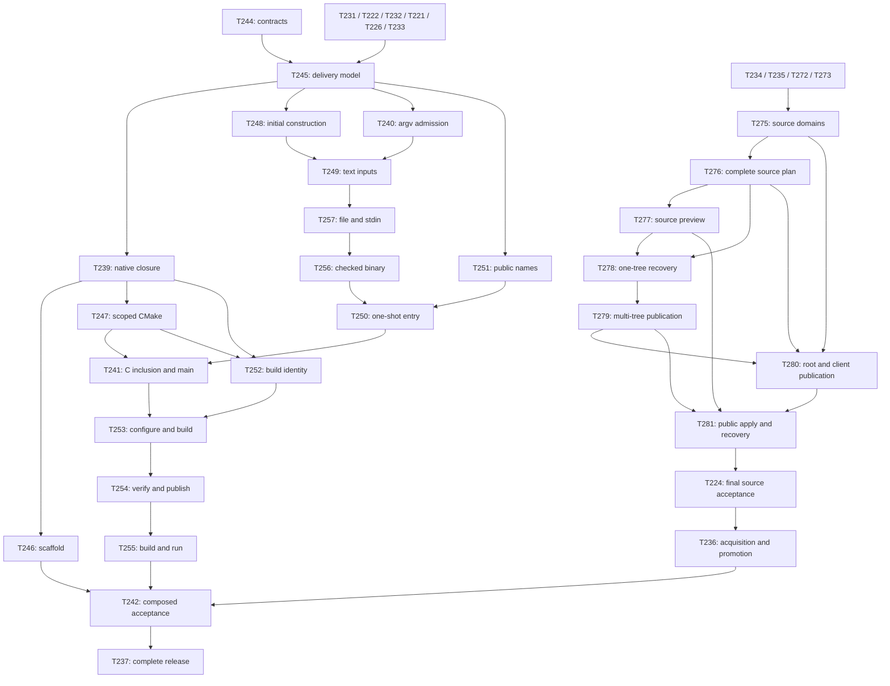

# CMake applications and C source inclusion: implementation plan

This is the implementation plan produced by [T243](../../DONE.md#t243) for the
contracts specified by [T229](../../DONE.md#t229). It explains how to build and
verify the feature; it does not add language rules or certify implementation.
The user requested this planning work on 2026-11-20. Feature implementation and
specification amendments remain separate authorizations.

Use [TODO](../../TODO.md) for task status and the
[development standard](../development/README.md) for the task lifecycle.
The prerequisite table describes task boundaries, not current status; accepted
foundations are recorded in DONE and the remaining tasks in TODO. Acceptance
cases and commands below are obligations, not results of this plan. Before each
next task, perform the current-state entry review in the development standard.

## Result and scope

The result is a prepared local Ama project whose selected concrete module can
be generated, built and run through an explicit CMake pipeline, or generated
without `main` and included in a C host. Both forms share the same argument
adapter and fresh one-shot execution boundary. Native dependency instructions
stay with their module; acquisition, scaffolding, building and test orchestration
stay outside compiler analysis/emission.

The canonical definitions are
[BUILD-01..05](../../spec/implementation/application-builds.md#build-01),
[CLI-01..04](../../spec/implementation/launch-and-embedding.md#cli-01) and
[EMBED-09](../../spec/implementation/c-library.md#embed-09). Existing
[EMBED-01..08](../../spec/implementation/c-library.md#embed-01),
[CABI-06](../../spec/implementation/native-interface.md#cabi-06),
[RT-11](../../spec/implementation/runtime.md#rt-11),
[GEN-01](../../spec/implementation/compiler.md#gen-01),
[NAME-01](../../spec/implementation/compiler.md#name-01),
[PROJECT-01/03](../../spec/implementation/project-tools.md#project-01) and
[PKG-07..10](../../spec/project/packages.md#pkg-07) constrain their composition.
Follow those definitions rather than treating this plan's summaries as a second
specification. Localization, dependent/phantom Types, new native protocols and
automatic installation of OS libraries are outside this work.

## Foundations and existing evidence

T229 and T230 are completed specification tasks. They do not establish that the
new source forms, project commands or CMake adapter work. T197's release evidence
is a historical regression baseline; the current complete conformance gate
correctly refuses its older specification fingerprints.

| Foundation | Deliverable needed by this plan | Gate |
|---|---|---|
| [T231](../../DONE.md#t231) | Canonical versioned identities, slash paths and current lexical forms | Required before new full-path/component records |
| [T222](../../DONE.md#t222) | Agreed reference-prefix notation | Complete with explicit authorization and scoped implementation/runtime/tool acceptance; full sprint conformance remains T237 |
| [T232](../../DONE.md#t232) | Shared prepared-project/configuration/alias resolution | Required before companion selection or build identity |
| [T221](../../DONE.md#t221), [T226](../../DONE.md#t226) | Marker admission and fully concrete declaration Type expressions | Required before entry/transport and specialization closure claims |
| [T233](../../DONE.md#t233) | Independent project-command/process boundary, guided projects and isolated test orchestration | Required before new build adapters; does not wait for their final runner |
| [T234](../../DONE.md#t234), [T235](../../DONE.md#t235), [T224](../../TODO.md#t224), [T236](../../TODO.md#t236) | Exact selection, source/test closure, explicit source copy/safe deletion/movement and snapshot acquisition/promotion | Required for final delivered-dependency/test workflows; acquisition is not a side effect of build |

The first implementation prerequisites remain T231, T222 and T232 in that
order. T244 can establish the new component contracts before them, using current
sources and the approved target definitions. Do not bypass a missing prerequisite
by maintaining another parser, a legacy path mode or a temporary launcher API.
T231's initial implementation inventory subsequently extracted the independently
accepted recognition/version-selection foundation as [T258](../../DONE.md#t258).
It precedes T231 integration without changing the remaining prerequisite edges;
see the [execution record](versioned-source.md) for actual status and evidence.
Once a genuine ambiguity blocks a task, use [AMBIGUITIES.md](../../AMBIGUITIES.md)
and stop that task as required by AGENTS; do not skip it by starting a later task.

### Bounded source inventory from planning

These are starting owners identified at commit `5d88e8e`, not a frozen file layout
or an acceptance claim. T244 checks the actual consumers again before changing
their interfaces. New child components follow cohesive responsibilities and
ownership boundaries rather than arbitrary file counts.

| Boundary | Current owner / starting test home | Consequence for implementation |
|---|---|---|
| Compiler request and emission | `src/driver/request/`, `src/driver/options/`, `src/codegen/project/`; `tests/unit/driver/`, `tests/unit/codegen/assembly/` | Explicit delivery request replaces fixed launcher assumptions; generation never invokes CMake |
| Module companion snapshots | `src/source/module/`, `src/project/inputs/capture/`; `tests/unit/source/module/`, `tests/unit/project/inputs/` | Extend the actual selected-input record to `.cmake` presence/content; do not scan other package copies |
| Native scaffolds | `src/native/scaffold/`; `tests/unit/native/scaffold/` | Reuse checked author-file publication and add the comments-only artifact |
| First root construction | `src/runtime/context/execution/begin.c`, `src/runtime/program/construction/start.c`; runtime construction/context/program tests | Current first-root calls supply no input recipe; add supplied/default choice to first construction before using argv inputs |
| Checked transport | `src/library/resolve/`, `src/library/transport/`; `tests/unit/library/` | Reuse exact Type/schema and ownership checks; a byte buffer does not itself define a decoder |
| Generated host startup | `src/codegen/project/host/`; assembly and compiled-host consumers | Current launcher uses `main(void)`; replace its startup route with the shared argument-aware one-shot entry |
| Public naming | `src/source/identity/`, `src/library/resolve/identities.c`; identity/library tests | The fixed hash-name buffer is unsuitable for an untruncated path encoding; use a separate checked-length owner |
| Toolchain verification | `src/native/toolchain/`, `src/codegen/toolchain/verification/`, `src/library/artifact/`; native/toolchain and library tests | Preserve exact native-entry checks; replace the unconditional requirement for a `main` symbol with explicit delivery/entry evidence |
| Build/process/publication | `src/codegen/toolchain/`, `src/library/artifact/`; actual toolchain consumers | Separate reusable process/check primitives from the superseded fixed GCC/launcher/object build route |

The old launcher/direct-build route is removed with tests dedicated solely to it
when its current consumer migrates. Shared stateful C-library, native ABI,
runtime and verifier components retain their real consumers and regression
tests. Passing an old test alone is not a reason to retain an obsolete contract.

## Dependency order and commit boundaries

Each row is one independently accepted task and one commit. The original
T239..T242 IDs remain assigned to coherent parts of their former broad scopes;
T244..T257 extract the other responsibilities. Task IDs do not encode order.
Use the following prerequisites rather than numeric sorting.

| Order | Task | Immediate prerequisites | Independently reviewable result |
|---|---|---|---|
| 1 | T244 | T243, T229, T230 | Current owner map, internal contracts, proof/test partitions and migration ledger |
| 2 | T245 | T244, T233 | Validated delivery request and typed emission/transport metadata consumed by the compiler |
| 3 | T239 | T245 | Exact native closure, companion/resource and optional guidance provenance |
| 4 | T246 | T239 | Preserving native scaffolding including comments-only `.cmake` |
| 5 | T247 | T239 | Real target-scoped CMake companion application |
| 6 | T248 | T245 | Supplied/default root inputs integrated into initial construction |
| 7 | T240 | T245 | Pure argv recognition and complete binding admission |
| 8 | T249 | T240, T248 | Exact text-to-input construction through checked capabilities |
| 9 | T257 | T240, T249 | Owned file views, borrowed stdin and byte-preserving cleanup |
| 10 | T256 | T245, T248, T257 | Explicit checked binary decoder integration |
| 11 | T251 | T245 | Exact component/path public-name codec and target-limit admission |
| 12 | T250 | T249, T256, T251 | One shared fresh one-shot executor, status and lifecycle boundary |
| 13 | T241 | T250, T247 | Complete source/header delivery and the matching executable wrapper |
| 14 | T252 | T245, T239, T247 | Explicit target/profile, complete declared build identity and reuse decision |
| 15 | T253 | T252, T241 | Real CMake configure/build adapters and structured stage outcomes |
| 16 | T254 | T253 | Actual artifact verification and coherent owned publication |
| 17 | T255 | T254, T250 | Public build/run orchestration and exact child outcomes |
| 18 | T242 | T246, T255, T241, T236 | Integrated application, inclusion and delivered-test acceptance |
| 19 | T237 | Existing project/path prerequisites plus T242 | Whole-sprint current conformance, clean release and documentation delivery |

The source-operation branch was revised by [T274](../../DONE.md#t274) after
reviewing actual T224 consumers and retained evidence. Its complete current
[subtask contracts and checkpoint](source-operations.md#current-plan-after-t274)
are authoritative for planning that branch; canonical semantics stay in spec.
The accepted selection/closure/protocol foundations feed T275's separation of
semantic and physical domains. [T276](../../DONE.md#t276) now supplies the accepted
complete immutable read-only operation certificate with actual final sealing.
T277 is next for entry review and exposes previews
before T278's first complete journal/recovery slice; T279 expands publication,
T280 integrates root/client metadata, and T281 exposes complete apply/recovery.
T224 retains final acceptance after all seven children; T236 still depends on
accepted T224. This split adds no dependency cycle and does not infer public
support from private preparation or record-codec tests.

T268's AMB-017/018 amendment makes source cloning consume the same complete
source/test closure; it does not authorize an incomplete mover or external-importer
rewriting. T239 is required by T235. T233's independent test orchestration must
not depend on T242: that would create a cycle. T242 connects it to the accepted
CMake runner after both sides exist. The CMake rows keep their actual immediate
prerequisites; do not start a later task to bypass a source-operation blocker.

The diagram is a reading aid; the table and TODO contain the immediate task
edges. All earlier foundation edges in TODO still apply.

## Detailed task steps and acceptance

Every task first establishes or updates its owning
[component contract](contracts/component-template.md), then implements and
documents its children, verifies independent behavior and composes the real
consumer. The checks below add task-specific partitions to TODO's common
completion criteria. A missing required case is unfinished work in its owner,
not evidence to defer silently to T242.

### T244 — Establish ownership and internal contracts

The [reconciled handoff and migration contract](build-launcher-contracts.md)
records the actual `dc284fb` consumers, typed ownership/state boundaries,
backend metadata envelopes and test partitions.

1. Reconcile the bounded inventory with actual callers and existing evidence.
   Assign every retained/new/removed boundary to a task; retain reusable code
   only with a named current consumer.
2. Define typed handoffs for the generation request, resolved native relations,
   binding recipes, checked binary schema, build profile, artifact identity,
   stage result and cleanup. Choose their concrete backend metadata formats as
   ordinary engineering work; document versions, ownership and validation.
3. Write the invariants and failure partitions before implementation. Distinguish
   malformed supported input from caller pointer precondition violations. Map
   existing tests and proposed narrow leaves without claiming they already run.

Accept a complete owner/dependency ledger and reviewed contracts, with no dormant
implementation or language change. Reconcile the current
[contract registry](contracts/README.md), rather than writing alternative API
descriptions. Later tasks add their actual file/test evidence.

### T245 — Carry an explicit delivery request through emission

1. Validate concrete root, component identity, output mode and declared literal
   input capability at the real driver boundary. Preserve the existing checked
   stateful C-export schema consumer. Keep build configuration separate from
   runtime argument values. Explicit binary descriptor/adaptor admission remains
   together in T256, where its actual decoder and ownership consumer are available.
2. Carry resolved identities/spans, supported capabilities and owned metadata
   through the actual emission plan. Connect existing compiler consumers to
   this representation without implementing another source resolver.
3. Emit required metadata through checked owned outputs; use the same model in
   later executable and source-inclusion compositions.

Test executable/native concrete roots and refusal of static, marker, open or
unresolved roots; exact input/Type capability and retained export-schema mismatch,
arithmetic/allocation failure and stale
borrowed metadata. Verify generation has no process/network/source-write effect.
Do not install the final public build command early with guessed defaults.

T245 is accepted in [DONE](../../DONE.md#t245); its actual metadata/entry, ownership,
full static correction and generated-reference evidence are in the
[handoff record](build-launcher-contracts.md#t245-continuation). Binary-adapter
metadata parsing stays with T256's concrete admission/decoder consumer rather
than creating a parser with no admitted adapter in this foundation.

### T239 — Capture the actual native build closure

Accepted in [DONE](../../DONE.md#t239); the
[capture contract and evidence](build-launcher-contracts.md#t239-captured-native-build-input-contract)
record concrete origins, exact snapshots, resource/guidance ownership and actual
emission/consumer checks. The steps below describe the accepted scope; T247/T252
still own configuration/external-provider inputs and build-cache admission.

1. Extend selected module snapshots to optional `.cmake`, declared resources and
   version-root README guidance. Preserve selected-copy and lifetime provenance.
2. Emit deterministic participating-module records from actual concrete closure;
   deduplicate within the component, independent of runtime instance count.
3. Connect records to generation, later selective delivery and precise ownership
   diagnostics. Absence, presence and content changes remain distinguishable.

Test absent/empty/commented/changed companions, unused modules and static
specialization dependencies. A missing `packages/` companion never falls back to
an ignored `dependencies/` copy. Two components retain separate membership.
Check resource and README absence/I/O failures without executing companion code.

### T246 — Generate author-preserving native scaffolds

1. Add `.cmake` to explicit scaffold preparation, with all BUILD-02 explanations,
   the commented dependency example and a usable canonical documentation link.
2. Reuse ownership/collision checks and safe publication. Preserve existing empty
   and nonempty authored companions byte for byte.
3. Align native/editor guidance with the supported build boundary, removing
   obsolete direct-command advice when its replacement consumer is available.

Check the scaffold contains no active CMake command, every required explanation
is present, repeated creation preserves bytes and unrelated files survive.
Inject preparation/publication/cleanup failures and controlled output conflicts;
verify no companion execution during scaffold/header refresh.

### T247 — Apply native instructions to the supplied CMake target

1. Generate the target-integration adapter from T239's exact ordered records.
   Keep emission separate from CMake execution.
2. Apply each include inside a fresh function scope with the supplied target.
   Preserve target usage requirements and resource bases.
3. Compose two independent components and source-inclusion host-target adaptation
   with real CMake, using a locally prepared fixture dependency.

Verify per-component inclusion, no leaked temporary variables, shared compatible
imported targets, declared conflict refusal and order-independent refusal of
incompatible requirements. The module's native `.c` is never compiled twice.
Use actual include/link requirements; generated-text assertions alone are
insufficient. Arbitrary trusted CMake side effects have no promised rollback.

### T248 — Construct fresh roots with their supplied inputs

1. Extend the existing first-root preparation path to accept checked construction
   recipes; do not reuse an operation that first creates defaults and overwrites
   them afterwards.
2. Select supplied or ordinary default construction exactly once for each input,
   then compose context/constants, results and remaining state in specified order.
3. Update both context/program startup consumers and retain the stateful host
   interface's separate reset/resume behavior.

Use native constructor/resource traces to independently observe declaration
order, a later default reading an earlier supplied value, one construction per
field and correct cleanup of a successfully acquired prefix. Inject failure at
each meaningful acquisition/constructor/destructor boundary. Never execute a
root body after preparation failure or conceal a second interface reset.

### T240 — Recognize argv and admit a complete binding plan

1. Separate argument-vector shape validation, token splitting, exact name lookup,
   transport selection and duplicate detection into narrow operations.
2. Produce one admitted binding plan before any stream read or root body.
3. Connect actual driver-generated input tables without altering token bytes or
   confusing `argv[0]`, project-tool options and application inputs.

Cover zero count/null vector, conventional sentinel, readable invalid-shape
cases, Unicode/multiword names, first `=`, repeated payload equals, empty inline
data and reordered tokens. Reject unknown/duplicate/unsupported bindings, bad
suffixes, positional/separate-value/shorthand forms and multiple stdin consumers.
Tests must not dereference fabricated invalid C pointers to simulate shape errors.

### T249 — Construct exact text values

1. Validate strict UTF-8 through the documented host encoding boundary.
2. Check the input's actual owned-scalar literal capability and create a fresh
   recipe for its exact immutable byte view/length.
3. Compose T248's one-time construction with T240's admitted plan and ordinary
   defaults. Preserve technical constructor rejection and cleanup behavior.

Test malformed UTF-8 boundaries and exact payload bytes including literal/comment
symbols. Explicit empty differs from omission. Reject unsupported reference,
list and compound text bindings; defaulted complex fields need no codec. Prove
token order does not become constructor order and argument values do not select
Type specializations.

### T257 — Acquire files and borrowed standard input

1. Implement bounded byte-preserving stream reads and owned views separately
   from filename selection, text validation and input construction.
2. Distinguish ordinary files, `-` stdin and `./-`; preserve caller working
   directory and perform reads in parameter declaration order.
3. Close opened resources and restore temporary host modes on every supported
   exit path; borrowed stdin remains open. Preserve primary/secondary failures.

Check empty/oversized inputs, independent reads of the same file and exact
CR/LF/TAB/BOM/NUL content. File text is outside source layout restrictions.
Inject open/read/allocation/size and applicable close/mode-restoration failures;
an earlier failed input prevents later reads. Verify two stdin consumers fail
admission before consuming data. Do not claim a shared filesystem snapshot.

### T256 — Integrate explicit checked binary decoders

1. Validate configured schemas/declarations against the exact nominal input Type
   during generation, using the existing checked C transport boundary.
2. Make T248's checked recipe invoke the declared decoder with a bounded immutable
   byte view at that input's initial construction, in declaration order. Publish
   only independently owned state; do not eagerly decode before construction.
3. Compose file acquisition, decoder failure and resource cleanup without adding
   an ABI protocol or discovering a helper from its C name.

Test embedded zeros, empty/size/range failures, decoder/partial-resource failure
and borrowed-view expiration. Reject absent or wrong-Type schemas even when C
layouts match. No raw payload cast, address-derived Ama reference or persistent
pointer into argv/file storage is permitted. Unsupported structured transports
remain explicit refusals rather than accidental support claims.

### T251 — Encode exact public entry identities

1. Implement checked-size UTF-8 byte encoding of full component identity and
   canonical root path, separate from fixed-size private hash-name storage.
2. Admit only toolchains that preserve the required external identifier under
   their documented limits; connect exact names to header/manifest emission.
3. Preserve the existing private naming/collision contracts.

Use independently specified ASCII/Unicode vectors, root-kind/version/src/tests
distinctions, aliases resolving to the same canonical path and two distinct
component identities. Check arithmetic/resource and unsupported-target failures.
Round-trip tests supplement the injectivity argument; they do not replace
independent vectors. Never truncate a name to fit an old hash buffer.

### T250 — Execute one fresh run and return to the host

1. Compose admission, acquisition, initial construction and execution through one
   entry implementation; keep orchestration separate from each child. After
   complete admission, acquire/decode/construct each input in declaration order;
   do not read every stream before starting constructors. An earlier constructor
   failure prevents later stream reads and decoding.
2. Apply normal cleanup and technical outcome handling, preserving original and
   secondary errors. Dispose a yielded one-shot root without resumption.
3. Expose the checked named entry while preserving separate retained host APIs.

Compile/run generated entry consumers for completion, repeated fresh state,
ordinary application failure, technical failure, yield and partial cleanup.
A host continues after an entry error; there is no `exit`, retained borrow or
hidden instance. Concurrency checks use distinct contexts and a conforming native
fixture, without implying arbitrary native libraries are reentrant.

### T241 — Deliver the C implementation/header and matching main

1. Compose the complete file-scope implementation, checked self-contained public
   header and manifest from the same model and exact public entry.
2. Generate executable `main(int, char **)` solely as a forwarding wrapper;
   source-inclusion output contains no `main`.
3. Adapt the host CMake target without adding the included generated `.c` again.
   Migrate old fixed-launcher artifact assumptions and their obsolete tests.

Build an own-main C host, a second header-only consumer TU, and two independently
qualified components in separate host TUs whose headers coexist. Verify isolation
despite native basename overlap, repeat calls and compare executable/inclusion
outcomes for the same argv. Retain stateful host entry/resume regression cases.
Header-first compilation and actual link/run are required.

### T252 — Plan the target and prove build reuse

1. Resolve explicit/native-default profiles, target/ABI/toolchain/configuration
   and declared dependency inputs into an owned deterministic plan.
2. Record complete declared content/presence identity, effective settings and
   external provider evidence without changing meaningful link ordering.
3. Decide invalidation/reuse from matching recorded inputs and actual dependency
   tracking; mark unrecordable effects as insufficient evidence for reuse.

Test source/alias/selected-copy/companion-presence/content/resource/toolchain/ABI
changes, including dependencies outside the Ama source tree. Runtime values and
optional README changes alone do not alter compiled behavior. Check target/host
separation and explicit cross-run environment admission. Existing output paths,
timestamps or imported target names alone never prove equivalence.

### T253 — Configure and build through real CMake

1. Generate an out-of-source build project and include the accepted component
   adapter using the selected profile and matching generated inputs.
2. Invoke configure and selected target/configuration build with argument vectors,
   not shell string interpolation. Separate process start, wait and result capture.
3. Return structured stage/tool/status/diagnostic evidence for T254 and T255;
   no failed stage may be hidden by an earlier successful artifact.

Use actual CMake, C compiler and a controlled installed/imported dependency;
require no network or preinstalled Zlib. Test supported generator/configuration
profiles, spaced/Unicode paths and missing tool/configure/compile/link failures.
Generation-only probes must prove that no CMake/C compiler command runs.

### T254 — Verify and publish only matching artifacts

1. Feed the actual built target and recorded toolchain settings into mandatory
   ABI/native-entry/control-flow verification. Select executable or named-entry
   evidence explicitly rather than requiring `main` in every component.
2. Stage a coherent artifact/metadata set in owned output paths and publish only
   after all checks pass. Preserve earlier results as earlier results.
3. Check output ownership and recover/report operation-owned partial publication
   and cleanup; do not promise rollback of arbitrary companion effects.

Use real positive and intentional-negative inlining/ABI controls. Inject failure
before/after each meaningful prepare/verify/publish/cleanup transition. Exercise
parallel jobs with independent outputs or controlled ownership conflicts, without
sleep-based synchronization. An old good binary is never labelled or run as the
new failed build; metadata always describes the published bytes.

### T255 — Compose public build/run and diagnostics

1. Connect independent project commands to validation, generation, configuration,
   build, verification, publication and optional child execution in that order.
2. Keep `build` nonexecuting and forward only tokens after the required tool
   separator to `run`'s child; preserve its selected working directory.
3. Report actual start/wait/exit/signal outcomes, exact known provenance and
   selected-version README guidance without guessing a culprit or OS package.

Exercise real commands, missing/conflicting options, defaulted/no-argument runs,
working-directory file inputs and explicitly selected cross execution. Inject
every stage failure and prove later stages, especially child execution, do not
run. Preserve raw diagnostics and primary failures. Ambiguous linker ownership
reports the component/participating instructions; absent README still reports
the effective version directory. Neither command installs or acquires software.

### T242 — Accept the real composed workflows

1. Prepare minimal versioned projects and independently selected test programs;
   cover packages-only, dependencies-only and whole-version local precedence.
2. Run actual build/run, generation-only, own-main C inclusion and retained
   stateful library consumers. Exercise native, concrete template/static,
   text/file/binary and application-failure/yield paths together.
3. Connect T236's delivered/promotion/relocation results and T233's test runner to
   the accepted build backend. Confirm source/tests isolation and selected
   companions/resources/README provenance survive delivery.
4. Reconcile per-file evidence and actual supported versions/configurations;
   publish examples that run from fresh output paths and retain no old launcher
   or direct-build implementation solely for superseded behavior.

Accept through real component and parent suites, stage/resource failure cases,
cache invalidation, controlled concurrent publication and host/header/inlining
checks. Record limitations honestly. T237, not a refreshed hash at this point,
owns the complete whole-sprint release claim.

## Invariants and the evidence they require

| Invariant / correctness argument | Independent observation |
|---|---|
| Native application is keyed by component and resolved module identity | One shared module applies once to each of two real component targets; more instances do not add applications |
| Bindings form a partial function from declared input identities to sources | Reordering tokens preserves bindings; duplicate input names or transport forms fail before I/O |
| Construction follows declaration order, selecting default or supplied once | Constructor/resource traces and later defaults observe exactly the expected installed prefix |
| Every acquired resource has one owner and one final release path | Failure-point enumeration, native ownership counters, borrowed-input checks and applicable sanitizers |
| Executable and inclusion modes refine the same one-shot operation | Identical argv and fixtures produce matching behavior and no retained state |
| Public name encoding is injective on identity/path pairs | Delimiter/byte-width argument plus independent vectors and supported-toolchain admission |
| Published implies verified for these inputs; run implies current published artifact | Failed configure/compile/link/verify/publish runs cannot execute an older artifact |
| Cache reuse follows complete declared identity and dependency evidence | Presence/content/profile/provider changes invalidate; unknown effects do not authorize reuse |

For each algorithm record domain, pre/postconditions, ownership, failure effects,
progress/termination measure, bounds and complexity under
[ARCH-05/06](../../spec/implementation/compiler.md#arch-05). Pure helpers and
I/O relations require different arguments; tests supplement both. Enumerated
finite-model claims name their exact domain. Do not infer correctness from test
counts, symbol presence or a successful linker exit.

## Verification and documentation at each checkpoint

Each implementation task records actual source paths and named cases in the
[per-file evidence registry](documentation/README.md). New narrow test leaves
join the existing recursive C/assert harness; tests exercise the real public
boundary rather than including production `.c` to bypass it. Each header has
standalone inclusion and consumer checks. Test/support/scripts/Makefiles and
authored native fixtures also have explicit evidence.

Every changed code file and nontrivial interface has purpose/ownership/failure
Doxygen explanations. Compiler rule explanations link exact canonical anchors
and explain how the rule determines the operation. Keep component derivations
with their actual owners and register them through the existing contract index;
do not turn this plan into a competing permanent API description.

The commands below are planned checkpoints, not runs performed by T243:

| Checkpoint | Commands / required execution | Evidence boundary |
|---|---|---|
| Each changed component | `make -C tests/unit/OWNER/LEAF`, then its real parent; record concrete paths before running | Meaningful success/boundary/failure partitions and handoffs; placeholders here are not executable commands |
| Native scaffold/capture | Existing `make -C tests/unit/native/scaffold` and affected source/project-input leaves | New companion publication and actual selected-input consumers |
| Runtime/transport | Affected runtime construction/context/program and library transport/lifecycle leaves | Initial supplied construction, ownership and preserved stateful API |
| Generated behavior | Registered integration leaves compile/link/run actual executables, own-main hosts and separate consumers | ABI, no-main inclusion, runtime outcomes and native inlining |
| Process/toolchain boundary | Real CMake configure/build plus injected adapters and verifier negative controls | Both subprocess failure paths and actual toolchain semantics |
| Per-task documentation | `make docs-complete`, `make docs`; verify source navigation and final input provenance | No unexplained per-file debt; generated reference matches final maintained inputs |
| Final T237 release | `make clean`, strict `make`, full `make test`, supported sanitizer/failure gates, `make conformance-check`, final documentation gates | Whole current specification and accepted supported configurations |

Use the exact compiler flags, tool versions and clean-release commands recorded
in the [release guide](conformance/release.md) after updating that guide to the
actual accepted boundary. Do not overlap a full suite with its included leaf or
build a shared output tree concurrently under different flags. Broaden testing
when a changed boundary or failure warrants it, not to accumulate pass counts.

Before T237, record the expected complete-conformance stale refusal accurately;
do not refresh fingerprints merely to remove it. Each earlier task still needs
its own current argument, per-file/component and real-composition evidence.
Review all affected requirement/acceptance witnesses before the final matrix
renewal and complete gate. Missing instrumentation is a stated limitation, not
a clean sanitizer result or permission to weaken the contract.

## Step records, continuation and completion

Use the [task record template](../development/task-template.md) in TODO or an
owning component note. After each meaningful step record purpose, actual changes,
reasoned decisions, exact commands/configuration/input fingerprints, outcomes,
failed-run facts and remaining checks. For a long run record the current step,
session/process, log path, output owner and next action. Collect its final status
before recording success; resume an existing run instead of relaunching it.

Before every task commit, finish code, tests and explanations together, remove
superseded code/tests, inspect explicit staged paths and preserve unrelated work.
After acceptance move the complete record from TODO to DONE in that commit.
Leave failing/blocked work unchecked. Generate Doxygen after final maintained
edits, then verify source/staged hashes against its manifest; later input edits
require regeneration. Generated references remain unversioned.

T243's own acceptance is documentation-only: unique task IDs, a complete acyclic
dependency graph, requirement/acceptance routing, valid links, unchanged `spec/`
and implementation/evidence inputs, and final documentation provenance. No
future compiler, CMake or application test is claimed as already passing.
