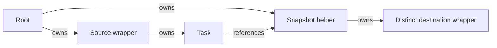

# Copy owned positions explicitly, never an active caller chain

T072 accepts scalar-owned continuation snapshots under
[CONT-04](../../spec/language/continuations.md#cont-04),
[CONT-05](../../spec/language/continuations.md#cont-05),
[COPY-03](../../spec/language/values-and-references.md#copy-03),
[COPY-06](../../spec/language/values-and-references.md#copy-06) and
[COPY-07](../../spec/language/values-and-references.md#copy-07).
Existing whole-tree preflight, clone mapping, native cloning and service-state
projection supply the implementation. Compiled cases connect those components
to ordinary assignment and explicit `% source` descriptors.

## The complete ownership tree has positions

A wrapper starts its owned child task, then yields. The child has already yielded
at its own first statement boundary. Both also record a handled self-reentry Busy
before suspension. Their native probes expose persistent counters and each
caller's refusal snapshot.

An ordinary copy retains value state but clears both root and child positions.
Resuming either copied instance refuses NoResume. An explicit continuation copy
retains both positions, so resuming the copied wrapper resumes its copied child
and continues its own following statement. Native counters start from their
copied values. The original wrapper and child remain independently resumable.

| Observation | Original source | Explicit copy |
|---|---|---|
| Child's first segment before copying | Probe count 1, Busy snapshot | Not executed during copying |
| Child's resumed segment | Probe count 2, original Busy snapshot | Probe count 2, empty snapshot |
| Wrapper's following probe | First call, original Busy snapshot | First call, empty snapshot |

The empty snapshots distinguish service-state projection from a raw metadata
copy. Copied instances inherit neither temporary copy-acquisition activity nor
old caller connections or refusal history. Their next calls create fresh current
return links. Declared references remain ordinary value fields under COPY-04;
they are distinct from hidden caller links and are not cleared as service history.

## Availability is quantified over owned descendants

Let `S` be the complete ownership tree being copied. Every `x` in `S` must be
available before native cloning begins. A valid available root alone is
insufficient. References do not add their referents to `S`.

Two compiled cases use the same structure:

When the root directly invokes the helper, source wrapper and owned task remain
Yielded. Their references point to the running helper outside `S`; snapshotting
succeeds and invokes the one expected native worker clone. Reference copying
does not acquire that external running object.

When the root resumes the source's owned task instead, that task invokes the
helper and becomes Waiting. The source wrapper remains Yielded, but its owned
task now violates the quantified availability condition. Snapshotting refuses
before any native clone marker. This distinguishes complete preflight from a
late per-node failure after constructing an earlier prefix. The standalone copy
uses the fatal lifecycle route; it has no invented assignment `:` handler.

## Compare actual identities

A reference alias can denote the same yielded instance as an owned destination.
An explicit copy through that alias must reject even though source and target
have different names. The runtime compares complete checked identities before
preparing a clone or changing payloads.

The compiled alias case produces no native clone marker. Terminal cleanup sees
the original probe count and consumes its existing native credit once. The
independent object-access suite also checks ordinary actual self-copy as an
effect-free operation and rejects continuation self-copy without allocating.

## Evidence and limits

`make -C tests/unit/codegen/snapshots` runs four compiled cases: owned root/child
positions and cleared histories, busy external referents, a Waiting owned child,
and actual self identity through an alias. Target sanitizer flags instrument the
generated programs. The independent `runtime/objects/clone` and
`runtime/objects/access` suites check position projection, complete preflight,
alias/overlap rules and failed preparation boundaries.

No new snapshot allocator, native-stack capture or alternate copy executor is
introduced. T084 adds [membership-aware live cursor copying](list-traversal-execution.md). Native resource
clone failures and mixed completed/yielded scalar trees receive broader composed
acceptance in T073.
