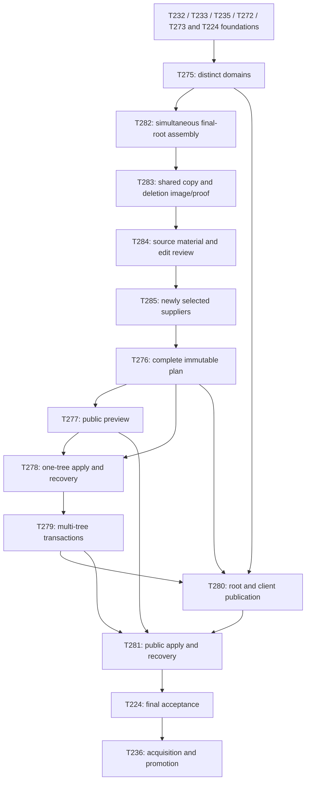

# Resolved source operations

## Current plan after T274

This is the current implementation checkpoint, revised on 2026-11-23 from the
actual `af8e43eb` planning baseline and prior T224 evidence, then updated by
accepted T275, T282, T283, T284, T285 and T276 below. The public operation is not
complete. [TODO](../../TODO.md#t277) owns current task status; canonical behavior
remains [TOOL-01..04](../../spec/implementation/tools-and-conformance.md#tool-01),
[SRC-06](../../spec/language/source-and-names.md#src-06),
[PKG-04/09](../../spec/project/packages.md#pkg-04) and
[PROJECT-01](../../spec/implementation/project-tools.md#project-01).
This plan adds no alternative source language or compatibility contract.

### What the review established

The delay is a planning/integration problem, not evidence of an infinite loop.
Thirty-two T224 commits have delivered meaningful narrow foundations, but the
original nine-step task kept semantic preparation, physical publication, crash
recovery and public commands inside one completion boundary. Late discovery of
root-setting and transaction distinctions expanded that boundary. Repeated
append-only status paragraphs made its next action hard to find. Splitting the
remaining work must expose real end-to-end results earlier, not restart verified
components or declare the unfinished parent complete.

| Existing boundary | Evidence and reuse limit |
|---|---|
| Original graph/input safety and compiler analysis export | Accepted [T272](../../DONE.md#t272); use the complete original domain, not runtime reachability |
| Project-side process/wire/input capture | Accepted [T273](../../DONE.md#t273); no compiler dispatcher is linked into the project tool |
| Source/test/native/configuration closure | Accepted [T235](../../DONE.md#t235), plus the detailed compositions below; acquisition remains separate |
| Exact original/final images, topology/maps, configuration edits and compiler/site proofs | Implemented and tested below, including independently compilable incorrect-image refusals; T276 now joins the complete read-only root-changing certificate |
| [Operation image plan](../../tools/project/source/operation/plan/plan.h) | Joins dependency modes, joint removal and final proofs; T282 supplies explicit final-root assembly; T283 unifies deletion and copy material/configuration/mutation/proof gates; T276 supplies the accepted complete authorization owner. The proof derives selected-registry retirement separately from physical removal |
| [Freshness guard](../../tools/project/source/transaction/guard/guard.h), [hierarchical leases](../../tools/project/source/transaction/lease/lease.h) and [mutation forest](../../tools/project/source/transaction/forest/forest.h) | Tested actual capture, stale membership/inodes and complete disjoint trees; T275 adds separate physical boundaries, unchanged-root regression and real changed-root consumers |
| [Image records](../../tools/project/source/transaction/document/document.h) and [private-tree ownership](../../tools/project/source/transaction/tree/tree.h) | Codec roundtrip, exact saved classes, synchronization/readback, reopen and permitted partial-cleanup transitions pass; a codec/private copy is not yet a durable transaction journal |
| Public command and process-loss recovery | Unfinished: command dispatch still supports init, not source-operation preview/apply; real whole-operation journal/recovery must be integrated |

Before T275, the last collected T224 foundation checks were
`/tmp/ama-t224-private-resume-tool.exit = 0`,
`/tmp/ama-t224-private-resume-copy.exit = 0` and
`/tmp/ama-t224-private-resume-docs.exit = 0` (3881 ready inputs, zero explicit
coverage debt). These are recorded historical results, not reruns by T274 or
public-command acceptance. Their detailed flags, failure cases and earlier
failed/corrected runs remain below. No implementation job was active at this
review checkpoint.

### Remaining tasks and consumers

Each row is a separately accepted implementation/test/documentation task and
commit. [TODO](../../TODO.md#t277) gives its complete scope and acceptance;
review that scope against actual circumstances before starting, under the
[task-entry rule](../development/README.md#review-the-next-task-against-the-current-state).
Use a short entry record here for each task, then append only its actual steps
and evidence. Revise this current checkpoint when an accepted result changes the
next action; keep prior facts explicitly historical.

| Task | Immediate prerequisites | Finite result and next real consumer |
|---|---|---|
| [T275](../../DONE.md#t275) | T232, T233, T235, T272, T273 and existing T224 foundations | Original/final semantic registries, actual physical mutation/removal and stable observation/coordination are separate in actual capture/plan consumers; T276 consumes them |
| [T282](../../DONE.md#t282) | T275 | One simultaneous changed-root image through actual assembly and copy-plan consumers; T276 consumes it |
| [T283](../../DONE.md#t283) | T275, T282 | One shared copy/deletion image and proof owner, with migrated real consumers; T276 supplies remaining authorization |
| [T284](../../DONE.md#t284) | T275, T282, T283 | Request/material/main-edit review and final-root initialization; actual shared image/proof consumers |
| [T285](../../DONE.md#t285) | T275, T284 | Exact admission boundary for untouched newly selected suppliers after PKG-02 selection |
| [T276](../../DONE.md#t276) | T275, T282, T283, T284, T285 | One complete immutable operation plan, including root/client/configuration and rebuild intentions, actual original/final compiler proofs; common input to T277/T278 |
| [T277](../../TODO.md#t277) | T276 | Real public read-only previews with precise refusals and no hidden effects; T281 later replaces the explicit unsupported-apply boundary |
| [T278](../../TODO.md#t278) | T276, T277 | One-tree apply/new-process recovery through the real durable journal/executor; T279 extends this exact consumer |
| [T279](../../TODO.md#t279) | T278 | Whole multi-tree copy/delete/move/replace publication and repeatable recovery, with writer/reader coordination and same/cross-filesystem failure evidence |
| [T280](../../TODO.md#t280) | T275, T276, T279 | Prepared root/client selection, metadata and rebuild consequences publish/recover with those sources |
| [T281](../../TODO.md#t281) | T277, T279, T280 | Public apply/recovery and coordinated read-only integration consume the same plan/executor, with precise outcome/retained-path reports |
| [T224](../../TODO.md#t224) | T232, T233, T235, T272, T273, T275..T281 | Final public matrix, current consumer/removal audit, complete affected regression and generated documentation; T236 consumes accepted operations |

The diagram shows the reading order, not a substitute for the prerequisite
lists. T224 also waits for every child independently. T236's dependency is not
weakened to a private-tree helper: whole-version promotion needs the same complete
operation and recovery guarantees. The independent CMake branch keeps its
existing dependencies; do not switch to it to bypass unfinished source work.

### Next action and acceptance safeguards

Resume T276 with the actual plan/image/removal/configuration interfaces after accepted T282. Its entry
review accounts for T275's accepted physical envelopes, explicit final
semantic roots and independent registry retirement. The remaining gap is one
complete immutable operation plan: T283 now unifies copy/deletion image preparation and final proof. Complete that
shared owner with operation-kind/source-versus-replacement removal provenance,
explicit root/client/configuration authority and rebuild intentions;
do not restart the accepted wire, closure, image, lease, record or owned-tree
foundations. Public commands and durable publication remain later gates.

T277 must exercise the real command executable before further private publication
work. T278 must perform a real controlled process kill and reopen from another
process, not only invoke a callback or replay an in-memory record. T279 extends
that production state machine instead of creating a second rollback algorithm.
A new reader/writer must still discover unfinished work after writer death has
released kernel locks: a lock becoming available is not a commit record. A
read-only consumer refuses that state without repairing it; an overlapping writer
reports the explicit recovery entry/location before new work.
T280 must consume root/client/configuration intentions already present in T276;
late metadata discovery is a plan defect, not permission for a best-effort fixup.
T281 documents coherent-reader participation without giving the compiler hidden
source-mutation or recovery effects. Nonparticipating readers receive no
whole-tree snapshot guarantee. Storage-fault ordering models and physical power
loss are different evidence; record actual supported assumptions honestly.

T224 retains all original final criteria, including removal of superseded
compiler-side mutation/importer rewriting after real consumer migration,
per-file coverage, Doxygen/source navigation and final compiler/site checks.
Child acceptance never implies whole-sprint conformance; T237 still owns that
release gate. Do not refresh old conformance fingerprints to hide missing public
behavior. Every child records successful/refused/failing compositions and commits
its own complete evidence before the next task.

## T276 entry review

The accepted T275 interfaces separate physical observation bounds from semantic
roots. At entry, consumers split copy preparation (`copy/plan`) and deletion
(`removal/image`). Neither was a complete public operation plan. Their existing
proofs, configuration expectations and mutation forests remain reusable.

The copy image builder still invokes projection with original semantic roots.
Its changed-root proof tests currently build that intermediate image and then
reselect roots. That composition cannot remove an original semantic root: the
intermediate image would require the removed directory. Extract T282 to pass
explicit final roots through the existing builder/plan and test simultaneous
root removal/replacement. No second projection or compatibility entry remains.
T276 retains operation-kind/removal provenance, authorized configuration and
root/client intentions, build invalidations and one common immutable-plan owner.
Original augmented-domain preparation must preserve selected original physical
identities and use the common whole-version selector; merging independently
selected catalogs is not an acceptable substitute.

### Entry-review split after initial I1/I2 evidence

The implemented physical intent/material/main-edit checks form a finite shared
review boundary with actual consumers and independent acceptance. Extract it as
T284 before further metadata work; it includes the required final-root initializer
refinement. T276 remains incomplete and still requires every source/configuration
write owner plus root/client/build intentions and sealing. These are extractions
of already authorized T276 steps, not new language rules or completed-task claims.

The next entry review also identifies the inverse selection case not covered by
T275's copy promotion: deleting a local version can reveal an untouched ignored
dependency copy. The current final-unit and graph proof admits only retained
selected originals or C images. T285 must first reproduce and compare that
boundary with independent PKG-02 selection, physical preservation and original
consumer laws, before changing admission. It cannot silently allow arbitrary
extra definitions, reinterpret ignored SOURCE selection, or bypass augmented
original analysis. Canonical meaning must be established before implementation;
any unresolved case follows the ambiguity procedure. No spec change is authorized.

### T276 remaining implementation steps after T283

Current step is **I2**. The preceding **I1** work attaches exact operation intent to the shared prepared image.
Validate copy/delete/move kind against genuine source selection and raw placement,
separate move-source/deletion removal from destination replacement, require
explicit replacement permission and prove the exact combined removal union.
Reject self-overlap; copying dependencies never authorizes their source removal.
Exercise real whole-root copy/move with actual final compiler proof, including
existing/missing destination roots, rather than treating arbitrary image unions
as complete authorized operations.

**I1 checkpoint.** Added `source/operation/intent` with separate admission,
raw-placement/overlap and source-versus-replacement/union checks. No synthetic
valid owners are used. Actual promotion and existing/new-root relocation now
also prepare a genuine complete source-removal union and prove a MOVE image
with two disjoint mutation roots through the independent final compiler response.
Negative cases reject missing source cuts, wrong request kinds, undeclared
replacement and extra removed material. Copy and deletion strict suites passed:
`/tmp/ama-t276-intent-copy.exit = 0`,
`/tmp/ama-t276-intent-removal.exit = 0`. This is initial I1 evidence, not final
T276 acceptance; broader malformed/overlap/completeness and allocation checks,
final sealing and documentation generation remain open. No test job remains.

**I2 entry finding.** `source_version_initialize` still derives destination
version identity and directory modes from original semantic roots. Like the
pre-T282 image builder, this cannot cover a wholly new missing final root even
when its physical parent is explicitly observed. Before config/write
certification, migrate initialization to explicit final semantic roots and
observed physical mode prototypes, retaining existing-root/carry/conflict
refusals. This is required implementation of existing TOOL-01/02/04, not a new
root policy or specification change.

**I2 partial results.** Initialization now consumes explicit final semantic roots
and retains them in its result. Existing roots supply their actual observed mode;
missing roots use the closest explicit physical boundary, matching scaffolding.
A real initializer/image/catalog/environment composition accepts empty versions
under existing and missing final roots; absent authority, wrong namespace,
exclusions and every measured allocation failure refuse without changing output.
Old carried/existing/incomplete-version cases remain in the passing copy suite:
`/tmp/ama-t276-final-root-initialization.exit = 0`.

Added main-file edit eligibility to the existing full copy proof, with typed
`SOURCE_COPY_PROOF_EDITS` witnesses. A nonempty edit must be enclosed in an
explicit original module operand; an insertion must lie strictly inside it.
Implicit constructs grant no edit authority. Exact final whole-site projection
remains mandatory, preventing an allowed interval from leaking new code around a
path. `SourceTextEdits` preserves all bytes outside those intervals; therefore
labels, literal payloads, comments and storage suffixes remain unchanged without
lexical guessing. Legitimate relative, rooted, partial-prefix and interior edits
remain possible when final binding/site laws hold. Non-main/configuration writes
are deliberately left to their own still-pending authority checks.

Real independently compiled images demonstrate that graph/site checking alone
accepts changed comments, removed reference suffixes and injected comments at
both operand boundaries. The new full proof rejects each, while accepting a
strict interior current-directory insertion and a partial rooted-prefix rewrite.
The strict whole-copy suite passed all cases:
`/tmp/ama-t276-main-edit-boundaries.exit = 0`. A genuinely prepared and compiling
self-copy image is refused by I1 overlap checks; repeated replacement owners use
idempotent set union (`/tmp/ama-t276-intent-overlap.exit = 0`). Current independent
tool build passed: `/tmp/ama-t276-partial-build.exit = 0`. These are partial
T276 receipts, not its final acceptance or a public operation claim.

**Current continuation checkpoint.** Code/registry edits for I1/I2 are
uncommitted and now owned by active extracted T284; T276 remains incomplete. The strict
deletion regression completed successfully and its session was collected:
`/tmp/ama-t276-removal-edits-regression.exit = 0`. No implementation/test or
Doxygen process remains active at this checkpoint. Further current material
results and the next action follow below; do not replay collected earlier jobs.

**I2 material-completeness design.** Reconstruct the required physical relation
from genuine inputs, rather than trusting that a supplied sealed P is complete:
raw request placement, complete unit causes, deepest associated test membership
and version-relative declared inputs. Reuse the existing exact mappers and derive
ordinary active logical destinations again from the actual explicit raw C rows.
Use actual final selected version scopes for physical version authorities, never
an ancestor/name guess. Compare reconstructed and supplied sets in both directions
by original key, destination, kind and bytes. Carried package configuration comes
only from raw selection; initialization and authorized configuration transformations
remain separate supplemental-write owners. Unplaced unversioned input remains a
typed refusal, not an invented location. Context-only copied-unit necessity and
full operation sealing remain later gates; material reconstruction alone grants
no request or publication authority. The new review owner must keep all failed
child prefixes destructible, with finite mapper bounds plus quadratic set checks.

**I2 material results.** Added the rederived review owner under
`source/operation/material`, with separate explicit-main extraction, actual final
version storage, ordinary logical candidates, membership composition and two-way
relation equality. All children have explicit reverse-order teardown and typed
failure evidence. Actual copy/move promotion and existing/missing-root relocation,
plus genuine empty deletion relations, pass reconstruction:
`/tmp/ama-t276-material-review-copy.exit = 0` and
`/tmp/ama-t276-material-review-removal.exit = 0`.

The cyclic cross-version copy with a binary payload/empty subtree reconstructs
exactly four mains and ten material entries. Every measured review allocation
failure retires without changing its prepared original plan. An independently
compiling image that passes the complete earlier unit/graph/site proof but omits
an associated test-directory P row is rejected by the new exact membership
review; silently regenerated scaffolding does not establish captured test-origin
membership. Full strict copy suite passed this composition:
`/tmp/ama-t276-material-membership-failures.exit = 0`; its session 33885 completed and was collected. This is initial I2 evidence,
not final T276 acceptance. Material review does not itself authorize context-only
copies, configuration/extra writes, roots, client selections or publication.

**Next action.** Complete known configuration/extra-write ownership checks, then
root/client/build intentions and the final seal. Reuse the actual rederived maps
and current full proof; do not create a command-specific planner or synthesize
valid closure/context owners. Broaden malformed intent, context-necessity,
empty/draft and failure compositions; final sanitizers and Doxygen/coverage for
all current input bytes are still required. No task completion or commit of
unfinished T276 is authorized merely by these partial checks.

Then **I2**: account for complete raw/unit/test/declared/configuration material and
trace every extra write to its actual typed prepared owner/authorization. **I3**:
record/validate original/final roots, explicit client selections, known writable
fields and owned rebuild intentions; unknown external formats are reported without
patching. **I4**: seal the one complete immutable plan only after all those gates
and its actual final compiler/site proof, with allocation/failure/composition
acceptance and removal of superseded interfaces. These are steps of unfinished
T276, not completed tasks or new specification rules. Public preview/publication
remain T277 onward. No implementation job is active at this entry checkpoint.

## T283 entry review and execution

**Entry finding.** T282 now delivers one final-root projection. The current copy
plan joins material, original removal cuts, final package scopes and mutation
forest. `removal/image` independently repeats projection/capture/proof and lacks
those configuration/forest gates. Its only live consumers are the actual removal
composition tests; copy-plan consumers are the actual copy compositions. Unify
these owners before adding operation authorization, rather than maintaining two
planners. Shared unit/material/registry/site proof already accepts empty sealed
maps algebraically; only the copy-context admission requires an actual copy.
Deletion has no copied context obligations, so require absent context only for
an empty relation and no mapped material/prepared text. No synthetic valid copy
closure or fallback is permitted.

**Finite steps.** Move the actual copy plan to the shared operation component and
make original analysis explicit. Admit either a genuine copy/context or deletion
with empty sealed maps and a genuine removal selection. Extract finite removal
observation requests/changes, migrate deletion compositions to this same owner,
remove obsolete removal orchestration, then test actual final compiler proofs,
original cuts, wrong input/owner/shape failures and allocation teardown. Run both
real consumer leaves strictly and with ASan/UBSan, independent tool build and
Doxygen/coverage/navigation before archival/commit. T276 retains the complete
request-kind/root/client/edit-authority and build-invalidation seal; prepared
image is not publication authority.

**Contract/invariant.** All input facts borrow one admitted original capture and
matching analysis. Empty maps express no clones; every physical deletion still
belongs to one reviewed original union with exact observed bytes/membership.
The shared image builder projects complete changes once against final roots;
final configuration scopes and disjoint mutation trees use that same image.
Independent final compiler evidence must match that capture exactly, and shared
unit/registry/site laws preserve originals even if their selected registry changes.
All list scans/child algorithms are finite; no new path resolution, catalog,
semantic interpretation, source mutation or native execution is introduced.
Failed prefixes remain owned and unprepared. Root/configuration/write authority
and complete operation-kind provenance remain explicit T276 obligations.

**Result.** All steps accepted. Shared `source/operation/plan` owns the actual
copy and deletion image/configuration/mutation gates; admission is its own
cohesive component. All live copy-plan/removal-image consumers migrated, and the
six-file superseded removal owner was deleted. The only extracted removal helper
pairs exact observation demands and REMOVE keys; observing remains explicit and
original material is compared by the shared plan. Deletion supplies empty sealed
relations without a fake copy owner. Both operations use complete original-unit,
material, registry-retirement and final site proofs. The deletion fixtures now
exercise these stronger gates, wrong mixed owners, stale/expanded physical
material, original cuts and every measured preparation/proof allocation failure.
No specification change, public-operation support or publication authority is
claimed. T276 remains active for complete operation authorization and intentions.

**Acceptance.** Strict C11 copy and expanded removal suites passed:
`/tmp/ama-t283-copy.exit = 0`,
`/tmp/ama-t283-removal-inputs-fixed.exit = 0`.
After extracting admission, final complete strict ASan/UBSan suites passed:
`/tmp/ama-t283-copy-final-sanitizers.exit = 0`,
`/tmp/ama-t283-removal-final-sanitizers.exit = 0`.
Flags are `-O0 -g -Wall -Wextra -Werror -std=c11 -pedantic
-D_POSIX_C_SOURCE=200809L -fsanitize=address,undefined
-fno-omit-frame-pointer -fno-pie -no-pie`, with
`ASAN_OPTIONS=detect_leaks=0:halt_on_error=1` and
`UBSAN_OPTIONS=halt_on_error=1`. Counted allocation teardown remains active;
no unsupported LSan claim. Independent tool build:
`/tmp/ama-t283-final-build.exit = 0`. The first new assertion used nonexistent
request field `demand`; strict compilation caught it and it was corrected to
actual typed field `kind` before execution. No expected result was weakened.

The first full documentation run passed; its earlier 3889-input coverage sample
predated the admission-file extraction. It is superseded by the final
`make docs-check`, `/tmp/ama-t283-final-coverage.exit = 0`: **3890 ready inputs,
zero debts**. Generated Doxygen checks passed with 3020 maintained file pages,
11571 documented interfaces, 495 canonical destinations and 9418 pages. The
archive-only final generator refresh uses the unchanged accepted code/registry
and writes `/tmp/ama-t283-docs-archived.exit`; its success is required before
this task's commit. No implementation job remains after the recorded acceptance.

**Next T276 step.** Verify complete request-kind and source/replacement-removal
provenance, then make every supplemental write trace to its actual prepared
owner/authorization. Add root/client selection changes and owned rebuild
intentions before sealing the one common immutable operation plan. Do not infer
complete operation support from the now-shared image preparation. Existing map,
configuration, original/final compiler and mutation evidence remains reusable.

## T282 entry review and execution

**Purpose and consumer.** Prepare one final material image with explicit semantic
roots, consumed immediately by the existing copy plan and genuine changed-root
compiler/proof compositions. This is a finite prerequisite extracted from T276;
it does not authorize settings edits or source publication. Canonical
[TOOL-02](../../spec/implementation/tools-and-conformance.md#tool-02) defines final
roots independently of physical material; [TOOL-04](../../spec/implementation/tools-and-conformance.md#tool-04)
requires their simultaneous validated preparation. No specification change.

**Steps.** (1) Replace the root-preserving image-builder contract with explicit
final roots and migrate every real caller. (2) Exercise simultaneous old-root
removal/new-root creation, invalid/empty final selections, failure atomicity and
allocation failures. (3) Run real promotion/relocation through one builder and
its current plan consumer, then full compiler/site proof. (4) Run affected strict
and sanitizer tests, documentation coverage/navigation, archive and commit.

**Invariant.** Material joins, collision checks and ancestor scaffolding use the
unchanged observed physical envelope. The one shared projection validates the
complete final row set against the supplied final roots. Original roots are
never silently substituted; zero final roots means an empty semantic selection.
Projection preserves original physical bounds. Invalid shape or allocation
failure publishes no output. No additional asymptotic work or host I/O is added;
existing finite material/ancestor/projection bounds remain applicable. Root
borrowing and all input owners outlive the plan as before. Caller authorization
and original/final root-domain proof remain T276 obligations.

**Result.** Steps 1–4 complete. All callers now pass final roots explicitly;
there is no root-preserving fallback or second intermediate image. Real
promotion and existing/new-root relocation use `SourceCopyPlan`, original
replacement review, exact final configuration scopes, mutation forest and the
independent final compiler/site proof. Simultaneous semantic-root removal and
creation, empty/malformed/missing/non-directory/outside roots, unchanged failure
output and every measured replacement-preparation allocation failure are covered.
Existing root-preserving copy/move compositions remain in the passing suite.
No specification edit, public operation or root/client-setting authorization
claim was added. T276 is the next active task.

**Acceptance and receipts.** Strict C11 (`-O0 -g -Wall -Wextra -Werror -std=c11
-pedantic -D_POSIX_C_SOURCE=200809L`) copy suite:
`/tmp/ama-t282-copy.exit = 0`. Independent `make -j2 -C tools/project`:
`/tmp/ama-t282-build.exit = 0`. ASan/UBSan copy suite adds
`-fsanitize=address,undefined -fno-omit-frame-pointer -fno-pie -no-pie`, with
`ASAN_OPTIONS=detect_leaks=0:halt_on_error=1` and
`UBSAN_OPTIONS=halt_on_error=1`:
`/tmp/ama-t282-sanitizers-clean.exit = 0`. Counted allocation teardown checks
remain active; no LeakSanitizer success is claimed. The first sanitizer launch
omitted the environment's required LSan exclusion and failed under ptrace;
rerunning without cleaning retained fixture output caused an existing exact
package-count assertion. A supported `make ... clean` followed by the complete
sanitizer run passed; production code/expectations were not changed to hide this.

`make docs` passed (`/tmp/ama-t282-docs.exit = 0`): 3891 ready inputs,
zero debts; Doxygen 1.11.0, 3021 maintained file pages, 11575 interfaces,
495 canonical destinations and 9418 pages. The new cohesive test file and
changed production headers/implementations have explicit current-case registry
evidence. Archive/navigation changes were covered by the final generator refresh,
`/tmp/ama-t282-docs-archived.exit = 0`; no code/coverage input changes followed
those accepted checks.

## T275 entry review and execution

Entry review (2026-11-23, `946a2f6f`, clean worktree): T232/T233/T235/T272/T273
are accepted and their real capture/analysis/image/lease consumers remain present.
The current image uses ModuleRoot for both catalog identity and physical coverage;
projection forbids changes to any semantic root, forest comparison requires equal
semantic roots, observer demands cannot leave those roots, and leases lock them.
The copy proof additionally treats physical removal names as effective-registry
retirement. These are the actual gaps, not missing wire/catalog implementations.
No unresolved product ambiguity was found in TOOL-02/03/04 or PKG-02. T275
remains a representation/common-consumer task; general operation orchestration
and public publication remain T276..T281.

Planned steps and invariant: (1) give image/observer/projection/codec/freshness/
lease/forest consumers a separate physical observation envelope, keeping semantic
roots exclusively for common catalog discovery; (2) derive effective-registry
retirement independently from reviewed physical removal and consume it in the
existing copy proof; (3) compose actual original/final compiler captures for root
augmentation/conflict, root relocation and same-identity promotion. A physical
ancestor grants observation/exclusion only, never module identity or deletion
permission. An unchanged registry view may use its exact semantic-root paths as
a compact physical envelope; an explicitly wider envelope never adds semantic
roots. Finite exact scans and existing no-follow physical operations are reused.

Acceptance will cover malformed/empty domains, root-only reselection with no
physical mutations, actual changed-root material forests, ignored copies, stale
opaque membership/identity, allocation refusals, real common-catalog/compiler
consumers, strict/sanitizer parent checks and per-file/Doxygen evidence. No
source mutation or specification edit is planned. Current step: implement the
image/envelope boundary and migrate existing maintained callers/tests; no jobs
are running at this entry checkpoint.

### T275 representation and proof

Implemented separate `SourceImageBounds` in the existing immutable image, observer,
projection, freshness, lease, forest and record-codec consumers. Semantic roots
alone feed common discovery. A zero-count compact envelope means exactly the
semantic root paths, not a guessed parent or a search; projection materializes
those paths before selecting different final roots. Explicit wider boundaries
observe stable ancestor chains and unrelated names/bytes without indexing them.
The closed image record is `ama.source-image.v2`, with separate roots and bounds;
the superseded record schema has no compatibility decoder. Original callers and
tests use the explicit compact envelope where physical/semantic paths coincide.

Let B be the fixed physical envelope, R0/R1 the original/final semantic root sets,
and E0/E1 the exact entry maps. Image admission requires coverage inside B and
observed parent provenance. Projection validates simultaneous changes against E0,
then admits E1 under R1 and the unchanged B. With no material changes, E1 = E0;
changing R alone therefore creates no mutation-forest removal. Forests compare
physical bounds, while freshness still requires both the original semantic roots
and physical envelope to match. Leases now acquire B, and guard reobservation
uses the same B with the unchanged original semantic capture.

The existing copy proof now consumes `source_copy_registry_retirement`. For
original/final selected units U0/U1, actual reviewed physical removal names D,
and selected main paths p0/p1, derive the registry retirement set
`Q = D union {n in U0 | n not in U1 or p0(n) != p1(n)}`. Q controls selected-main
and graph membership. D alone controls the strict removed-original-target test;
promotion does not turn an unchanged importer's target into a deleted definition.
Every original outside D must still preserve complete main/dot-companion bytes
and membership, even when Q retires its selected copy. An incomplete parent list,
missing/changed original or added companion refuses. Retirement never authorizes
a physical write. The new ignored-unit proof has its own narrow source file.

These are exact finite scans: retirement costs O(U0*(U1+D)) key comparisons and
O(U0) pointer storage; ignored-unit preservation costs O(I*N) comparisons for I
captured unit files and N physical image rows, plus compared bytes. Existing
image/forest/lease child bounds still apply. Borrowed path/text owners remain
alive through image/proof consumption; arenas own new arrays and failed prefixes.

### T275 checks and continuation

Actual compiler-backed tests now compose raw tree selection, required concrete
test closure, full physical mapping, production image/ancestor assembly, final
capture and complete copy proof for promotion, relocation to an existing empty
root, and creation of a previously absent root. The newly covered empty root is
part of original analysis; a competing original version refuses as MODULE_AMBIGUOUS.
Every old file remains present; only destination material enters the mutation
forest. Independently compilable images with missing/changed ignored originals,
extra companions or incomplete parent listings refuse. Wider-envelope observation
allocation failures, exact leased opaque-byte freshness and unchanged-importer
binding laws have explicit cases. Image/codec tests cover empty, malformed,
root-only reselection and physical-versus-semantic boundary persistence.

Strict copy composition passes (`/tmp/ama-t275-domain-final.exit = 0`), and the
independent project tool builds (`/tmp/ama-t275-project-build.exit = 0`). Earlier
strict image/observation/codec runs passed. The first full parent run reported a
test-fixture compile error: S_IFREG is not exposed by the selected strict POSIX
feature profile. The fixture now reuses real regular-file metadata instead of
requiring an extra platform macro; the corrected strict copy suite passes.
An earlier test compile caught use of a nonexistent response-definition source
field; provenance now comes from the exact checked dependency span owner (or
its original captured text for an edge-free source). No requirement changed.

All implementation/test jobs are collected. Strict source-parent acceptance
passes (`/tmp/ama-t275-source-parent-final.exit = 0`), including the actual copy
consumer; expanded NULL/interface cases pass strict and ASan/UBSan
(`/tmp/ama-t275-copy-interface-final.exit = 0`,
`/tmp/ama-t275-copy-interface-sanitizers.exit = 0`). The independent image,
image-document, forest and mapping sanitizer group also passes
(`/tmp/ama-t275-boundary-sanitizers.exit = 0`). Flags use non-PIE builds,
halt-on-error and the previously recorded disabled-LSan restriction. Counted
teardown reports zero live allocations. No physical power-loss or recovery
journal implementation is claimed.

The first coverage check correctly refused the new header's missing standalone
compile registration; its explicit strict header command is now registered.
Doxygen additionally found an existing undocumented main in the selector test
leaf; a purpose comment fixes that gap without changing its behavior. Complete
generation now passes (`/tmp/ama-t275-doxygen-final-inputs.exit = 0`): 3890 ready
inputs, zero debts, 3020 maintained file pages, 11573 interfaces, 495 canonical
destinations and 9416 total pages, using Doxygen 1.11.0. Final archive-input
regeneration is checked in `/tmp/ama-t275-archived-doxygen.log` before commit.
T275 is accepted in [DONE](../../DONE.md#t275); T276 is next for entry review.
The full parent T224 and public/durable source-operation support remain unfinished.

## Historical T224 execution record

Everything below preserves the original task plan and chronological step logs.
Their "current", "active" and "next" statements describe the checkpoint at which
they were written; use the current plan above for resumption. They retain the
actual decisions, failures and acceptance boundaries rather than being rewritten
as if later implementation had already existed.

## T224 contract and execution plan

T224 starts from accepted T235 commit `9506245c` and a clean worktree.
[TOOL-01](../../spec/implementation/tools-and-conformance.md#tool-01) defines
selection/modes, [TOOL-02](../../spec/implementation/tools-and-conformance.md#tool-02)
defines injective cloning and exact scopes,
[TOOL-03](../../spec/implementation/tools-and-conformance.md#tool-03) defines
original-graph deletion safety, and
[TOOL-04](../../spec/implementation/tools-and-conformance.md#tool-04) defines
whole-operation validation/recoverable publication.
[PROJECT-01](../../spec/implementation/project-tools.md#project-01) keeps source
mutation outside the compiler. Specification approval is not public command
implementation evidence.

### T272 prerequisite and unchanged T224 completion boundary

T272 is an explicit acceptance/commit unit extracted from the already recorded
T224 steps 1/2. It delivers original-edge/input removal checking and the read-only
compiler boundary: full active-domain semantics, immutable exports, exact protocol
syntax/schema, captured input/companion authority and root/snapshot inspection.
All component work below was already authorized/planned under T224; this refinement
makes its completed foundation independently reviewable before the larger operation
pipeline is implemented. It neither closes T224 nor drops any of its criteria.

T273 supplies the accepted project-side response/process bridge. T224 still owns
physical capture integration,
independent test-entry probes, exact selected/removal/client roots, clone maps,
rewrites and destination scopes, final graph laws, recoverable publication,
public copy/delete/move/replace commands and removal of superseded implementation.
T236 remains dependent on accepted T224. T272 passed its final real consumers,
sanitizer and documentation gates; its accepted record is [DONE](../../DONE.md#t272); all remaining T224
steps stay open. No public source-operation support is inferred from this split.

### Ordered steps

1. Implement the original surviving-consumer deletion predicate for definition
   edges and explicitly declared non-module inputs. Keep it independently
   testable with neutral compiler export records. It is shared by delete, move
   and replacement; replacement availability never changes this original test.
2. Prepare exact whole-original analysis/selection through read-only compiler
   interfaces and the common source catalog. Include newly covered roots, unused
   active modules and drafts; record all opaque/source/configuration inputs.
   Implement the compiler protocol adapter here before consumers need it; Git
   transport and publication-specific acquisition integration remain T236.
3. Derive explicit selected/removal sets and topology contexts. Consume T235's
   source/test closure for dependency cloning, without hidden acquisition. Plain
   deletion does not demand missing tests. Validate replacement/removal/client
   roots before any planned publication.
4. Construct injective physical/logical maps for selected trees, additional src
   dependencies, deepest associated-test directories and declared inputs. Validate
   original/final whole-version authority and all collisions/mode requirements.
5. Rewrite only copied parsed operands and authorized destination configuration
   fields. Preserve originals, static/member names, opaque content and exact
   selector sets; extend only explicitly authorized concrete permissions.
6. Reparse/recheck the staged whole final graph, original surviving edges and
   copied graph laws, contexts/test topology and client entry/export selections.
7. Adapt the existing identity-checked transaction/journal foundations for one
   copy/delete/move/replacement/configuration transaction, including real
   cross-filesystem publication, interruption and idempotent recovery.
8. Expose project-tool preview/apply commands, remove superseded compiler-side
   mutation/importer-rewrite APIs and their dedicated tests, and update retained
   component documentation and per-file ownership. Trace shared consumers first.
9. Accept components and real command compositions, source diagnostics, every
   relevant allocation/I/O/staleness/refusal branch, sanitizers, Doxygen and
   supported rendered provenance. Archive/commit T224 only after required gates.

No step uses text/C-expression searches for dependencies, guessed path-prefix
substitution, first-match ownership or implicit source acquisition. Existing
relocation documentation describes previous accepted tasks; T224 must replace
superseded current contracts when its new consumers are ready.

### Original-graph safety foundation

Let R be the exact original removed definition set and F the exact removed input
path set. For every original definition u outside R, report every original
resolved edge u -> v with v in R. For each declared input use (u,p), report it
when u is outside R and p is in F. This predicate ignores proposed replacement
copies and new graph edges. It is necessary for all removal operations and
sufficient for this boundary's authored-definition/declared-input safety claim:
any surviving path entering R has a first boundary edge, which this scan reports.
Explicit client-root handling, topology, completeness of original analysis and
transaction safety belong to the following composition steps.

Inputs borrow complete checked neutral source records, exact removed identities
and paths, and declared-input ownership/spans. Output blocker records own their
list metadata and borrow source identity/span owners through consumption. On
allocation/invalid-input failure no completed report is published. Empty sets and
cycles are valid; an outside unused/static/native/test consumer remains a blocker.
Work uses exact byte comparisons and finite scans, with no runtime reachability
filter. For E edges, I input uses, R removed identities and F removed paths,
straight lookup costs O((E+I)R + IF) name/path comparisons and O(blockers) records;
borrowed byte lengths multiply comparison costs.

Current step: implement/test the original-graph predicate. No new source-operation
command, mutation, protocol adapter or completed T224 support is claimed yet.

### Step 1 progress

Implemented `tools/project/source/removal/check`: exact original boundary edges
and declared input consumers produce one report node per blocking occurrence.
Removed owners do not block one another. Static/constants/parameterized/test
owners are never filtered by entry eligibility or runtime reachability. Duplicate
removed keys are harmless, drafts absent from active exports need no invented
edges, and foreign declared-input owners refuse. Complete OK/BLOCKED outcomes
publish together; invalid metadata/allocation failures leave the report output
unchanged and retain only arena-owned scratch.

Initial `make -j2 -C tests/unit/tools/project/source/removal` with
`-O0 -g -Wall -Wextra -Werror -std=c11 -pedantic -D_POSIX_C_SOURCE=200809L` passed
(exit 0, `/tmp/ama-t224-original-removal.log`). The independent oracle enumerates
all 4096 graph/removal pairs using row/column bit masks; further cases cover
shared declared files, every original blocker, duplicate/draft selections,
foreign owners and each measured report allocation failure with zero live
allocations. Added an explicit static/constants-only consumer case afterward.
The six named cases and all five new code/header/build inputs are registered;
standalone header and final component/parent checks remain pending.

Current step remains original-graph safety composition. The complete original
analysis/protocol adapter, physical selection/client roots, clone map, rewrite/
permission changes, transaction and public command migration remain unfinished.
No T224 completion commit is due at this substep. T235's accepted generated
reference is historical after these new maintained inputs; T224 must regenerate
its own final documentation before acceptance.

### Step 1 evidence and command-mode clarification

Expanded original-removal parent passed: `make -j2 -C
tests/unit/tools/project/source` with `-Werror`/normal C11-POSIX flags,
`/tmp/ama-t224-removal-parent.log`, exit 0. Standalone inclusion of
`tools/project/source/removal/check.h` passed strict C11 `-fsyntax-only` with
`-Wall -Wextra -Werror -pedantic -D_POSIX_C_SOURCE=200809L -I. -Isrc`.
ASan/UBSan removal leaf passed (exit 0),
`/tmp/ama-t224-removal-address-undefined.log`, using T235's documented
`detect_leaks=0`, halt-on-error, no-PIE sanitizer flags. All six cases and every
report allocation failure passed; counted result/source teardown reports zero
live allocations. No leak-instrumentation or public-command support is claimed.

Read-only command-contract review identified
[AMB-021](../../AMBIGUITIES.md#amb-021): TOOL-01 lists bare copy/delete/move
commands and requires preview/explicit application but does not state which
mode the bare command selects. Mutation, preview-only and refusal are observably
different. T224 is stopped before public request interpretation, with no
heuristic/default chosen and no specification change made. The registry records
the exact example, rules, alternatives and requested scoped authorization.

Current checkpoint: T235 is committed as `9506245c`; T224 has an uncommitted
original-graph kernel, one six-case leaf/parent and per-file evidence, but its
remaining original-analysis/protocol, selection/client roots, cloning, edits,
transaction and command migration are not complete. No jobs are running. Wait
for the explicit AMB-021 decision before resuming; do not commit this partial
task as completed or switch to another TODO task to bypass it.

### AMB-021 decision and resumption

On 2026-11-22 the user explicitly selected mandatory `--preview`/`--apply`
in response to the question authorizing this specification clarification.
TOOL-01 now requires exactly one mode and rejects absent, duplicate and
conflicting modes before mutation; PROJECT-01 uses the same command notation.
The prior waiting checkpoint is superseded. T224 is active, with no jobs running.
Next: implement the original-source analysis adapter and its component tests
(step 2), retaining the already tested removal kernel. Public commands, final
graph validation and transaction acceptance remain unfinished; no completion
commit is due yet.

### Step 2: captured-domain admission adapter

Added `src/delivery/source/domain/`: activity selection uses the production
parser for every captured catalog member, retains drafts as catalog bytes, sorts
all active identities, invokes ordinary entry-free frontend checks, and exports
original resolved definitions/edges. The caller remains responsible for complete
root/version/config/native capture. This child performs no discovery, process
execution or source mutation; it does not certify input sealing or implement
the serialized project-tool protocol. That transport boundary remains pending.

The active-set invariant is exactly all non-draft catalog records. Iteration over
the finite catalog terminates; sorting affects only deterministic request order.
Every active definition is required independently of incoming edges, so an unused
consumer or invalid body cannot disappear behind executable reachability. Drafts
are still present if an active definition incorrectly requires them. The normal
frontend supplies parsing, scopes, static closure and operation checks. Names and
export nodes are operation-arena owned, exported spans borrow frontend source
owners, and partial preparation never publishes caller output.

Initial strict component build/check is running: session 56065,
`/tmp/ama-t224-domain.log`; command `make -j2 -C
tests/unit/tools/project/source/domain` with `-O0 -g -Wall -Wextra -Werror
-std=c11 -pedantic -D_POSIX_C_SOURCE=200809L`. Collect its exit before claiming
acceptance. Five cases cover full active categories and drafts, unused errors,
empty/draft-only catalogs, every allocation failure and owner/reuse refusals.

Domain acceptance checkpoint: the initial five-case strict leaf (session 56065,
`/tmp/ama-t224-domain.log`) exited 0. The expanded six-case real source parent
(session 25251, `/tmp/ama-t224-source-parent.log`) exited 0 with the same strict
flags, including the existing six-case removal leaf. The native case supplies
sealed ABI/body/header metadata with nonexistent C paths: success demonstrates
entry-free admission without C compilation or runtime execution. Public and
internal domain headers passed strict independent C11 compilation. ASan/UBSan
expanded domain leaf (session 74656, `/tmp/ama-t224-domain-sanitizers.log`)
exited 0 with the previously documented no-PIE/halt-on-error flags and
`ASAN_OPTIONS=detect_leaks=0:halt_on_error=1`; counted complete/failed owner
teardown still independently verifies zero live allocations. No leak-sanitizer
claim is made. Per-file coverage includes all six new maintained domain inputs
and both recursive dispatchers. No acceptance inputs were edited during these
runs. The serialized protocol/capture producer and later T224 steps remain open.

The first domain `make docs-check` (session 37560,
`/tmp/ama-t224-domain-docs-check.log`) exited 2: although both headers had
passed standalone compilation, their per-file records omitted the executable
`standalone_header_command`. Added the same strict registered command as the
removal header; rerun is required. This was a metadata gate failure, not accepted
rendered documentation.

The expanded seven-case strict domain composition (session 76061,
`/tmp/ama-t224-domain-composition.log`) exited 0. It passes the compiler's
original cyclic graph to the deletion predicate: an unused outside consumer
blocks removal of the cycle, and selecting all three definitions removes the
blocker. `make -j2` compiled/linked the production compiler successfully,
`/tmp/ama-t224-domain-compiler-build.log`, exit 0.

The documentation coverage rerun (session 64622,
`/tmp/ama-t224-domain-docs-check-rerun.log`) exited 0: 3441 ready inputs and
zero debts. The seventh composition case and its registry association were
added while that scan was in progress; therefore this is not a frozen final-input
acceptance. Recheck the affected registered test interfaces against final inputs
before counting the delta, and retain the full-task documentation gate for task
completion. Expanded seven-case sanitizer acceptance is running with log
`/tmp/ama-t224-domain-composition-sanitizers.log`; collect its exit.

The final seven-case sanitizer run (session 48283,
`/tmp/ama-t224-domain-composition-sanitizers.log`) exited 0. Final affected
header and registered-case probes passed through the documentation gate's own
`check_header`/`check_test_interfaces` entry functions. An initial ad-hoc call
omitted the required `expected_failure` argument and exited 1 before checking;
rerun supplied `None` and exited 0, checking both headers and all seven actual
`void it_*(void)` signatures. Full final-task documentation remains pending.

Next protocol prerequisite: original edges must retain whether their source site
is an implicit language dependency and the normalized member of a qualified
constant. A requiring construct is not automatically a rewritable path; splitting
a member out of raw text would mis-handle aliases and relative reduction. Export
these already resolved facts rather than adding a second path parser.

### Resolved edge metadata for the protocol

`DeliverySourceDependency` now retains the original `implicit` flag and an owned
normalized constant member (NULL for ordinary module operands). The exporter
copies these compiler-resolved facts along with the original source span. No
syntax/alias/relative normalization is duplicated by a project consumer. This
prevents treating a requiring list construct as a path edit or accidentally
removing the constant name when an entire operand is replaced.

The initial eight-case domain check passed (session 67069,
`/tmp/ama-t224-domain-edge-metadata.log`, exit 0). The strengthened current case
uses a captured module alias whose complete written operand is `~chosen`, but
whose resolved constant member is `values`; those bytes cannot be recovered by
splitting the operand. An explicitly identified typed-flag copy probe marks one
checked edge implicit and reexports it; this verifies transport preservation and
does not claim discovery of a real language-generated implicit dependency.
The every-allocation case now includes constant-member allocation as well.

Strict source-parent acceptance is running: session 5888,
`/tmp/ama-t224-source-constant-metadata.log`, same strict C11/Werror flags.
Collect completion before changing source inputs. No public command/protocol or
T224 completion is claimed.

Strict eight-case source-parent acceptance (session 5888,
`/tmp/ama-t224-source-constant-metadata.log`) exited 0, including alias-normalized
member preservation and each constant-member allocation failure. Existing real
acquisition dependency/test-root consumers are now running with the same strict
flags: `/tmp/ama-t224-edge-export-consumers.log`.

Protocol adapter design: add an explicit read-only compiler domain request with
configured project/standard roots and exclusions, independent of any executable
entry. It uses the ordinary catalog and the accepted domain child. A versioned
structured response retains every catalog source (including drafts), version and
module configuration capture state, native companion metadata, original active
definitions, all original edges, normalized constant members and exact source
spans. Physical paths and contents use the existing lossless JSON byte form;
logical identities use checked UTF-8 strings. Response success requires normal
checking plus complete stream write/flush; partial output or unsuccessful child
status cannot be consumed. The response does not claim sealed native/opaque
inputs, test entry classification, mutation or publication. Project-side complete
capture/revalidation remains mandatory. The separate project executable consumes
records through its process boundary and must never link compiler/parser owners.

### Structured response producer

`src/delivery/source/report/` separates lossless physical byte/source values,
catalog snapshots, definition/edge graph values and top-level stream completion.
The versioned response schema is `ama.source-domain.v1`:

- `format` identifies the schema; `inputsSealed` is always false for this
  entry-free analysis boundary, never an executable/cache certificate.
- `versions` contains each catalog version's logical identity, physical
  directory and nullable captured configuration source.
- `sources` retains every catalog member, including drafts: logical identity,
  original source snapshot, `configurationCaptured` and nullable configuration,
  plus native `captured`, nullable body/header paths and nullable ABI source.
  An unobserved companion is distinct from observed absence. C/header contents
  and other opaque files belong to separate complete unit capture, not this
  semantic response.
- `definitions` contains byte-sorted checked original identities/categories and
  original ordered dependency edges. An edge retains target, implicit flag,
  nullable normalized constant member, original physical source path and
  half-open byte offsets as exact decimal strings.

Physical paths and contents use existing `{utf8, hex}` byte objects; malformed
UTF-8 has `utf8: null` and still retains every byte in lowercase hex. Nullable
source snapshots are `{path, content}` when present. Logical identifiers are
validated UTF-8 strings. Catalog source/version arrays retain catalog order;
consumers key by exact identity rather than treating that order as precedence.
Consumers must require complete JSON and successful producer exit. A partial
write/flush failure is never an accepted response.

The producer streams borrowed immutable owners in O(source/configuration bytes
plus definitions/edges) work and O(1) auxiliary memory, excluding host stream
buffering. It allocates no new source or graph records, opens no source/native
files and neither seals inputs nor executes code. Its caller must already have
a successful whole-domain check. No command adapter or project-side decoder is
claimed yet. The report leaf uses a real entry-free compiler domain with an
open helper, marker, constants/alias, native ABI and draft plus an independent
Python JSON decoder. A non-UTF-8 physical pathname verifies byte preservation.
Immediate read-only-stream and `/dev/full` flush errors verify caller ownership.

Initial strict report leaf is running: session 44828,
`/tmp/ama-t224-domain-report.log`, the established C11/Werror flags. Collect its
completion before editing its inputs.

The strict report leaf (session 44828, `/tmp/ama-t224-domain-report.log`)
exited 0: all three C cases and independent populated/empty Python decoding
passed. Existing acquisition dependency/test-root consumers (session 14823,
`/tmp/ama-t224-edge-export-consumers.log`) exited 0 against the augmented edge
records.

Read-only command adapter: `ama --source-domain ROOT [--root DIR]
[--standard-root DIR] [--exclude PATH]` has no executable-module operand. Exact
recognition/option assembly delegates ordinary root selection, entry-free
checking, warnings and source diagnostics, then writes/flushed the versioned
response. Unknown/mutating/emission options are refused before the frontend.
Catalog/native source owners outlive exported facts and diagnostics; exported
nodes retire first. No filesystem source mutation, network, C toolchain or Ama
execution is introduced. This is a compiler analysis interface for T224's separate
project process, not completed public project copy/delete/move support.

Request/options suites passed, `/tmp/ama-t224-domain-driver-request-options.log`,
exit 0, including exact spelling, index-three option consumption, explicit root
kinds/exclusions, forbidden flags and every option allocation failure. Strict
actual domain-command leaf is running: session 51504,
`/tmp/ama-t224-domain-command.log`; collect completion before source edits.

The strict actual command leaf (session 51504,
`/tmp/ama-t224-domain-command.log`) exited 0: complete unused/open/native/draft
observations decoded independently, unused body errors refused before response,
explicit exclusions respected, empty selected versions accepted, invalid roots
and requests rejected, and immediate/flush output errors propagated. Native
C/header `#error` fixtures were not compiled or executed. This is evidence for
the read-only compiler adapter only, not project-tool mutation support.
The production compiler rebuild is running: session 95966,
`/tmp/ama-t224-source-domain-compiler.log`; collect before using the new binary.

Production compiler rebuild (session 95966,
`/tmp/ama-t224-source-domain-compiler.log`) exited 0. Actual `./ama
--source-domain` execution against fresh `/tmp/ama-t224-domain-cli-kvu9abh6`
returned valid schema, four source rows and three checked definitions for a
reference cycle, draft and external test consumer. A forbidden `--apply` flag
returned failure with empty stdout. SHA-256 snapshots of every fixture file
before and after both invocations matched exactly. Existing driver run suite
(session 53997, `/tmp/ama-t224-domain-driver-existing-run.log`) exited 0.

Current independent sanitizer runs: report leaf session 55854,
`/tmp/ama-t224-report-sanitizers.log`; actual domain-command leaf session 34481,
`/tmp/ama-t224-command-sanitizers.log`. Both use established ASan/UBSan, no-PIE,
halt-on-error and detect_leaks=0 flags. Their output trees are disjoint and their
shared compiler inputs are frozen. Collect both exits before changing those
inputs.

### Project-side protocol decoder foundation

The next child is a strict JSON reader owned by the separate project tool. It
operates on captured response bytes without filesystem/process effects. Use the
standard JSON lexical grammar with exact UTF-8/Unicode escapes and decimal-number
spelling retained without floating-point conversion. Reject duplicate decoded
object keys so protocol fields never have first/last-match ambiguity. Retain exact
source spans; decoded strings carry explicit lengths, including embedded NUL.
The schema layer subsequently validates the exact version/key/type contracts and
lossless byte objects; syntax parsing alone never authorizes project operations.

Use an explicit arena-owned container stack rather than C recursion or an
arbitrary depth limit. Each transition consumes input or completes a container;
the finite input and finite stack bound progress. Two-pass string decoding sizes
allocations exactly. All AST/decoded-string/frame memory belongs to the caller's
operation arena; number text and diagnostics borrow the immutable response source.
Publish a root only after the entire document is accepted. Counted failures must
preserve caller output and remain safely destructible. Duplicate-key checks use
exact decoded byte lengths/content; no hash collisions, guessing or text search
can choose field meaning. This syntax component has an explicit current owner:
T224's `ama.source-domain.v1` response decoder.

Report ASan/UBSan (session 55854, `/tmp/ama-t224-report-sanitizers.log`) and
actual command ASan/UBSan (session 34481,
`/tmp/ama-t224-command-sanitizers.log`) both exited 0. Native #error files remain
unexecuted; detect_leaks=0 still means no leak-instrumentation claim.

The project-side JSON syntax child is implemented in
`tools/project/source/protocol/json/`: cursor/first failure, exact numeric token,
two-pass string decoding, value attachment, container state and complete-document
publication have separate cohesive ownership. The strict initial eight-case leaf
(`/tmp/ama-t224-protocol-json.log`) exited 0. Review then tightened diagnostic
sites for a consumed control/invalid escape/unpaired surrogate and duplicate key
to point to that original offending byte/key. Expanded nine-case strict leaf
(`/tmp/ama-t224-protocol-json-positions.log`) exited 0. Known exact UTF-8 boundary
bytes, all number grammar partitions, 41 malformed document cases, five malformed
UTF-8 sequences, decoded-key aliases/embedded NUL, each allocation failure and
20,000 nested arrays are covered. Counts are fixture domains, not universal
correctness claims.

Parser invariant: each stack frame owns one already attached container, its
append tail, and the exact grammar state after the consumed prefix. Attachment
sets its parent to separator state before a child frame is pushed. Empty-first
states accept a closing delimiter; required-after-comma states do not. Each
successful transition consumes bytes or closes a container; opening a container
already consumed its delimiter. Therefore finite input plus the stack of
previously consumed opens proves termination without a depth heuristic.
A successful root with an empty stack and only trailing JSON whitespace is
exactly one complete syntax tree. Object key uniqueness compares decoded byte
length/content within that object only, so escaped aliases cannot select a field
twice and equal keys in different nested objects remain independent.

Strings are sized/decoded twice from immutable bytes. Raw UTF-8 is validated
once; each escape emits no more bytes than it consumes. A high/low surrogate
pair becomes `0x10000 + (high - 0xd800) * 0x400 + low - 0xdc00`, lying in
`[0x10000, 0x10ffff]`; unmatched surrogates are errors. Exact allocation includes
one spare zero terminator while explicit lengths preserve escaped NUL. Numeric
tokens retain original bytes, avoiding host width/rounding/locale decisions.
Memory is linear in nodes, retained container frames and decoded string/key
bytes; time adds the exact per-object pairwise decoded-key comparisons to the
linear lexical scans. Source/number spans borrow the captured response, with
all complete/failed nodes/frames/strings owned by the operation arena.
Schema validation and process-result admission are still separate pending steps;
JSON syntax success does not certify a source-domain graph.

JSON syntax ASan/UBSan passed (`/tmp/ama-t224-protocol-json-sanitizers.log`,
exit 0); exact counted teardown also remained clean. The independent project
executable compiled/linked the neutral reader without compiler/parser ownership
(`/tmp/ama-t224-project-json-build.log`, exit 0). Scoped current canonical links,
standalone headers and actual test-case interfaces passed for 49 maintained
changed inputs (session 42954); the malformed-document corpus count was checked
as exactly 41. This is scoped evidence, not a substitute for final full gates.

The typed schema foundation now validates exact unordered field sets, nonempty
NUL-free strings, canonical size_t decimal strings and redundant lossless byte
objects in `tools/project/source/protocol/schema/`. Fields are validated before
any output-array publication. Generic JSON parsing already proves unique decoded
keys. Full-width decimal extraction checks `value <= (UINTMAX_MAX - digit) / 10`
before each step; size_t conversion additionally requires an exact unsigned
round trip. No signed/floating-point/locale parser is used. Hex decoding accepts
only even-length lowercase text and verifies the corresponding UTF-8 string or
null view; output is explicitly length-delimited and zero-terminated.

Strict six-case schema leaf passed, `/tmp/ama-t224-protocol-schema.log`, exit 0.
It covers reordered/missing/unknown/NUL-extended keys, every byte value, Unicode
redundancy, malformed/mismatched hex, empty bytes, SIZE_MAX and overflow, forbidden
integer spellings/types, string-NUL refusal, output preservation and payload
allocation/owner failure. Syntax/source/payload owners independently retire with
zero counted live allocations. Source/graph reconstruction and process-result
admission remain pending.

Refined file-purpose comments distinguish byte, graph, catalog, cursor, numeric
and schema responsibilities. Those changes are comments only; final compilation
and documentation gates will use their current bytes.

### Prepared-snapshot transport prerequisite

Whole-original analysis of newly covered destination roots cannot in general be
expressed by the root-only inspection command: already covered physical files
must retain original logical identities while new files use explicit analysis
identities. Overlapping roots can otherwise duplicate a physical source or
reidentify an existing consumer. TOOL-02 therefore requires a captured-table input
mode alongside ordinary root discovery, feeding the same frontend snapshot API.
Per-root exclusions/config/native capture must also retain their exact owners.

The generic JSON syntax/schema children will be shared as neutral
`src/source/json/` components, without compiler/Ama parser, project mutation or
process ownership. The project executable links only those neutral readers.
Compiler-side captured-input adaptation and project-side response adaptation
remain separate consumers with distinct schemas. This prevents linking the
project executor into the compiler or implementing another JSON grammar.
Current JSON/schema tests are moved to `tests/unit/source/json/{grammar,schema}`
and their per-file evidence follows the same named cases. No abandoned public
API or compatibility alias is retained. The root-only command remains useful
read-only convenience; it does not claim augmented-original snapshot support.

Schema ASan/UBSan passed, `/tmp/ama-t224-protocol-schema-sanitizers.log`, exit 0.
The forthcoming move changes neutral component ownership/names only; rerun both
real leaves, actual project build and source/header/case checks on final paths.

The shared neutral JSON grammar/schema parent passed after the ownership/name
move (`/tmp/ama-t224-neutral-json.log`, exit 0). Its APIs now use `SourceJson`
and `source_json_schema_*`; old project-prefixed files/interfaces are removed.
`tools/project/sources.mk` consumes only these neutral sources and retains its
existing actual private-build acceptance owner. Grammar tests alone are not
claimed as evidence for that build-infrastructure change.

Prepared-native authority is now a plain `DeliverySourceCompanions` table. The
domain API distinguishes normal catalog activation (NULL table) from captured
mode. Production parsing first classifies each source; only native definitions
receive exact table metadata through the existing catalog snapshot operation.
Missing/duplicate/already-bound authority is refused before ordinary checking,
with no row selection or physical-path fallback. Ordinary/draft companions stay
opaque even when captured ABI bytes would be invalid as an active ABI. Catalog
ownership retains successful/failed copied metadata and original diagnostics.
This avoids a second source classifier or guessing activation from companions.

The original eight-case domain suite still passed the interface adaptation
(session 90790, `/tmp/ama-t224-domain-captured-interface.log`, exit 0). Expanded
eleven-case strict domain acceptance ran as session 44700 with log
`/tmp/ama-t224-domain-native-capture.log`; collect/record its result. New cases
cover exact native-only installation, missing/duplicate/null/prebound rows and
each classifier/companion/ABI/ordinary-check allocation failure.

Next: decode the explicit captured input schema, construct version/module catalog
snapshots using captured identities/configuration/device/inode metadata, and feed
the authoritative companion table to the same whole-domain checker. The compiler
input path and project response decoder remain distinct adapters around neutral
JSON grammar/schema helpers. No snapshot command, copy/delete/move operation or
T224 completion is claimed yet.

Captured-input data decoder: `src/delivery/source/snapshot/` accepts the closed
`ama.source-snapshot.v1` schema with `format`, `versions` and `sources`. A version
contains canonical identity, physical directory bytes and required package.ini
snapshot. A source contains canonical identity, source snapshot, decimal device
and inode strings, nullable module configuration and unconditional `companions`
with nullable body/header paths and ABI snapshot. Null fields are captured
absence, never permission to reread physical paths. Descriptor validity certifies
only data/schema/coherence: normal catalog/frontend stages still validate
physical aliases, UTF-8 roles, Ama syntax, types and operations.

Decoded source/configuration/ABI blobs preserve arbitrary bytes. Only the normal
catalog/native classifier selects role-specific encoding/syntax validation; a
draft/ordinary ABI companion may legitimately be opaque binary data. Equal raw
physical paths must carry equal bytes; coherent repeated captures share one
owned SourceText. Canonical module/version keys, source key/path uniqueness and
ordinary selected-version presence are checked without filesystem inference.
Temporary JSON trees/buffers are freed after decoding; public arrays, names,
paths and SourceTexts remain independently owned. Failure diagnostics retain the
original request source until consumed.

The first strict snapshot-data leaf `/tmp/ama-t224-snapshot-input.log` exited 2
at linking: its fixture loader needed `source_manager_load`, but the explicit
test source list omitted `source/io` (production decode itself performs no I/O).
Added the existing narrow source/io units to that leaf and rerun before any
acceptance claim. The versioned independent Python fixture model defines valid
source/native/draft/opaque inputs, deferred frontend-error cases and 27 one-error
schema/coherence mutations.

Expanded prepared-native domain acceptance (session 44700,
`/tmp/ama-t224-domain-native-capture.log`) exited 0. The captured-input data
leaf rerun (`/tmp/ama-t224-snapshot-input-rerun.log`) exited 0 after adding its
fixture I/O units: five C cases, 27 independent one-property malformed models
and every transient/result allocation passed, including successful result
independence from freed original JSON and opaque binary draft ABI bytes.
The source/configuration roles are validated later by the normal catalog;
only production-classified native ABIs are validated as native companions.

Neutral grammar/schema parent passed with the new exact uintmax_t identity
extractor (`/tmp/ama-t224-neutral-json-identities.log`, exit 0), then again after
using one full unsigned parser plus an exact size_t conversion adapter
(`/tmp/ama-t224-neutral-json-identity-adapters.log`, exit 0). The size adapter
refuses `(uintmax_t)(size_t)value != value`; filesystem identity conversions
likewise refuse loss or negative converted identities.

`delivery_source_domain_snapshot` now constructs selected versions and the exact
module registry from the decoded table, then uses the same captured-native/domain
checker. Preparation failure consumes the frontend and retains original capture
diagnostics. Snapshot data outlives failed diagnostics; successful frontend and
exported facts own their needed bytes independently. No physical root or native
path lookup is introduced.

Initial strict frontend-composition build (`/tmp/ama-t224-snapshot-frontend.log`)
exited 2 because its broad compiler fixture declared an unused teardown helper.
Replaced it with the narrower counted-source fixture and explicit owner ordering;
the next build (`/tmp/ama-t224-snapshot-frontend-rerun.log`) exited 2 because that
removed a transitive stdio include. Added the actual explicit `<stdio.h>`
dependency. Strict rerun session 74897,
`/tmp/ama-t224-snapshot-frontend-explicit-fixture.log`, is running and must be
collected before acceptance. The model's positive INI fixture uses the specified
`;` comment profile when composed with the real frontend.

Prepared frontend composition (session 74897,
`/tmp/ama-t224-snapshot-frontend-explicit-fixture.log`) exited 0: four real
frontend cases include nonexistent future paths, open/helper/native/draft rows,
ordinary source/encoding/native ABI/alias refusals, every preparation/check/export
allocation failure, empty captured input and invalid/reused owners. Successful
frontend facts remain usable after both decoded snapshot and original JSON
owners are destroyed. No physical source/native path was published or probed.

The read-only command now has an explicit second form,
`ama --source-domain --snapshot FILE`, with no root/exclusion/emission options.
It reads only that request file, decodes the closed capture model and uses the
same ordinary prepared frontend, retaining original JSON/model owners through
diagnostic reporting. Root inspection remains its distinct original form.
Request/options/domain command acceptance is running as session 29404,
`/tmp/ama-t224-source-snapshot-driver.log`; collect its result. This work is now
owned for acceptance/commit by prerequisite T272; T224 itself remains unfinished.

The strict request/options/snapshot-command parent (session 29404,
`/tmp/ama-t224-source-snapshot-driver.log`) exited 0; its result was collected
before the plan-refinement discussion. A later redundant poll correctly returned
unknown process ID because the completed session was already collected; no run
was lost or relaunched on that basis. Six real domain-command cases now include
both input forms, nonexistent future paths and request-file/schema/source/ABI/alias
refusals with empty success output. Exact captured option tests prove no implicit
root or option allocation and refuse mixed/missing input modes.

T272 final acceptance is pending current consumer rebuilds/sanitizers, scoped/full
documentation coverage, generated Doxygen and review. No active job remains at
this checkpoint. T224 remains open with all operation-pipeline criteria intact.

### T272 final frozen acceptance

No production or test inputs may change while these independent runs execute.
All use `-O0 -g -Wall -Wextra -Werror -std=c11 -pedantic
-D_POSIX_C_SOURCE=200809L` and `make -j2`:

| Scope | Command directory/targets | Session | Log |
|---|---|---|---|
| Neutral JSON | `tests/unit/source/json` | 62363 | `/tmp/ama-t272-source-json.log` |
| Captured delivery | `tests/unit/delivery/source` | 78346 | `/tmp/ama-t272-delivery-source.log` |
| Graph/removal/report | `tests/unit/tools/project/source` | 57231 | `/tmp/ama-t272-source-components.log` |
| Driver consumers | `tests/unit/driver request options run source-domain` | 63160 | `/tmp/ama-t272-driver.log` |
| Private independent project build | `tests/unit/tools/project/building` | 86920 | `/tmp/ama-t272-project-building.log` |
| Production compiler | repository root | 74694 | `/tmp/ama-t272-compiler.log` |

Each leaf owns a distinct generated tree; private-build acceptance uses its
private copy. No code/test input edits or shared-output builds are permitted
until completion is collected. Next: collect all six results, actual compiler
root/snapshot process checks, isolated final sanitizers and documentation gates.

All six frozen strict/build runs completed with exit 0: sessions 62363, 78346,
57231, 63160, 86920 and 74694. Logs are listed in the table above. The 81 changed
maintained inputs were byte-checked against `/tmp/ama-t272-frozen-inputs.json`
after collection; none changed during those runs. Private project-build tests
exercise actual independent linking, flag/incremental inputs and exact removed
link membership with the shared neutral JSON reader.

Actual rebuilt compiler processes passed in fresh
`/tmp/ama-t272-cli-jafatikr`: root inspection retained an unused consumer; captured
inspection returned four source rows/three definitions with unpublished paths;
invalid captured code and mixed root/snapshot modes failed with empty stdout.
SHA-256 comparisons preserved request and root source/configuration bytes, and
no `not-published` directory appeared. No executable entry/native body ran.

Final ASan/UBSan jobs (same frozen code/test inputs, disjoint leaf outputs):

| Scope | Session | Log |
|---|---|---|
| Neutral JSON grammar/schema | 81172 | `/tmp/ama-t272-json-sanitizers.log` |
| Captured data/frontend | 32785 | `/tmp/ama-t272-delivery-sanitizers.log` |
| Original graph/domain/report | 33486 | `/tmp/ama-t272-source-sanitizers.log` |
| Both actual command input forms | 33513 | `/tmp/ama-t272-command-sanitizers.log` |

Flags add `-fsanitize=address,undefined -fno-omit-frame-pointer -fno-pie` and
`LINKER_FLAGS=-no-pie`; environment uses `ASAN_OPTIONS=detect_leaks=0:halt_on_error=1`
and `UBSAN_OPTIONS=halt_on_error=1`. Leak instrumentation remains unavailable
under the recorded ptrace restriction; exact counted allocation/teardown checks
are separate evidence. Collect all four before running shared Make-context
documentation probes or editing maintained code/tests.

All four final sanitizer jobs completed with exit 0: 81172, 32785, 33486 and
33513. The 81 frozen maintained input hashes still match. No sanitizer finding
or managed error escaped its expected test outcome; counted complete/failed
owners additionally retired to zero live allocations. The final full
documentation check/generation and source review remain before T272 archival.

### T272 accepted result and T224 continuation

Full `make docs` completed with exit 0 (session 40374,
`/tmp/ama-t272-documentation.log`): 3490 ready inputs, zero debts, 2646 maintained
file pages, 10198 documented interfaces, 494 canonical/referenced destinations
and 8354 total pages. Tools: Doxygen 1.11.0
(`9b424b03c9833626cd435af22a444888fbbb192d`), markdown-it-py 3.0.0,
Python 3.14.4 (GCC 15.2.0). The supported generated manifest equals
`build/documentation/report.json`; all 81 frozen maintained input hashes still
match after behavior/sanitizer/documentation collection. No conformance
fingerprint was refreshed; full release/conformance renewal remains T237.

The full T272 task/result is moved to DONE, and T224 depends on that accepted
foundation. Only Markdown status/plan notes changed after this documentation
run, so regenerate the reference using the supported documentation builder
before staging/commit. No code/test/build-input change is authorized by archival.

Next T224 action after the T272 commit: implement project-side response decoding
and process admission against complete locally prepared source snapshots, then
independent test-entry probing and exact original selected/removal/client-root
preparation. Clone laws, rewrites, final checks, transactional publication and
public source commands remain open. No background acceptance job remains.

Archived Markdown regeneration passed with exit 0 (session 49242,
`/tmp/ama-t272-documentation-archived.log`) through the supported command
`python3 tools/documentation/build.py --doxygen doxygen`; all file/interface/link
counts and tool versions remain as reported above. This final evidence note is
Markdown only. Refresh its reference provenance once more using the same builder
and verify every current input fingerprint before staging; no behavioral check
needs repeating because all 81 accepted code/build/test input hashes are unchanged.

### T273 accepted bridge and remaining T224 work

The [prepared source protocol](source-protocol.md) delivers the separately
accepted project-side response/process prerequisite, with complete immutable
source/version/configuration equality, compiler-classified native capture equality,
normal-success admission, raw diagnostic ownership and real compiler evidence.
Private duplicate blob/stream/wire implementations are removed. Its complete
record is [T273](../../DONE.md#t273).

Next T224 step: capture complete explicitly selected local roots and companions
through the common catalog/file primitives, then compose the bridge and independent
executable-test probes. Preserve original/newly covered identity authority;
no code-text searches, parameter-count guesses or live frontend state may replace
compiler facts. Selection, clone maps, rewriting, whole-final graph checks,
transactions, commands and removal of superseded implementations remain open.

### T224 physical compiler-input capture step

T273 is committed as `d7d8d8df`; continuation starts with a clean worktree.
This step prepares the existing `DeliverySourceSnapshotView` from explicitly
supplied `ModuleRoot` descriptors. It owns a common selected catalog, row/version
metadata and raw per-module companion observations. It introduces no alternative
path/package selection, compiler parsing or native classification. Every selected
catalog source participates, including drafts and unused definitions; selected
empty versions retain their required metadata.

Use the accepted structural unit capture in context-only mode for each indexed
main: retain that main and every same-basename companion without recursively
capturing the same submodule tree for every ancestor. The common catalog already
indexes descendant Ama modules. Other opaque directory members and selected-tree
publication remain later selection/transaction work; do not claim this finite
compiler-input view is a complete filesystem transaction snapshot. Companion C,
header and ABI input rows are unconditional, and ABI bytes stay opaque until the
actual compiler classifies a native module. Compare separately observed main/INI
bytes and main inode/device against catalog authority; inconsistency refuses,
without retries, convenient-first selection or recapture fallback.

Plan small components: owner/lifetime and public contract; exact physical unit
capture/coherence; immutable view construction; root orchestration/publication.
No valid flag publishes until all selected rows and version metadata succeed.
Partial source/arena/catalog owners remain destructible and retain an exact
failed path and typed child status. Lists are finite and supplied roots stable
for the capture call; concurrent-change detection during observation is not a
promise of atomic filesystem snapshotting. Final transaction freshness and
source-directory membership validation remain TOOL-04 work.

Acceptance: empty and selected-version-only domains, packages precedence and
multiple explicit root kinds, nested name+/ modules, unused/draft/native inputs,
binary arbitrary companions and ABI, exact absence/presence, malformed registry
or physical companions, exact independent view serialization/real compiler
handoff, source mutation after capture without rereading, each allocation fault,
partial owner cleanup and current shared unit/catalog consumers. Document every
new file and named consumer. This step remains part of open T224; no independent
completed task, source command or deletion/copy transaction is claimed.

Physical compiler-input capture is implemented under
`tools/project/source/capture/`: catalog/root orchestration, raw unit coherence,
immutable view construction and explicit lifetime are separate responsibilities.
It delegates whole-version precedence and canonical source discovery to the
common catalog, and same-name raw companion capture to T235's existing unit
reader. No second module/file-selection parser or native classifier was added.
The view contains every indexed main and selected version, plus unconditional
C/header/ABI captures. Other raw companions remain retained with their unit.
Version/row metadata borrows explicit owned catalog/file lifetimes.

First six-case strict leaf passed (`/tmp/ama-t224-capture.log`, session 4770,
exit 0). It includes ignored malformed dependency-copy bytes, an empty selected
version, a nested physical name+/ module, unused template and draft, binary opaque
companions, actual compiler analysis after physical main/ABI mutation,
nonregular companion/symlink refusals, deterministic main/configuration change
checks, every measured capture allocation failure and empty/invalid arguments.
Added a deterministic replaced-inode check with identical source bytes; the
current strict rerun is `/tmp/ama-t224-capture-final.log`. Strict root compiler/
independent project link check is `/tmp/ama-t224-capture-build.log`. These jobs
must be collected; public operations and this T224 task remain unfinished.
Next: collect final component/build results, register per-file consumer evidence,
run sanitizer/shared-boundary regressions, then prepare independent compiler
entry/test probes and original selection/removal roots. Do not mark T224 complete
or commit a partial task as complete.

Final strict physical capture and root/project build completed with exit 0
(`/tmp/ama-t224-capture-final.log`, session 8669;
`/tmp/ama-t224-capture-build.log`). All six capture cases now include a
replaced-inode/identical-byte refusal. New production/header/test/build files are
mapped to those explicit consumers in ready.json. The ASan/UBSan capture run is
active in `/tmp/ama-t224-capture-sanitizers.log`; collect it before rebuilding the
root compiler that its actual handoff borrows.

Entry-probe investigation found an existing exact classifier,
`delivery_source_entry_state`, backed by completed program plans or an unresolved
original root key at the static fixed point. The planned captured probe must
reuse that proof and normal frontend phases while leaving filesystem inputs
unsealed. It must not call the existing check_catalog path, because that path
performs physical input capture. First factor ordinary semantic/plan construction
from final filesystem input sealing; then add captured entry admission and reuse
the original parser/native capture preparation. Keep full-domain analysis and
independent entry checks in separate frontend owners over one immutable decoded
request. A successful read-only response can retain the existing closed domain
schema; typed dedicated command exit status will distinguish executable versus
open entry, while all other failures preserve normal diagnostics and refuse graph
admission. No diagnostic text or original parameter count selects helper status.

Capture sanitizer acceptance completed with exit 0 (session 24239,
`/tmp/ama-t224-capture-sanitizers.log`), using the established ASan/UBSan flags
and LSan restriction; every capture allocation fault also balances counted
ownership. Root compiler input files were not changed during that run.

Implemented a narrow shared frontend plan-completion operation: normal finish
still resolves semantics/builds the plan, then seals/compares physical inputs
and publishes composite readiness exactly as before. The new captured-entry
check performs normal entry loading, admission, inference, ordinary checks and
planning, leaving all filesystem input flags and frontend.valid false. The
existing typed entry classifier now consumes the actual completed plan.valid
certificate independently of physical build readiness. Its unresolved original
root-key rule remains unchanged. New captured-catalog tests cover ordinary and
internally grounded own-formal entries, native future paths, genuinely open
roots, unknown non-root outputs, bad bodies, non-executable static entries and
every proof allocation failure. Strict captured-core and unchanged ordinary
consumer runs are active in `/tmp/ama-t224-entry-core.log` (session 27554) and
`/tmp/ama-t224-entry-ordinary.log` (session 79405). Collect before editing their
inputs. New core file/interface coverage and process-mode integration remain
pending; T224 is still open.

Captured-entry core strict acceptance passed (session 27554,
`/tmp/ama-t224-entry-core.log`) and unchanged ordinary frontend checks passed
(session 79405, `/tmp/ama-t224-entry-ordinary.log`). Core ASan/UBSan and the real
T235 typed test-root regression also completed with exit 0 (sessions 60457 and
24941, `/tmp/ama-t224-entry-core-sanitizers.log`,
`/tmp/ama-t224-entry-roots-regression.log`). Core/header/consumer files are mapped
to explicit new captured-entry cases in ready.json.

The process probe uses `ama --source-domain --snapshot FILE --probe-entry ID`.
Operands are exact: only four plain arguments or six captured-probe arguments;
the entry is canonical and roots/output flags cannot be mixed into this mode.
One decoded immutable snapshot is reused by separate domain and entry frontends.
Normal zero completion means executable; dedicated protocol status ten means the
original root key is genuinely open. Other exits/signals/exec failures are never
interpreted as helpers. Before publishing the unchanged closed domain JSON, the
compiler completes full-domain checking and independent entry proof. This keeps
response/capture equality reusable without an unbound small classification reply.
The project client records the typed classification only after exact existing
schema/input admission; status ten is acceptable only for an explicit probe.
No code/string search or diagnostic-text parsing implements this protocol.

Implemented shared captured-catalog preparation and an independent delivery
probe; its real future-path native/open-root test is running in
`/tmp/ama-t224-entry-preparation.log` (session 42450). Added driver operand/probe
orchestration and updated the sole project client interface rather than retaining
an obsolete parallel API. The root build is active in
`/tmp/ama-t224-probe-build.log`; collect it before tests using the actual binary.
Command, project-mode and failure compositions still need acceptance and per-file
registration. T224 remains unfinished; no partial completion commit is due.

Shared decoded-snapshot preparation and independent delivery entry checking passed
strict acceptance (session 42450, `/tmp/ama-t224-entry-preparation.log`). Root
compiler and separate project executable built with strict flags (session 75276,
`/tmp/ama-t224-probe-build.log`). Project client probe acceptance passed (session
63763, `/tmp/ama-t224-probe-client.log`): status ten is rejected outside probe
mode; explicit probe publishes typed Open/Executable only after exact reply
admission; malformed canonical input refuses before spawning; actual compiler
processes classify independent main/helper roots correctly. Driver command
acceptance is active in `/tmp/ama-t224-probe-driver.log` (session 32490).
The physical capture composition now also probes both roots after physical
main/ABI mutation, using only the retained immutable request; current run is
`/tmp/ama-t224-capture-probe.log`. All new probe files and modified interfaces have
named consumer mappings. Sanitizer/process refusal renewal and selection/root
integration remain pending. No T224 completion or source-mutation support is
claimed.

Driver source-domain/probe strict acceptance passed (session 32490,
`/tmp/ama-t224-probe-driver.log`), with independent Python decoding of the full
unchanged domain response for both executable and open completions. Missing,
extra and noncanonical operands, absent entries and real source errors refuse
without graph output. Physical captured-root/real-probe composition also passed
(session 60538, `/tmp/ama-t224-capture-probe.log`): after main/ABI files are changed
on disk, retained captures still provide the original domain and exact independent
main/helper classification.

Extended probe client refusal checks with signalled/nonzero-127 explicit probes
and the driver with Open classification followed by real /dev/full flush failure.
Final probe client and driver ASan/UBSan jobs are active in
`/tmp/ama-t224-probe-client-sanitizers.log` and
`/tmp/ama-t224-probe-driver-sanitizers.log`. Keep their maintained inputs and the
root binary fixed until completion. No T224 completion is claimed. Next collect
these results, check the updated ordinary option/driver consumers and current
per-file/header contracts, then implement exact original selection/removal and
provider/test-root integration. No source-mutation command is available yet.

Final probe client/driver ASan/UBSan runs completed with exit 0 (sessions 97081
and 28028, `/tmp/ama-t224-probe-client-sanitizers.log`,
`/tmp/ama-t224-probe-driver-sanitizers.log`). They include probe-mode nonzero/signal
refusal and Open-result real flush failure. The current per-file/standalone-header/
actual named-interface check completed with exit 0 (session 18314,
`/tmp/ama-t224-coverage-check.log`). This is maintained-input coverage evidence,
not current generated reference or complete T224 acceptance.

The adjacent options leaf initially failed on its old exact diagnostic wording
(`/tmp/ama-t224-probe-options.log`, exit 2); the new probe mode intentionally
extends the command's accepted operands. Updated those three stale message
expectations and added a positive allocation-free canonical probe case with
alias/relative/empty/trailing/repeated operand refusals. Current strict rerun is
`/tmp/ama-t224-probe-options-current.log`; collect it before proceeding. Only that
test/registry correction follows the recorded coverage run; full generation and
final gates remain owned by unfinished T224.

Current strict options rerun passed with exit 0
(`/tmp/ama-t224-probe-options-current.log`). The corrected wording is tested
alongside exact allocation-free probe selection and invalid operands. Earlier
3538-input coverage remains historical after that test/registry-only change;
final T224 gates will check the final inventory again.

### Original-domain provider and independent-test admission integration

Next compose already accepted captured inputs and the separate compiler client
into a project-owned analysis/provider owner. The caller supplies the immutable
borrowed snapshot view and an already serialized operation-owned request file;
this owner does not create/delete staging files, discover roots, fetch sources
or mutate project inputs. It copies compiler/request strings for retained calls,
owns the original checked response and caches each independently probed original
definition once. Snapshot data and request storage remain immutable and alive
through all synchronous child calls and provider consumption.

Accept candidate handles only by exact membership in the original owned export,
then require an ordinary/native source category. Consume the dedicated typed
probe result, not parameter counts or diagnostic strings. Probe replies must
match both the prepared captured input and the original checked definition/edge
projection: compare ordered canonical definitions, categories, normalized targets,
implicit/member flags and original path/offset sites. This rejects a changed graph
even when bytes/schema agree. The pure equality component proves metadata
projection equality; captured byte equality remains the separate existing client
obligation. Termination is finite list traversal; no graph recursion is needed.

Retain each probe's raw diagnostics and failed status in the operation owner.
The T235 admission callback returns healthy Open only for exact typed Open;
compiler/protocol/graph failures remain preparation failures, with the candidate
as a requiring-site witness and raw compiler diagnostics separately available.
No fake source location is parsed from stderr. Cached requests retain owners
until destruction; outputs contain no live compiler state. Provider expansion,
selected/removal/client roots, closure maps and mutation remain following steps.
Acceptance will compose the actual compiler and T235 test-root selection,
exercise foreign/static candidates, cache identity and every allocation failure,
and reject changed graph facts from a controlled producer.

Implemented the provider analysis owner (copied compiler/request names, original
checked reply, exact candidate membership, cached typed proofs and retained raw
failure diagnostics) and pure graph projection equality. The latter passed three
strict direct cases (`/tmp/ama-t224-source-graph.log`), including finite cycles,
all metadata fields, no allocation and the explicit fact that graph equality
alone does not certify source byte equality.

The first provider composition run failed at original admission before any test
candidate was admitted (`/tmp/ama-t224-source-analysis.log`, session 32014,
exit 2). Added retained typed/raw compiler diagnostics to that fixture assertion
and removed unused Python names. Diagnostic rerun is active in
`/tmp/ama-t224-source-analysis-diagnostic.log`; collect and resolve the original
cause before claiming provider or allocation-failure acceptance. No fallback or
skipped fixture is permitted. These new files still need final named per-file
registration after the actual composition passes. T224 remains open.

The diagnostic rerun established the provider fixture's actual refusal:
`Captured test module lacks exact selected-version physical provenance`
(`/tmp/ama-t224-source-analysis-diagnostic.log`, exit 2). The independently
remapped tests retained source-style future physical paths outside their selected
version's tests directory. Corrected the fixture to use exact captured
`not-published/version/tests/sort/...` main/INI/ABI paths, with no physical file
creation and no relaxed compiler check. Standard native/palette paths remain
explicit standard captures. Rerun: `/tmp/ama-t224-source-analysis-provenance.log`.
The invalid original model remains recorded as rejected, not silently skipped.

Provider composition passed with exit 0 (session 24612,
`/tmp/ama-t224-source-analysis-provenance.log`). Actual T235 direct-root selection
plus the new admission callback accepts two concrete tests, including an
internally grounded original formal, and retains the genuinely open helper as
support. Retained compiler/request names survive caller string mutation; repeated
candidate checks reuse the exact owned proof without allocation. Foreign copied
handles and static definitions refuse before spawning. A controlled successful
producer with identical source captures but changed graph category is rejected;
its failed proof is cached without retry. Actual compiler body failure retains
raw diagnostics without exposing a valid original domain. Every measured
original/probe allocation failure stays destructible and never becomes healthy
Open. Five provider cases and three graph-equality cases are explicitly mapped
for all new source/header/test/build/script inputs in ready.json.

ASan/UBSan provider acceptance is active in
`/tmp/ama-t224-source-analysis-sanitizers.log`; the direct graph sanitizer leaf and
independent project build completed with exit 0 in
`/tmp/ama-t224-source-graph-sanitizers.log` and
`/tmp/ama-t224-source-analysis-tool-build.log`. Keep their maintained inputs and
the borrowed root compiler fixed until completion. T224's provider expansion,
selection/removal roots, clone maps, rewriting, final validation, transaction and
public command stages remain open. No partial completion commit is due.

### T224 continuation checkpoint after provider admission

Provider ASan/UBSan completed successfully (session 42693,
`/tmp/ama-t224-source-analysis-sanitizers.log`, exit 0), including every counted
original/probe allocation failure and actual compiler/T235 callback composition.
No acceptance job remains. Per-file registrations include all new analysis and
graph source/header/test/build/script files and the recursive source parent.
The generated reference remains T273's accepted historical checkpoint; T224
still owns renewed final coverage/Doxygen/conformance scope. No conformance
fingerprint or specification file has changed.

The cache's invariant is one retained result per exact original definition handle;
original response ownership outlives all proof/cache metadata. Candidate validation
walks the finite original definition list before dereferencing a supplied handle.
Independent proof admission first matches the full prepared byte snapshot, then
matches ordered original graph facts, and only then exposes healthy executable or
Open status. Each paired graph comparison consumes one definition/edge at a time;
cycles are names, never recursive traversal. Cache lookup costs O(previous probes),
original membership O(definitions), and exact graph comparison O(definitions +
edges + compared name/path bytes). New cached proof storage is linear in retained
child response size; compiler/process costs are separate. Each finite candidate is
probed at most once; no implicit defaults, retry or heuristic timeout is used.

The shared frontend extraction preserves the ordinary finish statement order:
resolve semantics, initialize/build plan, seal/compare inputs, publish readiness.
The captured variant stops before sealing and relies solely on the normal valid
plan for eligibility. Exact pending root-key closure facts are unchanged. Thus
captured eligibility never supplies a physical input-cache certificate.

HEAD is `d7d8d8df` (completed T273). Current T224 changes are uncommitted and
unfinished: local capture, captured entry/core/driver/process support, exact graph
comparison and original/provider admission. No public source operation, complete
expansion provider, selected/removal/client-root set, clone mapping, rewrite,
whole-final validation or transaction is complete. Next: prepare those exact
original selection/provider facts using the existing common catalog, structural
unit/test association and T235 closure interfaces. Preserve whole-version origin,
explicit roots and declared input ownership; plain deletion must not require
missing tests. Record finite membership/freshness and failure arguments before
implementation. Commit only after the complete T224 task meets its criteria.

### Physical operands before original selection

Selection needs common exact physical keys before joining CLI operands to catalog
records. Introduce a narrow filesystem-path resolver under `source/path/physical/`:
resolve explicit absolute/relative byte paths from the actual current directory,
verify every traversed child with the shared exact-entry probe before interpreting
subsequent `..`, reject symlinks/special files and non-directory intermediates,
and permit a missing final destination only when explicitly requested. Return
owned absolute path plus observed presence/metadata and directory intent; never
create an endpoint, infer a namespace or use realpath's symlink following.
Module/version/name validation remains the catalog's separate responsibility;
physical root prefixes are byte paths, not Ama identifiers.

A source endpoint may be an ordinary file or directory; only a later exact catalog
join can identify a file as a module. Roots require directories. A trailing slash
requires a directory as normal filesystem notation; a missing destination retains
that requirement for its creator. Missing intermediate components cannot be erased
by lexical `..`. Outputs change only after complete traversal. Failures retain
arena-owned witness paths; exact allocation/storage refusal has no fallback.
For a finite input there is one forward component scan; cwd capacity grows only
on observed ERANGE with checked representability. Path joining and exact-entry
probe costs are explicit; no heuristic prefix ownership is introduced.

Accept independent POSIX positive oracles, dot/dot-dot and repeated separators,
file/directory distinctions, raw physical byte prefixes, missing final versus
missing intermediate, alias/special-file refusals, unchanged failed outputs and
every allocation refusal. This foundation supports configured-root normalization
and original selection; it does not complete selection, replacement or mutation.
Existing old relocation consumers remain traced until their replacement pipeline
is accepted; remove their superseded private logic with T224's final migration.

Physical operand resolution passed six strict cases
(`/tmp/ama-t224-physical-path.log`), with independent POSIX canonical/metadata
oracles, raw byte prefixes, exact missing-final policy, symlink and FIFO refusal,
regular-file intermediate/trailing-slash errors, every path allocation failure,
long actual cwd requiring several observed ERANGE growth steps (including each
capacity allocation refusal) and an actually deleted cwd with no PWD/root fallback.
Configured-root capture now consumes this component, retains absolute physical
keys and deep-copies exclusions without changing explicit namespace kind. Its
seven-case strict rerun passed (session 32424,
`/tmp/ama-t224-capture-normalized-roots.log`), including caller string mutation and
missing-root typed refusal. New inputs and consumer mappings are registered.
Physical and normalized-capture ASan/UBSan runs are now active in
`/tmp/ama-t224-physical-path-sanitizers.log` and
`/tmp/ama-t224-capture-normalized-sanitizers.log`; collect them before changing
those inputs or the borrowed root compiler.

Closure integration exposed a concrete existing implementation gap: T235's
controller currently requires a checked active definition/test directory for
every selected delivery unit, although TOOL-01/03 preserve inactive SYN-04 drafts
and PKG-07 retains complete subtrees containing them. Delivery role Active is not
the same as an active Ama definition. Adapt the plain expansion contract with an
explicit compiler-confirmed draft bit: retain all structural/submodule/declared
input facts, but require no invented semantic dependencies or tests for that
inactive definition. Reject a draft flag contradicting an existing checked own
definition or supplied automatic test association; preserve all normal active
module behavior. Version expansions cannot be drafts. The T224 provider will
use absence only from its complete checked original active-definition export,
not a source-text heuristic or arbitrary partial export. Add direct selected-draft,
active-child and contradictory-fact cases to the existing T235 controller suite
before relying on it for copy/move selection. No specification change is needed
for this correction to the already explicit draft rules.

Physical resolver and normalized-root capture ASan/UBSan checks passed with exit
0 (`/tmp/ama-t224-physical-path-sanitizers.log`,
`/tmp/ama-t224-capture-normalized-sanitizers.log`, session 32609). Root/source
bytes and namespace kinds stay explicit; no endpoint was created by resolution.

Implemented the draft correction in T235's current closure controller: an explicit
provider-confirmed draft main retains complete structural/submodule/declared input
membership, while a small definition-admission checker refuses contradictory own
active definitions or automatic test association. Active source behavior still
requires an own checked definition and normal tests/dependency expansion. Whole
versions reject a draft flag. Added selected-draft/active-child and malformed-fact
cases to the existing real controller leaf; normal context-only cases remain.
The initial strict build caught an accidentally removed string.h needed by the
controller's existing strlen (`/tmp/ama-t224-draft-closure.log`, exit 2). Restored
the include; current strict rerun is `/tmp/ama-t224-draft-closure-includes.log`.
Collect before modifying these inputs or claiming this correction accepted.
No specification rule was changed.

Draft closure strict rerun passed (session 47322,
`/tmp/ama-t224-draft-closure-includes.log`, exit 0). Explicit draft selection keeps
its entire unit and active child experiments without requiring the inactive
parent's tests; contradictory active-own/test metadata and draft-on-version facts
refuse. Existing context promotion, cycles, open/grounded tests, standard native,
whole-version, explicit input and measured controller allocation cases still pass.
The ASan/UBSan renewal is `/tmp/ama-t224-draft-closure-sanitizers.log`.

Extended physical invalid-argument checks to NULL input/output/issue and invalid
kind, root checks to missing namespace/exclusion data, and the exhaustive root
capture allocation run to include owned exclusion-array/string allocations.
Current ASan/UBSan boundary reruns are `/tmp/ama-t224-physical-path-boundaries.log`
and `/tmp/ama-t224-capture-root-boundaries.log`. Collect all three before changing
those inputs. New draft-controller file/test mappings remain to be registered;
provider expansion and original selection/removal integration are next. No T224
completion or mutation command is claimed.

All renewed draft/root boundary sanitizer jobs passed with exit 0 (sessions 71953
and 21230; `/tmp/ama-t224-draft-closure-sanitizers.log`,
`/tmp/ama-t224-capture-root-boundaries.log`, and the direct physical boundary log).
New draft-controller/checker/case files have named per-file mappings. No job is
active at this checkpoint.

Source copying also needs an explicit dependency-selection boundary distinct
from acquisition's default complete dependency delivery. `--extend-package`
and ordinary same-version copying retain unselected targets at their original
identities; they must not demand tests or copy units for those unchanged external
definitions. Extend the existing dependency expansion with an optional pure
selection callback, preserving the checked export itself. NULL follows every
edge for acquisition, exactly as before. A source-operation provider can keep an
edge external according to its explicit mode; structural submodules, associated
selected tests and declared inputs still expand normally. Skipping an edge changes
only copied-unit membership, never its original binding; the complete original
analysis remains available for rewriting/final graph laws and diagnostics.
The least fixed point is relative to this explicit policy, not guessed runtime
reachability. Add direct policy/foreign-owner checks and a real source-cycle case
that retains a parent as context without activating its unchanged dependency unit.
T224's eventual provider will follow additional ordinary targets only when
explicit dependency cloning is requested, while referred standard targets stay
external unless explicitly selected. No default acquisition semantics change.

Resumed T224 after the connection interruption. The explicit dependency policy
is now checked both directly and through the real closure controller. The direct
case retains the actual alias-resolved edge externally with zero allocations,
leaves its target unchanged and rejects a copied foreign role handle before
calling the policy. The composition retains an unexpanded topology-only parent
without demanding that unchanged parent's tests. Default NULL-policy acquisition
continues to expand the existing cycle and static/constant dependencies.

Strict direct renewal passed (session 37648,
`/tmp/ama-t224-dependency-policy-direct-current.log`, exit 0). ASan/UBSan direct
and controller renewals also passed (sessions 50324 and 40077,
`/tmp/ama-t224-dependency-policy-direct-sanitizers.log` and
`/tmp/ama-t224-dependency-policy-plan-sanitizers.log`, exit 0). Commands use
`make -C tests/unit/tools/project/acquisition/{dependencies,plan}` separately,
`C_COMPILER_FLAGS='-O0 -g -Wall -Wextra -Werror -std=c11 -pedantic -D_POSIX_C_SOURCE=200809L'`,
with sanitizer runs appending `-fsanitize=address,undefined -fno-omit-frame-pointer
-fno-pie`, `LINKER_FLAGS=-no-pie`, `ASAN_OPTIONS=detect_leaks=0:halt_on_error=1`
and `UBSAN_OPTIONS=halt_on_error=1`. Leak instrumentation remains unavailable as
previously recorded; counted teardown checks remain separate evidence. Named
per-file mappings now include the policy composition and direct boundary case.
Standalone tool build and documentation coverage renewal are running in
`/tmp/ama-t224-policy-tool-build.log` and `/tmp/ama-t224-policy-coverage.log`;
collect their completion before claiming those gates passed. Next integration:
prepare structural provider facts from the retained original catalog and checked
export, then original selection/removal roots. T224 remains unfinished; no public
copy/delete/move acceptance or task commit is claimed.

Standalone project executable strict build completed successfully (exit 0,
`/tmp/ama-t224-policy-tool-build.log`). Documentation coverage renewal session
6620 is still active; its output is buffered. No code inputs have changed during
that renewal. This is a per-file registry gate, not Doxygen regeneration or final
T224 acceptance.

The next provider boundary joins two already admitted owners: SourceRootCapture's
selected catalog/opaque companion bytes and SourceAnalysis's complete original
export. They must refer to the same immutable view, not merely equal-looking
module names. Provider facts borrow these owners; separately owned arena/file
storage retains complete selected structural trees and associated test directories.
Use an exact canonical-identity lookup, not source-body parsing or root-name
inference. Absence from the complete checked export identifies an inactive draft
only after that catalog/source join has succeeded. All indexed descendants and
required ancestor mains come from the original catalog; full tree bytes come
from the structural capture component. Repeated physical observations must agree
with originally captured main/INI/companion bytes, and shared observations must
agree in the closure member join. Final whole-domain freshness remains a separate
mandatory pre-publication gate: structural preparation cannot certify a live
filesystem as unchanged after it returns.

Version facts use their catalog-selected physical directory and configuration,
never an independently guessed packages/dependencies choice. Exact optional
README capture retains absence separately from unreadable/non-file presence.
Only active ordinary src units obtain associated test directories. Drafts,
standard modules and test helpers do not invent test-of-test associations.
Independent concrete-test admission remains SourceAnalysis's existing typed
callback; external-edge selection remains the explicit source-operation policy.
These boundaries determine the next cohesive implementation and failure tests;
they do not establish provider completion or replace its actual acceptance.

Documentation registry renewal completed successfully (session 6620, exit 0):
3561 ready inputs checked, zero explicit debts. This checks actual registered C
case signatures and standalone headers; it does not assert those cases executed
in this gate. The strict and sanitizer executions above are the behavioral
policy evidence. No acceptance jobs remain active at this checkpoint.

Implemented the original structural provider under `tools/project/source/expansion/`.
The public callback now composes SourceRootCapture, admitted SourceAnalysis,
complete unit/directory readers, exact test association and the real T235 closure.
It supports individual ordinary/standard/test/draft modules and whole selected
versions (including empty src roots). Selected version contracts are interned once;
context mains borrow the original capture without activating siblings. It forwards
independent test eligibility to the retained original compiler proofs. No parser,
native body or CMake instruction is executed by structural preparation.

Correctness boundary: validate identical immutable view ownership before joining
catalog and checked definitions. Enumerate finite original catalog identities with
component-boundary ancestry. Absence in the complete admitted active export then
certifies drafts. Complete structural capture retains all raw files/directories;
for each original indexed main in that exact physical scope, require all original
same-module companion paths/bytes, no new companion, and unchanged main device/inode.
This is a two-way same-module set comparison, not basename ownership guessing for
unrelated assets. The closure checks overlap bytes and finite role promotion;
independent probes check the original graph and captured input view. Final whole
original/final registry and directory-membership freshness remains T224's mandatory
later gate; this component does not establish a transaction-wide atomic snapshot.

All iteration domains are finite retained lists. With K indexed units, R observed
structural entries and B bytes compared, straightforward exact joins take
O(K*R*R + B) comparisons in the worst case, plus the structural reader's documented
cost; topology is two catalog passes and O(K) metadata. Version interning is a
finite pointer-key lookup, preserving one selected origin per original version.
No recursive compiler-type traversal or repeated dependency expansion is introduced.
Failure leaves output unchanged and scratch under the owner; no source mutation
has occurred. Caller-supplied additional declared inputs and operation-mode
selection remain separate outer orchestration obligations, not guessed files.

Strict initial module-provider run passed (session 9409,
`/tmp/ama-t224-expansion-first.log`, exit 0). Expanded module boundaries passed
(session 77994, `/tmp/ama-t224-expansion-boundaries.log`, exit 0). Whole-version and
empty-version renewal passed (session 99616,
`/tmp/ama-t224-expansion-version-scope.log`, exit 0), including all measured module,
whole-version and empty-version preparation allocation failures with zero live
counted allocations after teardown. Real closure checks include a source cycle,
independently admitted concrete experiments, draft contexts/subtrees, standard
and test units, absent versus invalid README, missing test material, changed main/
new or removed companion/configuration bytes, and replacement inode identity.
The leaf uses its own generated tree and actual `ama --source-domain --snapshot`
requests; its CMake/native bodies are never run. Named file mappings and recursive
source-suite registration are updated. Current sanitizer/tool build logs are
`/tmp/ama-t224-expansion-sanitizers.log` and
`/tmp/ama-t224-expansion-tool-build.log`; collect completion before editing these
inputs or treating those checks as passed. T224 is not complete or committed.

Provider sanitizer renewal passed (session 87116,
`/tmp/ama-t224-expansion-sanitizers.log`, exit 0), as did its standalone strict
project build (`/tmp/ama-t224-expansion-tool-build.log`, exit 0). Added explicit
NULL/unprepared/unknown-version/relative-identity refusal checks and diagnostic
assignment for admission without an owner; the final sanitizer boundary renewal
also passed (session 5453, `/tmp/ama-t224-expansion-invalid-boundaries.log`, exit 0).
Both new headers compile independently with registered strict C11/POSIX commands.
Scoped actual named-test-signature/header registry checks and the final standalone
tool relink are running; collect them next. There is no open semantic question.

Continuation: structural provider expansion is now implemented and exercised by
its real closure consumer. Original source selection/removal/client roots are the
next active step. Whole-version and individual-module facts do not yet constitute
filesystem SOURCE operand selection, original removal sets or explicit client-root
safety. They also do not supply the injective destination map, final rewrites or
transaction. Those remain T224 acceptance obligations. No implementation support
for the public copy/delete/move interface or task completion is claimed.

Scoped provider registry checking initially failed before examining inputs because
an ad-hoc import omitted the documentation tool's own Python import directory
(`ModuleNotFoundError: linking`). Corrected the invocation by adding
`tools/documentation` to sys.path; the production gate is unchanged. The scoped
rerun passed: all 10 structural-provider maintained file mappings resolve to actual
C case signatures and both headers compile independently. The final standalone
strict tool relink also passed (`/tmp/ama-t224-expansion-current-tool-build.log`,
exit 0). The earlier 3561-file whole-registry result predates these new files and
is historical; final T224 owns the renewed full registry and rendered Doxygen gate.

Implemented the next pure original-root check under source/removal/roots.{h,c}.
Client entry/export roots retain exact original definition handles and explicit
KEEP/DROP/MAP dispositions; only KEEP into the original removal set blocks.
MAP records an explicit client decision, not an inferred same-identity replacement.
Its final target availability/type/entry checks remain final-graph obligations.
The authored-edge/input predicate is independent: an explicitly mapped client root
cannot release an outside source edge. Multiple entry/export occurrences naming
the same definition are checked/reported separately, in original client order.

Invariant: after each finite client-list prefix, the private report is exactly
that prefix's KEEP selections crossing into the removal set. Validate original
handle membership before dereference, exact action/kind and map spelling, and
nonempty removal keys. Append only those crossings. OK/BLOCKED publishes the
complete report; invalid data or failed allocation leaves output untouched and
scratch owned. Cost O(Q*(N+R)) comparisons plus canonical destination validation,
O(blockers) retained nodes. No filesystem/graph mutation or final-target guess
occurs. These checks complement rather than replace whole SOURCE selection,
structural deletion safety and final graph validation.

Strict root-check composition passed (session 91632,
`/tmp/ama-t224-client-roots.log`, exit 0). Independent oracle covers all 27
three-root disposition combinations and all eight removal cuts (216 cases),
including entry/export roots, plus existing exhaustive 512-by-eight authored
cuts. Additional cases compose explicit root mapping with a still-blocked outside
edge, preserve duplicate client occurrences, fail each report allocation, and
refuse foreign handles, invalid mode/kind/target/set shapes and late invalidity
without output publication. Named per-file mappings are added. Sanitizer renewal
is `/tmp/ama-t224-client-roots-sanitizers.log`; collect completion before changing
these inputs. Filesystem SOURCE selection and original removal-set construction
remain active; no T224 completion or commit is claimed.

Client-root ASan/UBSan run passed (session 65034,
`/tmp/ama-t224-client-roots-sanitizers.log`, exit 0), including every measured
root report allocation failure and zero counted live allocations at teardown.
Scoped removal registry/header checks and standalone strict tool relink are the
remaining checks for this component step. No source mutation or final target
availability was inferred from the root predicate.

Scoped removal registry/header checks passed: seven maintained file mappings
resolve to actual test signatures and both public headers compile independently.
Standalone strict project relink passed
(`/tmp/ama-t224-client-roots-tool-build.log`, exit 0). `git diff --check` passes.
No acceptance job remains active. T224 continuation checkpoint: original structural
provider and independent client-root predicate have accepted component evidence;
next implement filesystem SOURCE selection and exact original removal membership,
then join those sets with graph/input/client checks. Source directory selection
must retain raw trees, complete selected module units and actual associated tests,
without selecting a bare plus-directory's sibling main. Ignored-version source
selection must refuse rather than reinterpret its bytes in the selected version's
scope. Plain deletion must work with missing tests and must not expand outgoing
module dependencies. These are unchanged canonical obligations, not inferred
shortcuts. Clone maps, final rewrites/graph laws, recoverable publication, public
commands, full documentation/release gates and the task commit remain pending.

Resumed filesystem selection in T224. Added a resolved-directory structural capture
entrypoint that retains the actual directory root (including an empty/root path)
without inventing a sibling main or synthetic basename. It shares the original
iterative descendant walker, rechecks resolved root device/inode and directory
shape, and owns its initial directory membership/identity registration. Child path
joining preserves a filesystem-root separator without introducing another slash.
The existing named associated-directory and active module interfaces still use
the same walker and exact child checks.

Implemented raw explicit SOURCE projection under source/selection. This stage
resolves physical operands beneath an explicitly retained root, requires a file
operand to match an original selected main, captures its complete unit or an
entire directory, and joins covered original indexed mains to exact immutable
handles. An ordinary physical directory uses slash-boundary containment; a module
file uses its main plus physical basename-plus subtree. Thus a bare plus directory
contains child seeds but does not activate its sibling main. Root '/' containment
is explicit, never inferred from a basename or namespace spelling. Empty directories
retain membership with zero invented module seeds. No test availability or outgoing
dependency is needed to read this raw selection.

Moved the already tested two-way original main/companion/inode observation check
from structural expansion to source/capture/match.{h,c}; both expansion and tree
projection consume it. Every covered original indexed unit must match before raw
projection becomes valid, including disappeared indexed descendants and unknown
same-module extensions. The raw stage does not certify ignored/excluded-version
selection, new unindexed definitions, complete associated material, graph/client
safety, final registry freshness or publication. Those remain outer planning
checks: in particular a captured raw directory is not an accepted public operation.
This separation does not weaken TOOL-02's refusal of ignored-version selection.

Projection correctness: the finite first catalog pass selects exactly old physical
mains inside the defined operand scope and verifies their observations; the second
pass emits precisely that same set. Match predicates use slash/plus boundaries,
not logical string replacement. Two-way companion comparison proves equality for
all originally indexed unit files but intentionally makes no whole-domain freshness
claim. The resolved directory walker retains every observed raw member and rejects
unsupported links/aliases through the existing exact path/directory registry.
Loops range over finite catalog and captured lists; storage is O(selected seeds)
plus complete captured bytes/paths and existing walker scratch. Failure leaves
valid false and all partial storage owned for deterministic teardown.

Initial strict selection run passed (session 90778,
`/tmp/ama-t224-tree-selection-first.log`, exit 0). Cases cover file versus bare-plus
selection, opaque/unknown companions and empty directories, exact lookalike-name
boundaries, source-area and zero-module directories, companion/outside/missing/link
operands, changed/disappeared original units, new/removed companions, malformed
resolved roots, and every measured allocation for module/directory/empty selection.
Added explicit filesystem-root slash-boundary cases. Current jobs: selection
ASan/UBSan session 6303 (`/tmp/ama-t224-tree-selection-sanitizers.log`), strict old
unit and real expansion regressions (`/tmp/ama-t224-tree-acquisition-regression.log`,
`/tmp/ama-t224-tree-expansion-regression.log`) and standalone tool relink
(`/tmp/ama-t224-tree-tool-build.log`). Collect completion before editing those
inputs. Per-file mappings and recursive selection suite dispatch are registered.
The task remains unfinished and no partial-task commit is claimed.

All raw-tree renewals completed with exit 0: selection ASan/UBSan session 6303,
old structural-unit strict regression session 42694, real structural-provider
strict regression session 57517, and standalone tool build session 99811.
Added the physical-domain admission check separately from raw reading. Each raw
member must belong to the union of explicitly declared root scopes minus that
root's exclusions and ignored physical version copies. Ordinary version boundaries
use the shared module_version_component predicate; authority is exact physical
selected-version placement, never a same-name logical version elsewhere. An
independently explicit covering root can provide its own authority, so root order
cannot decide the result. No allocation or I/O occurs in this domain projection.
Strict domain composition passed (session 70453,
`/tmp/ama-t224-tree-selection-domain.log`, exit 0), including binary malformed
ignored code, a selected parent tree containing an ignored version, local precedence,
exclusions and an explicitly configured standard root covering an otherwise
excluded child. This confirms distinct raw-reader and analysis-domain contracts.

Next implementation step constructs the original removal material from admitted
raw selection and original checked data. Add actually present associated test
directories for active ordinary src units, without requiring concrete test roots
or following outgoing dependencies. Drafts and test units invent no association.
Capture optional test directories with exact physical status; absence is allowed
only without contradicting originally indexed test mains. Merge raw/test groups
by exact physical key and identical captured bytes, then derive removed identities
from all original catalog mains present in that material (including drafts and
open test helpers). Keep ancestor context outside removal. Review this exact set
with both existing original graph/input and explicit client-root predicates;
neither replacement availability nor root mapping can release authored blockers.
Topological/final graph and recoverable publication checks remain later gates.

Implemented original removal material and combined review in source/removal/selection/.
Require the exact same admitted original capture/view as raw selection and reject
an out-of-domain raw source before material preparation. Capture actually present
associated directories; missing tests are allowed without executable admission,
but absence/changed bytes contradicting originally indexed test mains refuses.
Raw/complete-unit/test/explicit-input groups retain separate causes. Merge repeated
physical keys only when directory/file shape and bytes agree, emit byte-sorted
unique paths and original identities (including drafts/open helpers), and review
both authored/input and client-root cuts before publishing a combined report.
A blocked graph still collects client blockers; a later failure publishes neither
partial report. Final topology/freshness/publication obligations remain separate.

Required caller-declared inputs are supported explicitly, with original source
handle ownership and verified capture records rather than resource-name guesses.
A file can be used as data and also be an originally indexed module main. The
initial narrow asset validator was replaced before component acceptance: data role
must not conceal that physically removed module or omit its complete unit. The
builder reaches the least physical closure: find each not-yet-processed original
main present in current material, capture its whole unit, add its actual src tests
and explicitly declared inputs, then repeat. Every original main is processed
once; outgoing resolved module edges are never expansion requests. An associated
helper is processed as a test unit and does not demand tests-of-tests. Thus declared
input cycles terminate on the finite original catalog without deleting unrelated
semantic dependency modules. Outside consumers of shared declared inputs remain
blockers in the separate original cut.

Closure argument: each step monotonically adds exactly required structural/test/
explicit-input facts of one present original main. At most K original mains are
claimed; with L finite declaration groups, at most 1+2K+L groups are admitted.
The fixed point contains every required physical main/unit/group and no graph-only
dependency. One exact union pass detects contradictory overlap and derives R from
all original mains physically removed. Queue search uses finite original lists and
processed pointer membership, not recursive graph traversal or iteration bounds.
The straightforward group/main joins and sorted union are polynomial in retained
catalog/groups/observations; memory includes complete captured bytes, one processed
node per main, group metadata and unique-path indices. Repeated observations are
owned through failure; the enclosing transaction must still revalidate freshness.

Initial strict material/review run passed (session 11697,
`/tmp/ama-t224-removal-selection-first.log`, exit 0), then missing/support-only/
empty/raw-domain/late-invalid-review boundaries passed (session 76526,
`/tmp/ama-t224-removal-selection-boundaries.log`, exit 0). The declared-input run
passed (session 94764, `/tmp/ama-t224-removal-selection-declared.log`, exit 0).
Current general physical-closure renewal passed (session 57031,
`/tmp/ama-t224-removal-selection-physical-closure.log`, exit 0), superseding the
narrow overlapping-main assertion. Cases compose real original compiler analysis,
raw tree selection, actual associated tests/open helpers/data, outside unused test
edges, shared asset and explicit client blockers, whole-version overlap, missing
and changed original experiments, explicit asset ownership and conflicting captures,
and exhaustive measured material/combined-review allocation failures. Common
selection fixtures now live in a guarded leaf-local common.c used by both leaves;
there is no shared generated output directory. No job is active at this checkpoint.
Pending this step: final closure boundary cases, refreshed per-file mappings,
strict/sanitizer and real-consumer renewals. T224 remains unfinished/uncommitted.

Final strict selection and removal-material renewals passed (sessions 96687 and
37919, `/tmp/ama-t224-tree-selection-directory-boundaries.log` and
`/tmp/ama-t224-removal-selection-current.log`, exit 0). The earlier cycle-run
session 24158 was unavailable when collected; its successful-looking log is not
used as exit evidence. The current complete rerun with an explicit durable exit
marker replaces that unconfirmed handle. Current ASan/UBSan runs passed (sessions
63907 and 48928; `/tmp/ama-t224-selection-current-sanitizers.log` and
`/tmp/ama-t224-removal-selection-current-sanitizers.log`, both durable .exit files
contain 0). Standalone strict tool relink passed with durable exit 0 in
`/tmp/ama-t224-material-current-tool-build.exit`. Scoped registry/header validation
passed for all 24 new/changed material/selection file mappings. No job is active.

The domain review caught a structural boundary worth an explicit case: a regular
opaque file named v7.8.9 is not a package-version directory. Match package
selection's shape distinction, not just the lexical version predicate; tests now
retain version-shaped files at both vendor and package positions. Root priority,
ignored actual version directories and explicit covering roots retain their prior
behavior. The finite module-as-data declaration-cycle case completes each of six
actual removed units once, retains an additional companion/submodule, leaves the
outgoing semantic dependency remote untouched, and still reports the outside test
consumer. This is physical obligation closure, not module dependency cloning.

Next original-review integration: automatically derive known configuration/native
input uses from admitted original response/captures and include explicit declaration
uses for every active original owner. Review must not rely on callers repeating
known package.ini/native/declared-input metadata to discover shared surviving users.
Use typed captured observations only; do not scan C/CMake or infer asset ownership.
Keep optional guidance out of compilation-input claims. Extra caller input uses
remain explicit, validated data. Final topology and original/final freshness still
remain mandatory before any public operation is publishable.

Known original input protection is now built into removal preparation/review.
Derive module/version configuration uses and typed native C/header/ABI paths from
admitted original observations, plus the exact native CMake companion from its
complete original unit capture. Retain every supplied declaration use for active
original owners, even when that owner is outside the selected material. Required
paths and captured-file witness spans are metadata, not guessed C/CMake source
occurrences; no code/text scanning or instruction execution occurs. Optional README
remains guidance, not a compilation-input requirement. Additional caller uses
augment rather than replace those known uses; review copies their records before
linking the immutable original list and still publishes only a complete report.

Strict original-input run passed (session 17128,
`/tmp/ama-t224-removal-original-inputs.log`, durable exit 0); expanded package,
standard-root and native allocation boundaries passed (session 13760,
`/tmp/ama-t224-removal-input-boundaries.log`, durable exit 0). Split the real
composition leaf into cohesive material/declaration/review/failure case files
with a guarded fixture owner and explicit main run list. Its strict renewal passed
(session 50975, `/tmp/ama-t224-removal-input-granules.log`, durable exit 0).
Current ASan/UBSan renewal also passed (session 48330,
`/tmp/ama-t224-removal-known-inputs-sanitizers.log`, durable exit 0), including
all measured native/configuration/declared-input construction failures. Scoped
actual case/header checks passed for 21 material/input maintained mappings;
standalone strict tool build passed with durable exit 0 in
`/tmp/ama-t224-original-inputs-tool-build.exit`. No job is active.

The native cases protect C/header/ABI/CMake/module.ini files without caller-repeated
use records and deliberately contain CMake fatal text that must not execute.
Shared declaration owners are discovered from the supplied global declaration
metadata rather than guessed filenames. The package.ini case reports every
surviving package-environment consumer; the standard-root case invents no ordinary
package configuration or tests namespace. Current protocol documentation now
separates typed captured entry probes from actual build/test success.

Original material/input review is accepted at component scale with the recorded
strict, sanitizer, real-compiler and registry/header checks. Next step starts the
clone relation: each original catalog definition has at most one proposed final
identity/physical main; different originals cannot share either final key. Equal
repeat proposals are idempotent, including identical content from different
originals never making them equal. Validate exact original handles and canonical
final names, own destination strings, publish rows only after allocation succeeds,
and permit consumption only after an explicit successful seal. Placement derivation,
existing-destination replacement, source/destination overlap, package selection,
context/test maps and final graph laws remain separate outer obligations. This
relation accepts explicit prepared placements; it does not guess them from path
prefixes or silently invent a second clone for a shared original.

The basic clone relation strict leaf passed (session 4619,
`/tmp/ama-t224-clone-relation.log`, durable exit 0). It checks all two-origin,
two-path, two-name pair conflicts independently, copied destination ownership,
allocation-free repeats, identical-body nominal distinction, every measured
proposal allocation failure, foreign/invalid keys, sticky refusal and empty seal.
Next physical placement consumer computes the explicitly selected tree's specified
P: directory-relative translation, or module-stem/companion/plus-subtree translation.
It will retain exact raw byte observations, own final physical strings and expose
no final logical identities until common final discovery supplies them. Context,
associated-test and additional-dependency maps will join this fixed explicit map;
all overlap must agree instead of overwriting an earlier placement.

Explicit selected-tree placement strict renewal passed (session 56093,
`/tmp/ama-t224-explicit-placement.log`, durable exit 0). Geometry cases independently
enumerate module/companion/plus-subtree and bare/empty-directory destinations and
compose the resulting main placements with the nominal clone relation. Every
measured physical-placement allocation refuses with an owned unready prefix.
Mapping ASan/UBSan renewal passed (session 69461,
`/tmp/ama-t224-mapping-sanitizers.log`, durable exit 0), scoped registry/header
validation passed for 10 maintained mapping inputs, and standalone strict tool
relink passed with durable exit 0 in `/tmp/ama-t224-mapping-tool-build.exit`.
No acceptance job is active.

Next identity projection must separate a candidate structural name from final
catalog authority: decode prepared physical placement under explicit final root
kind, using ordinary storage/version/src-or-tests layout or standard layout,
remove plus markers only from module-area directory components, and validate the
complete identity with the shared canonical module-path predicate. Do not strip
plus from vendor/package/version/area components or the final main filename.
Respect root-local exclusions and refuse multiple eligible root interpretations.
Common final package selection/discovery must still confirm the candidate and
reject ignored copies, aliases, orphan storage and shadowed/changed originals.
This is physical layout decoding, never textual source-import substitution.

Candidate identity decoding passed the strict mapping leaf (durable exit 0 in
`/tmp/ama-t224-placement-identities.exit`). Actual original catalog names are
compared with independently decoded ordinary/standard placements; layout cases
cover package hierarchy/version variants, plus storage, exclusion boundaries,
invalid mains and ambiguous root order. Every measured decoding allocation has
failure coverage with output preservation. ASan/UBSan passed (session 47236,
`/tmp/ama-t224-identities-sanitizers.exit`, exit 0); scoped actual-case/header
checks passed for 13 mapping inputs and standalone strict tool relink passed
(`/tmp/ama-t224-identities-tool-build.exit`, exit 0).

The explicit-tree proposal consumer now joins every selected original main's
exact captured file row to its prepared physical placement, decodes the candidate
under explicit destination roots and admits it through the injective clone
relation. It does not rename logical prefixes, select a final package environment
or seal the map before remaining context/test/dependency proposals. Each selected
unit is visited once; absent main rows, foreign capture owners, invalid root
interpretations and conflicts poison the relation rather than accept a prefix.
Temporary identities and failed rows remain map-arena-owned. The loop is finite
in the selected-unit count, with O(U*(E+R+M)) path comparisons for U selected units,
E physical entries, R roots and M existing proposals (plus compared/copied bytes).
No filesystem read/write or body parsing occurs in this join.

Strict joined-proposal acceptance passed (session 40947,
`/tmp/ama-t224-joined-proposals.exit`, exit 0). Independently expected names cover
cross-vendor/package/version renaming, physical plus storage, bare-subtree and
empty-directory selections, repeat proposals and sealed refusal. Foreign-view,
unready tree, invalid ordinary placement, existing nominal conflict and every
measured joined allocation failure refuse without final acceptance. Current
sanitizer/registry/header and standalone tool renewal follow before advancing.
T224 remains unfinished; final common discovery, additional maps, graph/edit laws,
recoverable mutation and public-command acceptance are still outstanding.

Joined-proposal renewal passed ASan/UBSan (session 53846,
`/tmp/ama-t224-joined-sanitizers.exit`, exit 0), scoped actual-case/header checks
for 16 mappings, and strict standalone tool relink
(`/tmp/ama-t224-joined-tool-build.exit`, exit 0).

Physical file mapping now includes every raw file/directory rather than only
indexed mains. It owns both prepared keys and borrows original byte observations.
For each original key, repeated proposals must agree on directory/file shape,
all file bytes and output key. Distinct originals cannot share an output even if
their contents match. An equal repeat allocates nothing; all allocations precede
row publication. Failure preserves previous rows/output and poisons sealing.
Sealing additionally checks all final path pairs: a regular file cannot occupy an
ancestor directory position. Directory ancestry and component lookalikes remain
valid. This pure relation performs no path normalization, filesystem reads or
writes, and proves no replacement/whole-version/graph/publication authority.
The finite scan costs O(M) key comparisons plus repeated bytes per proposal,
O(M squared) key comparisons at seal, and O(total owned keys + M) space.

Strict file-map acceptance passed (session 77301,
`/tmp/ama-t224-file-maps.exit`, exit 0); root-directory/unready-placement boundaries
also passed (session 88998, `/tmp/ama-t224-file-map-boundaries.exit`, exit 0).
The independent 16-way original/output/shape/byte partition and 8-way insertion-
order/ancestor/component-boundary partition exercise the relation. Real explicit
trees retain six expected main/companion/plus/empty/opaque members; all three
new-row allocations refuse independently without publishing a row. Invalid
snapshot state/content/paths/output and empty sealing are checked explicitly.

The cross-relation predicate now requires both sealed tables and scans the exact
original catalog. A physical copied main has a nominal clone row if and only if
that main appears in the file map; its final physical key agrees, its observation
is a regular file, and its bytes equal the original main. This applies to drafts
and module-as-data inputs as well as ordinary active definitions. Opaque inputs
that are not indexed mains need no invented clone. The scan allocates nothing,
retains exact first witnesses, takes O(U*(F+C)) key comparisons plus main bytes,
and uses constant scratch for U originals, F files and C clones. This is a
necessary relation check, not final filesystem discovery or graph conformance.

Strict correspondence acceptance passed (session 32732,
`/tmp/ama-t224-map-correspondence.exit`, exit 0), with independent missing-file,
missing-clone, changed-destination, changed-byte and file/directory contradictions,
plus empty, incomplete-owner and allocation-free cases. Current combined mapping
ASan/UBSan passed (session 56357,
`/tmp/ama-t224-correspondence-sanitizers.exit`, exit 0). All 24 maintained mapping
inputs have scoped actual-case/header validation; strict standalone tool relink
passed (`/tmp/ama-t224-correspondence-tool-build.exit`, exit 0).

Continuation: T224 is active, no semantic ambiguity is open, no specification
file has changed, and no incomplete task has been committed. Full current
per-file coverage is running as session 72116 with durable result in
`/tmp/ama-t224-mapping-coverage.exit` and log at the same prefix. Collect it
before changing maintained code again. Next join is the simultaneous original/
copy graph law over checked exports: original survivors retain their edges,
copies target mapped definitions exactly when those targets are copied, and
constant-member/implicit-edge distinctions remain unchanged. Exact changed-site
provenance must be supplied by parsed operand edits, never guessed from offsets
or stderr. Final common catalog construction, extra placement derivation,
configuration edits and recoverable command publication remain T224 obligations.

The full current per-file documentation/coverage gate completed successfully
(session 72116, `/tmp/ama-t224-mapping-coverage.exit`, exit 0): 3632 ready inputs,
zero debt. That snapshot precedes the subsequently added binding-law checker;
it is not a claim that later inputs were included in the earlier full run.

The binding projection checker now compares complete original/final exported
metadata using one sealed clone relation and an explicit original removal set.
Every active survivor/copy has exactly one expected final definition; a final
survivor/copy identity collision, missing definition or extra active draft refuses.
Categories, ordered edge multiplicity, implicit flags and normalized constant
members remain invariant. Survivors keep original targets; copies substitute a
target through C exactly when it is copied. Each edge uses the same immutable
map, so cycles need no rewriting order or recursive traversal. Finite list scans
use O((N+C)*(N+F)+(N+F)*R+E*C) key comparisons and constant scratch for N originals,
F final definitions, C clones, R removed names and E compared edge occurrences.
The predicate allocates nothing. It certifies only this binding projection:
final ordinary validity, original byte preservation, exact rewritten occurrence
spans, physical selection/topology and recoverable publication remain separate.

Strict initial binding cases passed (session 84044,
`/tmp/ama-t224-binding-laws.exit`, exit 0). The success fixture was then tightened
to closed final graph shapes: all self-recursive removal/copy combinations and
only cuts of two-source cycles that preserve final closure; unsafe partial cycle
cuts belong to deletion-refusal evidence rather than positive final graph cases.
The standard target is represented as an unchanged definition. This renewal
passed (session 23677, `/tmp/ama-t224-binding-closed-graphs.exit`, exit 0).
These are independent graph-metadata component fixtures, not a claim of parsed
staged-source or real final compiler composition. Negative cases change every
binding field/category, add/remove occurrences, redirect a surviving importer,
omit expected originals/copies, add unknown/active draft definitions and collide
survivor/copy names; identity-preserving movement works only with original removal.
ASan/UBSan passed (session 61763, `/tmp/ama-t224-binding-sanitizers.exit`, exit 0).
Scoped actual-case/header checks passed for 29 mapping/graph inputs and strict
standalone tool relink passed (`/tmp/ama-t224-bindings-tool-build.exit`, exit 0).

Next exact edit foundation: operate only on explicit parsed source spans, never
search text for target names. Retain original bytes, own sorted nonoverlapping
replacement bytes, and reject conflicting ranges. Configuration insertion/deletion
must be representable too: a unique insertion at a boundary precedes replacement
at that start; insertion inside a replaced interval refuses; equal repeats are
idempotent, while different insertions at one point refuse. All nonedited bytes
remain byte-identical. Apply with checked unsigned size arithmetic and one owned
output. Exact occurrence projection must reject endpoints inside a replaced span;
boundary insertions use right bias for a nonempty occurrence start and left bias
for its end, so outside inserted text is not incorrectly claimed as original
provenance. This is an engineering byte-edit contract, not permission to select
which Ama/configuration spans are semantically editable. Common parsers/resolvers
and the later whole-source graph/selection checks still supply that authority.
No acceptance job is active at this checkpoint; T224 remains unfinished.

Exact source edits are now implemented with separate lifetime, sorted admission,
application and occurrence-projection files. A single owner borrows one immutable
original, owns each replacement range/byte extent and, after application, borrows
the explicit output-manager result. Same-range equal edits allocate nothing;
contradictory overlaps poison preparation. Boundary insertions are ordered before
a replacement at the same start and cannot appear inside replaced text. Shrinking
ranges are subtracted before additions, avoiding signed deltas and intermediate
unsigned overflows; output size must also leave the source manager's terminator.
Application copies only retained segments and explicit replacements. The scratch
buffer is retired on every allocation/source-ownership result. Projection rejects
interior endpoints and uses explicit insertion bias; empty anchors use right bias
at both ends. No parsing, name search, filesystem access or semantic permission
is introduced by this byte-edit layer.

Strict edit acceptance passed (`/tmp/ama-t224-exact-edits.exit`, exit 0), followed
by retained-prefix/sticky-refusal boundary renewal
(`/tmp/ama-t224-edit-prefix-failures.exit`, exit 0). Finite independent checks cover
all 450 pairs of ranges/insertion points over four original bytes with two
replacement values, all 24 orders of the four-edit model, and all 45 original
occurrence intervals against a literal expected boundary table. Cases retain
NUL/non-UTF8/CRLF bytes outside edits, check empty input, complete deletion,
no-edit copies, foreign source handles, malformed ranges/byte extents, every
measured add/application allocation, owned caller replacement bytes and output
preservation. Preparation was then tightened to reject a SIZE_MAX final length
before temporary allocation because SourceText also needs a convenience
terminator. Current strict renewal passed
(`/tmp/ama-t224-edits-limit-renewal.exit`, exit 0); current ASan/UBSan passed
(`/tmp/ama-t224-edits-current-sanitizers.exit`, exit 0). Counted teardown reaches
zero independently of unavailable leak instrumentation.

The graph-site join now first admits binding laws, then compares original sites
unchanged and copied sites through explicit successful edit results. A preparation
row uses the exact original-export SourceText handle. Final response captures have
independent ownership, so comparison uses exact prepared physical path/offsets;
actual final source bytes are admitted separately by the existing compiler client.
Missing/duplicate/unready preparations, foreign equal-byte input handles, replaced
interior endpoints, shifted/wrong-path sites and original-site changes refuse.
The checker performs no source search or offset guess and allocates nothing.
Beyond binding checking its finite scans cost O(P squared + F*(N+C) + E*(P+A))
and constant scratch for P prepared texts, F final definitions, N originals,
C clones, E occurrences and at most A edits/text. Complete input-byte preservation,
filesystem/topology/package authority and transactions remain separate gates.

Strict site-provenance acceptance passed (session 60901,
`/tmp/ama-t224-site-provenance.exit`, exit 0); combined mapping/site ASan/UBSan
passed (session 28615, `/tmp/ama-t224-sites-sanitizers.exit`, exit 0).

Real compiler composition now prepares two copied source modules from the
original exported operand spans, with a source-reference cycle and explicit
future main paths. The compiler receives the prepared captured view before these
future files exist. Existing snapshot aliases are modeled by finite distinct
labels (original capture already rejects aliases), not claimed final OS inode
observations. Original package/configuration and unconditional companion captures
remain explicit. Both original definitions and copies are reparsed by the actual
compiler, and admitted final graph sites use its independent response capture.
Correct rewritten cyclic copies pass binding and site checks. A wrong but valid
path to an original passes ordinary compilation and then fails the clone binding
law. An unresolved rewritten path fails compiler admission before any graph proof.
This accepts the real prepared-input/graph/site boundary only, not final physical
package selection, complete copy/test closure or recoverable public operations.

Initial real composition strict acceptance passed (session 18335,
`/tmp/ama-t224-real-prepared-graph.exit`, exit 0). Companion list ownership was
then made explicit by copying rows instead of casting the original immutable
list. That strict renewal passed (session 3827,
`/tmp/ama-t224-real-graph-owned-rows.exit`, exit 0). Current real composition
ASan/UBSan passed (session 54168,
`/tmp/ama-t224-real-graph-sanitizers.exit`, exit 0). Scoped actual-case/header
checks passed for 46 current mapping/graph/edit/composition inputs; standalone
strict tool relink passed (`/tmp/ama-t224-sites-tool-build.exit`, exit 0).

Continuation checkpoint: T224 remains active; no ambiguity/specification change
or completed-task commit occurred. The strict recursive source-tool component
suite is running with log `/tmp/ama-t224-source-components.log` and durable result
`/tmp/ama-t224-source-components.exit`; collect that result before overlapping any
included leaf. Freeze its maintained code until completion. Then run current full
per-file coverage (the earlier 3632-input pass predates these additions). Remaining
operation work includes actual additional/context/test placement and finite copy
closure selection, common final physical catalog/whole-version authority, parsed
configuration/path edits, full final preservation checks and recoverable public
copy/delete/move/replacement publication. Do not treat this accepted prepared
compiler boundary as completion of those remaining requirements.

The strict recursive source-tool component suite completed (session 19184,
`/tmp/ama-t224-source-components.exit`, exit 0), including the actual parent
Make dispatch to the new edit leaf. Current full coverage is running as session
16917 with `/tmp/ama-t224-prepared-coverage.log` and durable `.exit` at that prefix;
maintained code remains frozen until it completes.

Read-only replacement review found an implementation gap in the binding
projection, not a missing specification decision. Let original A refer to B;
move/copy A onto B with replacement, remove both originals, and let the resulting
B still refer to name B. The names-only expected target equals B, but required
original B is gone: the final name denotes C(A). TOOL-02's retained-original
edge law is not satisfied merely because the identifier string matches. Therefore
an original-target expectation must refuse when that original is in the removal
set. Only a copied edge whose original target itself belongs to C may substitute
C(target), including an identity-preserving move. A surviving original always
requires the original target, even when a clone also exists. This is a direct
consequence of the agreed preservation law; no specification edit or user
clarification is needed. Next code change after the coverage freeze adds a typed
removed-target refusal, explicit copied/surviving replacement cases and an
identity-preserving self-reference positive control. Site-join diagnostics must
retain the exact binding-check status rather than only its generic failure stage.

The second full coverage gate completed (session 16917,
`/tmp/ama-t224-prepared-coverage.exit`, exit 0): 3650 ready inputs and zero debt.
That snapshot precedes the replacement-lineage correction. The correction now
rejects any edge requiring a removed original unless it is a copied edge whose
target itself has a clone mapping. It preserves identity-retaining mapped self
references. The site join also retains the exact typed binding-refusal status.
Initial strict lineage tests passed (session 83034,
`/tmp/ama-t224-replacement-lineage.exit`, exit 0). Current renewal includes explicit
propagation of removed-target refusal through the site-check boundary, plus the
real compiler boundary's expected wrong-edge status. Logs/results are
`/tmp/ama-t224-lineage-sites.{log,exit}` (session 56815) and
`/tmp/ama-t224-lineage-real-graph.{log,exit}` (session 36714); collect before
changing either included test/source scope again.

Next rooted operand fallback consumes only admitted exported occurrences and
one sealed C. It emits the mapped module identity (or retained original target)
and the already normalized constant member when present. It must never split a
raw aliased/relative constant expression to guess a module prefix. Storage
suffixes lie outside the parsed operand interval and remain byte-identical.
An implicit fixed dependency is not a writable path: retain it when its expected
identity is unchanged and refuse if C would change it. This helper supplies a
provable rooted fallback, not final alias/configuration/permission planning.
Use it in the actual cyclic prepared-source test only after all clone rows are
registered and sealed; this removes fixture-specific path rewriting from the
positive consumer and exercises simultaneous mapping directly. Negative wrong-
binding and unresolved-path controls remain intentionally authored separately.

Current replacement-lineage/site strict renewal passed (sessions 56815/36714,
`/tmp/ama-t224-lineage-sites.exit` and `/tmp/ama-t224-lineage-real-graph.exit`,
both exit 0). Rooted fallback component strict acceptance passed (session 11033,
`/tmp/ama-t224-rooted-operands.exit`, exit 0), then invalid/prefix/post-apply
boundaries passed (session 84673, `/tmp/ama-t224-rooted-boundaries.exit`, exit 0).
It preserves outside storage/comment/CRLF bytes, distinguishes retained/mapped
module targets, reconstructs a normalized constant member even for an alias-only
raw expression, skips identical rooted operands, refuses changed fixed targets
and retires every measured temporary/durable operand allocation failure.

The positive actual cyclic compiler consumer now registers and seals all clone
rows before producing any operand edit and uses the common rooted fallback for
both modules. Wrong-binding and unresolved-path controls remain explicit negative
authored edits. Strict actual renewal passed (session 61738,
`/tmp/ama-t224-rooted-real-graph.exit`, exit 0). Current mapping/fallback/lineage
ASan/UBSan passed (session 42160,
`/tmp/ama-t224-rooted-mapping-sanitizers.exit`, exit 0); actual rooted compiler
composition ASan/UBSan passed (session 84320,
`/tmp/ama-t224-rooted-expansion-sanitizers.exit`, exit 0). Scoped actual-case/header
checks passed for 21 rooted/binding consumer inputs; standalone strict tool
relink passed (`/tmp/ama-t224-rooted-tool-build.exit`, exit 0). No job is active.

The next copy-closure prerequisite is explicit module-as-declared-input activation.
Existing acquisition facts retain opaque declared bytes but have no separate
way to schedule an indexed module selected as data. A source-copy policy may skip
semantic outgoing edges, yet that must not hide the module whose main bytes are
explicitly required. Add exact provider-certified required-module facts and a
distinct declared-module cause to the shared controller. After structural context
is retained, activate those exact identities independently of the semantic-edge
policy; context-to-active promotion and one-time queue claiming still apply.
Providers, not filename/text guesses, certify that each identity is an originally
indexed declared main. Preserve ordinary test admission on activated modules,
close declared cycles once, and test every new controller allocation. No new
language rule is needed: this supplies the TOOL-02/PKG-07 data-role closure already
required and tested by original removal material. Subsequent project-side provider
integration will join global declared-input groups by exact original handles;
copy selection will then consume the same monotone controller without rerunning
whole closure computations or making data mains invisible.

Declared-module control strict acceptance passed for real context promotion,
source/data cycles and semantic-edge-policy independence (session 98162,
`/tmp/ama-t224-declared-module-plan.exit`, exit 0). Exact identity/provenance
refusals retain context without publishing an active promotion. Every measured
controller allocation is faulted against a separately healthy fact provider.
The declared-reason boundary/idempotence case also passed (session 16438,
`/tmp/ama-t224-declared-module-roles.exit`, exit 0). ASan/UBSan renewals passed
(sessions 65331/71706, `/tmp/ama-t224-declared-plan-sanitizers.exit` and
`/tmp/ama-t224-declared-roles-sanitizers.exit`, both 0).

Explicit original input ownership is now shared as SourceDeclaredGroup rather
than a removal-only type. The superseded type/validator were removed, not aliased.
An exact optional original version supplies input origin explicitly; NULL denotes
unversioned data. Bound inputs stay within their supplied version. Pointer-exact
owner/version membership is checked before dereference. PRESENT/FOUND absolute
file/directory shapes are required. Original main/companion/configuration bytes
must agree across observations, complete original dot-companion absence cannot
turn into presence, and known roots/main ancestors/version areas cannot become
regular files. Unknown opaque assets retain their explicit observed bytes.
These are pure consistency checks, not complete directory-membership/freshness
proofs. Invalid metadata and contradictory observations remain distinct stages.
The matcher allocates nothing and uses O(F*(S+V+R)) key comparisons plus shape
validation and matched bytes; the shape validator uses O(G*(U+V)+F) visits plus
bound-path comparisons. G is groups, U original units, S original captured unit
files, V selected versions, R roots and F supplied observations.

Shared removal regression passed (session 71865,
`/tmp/ama-t224-shared-declared-inputs.exit`, 0), then observation integration passed
(session 82935, `/tmp/ama-t224-declared-observations.exit`, 0), invalid/version/key
shape partitions passed (session 69620, `/tmp/ama-t224-declared-shapes.exit`, 0),
and negative-presence/directory observations passed (session 95653,
`/tmp/ama-t224-declared-negative-observations.exit`, 0). Cases include all 12
malformed/foreign/boundary shapes, known main/opaque INI/package.ini byte changes,
file-to-directory changes and newly supplied companions. Unknown/shared asset
and module-as-data tests remain active real consumers.

The structural provider accepts immutable global declarations, validates/caches
original consistency and attaches only the exact requesting unit's groups.
Explicit version/unversioned origins are retained without borrowing the caller's
version. Exact data-main membership supplies canonical original-main observation
witnesses for the new controller cause; it never searches C/CMake or infers an
owner from adjacency. Failed preparation leaves declaration fact fields
unpublished. Actual declared cycles close with semantic dependency cloning turned
off and still require both concrete tests. Opaque foreign-version/unversioned
inputs, foreign owner/version and changed frozen bytes, plus every measured
structural/declaration/origin allocation are tested. Strict actual provider cases
passed (session 50788, `/tmp/ama-t224-declared-real-provider.exit`, 0); the base
provider renewal passed (session 9134, `/tmp/ama-t224-declared-expansion-base.exit`,
0). ASan/UBSan provider/removal renewals passed (sessions 95037/15642,
`/tmp/ama-t224-declared-provider-sanitizers.exit` and
`/tmp/ama-t224-declared-removal-sanitizers.exit`, both 0).

Copy closure now owns original-proof validation, raw selected-unit seeds, the
structural provider and one shared monotone controller. The same validation
operation serves ordinary provider calls and empty raw selections. Default and
extend modes retain semantic dependencies externally; explicit clone mode
follows ordinary targets, while canonical standard targets stay external unless
selected structurally. Declared data-main activation is independent of that
semantic policy. Raw opaque/empty-directory material remains borrowed in the
explicit tree. Context/test/additional physical placement, clone identities,
permissions, final package admission and transactions are still separate gates;
valid here permits fact consumption only.

The original-domain fixture was separated into a guarded shared common.c with
normal, standard-dependency and open/missing-main-test profiles. Strict baseline
copy acceptance passed (session 13133, `/tmp/ama-t224-copy-closure.exit`, 0).
Declared data, stale-byte/new-companion refusal and every measured copy-owner
allocation in default/dependency/data compositions passed (session 79993,
`/tmp/ama-t224-copy-owner-failures.exit`, 0). The fault domain includes seed,
provider and closure owners; original compiler proof retains a separately healthy
allocator, whose failures already have independent component evidence. Both
allocator domains retire to zero. Existing structural/provider tests passed after
shared fixture and validation extraction (session 60121,
`/tmp/ama-t224-expansion-shared-fixtures.exit`, 0). Scoped real case/header checks
passed for 30 copy/declaration maintained inputs and strict standalone tool relink
passed (session 26207, `/tmp/ama-t224-copy-tool-build.exit`, 0).

Continuation: T224 remains unfinished; no open semantic question or spec edit.
Current copy/provider ASan/UBSan jobs are sessions 27594/69715, logs and durable
results `/tmp/ama-t224-copy-sanitizers.{log,exit}` and
`/tmp/ama-t224-provider-current-sanitizers.{log,exit}`. Freeze their inputs until
completion and collect exits. Then renew full per-file coverage for all newly
registered files; the earlier 3650-input pass predates these additions. Active
next implementation step is additional/context/test/declared physical placement
and common final catalog/whole-version authority, followed by configuration/set
preservation and recoverable public operations. Neither closure completion nor
successful prepared compiler proofs complete the public T224 task.

Copy/provider ASan/UBSan renewals completed (sessions 27594/69715,
`/tmp/ama-t224-copy-sanitizers.exit` and
`/tmp/ama-t224-provider-current-sanitizers.exit`, both 0). The strict recursive
source-tool suite also completed (session 13960,
`/tmp/ama-t224-copy-source-suite.exit`, 0), including actual dispatch to the new
copy leaf. No acceptance job remains active at this checkpoint.

Affected T224 implementation is now stopped on AMB-022. Read-only final-placement
review exposed two possible meanings of retaining an unselected original target
when its complete identity is reused by replacement. The minimal move-a-over-b
case passes both the original deletion cut (all old consumers are in R) and
actual final ordinary compiler checking. The original/final fixtures and command
exits are recorded in AMBIGUITIES.md. The earlier assertion that the strict
removed-target guard followed unambiguously from TOOL-02 is withdrawn: that
uncommitted guard is provisional until the user selects the rule. No specification
file changed and no incomplete task was committed. Stop affected implementation,
keep all task/step evidence, and do not switch to another TODO task. Read-only
coverage/documentation checks may still finish while awaiting clarification.

Read-only full documentation/coverage renewal is active as session 68680, with
`/tmp/ama-t224-copy-coverage.log` and durable `.exit` at that prefix. No affected
implementation may resume on elapsed time: AMB-022 requires an explicit user
answer. Collect this read-only gate's exit before changing its maintained inputs.
The current provisional strict guard and its tests are not a user-approved rule.

Read-only full coverage completed successfully (session 68680,
`/tmp/ama-t224-copy-coverage.exit`, exit 0): 3675 ready inputs and zero explicit
debt. This validates per-file comments, canonical rule links, independent headers
and registered actual test interfaces; it does not settle AMB-022 or certify the
unfinished public source operations. No job remains active. T224 is blocked on
the user's explicit semantic decision; the question has been sent with both
consequences. No spec edit, task archival or commit occurred. Resume only after
recording that answer and any expressly authorized canonical clarification.

### AMB-022 decision recorded; T224 resumed

The user selected refusal: an unselected original dependency target must survive.
The clarification question explicitly requested authorization to record that rule
in spec; the answer authorizes the narrow TOOL-02 amendment. AMBIGUITIES.md now
records the answer and source. A replacement reusing the complete identity cannot
satisfy this retained-definition obligation. Explicitly copied targets still use
C(v), including mapped identity-preserving self-references. Original incoming-edge
deletion safety and ordinary final compiler checks remain separate gates.

The existing strict removed-target guard and corresponding component tests now
implement the agreed rule rather than a provisional interpretation. No public
operation or T224 completion is claimed. Next: review those concrete cases against
the clarification, then implement additional/context/test/declared placement and
common final catalog authority. No acceptance job is currently active.

### Associated-test namespace and deepest-directory projection

T224 placement now shares `acquisition_test_namespace` with original delivery.
It derives only the logical PKG-08 namespace from a canonical complete src name;
`acquisition_test_directory` remains responsible for the selected physical version.
No fabricated ModuleSource or guessed physical plus stripping is required for a
future final candidate. The derivation allocates one exact owned output and leaves
outputs unchanged on invalid input or allocation failure. Existing association
composition tests retain version-owner checks and exhaust both output failures.

`source_associated_test_identity` accepts explicit original/destination associated
logical directory pairs. It validates the entire finite relation, rejects one
original directory assigned different destinations, then chooses the strict
slash-boundary containing original directory of greatest byte length. Canonical
prefix nesting makes that longest prefix the unique deepest association; duplicate
agreeing pairs are idempotent. Order cannot choose a different map. The complete
remaining test suffix is preserved. A main whose logical name equals a directory
is outside that directory; similarly spelled siblings do not match. Unmatched
helpers are reported separately, leaving their designated-version placement to
the surrounding planner. This helper owns no catalog, physical path authority or
permission to publish; file-map overlap and final whole-version checks remain.
T224's final placement orchestration is the implementation owner of these facts.

Strict namespace/association acceptance passed (`/tmp/ama-t224-test-namespace.exit`,
0). Strict mapping acceptance, including the now-approved AMB-022 refusal and
identity-preserving mapped-self positive case, passed
(`/tmp/ama-t224-test-directory.exit`, 0). Strict recursive acquisition and source
suites passed (`/tmp/ama-t224-association-current.exit` and
`/tmp/ama-t224-source-current.exit`, both 0), and the project executable relink
passed (`/tmp/ama-t224-tool-current.exit`, 0). ASan/UBSan association and mapping
checks passed (`/tmp/ama-t224-namespace-sanitizers.exit` and
`/tmp/ama-t224-test-mapping-sanitizers.exit`, both 0), with the recorded ptrace
leak-sanitizer restriction and counted complete teardown. Per-file registry entries
name actual new cases and independent header probes. Full coverage renewal is
still running as session 15594, `/tmp/ama-t224-associations-coverage.{log,exit}`;
collect its durable result before claiming completion of this gate.

T224 remains active and unfinished. No task has been archived or committed.
Next placement work: join source-clone associations to these directory maps,
propagate designated destination versions for additional units, and validate
physical main/companion/context/data proposals through the common final catalog.
Configuration edits, final binding admission and recoverable public transactions
remain mandatory later steps. No unresolved semantic question is currently known.

Full coverage renewal completed (`/tmp/ama-t224-associations-coverage.exit`, 0):
3679 ready inputs, zero explicit debts. A subsequent real-catalog composition case
builds associations from two actual original catalog handles and explicit clone
rows via the shared logical derivation, then projects their tests to the mapped
source locations. Strict mapping acceptance passed again
(`/tmp/ama-t224-associated-clone-composition.exit`, 0). Its seven affected registry
entries passed fresh actual case-interface and independent-header checks. The
3679-input full gate preceded that last case registration; it is not claimed as a
later all-input renewal. No job remains active at this checkpoint. Future physical
placement still needs the complete final catalog; these logical results are not
physical source discovery or transactional publication evidence.

### Finite destination-version demands and final main topology

The placement step now has an exact finite directed demand solver. Each ordinary
unit has one unknown destination or one explicit fixed version. A demand transfers
a requester's version only into a nonfixed target; explicit target placements
therefore retain their own versions across dependency edges. Each changing pass
labels at least one previously unknown node, so cycles terminate after at most N
changing passes. Repeated equal demands are idempotent. Two unequal demands refuse;
an unknown at the fixed point is a distinct refusal rather than a default version.
All inputs/edge indices and canonical endpoints are validated before propagation.
Owned assignments publish only after all allocation/copy operations succeed.

An independent Floyd-Warshall reachability oracle checked all 512 directed graphs
of three units, all 27 zero/two-fixed-version label assignments, and both edge
orders: 27648 comparisons, including disconnected cycles and explicitly placed
targets. Actual original catalog handles are used. Invalid inputs allocate nothing;
every measured successful-path allocation fails independently with unchanged
public output and complete counted teardown. Strict acceptance passed
(`/tmp/ama-t224-version-demands.exit`, 0).

Additional identity construction preserves the original complete area-relative
suffix under its resolved destination version. The composition keeps an explicitly
renamed worker separate from an additional nested helper, preserving that helper's
old src-relative directory. Tests outside associated directories preserve tests-
relative suffixes. Unicode, hierarchical package names, variants, malformed roots
and allocation refusal are covered (`/tmp/ama-t224-version-candidates.exit`, 0).

Final main physical keys now derive from a complete proposed same-version name
index. Insert a plus directory exactly when an ancestor prefix is itself a final
main; otherwise retain an ordinary directory. This uses final names, not the
original plus layout or assumed source/test mirroring. Validate every index name,
version boundary and duplicate before allocation. The requested main must exist
in the index. A pure path is still only a proposal: outer final discovery must
confirm roots/selection/anchors and all retained originals and copies.
All four two-ancestor subsets in both src/tests were materialized independently
and checked through the production common catalog. This is an independent final
fixture oracle, not an operation transaction. Strict acceptance passed
(`/tmp/ama-t224-final-main-topology.exit`, 0). The real-original version/suffix/
physical-key/injective-map composition and all mapping cases passed ASan/UBSan
(`/tmp/ama-t224-version-physical-sanitizers.exit`, 0), with the previously recorded
LSan host limitation and counted teardown. The earlier coverage gate predates
these additions; new per-file entries and fresh checks are required.

### Actual copy closure to active ordinary logical destinations

The copy destination consumer now joins valid original closure roles, exactly the
raw selection's explicit clone rows and the finite demand solver. Standard originals
produce no invented ordinary version; incompatible final root kinds report a
separate phase outcome for the outer root-kind planner. Context-only roles are not
active cloned units. Actual checked src definitions supply original associated
test namespaces; draft mains do not acquire automatic associations. Every target
inside associated test directories follows the deepest source owner, irrespective
of discovery order or additional wider incoming test-directory causes. Other
additional active units follow their actual requiring roles. Explicit placements
remain fixed. Source names are constructed before final test associations, then
test names use the shared deepest-directory projector; outside helpers retain their
whole original tests suffix. No provider/compiler/test execution occurs in this
phase. Candidates do not prove full raw/draft/context/data physical placement,
package permissions, final source admission or recoverable publication.

Strict real-copy composition passed for default, extend-package and dependency-
cloning modes, including cyclic source dependencies, standard external targets,
version/suffix/physical/injective-map joins and repeat-call refusal
(`/tmp/ama-t224-copy-destination-join.exit`, 0). Further strict acceptance passed
(`/tmp/ama-t224-copy-destination-boundaries.exit`, 0): deepest nested test ownership,
shared outside-helper version conflict with exact requiring-role diagnostic,
standard-only/empty/draft partitions, explicit coverage/foreign original refusal,
namespace staging outcomes and every measured destination-owner allocation.
Nested cross-version seed fixtures certify the logical phase only; they do not
assert agreement with physical selected-tree P. Source/physical agreement remains
mandatory before publication. Shared test fixture preparation now permits authored
variants before freezing/admitting the same immutable original domain.

T224 remains active and unfinished. Next: complete physical member proposals for
contexts, test/data drafts and opaque declared material, then common final catalog/
whole-version authority, exact configuration edits and recoverable public commands.
No task archival or incomplete-task commit has occurred. Renew registered actual
case/header interfaces and relevant sanitizer/fixture-composition checks before
claiming this newly joined phase accepted. No unresolved semantics is known.

Destination consumer ASan/UBSan acceptance passed
(`/tmp/ama-t224-copy-destinations-sanitizers.exit`, 0), including the final precise
stage-status mapping and every measured owner allocation. Existing expansion
fixture/composition regression passed after extracting pre-freeze fixture admission
(`/tmp/ama-t224-destination-fixtures-regression.exit`, 0). Strict standalone tool
relink passed (`/tmp/ama-t224-destination-tool-build.exit`, 0). Full per-file
coverage renewal also passed (`/tmp/ama-t224-destination-coverage.exit`, 0); consult
its log for the exact current input count. No acceptance job remains active.

Next common-final-catalog step: package selection already accepts an explicit
read-only metadata/directory reader, but module traversal and companion loading
still use physical-only reads. Extend that same common catalog pipeline to consume
an explicit immutable reader for source indexing and companion observations too.
The reader must supply exact complete directory names, stable alias equivalence
metadata and borrowed immutable source bytes; the catalog owns all resulting
source/path bytes. No fallback physical I/O is allowed for a projected view.
This is a reusable T224 final-view foundation, not a second precedence/scanning
algorithm and not evidence that final overlay construction is already implemented.

### One complete catalog pipeline for explicit immutable views

`module_catalog_build_view` now feeds the existing package selector and complete
module scanner from one explicit immutable reader. Metadata, directory membership,
main/package/alias/ABI bytes and lazy native companion probes share this adapter;
there is no disk fallback in projected mode. Physical builds retain their existing
entry point and I/O path. Stable reader metadata still goes through the same
source/directory alias registries and plus-anchor checks. Borrowed source text is
deep-copied under the requested final key before UTF-8 checking/publication, so
copied bytes may retain an original captured-text path without contaminating the
new source key. Optional companion absence restores the pre-probe issue rather
than leaving a successful observation tagged as missing. Reader tuple/context
outlive the catalog, including lazy observations; catalog destruction never owns
or destroys that external input domain.

A complete finite virtual project/std view is accepted with measured zero actual
metadata/directory I/O. Its ignored dependency version exists only as a listed
name: it cannot supply metadata/configuration/holes after local selection. Native
C/h contents remain opaque; only main/config/ABI text is read. Common checks reject
source and directory aliases, orphan plus directories, missing required local
configuration, invalid UTF-8 and a successful read with no bytes. Every reader
callback and every measured catalog allocation independently refuses without disk
fallback or retained allocation leakage. Strict acceptance passed
(`/tmp/ama-t224-common-catalog-view.exit` and
`/tmp/ama-t224-catalog-view-current.exit`, both 0). Existing physical module and
package suites passed (`/tmp/ama-t224-catalog-physical-regression.exit` and
`/tmp/ama-t224-package-physical-regression.exit`, both 0); strict standalone tool
relink passed (`/tmp/ama-t224-catalog-tool-build.exit`, 0).

The compiler rebuild is tracked by `/tmp/ama-t224-catalog-compiler-build.{log,exit}`,
initially session 11108. Collect its durable result before running downstream
real-compiler compositions. New/changed inputs have actual case/header coverage
registrations; full coverage and projected-view sanitizer renewal remain required.
This is the common reader foundation, not a claim of a complete final operation
image or source-transaction implementation. Next construct the explicit finite
prepared image adapter, preserving unknown/unread ignored inputs as unavailable
observations rather than reading unrelated host files or inventing their bytes.

The strict compiler rebuild completed (`/tmp/ama-t224-catalog-compiler-build.exit`,
0). Downstream real source compositions and captured-compiler admission also
passed (`/tmp/ama-t224-catalog-source-compositions.exit` and
`/tmp/ama-t224-catalog-captured-compiler.exit`, both 0). Projected-view ASan/UBSan
initially failed at link because command-line LINKER_FLAGS=-no-pie replaced the
leaf's required --wrap flags; no test executed in that attempt. The corrected
explicit combined linker flags passed
(`/tmp/ama-t224-catalog-view-sanitizers-renewed.exit`, 0). This is a test invocation
correction, not a runtime defect or a passing result for the failed attempt.

### Finite prepared-image adapter for complete common discovery

`source_catalog_image_prepare` now creates an allocation-free borrowed adapter
over explicit immutable root/entry records. Input keys are exact physical
spellings, without prefix normalization or content deduplication. Reject duplicate
keys, malformed captures, outside-root material and missing/nondirectory declared
parents before publishing the adapter. Metadata absence is unavailable, not
nonexistence; NULL file content is unread, not an observed empty file. Only observed
directories may assert complete immediate membership. Missing child keys prove
absence only in a complete parent listing. Other needed observations fail with
read errors; no callback consults host storage or manufactures bytes/metadata.
Below previously verified/proven prepared roots, every requested directory path
checks exact declared ancestor metadata. Stable alias equivalence remains supplied
metadata, checked by the common catalog rather than synthesized by this adapter.

The catalog owns copies of successful text/name observations; entry/root/content
owners outlive all catalog borrowers. The adapter itself owns no heap allocation.
It certifies input shape only, not truthful original capture, complete projected
material derivation, final semantics or transaction freshness. Producer assembly
and safe publication remain T224 obligations.

An independent virtual reader and both image-entry orders produce identical full
common catalogs with zero measured physical I/O. An ignored dependency version
can retain only known listing membership and unavailable metadata. Opaque native
C/h contents remain unread while their metadata remains observable. Known missing
required configuration, orphan plus anchors and original file/directory aliases
still fail in the common catalog. Selected unavailable metadata/content and
incomplete membership fail as read errors instead of becoming absence. Direct
probes cover complete versus incomplete absence, unknown existing entries,
unsupported entry types, empty directories, invalid callback inputs and output
preservation. Image preparation failures leave prior output untouched and allocate
nothing. Every measured image/common-catalog allocation independently fails and
returns to the retained original-source allocation baseline.

Strict image acceptance passed (`/tmp/ama-t224-catalog-image.exit`, 0); expanded
boundary checks passed (`/tmp/ama-t224-catalog-image-boundaries.exit`, 0). Per-file
registry entries name actual cases and standalone headers. New image sanitizer,
whole-tool linking and full coverage renewal remain pending; no acceptance job is
active at this checkpoint. T224 remains unfinished and no task has been committed.
Next assemble exact projected original/copy/removal material with complete directory
provenance, then run the common final catalog and compiler binding/site gates.

Image ASan/UBSan acceptance passed (`/tmp/ama-t224-image-sanitizers.exit`, 0), using
both the required I/O linker wrappers and non-PIE sanitizer flags. The complete
recursive source component suite passed (`/tmp/ama-t224-image-source-suite.exit`,
0), including new common-view dispatch and prior physical/captured foundations.
Strict standalone project-tool linking passed (`/tmp/ama-t224-image-tool-build.exit`,
0). Full per-file coverage completed (`/tmp/ama-t224-image-coverage.exit`, 0); its
log records the current ready-input count and zero explicit debts. No job remains
active. No Doxygen/conformance fingerprint renewal or full T224 acceptance is
claimed, and no incomplete task has been committed.

Current next step: capture original complete directory/name/metadata observations
through the common catalog traversal, retaining unknown ignored entries explicitly,
then assemble the original-plus-copy-minus-removal image. Do not require reading
ignored version bodies or opaque unrelated bytes merely to capture their names.
All new material and root scope must join the augmented original analysis before
final graph checking. Complete context/data/unit physical maps, permissions, source
edits and recoverable publication remain separate mandatory T224 steps.

### Original observations admitted and sealed for replay

`SourceObservedImage` now observes the retained original roots through the same
complete common catalog, with explicit local read callbacks. The first complete
directory enumeration records every name, including unread ignored/excluded
entries; metadata stays unavailable until an actual common-catalog or required-
companion probe requests it. Stable cached observations supply repeated callbacks.
Exact child probes must agree with the complete cached parent membership. Root
provenance uses the shared exact physical resolver; directory/source alias checks
remain in the common catalog. There is no namespace/body inference from filenames.

Before sealing, compare both selected main sets, their original device/inode,
exact main/alias bytes and selected package configuration identity/path/bytes with
the retained RootCapture. Fetch every captured original dot companion as raw bytes,
including unknown suffixes and invalid-UTF8/NUL native contents. Reject newly listed
same-module companions, missing old members or any different bytes. Never replace
the RootCapture after contradiction. The owner keeps separate observation catalogs,
raw bytes and failed prefixes; successful sealing publishes a borrowed immutable
image and disables further observation I/O. Stable original inputs during this
synchronous capture and final whole-domain freshness before apply remain explicit
requirements; sealing is not a filesystem lease or transaction permission.

Strict acceptance passed (`/tmp/ama-t224-original-observation.exit`, 0): ordinary
and explicitly excluded/standard-root compositions, unread ignored bad source
bodies, zero-I/O common replay including lazy native/alias observations, opaque
binary companions and unknown suffixes, changed bodies/main sets/packages/aliases/
companion membership/main inodes, every measured owner allocation failure and
every measured physical metadata/directory open/read/close failure. Every failed
prefix retires to the independently retained original capture allocation baseline.
Empty domains and repeat/post-seal interface refusals preserve accepted results.
Selection test fixture setup now separates filesystem preparation from the one
original capture so new profiles author all initial bytes before admission.

The finite image also retains raw slash root prefixes exactly, including the
common scanner's generated separator spelling; it does not collapse '/' versus
'//' keys. Dedicated common-discovery cases passed
(`/tmp/ama-t224-image-root-prefixes.exit`, 0). Original observation and image
admission now share the public pure exact-key root-containment predicate. New
entries have actual case/header coverage registrations, but the earlier 3712-input
coverage pass predates this observer and the root-prefix/scope renewal.

No acceptance job is currently active. Next renew observer/image sanitizer,
shared-fixture regression, tool linking and per-file gates, then compose the
captured original image with explicit inserted/replaced/removed material. T224
remains active/unfinished; no incomplete task or new task has been committed.

Original-observation ASan/UBSan passed (`/tmp/ama-t224-observation-sanitizers.exit`,
0), including exhaustive measured allocation and physical-I/O fault retirement.
Image sanitizer renewal also passed after exact raw-root-prefix and shared scope
changes (`/tmp/ama-t224-image-current-sanitizers.exit`, 0). Mapping regression
passed after shared fixture preparation extraction
(`/tmp/ama-t224-observation-mapping-regression.exit`, 0), and the complete project
tool linked strictly (`/tmp/ama-t224-observation-tool-build.exit`, 0). Full coverage
is still active as session 19468, `/tmp/ama-t224-observation-coverage.{log,exit}`;
collect its durable result. No task is complete or ready to archive/commit.

After that gate, the next narrow consumer is a separately typed prepared-image
capture owner: common final catalog plus complete same-module companions into
DeliverySourceSnapshotView, with no filesystem reads. Reuse the existing physical
capture table construction rather than hand-assembling another protocol. Do not
weaken SourceRootCapture's physical-original authority by reusing its valid flag
for counterfactual final paths. Only after common final selection and complete
available unit captures may the prepared snapshot cross the existing independent
compiler client. Then join explicit copy/removal/configuration material into that
pipeline and its original/copy graph/site proofs.

Full observer/image per-file coverage completed
(`/tmp/ama-t224-observation-coverage.exit`, 0): 3726 ready inputs, zero explicit
debts. That gate precedes the prepared-image snapshot owner and composition below.

### Common final image to complete compiler snapshot

`SourceImageCapture` is now a separate authority from physical `SourceRootCapture`.
It builds the common complete catalog from an admitted immutable image, owns main
and every same-module dot companion under the final physical key, and refuses
unavailable/wrong-kind companions even when an ordinary body would not activate
native C. Units are byte-sorted. Opaque binary/unknown suffixes are preserved, while
similarly prefixed orphan assets are not absorbed into another unit. The physical
and prepared owners now call the same `source_capture_tables` implementation;
the superseded private one-owner table wrapper was removed. Both produce identical
source-snapshot schema and unconditional native/version tables. The new valid flag
means prepared input capture, never physical-original/freshness or semantic proof.

Strict zero-source-I/O image capture and real independent compiler snapshot
admission passed (`/tmp/ama-t224-image-snapshot.exit`, 0). It includes complete
owned native paths/config/ABI data, every measured catalog/unit/table allocation
failure, unavailable/nonregular companions, unknown binary suffixes, stem boundaries,
empty domains and repeat/invalid interfaces. No runtime native code or CMake runs.

The existing cyclic-copy compiler/site test now uses real original observation,
an explicit finite counterfactual image, common final package/plus discovery and
SourceImageCapture instead of hand-assembled ModuleSnapshotEntry/native tables.
Its dense virtual metadata labels preserve every original observed alias class,
then give each copied main a distinct class; they do not predict OS inode values.
Original root observations remain actual metadata in their own owner. The fixture
inserts only its declared two mains; full copy/test/context/data material assembly
is still separate. Correct rewritten targets pass actual compiler and graph/site
checks; a valid wrong original target compiles but the binding gate refuses, while
an unresolved target is a real compiler-child failure. Strict composition passed
(`/tmp/ama-t224-common-final-compiler-join.exit`, 0).

No acceptance job is active. Renew prepared-capture/real-join sanitizer and physical
capture regression plus full input coverage before extending the material planner.
T224 remains unfinished; no archival, conformance fingerprint refresh or commit
has occurred. Current next production operation is finite original-plus-explicit-
changes image assembly, preserving complete observed directory membership and
requiring all missing original observations before projection rather than filling
holes during final compilation.

Prepared-image capture and complete common-final-image/compiler/site compositions
passed ASan/UBSan (`/tmp/ama-t224-image-snapshot-sanitizers.exit` and
`/tmp/ama-t224-common-final-join-sanitizers.exit`, both 0). Physical original capture
regression passed after sharing the table constructor
(`/tmp/ama-t224-shared-table-physical-regression.exit`, 0); the standalone tool
linked strictly (`/tmp/ama-t224-snapshot-tool-build.exit`, 0). Full per-file coverage
completed (`/tmp/ama-t224-snapshot-coverage.exit`, 0): 3733 ready inputs, zero
explicit debts. No acceptance job remains active.

This verified preparation milestone is being checkpointed without claiming T224
completion or moving it to DONE. The task remains unchecked: full material mapping,
original-plus-change image assembly, exact configuration edits, public commands and
recoverable publication are still required. A checkpoint preserves the tested
foundation across interruptions; it is not the task's final acceptance/commit.
No Doxygen or conformance fingerprints have been refreshed as a release claim.
Continue with finite projected material assembly and complete directory provenance.

### Explicit finite image projection (active step)

Next implement an immutable, root-preserving projection boundary: unique explicit
ADD/UPDATE/REMOVE rows over an admitted original image. This is material algebra,
not operation permission, recursive filesystem deletion, freshness or publication.
ADD requires proved absence by a complete original directory listing (possibly
above an absent new directory); UPDATE/REMOVE require known original metadata.
Changes to directory membership require complete original parent listings. New
directories assert complete planned membership; updated directories retain their
original complete-listing authority. Roots cannot change at this boundary. The
outer planner must gather missing observations and independently prove physical
removal, clone/reference and configuration laws. No unavailable observation is
silently promoted to absence or completeness.

Use unique exact keys, validate each change against the same original image,
then emit retained/updated original rows and additions and run common image shape
validation. Thus order cannot change meaning; parent removal without child removal
fails shape validation. Output is published only after validation. Borrow immutable
paths/content/roots, own only the result row vector in the caller's arena. Failed
attempts may retain scratch arena allocations until its normal teardown. Quadratic
lookup/duplicate checking terminates over finite rows; checked cardinality bounds
protect allocation. Test independent expected memberships, permutations, unknown
and incomplete observations, parent/child edits, malformed changes, allocation
failure and common final catalogue consumption before extending the planner.

Projection now owns a checked exact row-vector transformation under
`source/image/projection.h` and `project.c`. It is consumed by the existing real
cyclic-copy compiler/site composition, replacing its handwritten append logic.
The component cases in `tests/unit/tools/project/source/image/projection.c` are
included by that leaf's actual `main.c` (shared guarded fixtures stay in one
translation unit). They check all 120 permutations, independent final key sets,
common discovery with zero disk I/O, fourteen refusal profiles, complete subtree
removal, no-op ownership, the single allocation failure, empty/invalid interfaces
and output atomicity. Per-file registry links all new inputs to these cases and
the production handoff; the header has an independent inclusion probe.

Strict component and actual compiler/site composition initially passed
(`/tmp/ama-t224-projection.exit`, `/tmp/ama-t224-projection-compiler.exit`, both 0).
The subsequently expanded refusal/ownership cases passed ASan/UBSan with leak
checking disabled (`/tmp/ama-t224-projection-sanitizers-renewed.exit`, 0), plus
counted zero-live teardown. The first sanitizer invocation reached LeakSanitizer's
known ptrace failure after running assertions; it is not counted as a successful
gate. The first full coverage invocation correctly rejected the missing explicit
standalone-header command; that registry omission is corrected for the next run.
No task completion, transaction safety, physical mapping or final acceptance is
claimed. Next capture explicitly needed original opaque/deep-directory observations
before sealing, then join complete physical copy/removal material with this image
projection and the already real final compiler proof.

Projection's expanded cases and real compiler join both passed ASan/UBSan;
`/tmp/ama-t224-projection-compiler-sanitizers.exit` is 0. Strict standalone tool
link passed (`/tmp/ama-t224-projection-tool-build.exit`, 0). Renewed full per-file
coverage passed (`/tmp/ama-t224-projection-coverage-renewed.exit`, 0): 3736 ready
inputs, zero explicit debts. No job remains active at this boundary.

### Explicit extra original observation demands (active next step)

Extend the existing observer's build input with a finite explicit request array,
not an unsealing API or whole-filesystem scan. Each request asks for metadata,
raw file bytes or complete directory membership under already authorized original
roots; optional absence is distinct from required input failure. Walk every exact
ancestor from a captured root using the same complete-name/metadata callbacks.
Refuse dot traversal and malformed structural keys, wrong-kind requests and
contradictory observations. Unknown opaque entries are touched only when requested.
The same selected-source consistency checks remain mandatory, and requests cannot
introduce selected definitions or amend roots. All requests run before sealing;
final consumers still perform zero physical I/O. Update actual consumers explicitly
rather than retain a superseded build signature. Verify deep opaque paths, missing
ancestor proof, unchanged ignored inputs, request ordering/idempotence, failures
and original-to-projection composition before further physical material joining.

Explicit demanded observation checks passed strictly and under ASan/UBSan
(`/tmp/ama-t224-requested-observations.exit` and
`/tmp/ama-t224-requested-observations-sanitizers.exit`, both 0), including all
measured allocation/physical failures, two reverse dependency orders, optional
missing ancestors and wrong-kind/path requests. The observed opaque bytes feed
real image projection without post-seal I/O. The updated real compiler join and
standalone tool linked/passed (`/tmp/ama-t224-requested-compiler-join.exit`,
`/tmp/ama-t224-requested-tool-build.exit`, both 0). The completed coverage gate
reported 3738 ready inputs/zero debts; this is the preceding boundary, before
adding the removal-image orchestration below. No previous two-argument observer
build API remains. Requests terminate because every successful descent consumes
one nonempty component; cached complete lists cannot acquire invented children.
Existing callback, image and common catalog contracts supply allocation/alias
and source-consistency obligations. Requests do not authorize root changes.

### Original removal material to final compiler image (active step)

Join the actual removal selection/review with explicit observation demands and
simultaneous projection under `source/removal/image/`. Original authored input,
module and client cuts run before final availability. Demand complete raw bytes
for every removed regular file and complete membership for every removed directory;
compare raw bytes/shapes against the previously captured removal set. Then project
all removals once and build actual common final capture. No physical deletion or
publication is performed. This root-preserving preparation boundary rejects root
removal and unavailable final observations; outer complete operation planning must
handle root changes and prove final semantic/reference/freshness/journal contracts.

The invariant is: every projected removed key belongs to the same reviewed original
set and matches its earlier captured material; all remaining image rows are exact
original observations. A new unselected child of a removed directory makes final
shape admission fail instead of being silently deleted. Finite unique original
members bound request/change arrays; checked counts and multiplication protect
allocations. Tests must compose real original compiler/removal selection, opaque
associated data, final common capture and independent final compiler/graph checks;
check blockers before observation, changed opaque bytes, newly appeared children,
repeat/invalid inputs and every measured owner allocation failure. No public delete
command or task completion claim follows from preparation alone.

Removal-image composition passed strictly and under ASan/UBSan, including all
measured preparation allocation failures (`/tmp/ama-t224-removal-image.exit` and
`/tmp/ama-t224-removal-image-sanitizers.exit`, both 0). Standalone tool strict link
passed (`/tmp/ama-t224-removal-image-tool-build.exit`, 0). Full per-file coverage
passed at this boundary: 3744 ready inputs, zero debts
(`/tmp/ama-t224-removal-image-coverage.exit`, 0). No job remains active.

Next replace the test's manual graph join with the actual production proof:
`source_removal_image_prove` first checks that an independently successful
whole-domain compiler response matches the prepared snapshot, then checks every
surviving original binding and occurrence site through the existing graph/site
algorithms with the empty clone relation. Repeated proof is allocation-free and
has no filesystem effects. An original response cannot substitute for a changed
module set; for an empty opaque-directory removal, unchanged semantic inputs may
legitimately reuse an equal checked response. This proof still grants no freshness
or publication authority. Test exact inputs, positive/negative response reuse,
empty removal semantics and invalid interfaces before further command integration.

The production removal proof now replaces the test's handwritten empty-map join.
It checks exact final response inputs and every surviving occurrence through
`source_graph_sites`, is repeatable without allocation, and rejects stale original
responses when semantic inputs changed. The added empty-directory case legitimately
accepts an equal original semantic response, without confusing that equality with
physical removal safety. Strict proof/composition and ASan/UBSan passed
(`/tmp/ama-t224-removal-proof.exit` and
`/tmp/ama-t224-removal-proof-sanitizers.exit`, both 0); strict standalone tool link
passed (`/tmp/ama-t224-removal-proof-tool-build.exit`, 0). The new `prove.c` is
registered; the previous full gate predates it, so renew complete coverage at the
next preparation milestone. No job remains active.

### Actual copy candidate to physical main-map join (active next step)

Replace the copy test's handwritten destination-to-clone loop with a production
join, one explicitly designated destination version at a time. Consume the admitted
logical candidate owner and its immutable explicit map, the actual destination
version root and complete proposed same-version main namespace. Derive physical
paths by the existing final-name topology algorithm, require explicit P placements
to agree exactly, and add active/explicit rows through the same injective clone
owner. Do not seal: final context/opaque/declared material joining still follows.
A refusal poisons map sealing, so a successful prefix can never masquerade as the
complete plan. No destination I/O, root selection, context fabrication or filesystem
identity prediction occurs. Tests cover actual copy modes, missing/duplicate main
names, explicit-physical disagreement, retained topology anchors, invalid owners,
all allocation failures and a later complete common-final-catalog join. This step
certifies supplied active/explicit mains only; it cannot omit required context or
claim operation completion.

Actual copy-main joining passed strict mode, boundary/allocation tests and the
complete original-observation -> explicit target package image -> independent
compiler -> copy/survivor site composition. The fixture declares seven directories,
one destination configuration and four copied mains explicitly; full general
opaque/context/configuration placement and publication remain outer work. Synthetic
new metadata classes are the exact least unused finite labels, disjoint from all
original classes; they do not predict filesystem identities. The first fixture
compile exposed nonportable S_IFDIR/S_IFREG availability under strict POSIX flags;
use actual observed mode prototypes instead. Corrected strict composition passed
(`/tmp/ama-t224-copy-main-final-compiler.exit`, 0), then ASan/UBSan passed
(`/tmp/ama-t224-copy-main-final-sanitizers.exit`, 0). Earlier mode/boundary checks
also passed (`/tmp/ama-t224-copy-main-join.exit` and
`/tmp/ama-t224-copy-main-boundaries.exit`, 0). Strict tool link passed
(`/tmp/ama-t224-copy-main-tool-build.exit`, 0). Full per-file gate passed
(`/tmp/ama-t224-main-material-coverage.exit`, 0): 3749 ready inputs/zero debts.

A boundary review found one overly narrow internal absence proof: a known regular
file cannot have descendants, even without a directory listing. Generalize the
projection proof to include that exact case, allowing explicit file-to-directory
replacement plus new children. The final shape must still reject adding children
without replacing the regular parent. Test both replacement directions and required
missing descendants; this is an implementation completeness correction, not a
specification amendment or permission to replace an occupied target. The outer
safe-removal and --replace gates remain mandatory. Renew affected image tests and
the real main/removal consumers before checkpointing; no jobs are active now.

Replacement completeness checks passed strictly and under ASan/UBSan
(`/tmp/ama-t224-image-kind-replacement.exit` and
`/tmp/ama-t224-image-kind-sanitizers.exit`, both 0). Actual copy and removal
consumers passed again under ASan/UBSan after that proof correction
(`/tmp/ama-t224-kind-copy-consumer.exit`, `/tmp/ama-t224-kind-removal-consumer.exit`,
both 0). Standalone strict tool rebuilt/linked successfully
(`/tmp/ama-t224-kind-tool-build.exit`, 0). Renewed full coverage passed
(`/tmp/ama-t224-image-projection-final-coverage.exit`, 0): 3749 ready inputs,
zero explicit debts, including independent public/internal header compilation.
No acceptance process remains active.

Checkpoint: save these verified material/image/main-placement and removal-proof
steps without marking T224 complete or moving it to DONE. No specification,
Doxygen output or release-conformance fingerprints changed. The next coherent
step is the shared exact unit-member physical translation, consumed by raw-tree
placement and expanded copy material, then complete context/test/declared/opaque
file-map joining. Exact destination configuration edits, whole-operation final
proof, freshness/journal recovery and public commands remain mandatory. T236 and
T237 remain dependent and have not been started. No ambiguity is open.

### Shared exact structural unit-member placement (active step)

Checkpoint `2b2bb0b8` preserves the preceding verified material/proof milestone;
T224 remains open. Extract exact module-unit translation from raw-tree placement
into `mapping/unit/`: a regular main, flat nonempty dot companions, and the plus
root/full descendant tree are the three disjoint permitted forms. Keep directory
selection's relative geometry separate. The result joins the destination main
with the exact physical storage suffix; no import-text or logical-prefix rewriting
occurs. Nonmembers allocate nothing; malformed interfaces and allocation failure
preserve output. Caller supplies normalized captured keys and separately proves
whole-unit completeness, final topology and destination permission.

Reuse the helper from actual `source_tree_placement_build`, removing the duplicate
private classifier. This supplies both a real existing consumer and the foundation
for expanded-copy member causes. Test independently enumerated main/companion/
plus and nonmember partitions, boundary prefix names, nested opaque files, spaces,
wrong file/directory shapes, output ownership and allocation failure; retain the
existing real raw-tree/candidate/file-map compositions. Recognition is a finite
exact suffix classification, and checked arena joining bounds storage by the two
keys' lengths. A flat companion cannot contain '/'; a plus subtree can. No changed
specification behavior or public operation support is claimed.

Shared unit-member translation now drives real raw-tree module placement; the
superseded private classifier is removed. Strict existing mapping compositions
plus independent exact-member/ownership/failure cases passed
(`/tmp/ama-t224-unit-member-mapping-renewed.exit`, 0). The first compile caught the
new narrow header's missing explicit stdbool include; corrected standalone header
compilation also passed. New per-file entries link the helper, header and test
input to those actual cases and existing complete-tree compositions.

Next join immutable closure unit-member causes with the actual clone relation.
Adapt plain captured member bytes into arena-owned entry descriptors before the
existing file-map insertion, avoiding borrowed stack diagnostics. Share the same
entry-shape validator with ordinary captured-entry insertion; do not duplicate
that contract. For each UNIT_MEMBER cause require an explicit original-to-copy
main row, translate by the shared unit helper and join through the file map's
injectivity/byte agreement rules. Missing mapped context/active causes refuse;
there is no guessed destination. Other cause families (tests/config/guidance/
declared groups) remain explicit later passes, and the map stays unsealed until
those passes finish. This stage neither classifies needed final contexts nor
claims complete unit/test material. Test actual copy closures with opaque companions
and plus data, map conflicts/missing mains and every allocation failure; consume
this production unit join in the complete projected-version compiler fixture.

Mapped unit-member joining now consumes actual closure causes and the ready main
relation, with arena-owned capture descriptors shared through the existing exact
file-map admission. The actual projected-version compiler/site fixture consumes
this production unit map, rather than only independent main candidates. Raw
companions, complete plus data/empty directory shapes, repeated causes, missing
main correspondence, conflicting outputs, durable failed witnesses and every
measured allocation failure passed. The first combined test run exposed opaque
fixture files left behind for later cases; teardown now retires all owners before
removing that profile's extras. No production expectation was weakened.

Strict corrected copy/member composition passed
(`/tmp/ama-t224-copy-unit-members-renewed.exit`, 0). Both mapping and actual-copy
compositions passed ASan/UBSan with counted zero-live teardown
(`/tmp/ama-t224-unit-member-mapping-sanitizers.exit`,
`/tmp/ama-t224-copy-unit-members-sanitizers.exit`, both 0). Strict standalone tool
link passed (`/tmp/ama-t224-unit-material-tool-build.exit`, 0). Complete per-file
coverage passed (`/tmp/ama-t224-unit-material-coverage.exit`, 0): 3757 ready inputs,
zero debts, including independent header probes. No acceptance process remains
active. Doxygen generation/release conformance remain final task gates, not claims
of this intermediate preparation boundary.

### Awaiting AMB-023; do not choose test locations

Read-only review of the next test-material pass found
[AMB-023](../../AMBIGUITIES.md#amb-023). TOOL-01 permits graph-safe ordinary/standard
root-kind changes; TOOL-02 maps associated tests through PKG-08, defined only for
ordinary src destinations. The concrete leaf-module example isolates missing
storage policy from forbidden graph edges. Explicit src -> tests destinations
likewise lack a specified corresponding association, and reverse transitions
must not invent new test programs. Record the user's decision and obtain explicit
specification authorization before changing that contract. No exceptional layout,
implicit dropping of tests or blanket rejection has been implemented.

The new unit-member components are verified but T224 is unfinished and paused.
Save a transparent intermediate checkpoint with this question; do not archive the
task or advance to T236/T237. The clarification question was sent through the user
input tool; no answer has arrived. On resumption, reconcile the exact answer with
TOOL-01/02 and PKG-08 before implementing the remaining deepest associated-test,
context/declared/environment maps, whole-operation proof and recoverable publication.

### AMB-023 resolved: preserve namespace and source/test area

The user clarified that the complete module/submodule branch and corresponding
whole test branch move together, code staying in src and tests in tests; then
forbade namespace changes and explicitly authorized the spec amendment with
«да, разрешаю». TOOL-01 now rejects ordinary/standard and src/tests transitions,
including replacement and dependency modes. Vendor/package/version changes
within those boundaries remain allowed. The former root-kind planner proposal
above is superseded by this explicit refusal contract; existing supported
cross-root dependency operands still need correct rewriting.

Documentation review checks the normative rule, conformance row, decision
registry and TODO against this one boundary. T224 resumes at deepest associated
test material mapping; context/declared/environment placement and full public
transaction acceptance remain pending. No implementation or execution acceptance
is claimed for this documentation checkpoint.

### Namespace admission at the shared clone relation

Implement TOOL-01 at `source_clone_map_add`, after original-handle and canonical
identity validation but before any row allocation: compare parsed root kind and
structural area. Equality is necessary for every copied main, independent of
physical placement, selection route or dependency mode. A mismatch retains the
original requester, leaves output and previous rows intact and prevents sealing.
The three classes src/tests/standard give a complete nine-pair acceptance matrix;
only the diagonal is allowed. Vendor/package/version/name components do not enter
this invariant. Work is linear in the two names with constant auxiliary storage.
Existing explicit-tree conflict and allocation cases now use valid same-space
ordinary destinations rather than abandoned cross-root success expectations.

Current checks pending: strict mapping suite, actual copy consumer, sanitizers,
standalone tool build and per-file documentation registry. No running job yet.

### Complete physical associated-test projection

Prepare the entire source-association set from actual TEST_MEMBER causes and the
ready main relation. Every cause must name a copied source; every final source
must have one explicit ordinary destination version. Validate the version table
before using it. Derive original directories using the shared selected-version
PKG-08 helper and final directories from the shared logical association and its
explicit physical version root. No physical source plus marker is mirrored.
Then visit each unique test member once, selecting the longest containing
original directory on a slash boundary, including the directory itself, and
append its untouched physical suffix. Because a valid source clone map assigns
one output per original and PKG-08 is injective within one original version,
there cannot be two different associations with the same original directory.
Strict length order therefore gives a unique deepest match independently of
cause/association insertion order. Unit/test overlap still uses the common file
relation and must agree; this component cannot override a disagreement.

Scratch association rows and proposed keys belong to the open file-map arena.
Failures retain witnesses, prevent sealing and retire with the normal file owner.
No compiler/native/test execution or source mutation occurs here. Finite nested
scans are exact; total original member/cause/main/version counts and string bytes
bound work and storage. The final common discovery/main correspondence remains
necessary: preservation of a raw test suffix alone does not prove final topology.

Strict namespace relation tests passed after updating abandoned cross-root fixture
placements. Initial `/tmp/ama-t224-namespace.exit` and
`/tmp/ama-t224-namespace-renewed.exit` were 2: the first explicit standard fixture
was not a canonical standard destination, then the correspondence fixture still
expected cross-root success. `/tmp/ama-t224-namespace-current.exit` is 0 after
using canonical same-area placements throughout binding/correspondence/operand
fixtures. `/tmp/ama-t224-namespace-copy.exit` was 2 because its collision seed
chose a test original for a source destination; it now explicitly selects the
other source original, preserving that collision partition.

Actual test material, all allocation ordinals and final independent compiler/site
composition passed `/tmp/ama-t224-test-material.exit` (0). The additional nested
parent/child case uses two destination versions, checks the nested directory
itself plus opaque input, rejects an obsolete parent-relative output and reverses
the version table: `/tmp/ama-t224-nested-test-material.exit` (0). Unit/test overlap
and retained test-helper plus storage are checked by the real main topology.

Continuation: no source edits while the two sanitizer leaves run. Active jobs:
copy sanitizer session 3177 (`/tmp/ama-t224-test-material-sanitizers.log`, `.exit`);
mapping sanitizer session 45102 (`/tmp/ama-t224-namespace-sanitizers.log`, `.exit`).
The earlier registry job 56023 is provisional because final registry entries were
added while it ran; collect it but rerun against the frozen final inputs before
claiming current complete coverage. Next: collect jobs, strict tool build, final
registry, then context/declared/environment material and full operation gates.

Both sanitizer leaves completed with exit 0: mapping
`/tmp/ama-t224-namespace-sanitizers.exit` and actual copy
`/tmp/ama-t224-test-material-sanitizers.exit`. They ran with strict C11 flags,
ASan/UBSan, `-fno-omit-frame-pointer -fno-pie`, linker `-no-pie`,
`ASAN_OPTIONS=detect_leaks=0:halt_on_error=1` and
`UBSAN_OPTIONS=halt_on_error=1`. LSan remains unavailable under this environment's
ptrace restriction; counted allocation teardown separately returns to the owner
baseline at every measured failure. The standalone strict tool build passed
`/tmp/ama-t224-test-material-tool.exit` (0), including all new test-material units.

The final frozen-input registry run passed
`/tmp/ama-t224-test-material-final-registry.exit` (0): 3763 ready inputs, no debt,
including independent new public/internal header probes. Earlier provisional
registry also passed but is not substituted for this final run. No process is
active. No Doxygen/release conformance renewal or public mutation acceptance is
claimed at this intermediate T224 boundary. Save a transparent checkpoint, then
continue context/declared/environment placement and full operation acceptance.

### Declared raw inputs after structural maps (active step)

Purpose: join actual DECLARED_INPUT causes after explicit/unit/test placement.
Preexisting file rows are the explicit/structural authority. For each unique
member, remember that authority before inserting any cause; otherwise a fallback
inserted for its first requester could hide a conflicting fallback required by a
later requester. Without a preexisting placement, use the exact original bound
version root and the requiring role's actual destination-version candidate.
Preserve the entire version-relative suffix. Every cause proposes through the
same file relation, so a shared asset requiring different outputs refuses.
Unversioned/outside inputs need supplied placement authority; this internal stage
returns UNPLACED instead of guessing a base or defining a new command default.
Original package configurations remain owned by the environment transformation,
including when a caller lists them as declared data.

Extract the already exercised complete destination-version-table validation into
its physical version component, shared by test associations and declared inputs.
Retain canonical ordinary version identities, unique entries and explicit absolute
roots, with physical normalization remaining a prior caller obligation.

Proof: each member has one immutable initial structural authority or independently
computed per-cause fallback. Every required cause is visited. The file relation
admits exactly equal original-kind/bytes/output repetitions; different fallback
outputs therefore cannot be hidden by enumeration order. Finite scans bound work;
all new strings/adapters remain in the file arena through refusal cleanup.
Acceptance: actual closure/destination compositions for bound, unversioned,
explicitly placed, configuration, shared-version-conflict, malformed-table and
all-allocation partitions; strict build, sanitizer and full per-file checks.

The first strict declared-material run failed its test-support zero-live check
(`/tmp/ama-t224-declared-material.exit`, 2): the profile destroyed the counted
allocator before retiring its separate declaration text/arena owners. The new
fixture teardown destroys closure/tree borrowers, removes the asset while its
owned path is live, retires declaration bytes/arena, then destroys original test
owners. Production behavior was unchanged. The complete corrected strict leaf
passed `/tmp/ama-t224-declared-material-renewed.exit` (0), including existing
real final compiler/site composition and all new declared cases.

Active jobs over frozen implementation/test inputs: copy ASan/UBSan session
39412 (`/tmp/ama-t224-declared-sanitizers.log`, `.exit`) and complete registry
session 99741 (`/tmp/ama-t224-declared-registry.log`, `.exit`). Strict tool build
already passed `/tmp/ama-t224-declared-tool.exit` (0). Collect both before
checkpointing; do not infer acceptance from launch. Context and complete final
material/environment/publication remain unfinished T224 work.

Declared-material ASan/UBSan completed successfully:
`/tmp/ama-t224-declared-sanitizers.exit` is 0 under the same strict sanitizer
flags and explicit LSan limitation recorded above. The final registry also
completed successfully: `/tmp/ama-t224-declared-registry.exit` is 0, checking
3768 ready inputs with zero debt, including both new independent headers.
Strict tool build is 0 as recorded above. No process is active. This intermediate
boundary is ready to checkpoint; T224 remains open for context/environment/full
material and transaction/public command acceptance.

### Broader source-composition gate after declared material

Checkpoint `4e616dd1` preserves the accepted declared-input boundary. The shared
version type moved to its focused header and is consumed through main placement
and test-material paths too. Therefore run the complete source-operation parent
with strict C11 flags before changing those shared inputs again:
`make -C tests/unit/tools/project/source C_COMPILER_FLAGS='-O0 -g -Wall -Wextra -Werror -std=c11 -pedantic -D_POSIX_C_SOURCE=200809L'`.
Active session 84709, `/tmp/ama-t224-source-composition.log` and `.exit`.
Freeze these sources until the result is collected. This is a subsystem
composition run, not whole-project release acceptance. Context/environment maps,
full final-material assembly and recoverable public commands remain pending.

The strict complete source-operation parent finished successfully:
`/tmp/ama-t224-source-composition.exit` is 0. Every registered leaf, including
original/final compiler joins, ran and cleaned successfully. No active job remains.

### Local alias rebasing for rooted-use occurrence plans (active step)

Prepare parsed module-INI target edits from its actual common original alias
scope. Replace targets with their exact original normalized paths, preserving
keys and every outside byte. Package alias expansion is thereby materialized
without copying any package table into the module. This strategy accompanies
separately rooted actual module-use occurrence edits; destination nonshadowing,
final scope and graph/site validation remain mandatory outer gates. No unused
alias becomes a dependency or triggers target loading.

Contract: document, own module scope and edit input share one exact SourceText;
match aliases through their parser-retained name spans, not a textual key search.
Validate complete table correspondence and insert only authoritative target spans
through the existing byte-edit owner. Equal repeat edits are idempotent. Conflicts
and allocation failures preserve failed prefixes but poison application.
Finite alias/table/edit scans plus replacement bytes bound work and storage.
Tests use actual INI parser and scope normalizer, ordinary/standard bases,
package-prefix references, multiword keys, CRLF/comments, empty/canonical inputs,
wrong owners/profiles/table shapes, pending edit conflicts and every allocation.

Local target rebasing passed the strict leaf
(`/tmp/ama-t224-local-aliases.exit`, 0). The real destination composition also
passed (`/tmp/ama-t224-local-alias-destination.exit`, 0): reparse generated INI
and construct a new ordinary package scope with no old aliases, or a separate
standard scope; every retained local key resolves to the original target. A new
package's same-key alias still makes final module-scope admission refuse. This
checks actual parser/resolver handoffs, not just an expected output substring.

ASan/UBSan passed `/tmp/ama-t224-local-alias-sanitizers.exit` (0), under the
previously recorded strict flags/LSan limitation and counted teardown. Strict
standalone tool link passed `/tmp/ama-t224-local-alias-tool.exit` (0). Active
jobs: parent dispatcher `make -C tests/unit/tools/project/source aliases` session
4064 (`/tmp/ama-t224-local-alias-parent.log`, `.exit`) and frozen-input complete
registry session 50555 (`/tmp/ama-t224-local-alias-registry.log`, `.exit`). Collect
both before checkpointing. No implementation/test/registry edits while they run.
Remaining T224 obligations still include context/environment selection, complete
physical material, whole-operation final proof and recoverable publication.

Local-alias parent dispatch passed `/tmp/ama-t224-local-alias-parent.exit` (0).
Final frozen-input registry passed `/tmp/ama-t224-local-alias-registry.exit` (0):
3772 ready inputs and zero debt, including standalone header compilation. No job
remains active. Doxygen/release/public mutation acceptance remains outstanding.

### Awaiting AMB-024: existing different destination parent

Read-only review of the next context-inclusion step isolated
[AMB-024](../../AMBIGUITIES.md#amb-024). The source controller correctly retains
original parent context; final plus topology may instead already be supplied by
an existing different destination parent. The normative rules do not explicitly
say whether to omit the old context or treat it as a colliding additional copy.
Record the minimal same-version, same-src-area, zero-edge example in the registry
and ask before implementing either inclusion policy. This is separate from
namespace changes resolved by AMB-023. Save the verified alias/material stages as
an intermediate checkpoint, leave T224 open, and do not advance other TODO tasks.

### AMB-024 resolved: use unchanged destination topology

The user selected «Использовать существующий b; a не копировать (рекомендуется)»
in reply to the explicit request to record this rule in spec/. TOOL-01 now
separates original context retained for analysis from final required copied
material. Existing unchanged b can supply the final b+ topology; context-only a
and its companions are not implicitly copied/replaced/removed for that purpose.
An actual active requirement for a remains separate. Final reference laws never
redirect a binding merely because a child has another physical parent.

Reviewed the normative rule, conformance row, registry and TODO against that exact
boundary; no new missing-parent policy is inferred. Next implement explicit
context-disposition evidence consumed by physical unit mapping, with actual
retained-parent/detached/required-context and final-catalog/reference checks.

### Explicit context omissions and actual final-parent proof (active step)

Add an operation-owned unique omission ledger. The unit mapper can skip an
unmapped structural-only cause only when supplied that exact copy/main-map ledger;
otherwise missing context still refuses, and missing active mains always refuse.
Seal the ledger only after every unmapped unit cause has been accounted for.
A sealed ledger is a frozen obligation set, not final acceptance. Candidate file
maps can be prepared/sealed for image construction while these obligations await
final common discovery, avoiding circular or falsely asserted topology authority.

After complete final image capture, check each original context's actual requiring
copied mains at their mapped identities/paths. Common SRC-05 discovery establishes
valid plus ancestry. Every supplying parent must be an explicitly mapped main or
an unchanged retained original: same logical/physical identity, exact main and
complete dot-companion bytes, and no removal entry. Ordinary directories impose
no parent-module obligation. Never redirect a reference to the new physical parent;
final independent compiler and clone/surviving binding/site proof remain mandatory.

Completeness/termination: original valid closure causes and unique immutable role
handles bound the omission set. Equal role requests are idempotent. Seal scans all
unit causes, so no active source disappears. Final valid capture indexes all actual
plus ancestors; scan logical and physical ancestor boundaries together, preventing
unrelated nested root prefixes from becoming providers. Every checked requiring
main and supplying parent has explicit provenance. All scans are finite; recording
owns only one node per omitted role, checking allocates nothing. Failure retains
owned prefixes and cannot produce a final proof.

Acceptance in progress: real old draft-parent/companion closure copied under an
unchanged existing other parent and into a detached ordinary directory; full test
material/image/independent compiler/site joins; missing parent, changed main/new
companion, removed-parent and missing-child refusals; complete accounting, foreign/
active roles, frozen owners, repeat checking and all allocation ordinals.

Strict C11 copy acceptance passed (`/tmp/ama-t224-context-omissions.exit = 0`).
ASan/UBSan copy acceptance also passed (`/tmp/ama-t224-context-sanitizers.exit = 0`),
including counted-owner zero-live teardown and every injected allocation ordinal.
LeakSanitizer remains disabled under the previously recorded ptrace restriction;
no unsupported leak-sanitizer result is claimed. Both real positive final images
pass independent compiler/site checks. Negative images distinguish invalid common
discovery, changed retained main/companion sets, removed parent and absent mapped
child. Neither seal nor these component checks claims public operation completion.
The project-tool build passed (`/tmp/ama-t224-context-tool.exit = 0`), and
`make docs-check` passed with 3777 ready inputs / zero explicit debts
(`/tmp/ama-t224-context-registry.exit = 0`). Registry serialization afterward
restored its existing literal Unicode spelling, with parsed-object equality
asserted; no coverage contract changed. The strict full source parent suite is
running independently (`/tmp/ama-t224-context-source.log`, exit recorded beside
it on completion). Do not edit its source inputs while that acceptance is active.
The full strict source parent suite passed (`/tmp/ama-t224-context-source.exit = 0`),
including all recursive source-operation leaves and their real compiler joins.
Checkpoint this verified omission boundary without completing T224. Next retain
one exact selection-domain contract for original/final package environments,
then integrate complete material and configuration preparation before publication.

### Concrete selector re-expression from a proven finite domain (active step)

The next component owns byte preparation, not permission policy: accept exact
actual entries of an independently built final DependencyView, and replace only
parsed selector spans with their duplicate-free canonical rooted spellings.
Caller remains responsible for deriving that finite set from the original
selection/C plus authorized concrete additions. No wildcard is widened and no
alias/repository table is imported. Reparse and independently evaluate the final
configuration; equality of selected roots and all ordinary edge checks remain
mandatory before publication. Empty desired sets remove pattern tokens while
preserving intervening comments/line endings. Empty dependency sections and
missing sections need explicit parsed-header insertion, not guessed source edits.
Termination is bounded by finite view/selector/source scans; emit entries in the
view's canonical order, independent of input order. Resource failures poison the
edit owner without source mutation. Test real parser/selector evaluation, CRLF,
unterminated files, empty sections/documents, comments, duplicate requests,
foreign view entries, invalid owners and every allocation ordinal.

Initial strict selector acceptance passed (`/tmp/ama-t224-selectors.exit = 0`),
then augmented-domain acceptance passed (`/tmp/ama-t224-selectors-domain.exit = 0`).
The original real wildcard selects two source roots; evaluating it unchanged in
the augmented final view selects three. Re-expression derived from the original
actual roots selects exactly the original two in the same augmented view. A
separately requested concrete whole-version root retains normal PKG-05 coverage;
it is not treated as a single-module selector. Actual independent INI parsing and
selection also cover empty/missing sections, reordered duplicate requests, empty
sets, comments/aliases, LF/CRLF and unterminated input. Current ASan/UBSan tests
pass (`/tmp/ama-t224-selector-sanitizers.exit = 0`), including failures while
removing a second original selector after preparing the first replacement,
foreign byte-equal entries, source/profile mismatch and overlapping pending edits.
Project-tool linking with shared strict INI record/line components passes
(`/tmp/ama-t224-selector-tool.exit = 0`). Selection-policy derivation, final
coverage equality and public operation acceptance remain separate unfinished work.
Recursive parent dispatch of the strict current selector suite passed
(`/tmp/ama-t224-selector-parent.exit = 0`). Full per-file checking passed with
3781 ready inputs and zero explicit debt (`/tmp/ama-t224-selector-registry.exit = 0`).
Checkpoint this verified byte-preparation boundary; do not mark T224 complete.
Next derive and prove the requested exact finite root set from original/final
selection domains and the operation's explicit mapping/extension authority,
then compose final permission and material checks before transaction work.

### Shared actual catalog-to-selection domain (active step)

Before mapping permission sets, extract the compiler's existing neutral
catalog-to-DependencyView construction from its Project owner. Both compiler
and project operations must use the same actual version/module universe,
including empty versions and physical test-directory provenance. Keep Project
cache/diagnostic translation in its existing owner; normalized identities and
view storage belong to the caller arena. Do not duplicate discovery or derive
physical '+' ancestry from logical depth. Test actual catalog discovery,
standard exclusion, local-version precedence, empty versions, catalog teardown,
invalid provenance and every allocation failure; retain compiler configuration
and actual project-tool compositions as separate acceptance gates.

The first new full-catalog fixture failed because its empty version omitted the
required tests/ directory (`/tmp/ama-t224-catalog-view.exit = 2`, diagnostic run
identified that exact path). Corrected the fixture, retaining the normative
layout; no production fallback or discovery rule changed. Strict shared-view
acceptance then passed (`/tmp/ama-t224-catalog-view-renewed.exit = 0`). The view
contains real local modules and empty versions, excludes standard/overridden
external modules, retains ordinary versus structural test ancestry, and owns its
canonical metadata independently after catalog teardown. Every preparation
allocation ordinal is exercised with unchanged output on failure. Invalid
catalog/provenance handoffs refuse rather than derive logical-depth guesses.
Compiler build, Project input composition, sanitizer and complete per-file gates
are active; preserve their source inputs until completion and record exit status.

Shared-view sanitizer, compiler build and existing Project input composition all
passed (`/tmp/ama-t224-catalog-sanitizers.exit = 0`,
`/tmp/ama-t224-catalog-compiler.exit = 0`,
`/tmp/ama-t224-catalog-project.exit = 0`). The initial documentation gate correctly
refused a function-purpose comment lacking its own canonical rule link
(`/tmp/ama-t224-catalog-registry.exit = 2`). Added rule-specific explanations to
the Project adapter and neutral catalog helper comments; no executable behavior
changed. The renewed full per-file gate is running at
`/tmp/ama-t224-catalog-registry-renewed.log` with exit recorded alongside it.
The renewed gate also identified the public header's own interface-purpose
comment (`/tmp/ama-t224-catalog-registry-renewed.exit = 2`). Linked its actual
PKG-05/08 contract explicitly rather than relying on the file-purpose comment.
The final complete check is `/tmp/ama-t224-catalog-registry-final.log`.
The existing project integration suite also passed
(`/tmp/ama-t224-catalog-integration.exit = 0`), exercising the rebuilt compiler
through real project closure/configuration behavior. Current source changes are
frozen pending final full documentation/header checking; no final operation,
transaction, Doxygen release or T224 completion is claimed by this extraction.
Final full per-file/header checking passed with 3784 ready inputs and zero debt
(`/tmp/ama-t224-catalog-registry-final.exit = 0`). Checkpoint this shared working
compiler foundation with its real catalog/Project/integration/sanitizer evidence;
T224 remains open. Next prepare actual package scopes/selections for source
operations using this shared domain, then derive exact mapping/extension sets.

### Actual package environments over the shared domain (active step)

Prepare one explicit project-tool owner over a successful immutable original or
final catalog. Build the shared actual availability view, parse every actual
version's retained package.ini with the common strict parser, normalize package
aliases in that exact version, compile the original selector spans and evaluate
their exact union. Standard modules contribute no invented package environment.
Publish valid only after every scope succeeds. A partial row is registered for
cleanup before parsing, so its separate document arena and shared result scratch
are always retired. No filesystem fallback, network, compiler state or source
mutation enters this component. Use actual copy-fixture catalog/compiler inputs
for alias/version isolation, real wildcard matches, malformed retained inputs,
missing scope authority, repeated builds and every preparation allocation failure.
This supplies original/final facts, not permission mapping or operation acceptance.

Strict actual environment/copy composition passed
(`/tmp/ama-t224-environments.exit = 0`), as did ASan/UBSan with every allocation
ordinal and counted zero-live teardown (`/tmp/ama-t224-environment-sanitizers.exit = 0`).
Two actual selected versions resolve the same alias key to independent canonical
bases; one wildcard selects four actual source roots and their normal associated
test coverage, while the empty version selects none. A real original compiler
analysis supplies the normal fixture before preparation. Separate physically
captured malformed empty-version configurations refuse in document, alias or
selector phases with the exact original source and failed version. Standard-only
capture has a valid empty domain and no package scopes. Repeated build attempts
leave accepted/failed owners unchanged and allocate nothing. Tool linking passes
(`/tmp/ama-t224-environment-tool.exit = 0`). Full per-file checking and the strict
recursive source parent suite are running; keep inputs frozen until both finish.
Full per-file/header checking passed with 3790 ready inputs and zero debt
(`/tmp/ama-t224-environment-registry.exit = 0`). The full strict recursive source
suite also passed (`/tmp/ama-t224-environment-source.exit = 0`), including all
consumers of the expanded shared neutral configuration source list. Checkpoint
this complete fact-preparation step, keeping T224 open. Next derive requested
roots from original selections, explicit copied-configuration origins and C;
only EXTEND_PACKAGE may add concrete uncovered copied-edge targets. Re-expression
and final independent parser/permission/reference checks remain mandatory.

### Exact image of explicit selected roots (active next step)

For one original successful selection, construct its finite root-name image in
an actual final view. An unchanged configuration retains root names; a copied
configuration maps selected module roots through the ready C relation and
selected version roots through explicitly supplied actual version pairs. Retain
unmapped names. Intersect with actual final availability: PKG-05 permits a
selector with no remaining match after explicitly removed inputs. No wildcard
re-evaluation or permission addition belongs to this baseline. Preserve normal
PKG-05 unit/version/test coverage of the resulting exact roots; an explicitly
selected whole version still means its complete actual tree. Distinguish this
from new wildcard-matched roots. Validate version-pair ownership/category and
conflicting source assignments before allocation. Iterate final actual entries
once per comparison pass for canonical unique output, independent of input pair
or source-root order. Finite exact comparisons bound work; publish only a full
arena-owned entry array. Test with actual original/final package environments,
ready C, augmented catalog membership, retained/mapped roots, explicit version
pairs, absent roots, conflicting/foreign pairs and every allocation refusal.

Baseline invariant: let R be the original successful selection's explicit roots,
f the identity map for unchanged configurations or the exact C/version-pair image
for copied configurations, and V the actual final view. Output is exactly
`{v in V | identity(v) in f(R)}`. The two finite membership passes use the same
immutable inputs: the first proves exact allocation capacity; the second emits
one pointer per matching unique canonical V entry in view order. Every original
root is tested by complete-name equality. Unavailable names contribute no match;
no new matching root can enter by re-evaluating an original wildcard. Normal
structural/version/associated-test coverage is evaluated afterward from these
roots by the common PKG-05 implementation, not replaced by this identity law.

Strict actual-root acceptance passed (`/tmp/ama-t224-selection-roots.exit = 0`).
It captures a real augmented final catalog where the unchanged wildcard matches
five rather than four roots, derives exact unchanged/copied sets via a ready C,
re-expresses them into parsed selector spans and independently reparses/evaluates
the prepared documents. It also covers explicit actual version mapping,
idempotent duplicate pairs, conflicting destinations, foreign/category-invalid
pairs, empty final matches without allocation, invalid map modes and every output
allocation refusal with unchanged output and counted cleanup. Tool linking passes
(`/tmp/ama-t224-root-tool.exit = 0`). Sanitizer and full per-file gates are active.
ASan/UBSan root-image/copy composition also passed
(`/tmp/ama-t224-root-sanitizers.exit = 0`). Current code/test/registry inputs are
frozen for full per-file/header acceptance; the pending log is
`/tmp/ama-t224-root-registry.log`. After this boundary, the next policy component
must collect the canonical set of actual copied-edge ordinary targets uncovered
by the preserved baseline. Only EXTEND_PACKAGE authorizes those concrete roots;
other modes must refuse an uncovered external edge. Same-version/standard targets
need no new roots; normal PKG-05 coverage and PKG-09 direction checks remain in
the shared evaluator. Collect against the fixed baseline, deduplicate exact target
identities and emit in actual view order, so graph/edge order cannot choose a
different permission set. No speculative wildcard, repository binding or system
library permission is an addition candidate.
Full per-file/header checking passed with 3793 ready inputs and zero debt
(`/tmp/ama-t224-root-registry.exit = 0`). Checkpoint the verified baseline image
boundary without claiming permission-extension or T224 completion.

### Concrete copied-edge permission additions (active step)

For one actual final package scope, construct the ordinary shared sparse selection
from its validated canonical baseline roots. Examine admitted original dependency
records whose ready C source images belong to that version. Expected targets use
C simultaneously, otherwise retain the original identity. Require actual final
module availability; standard targets are looked up in the actual final catalog.
Shared PKG-05/09 checking decides coverage and direction. Only EXTEND_PACKAGE may
collect uncovered external ordinary targets. Evaluate all edges against the fixed
baseline, not a growing permission set, and mark actual target indices. The final
view-order scan yields the canonical duplicate-free addition set. Thus repeated
edges and edge/definition order cannot choose different permissions; no greedy
cover or wildcard broadening is introduced. Failed scratch never changes output.

Acceptance uses real cross-version source/test clones and retained compiler edge
sites. Root copied operands through the existing occurrence editor, prepare the
exact preserved-plus-added package.ini, capture its actual bytes independently,
run the real compiler, then prove full original/copied graph bindings/sites.
Cover duplicate external edges plus a standard target, existing coverage,
same-version fully cloned cycles, default refusal, missing ordinary/standard
targets, foreign scopes/roots, unsealed C and every preparation allocation ordinal.
The first test build exposed a misspelled existing client API in the new harness
(`/tmp/ama-t224-permission-additions.exit = 2`); corrected to the declared
source_compiler_client_run, without changing product behavior. Current strict
acceptance is `/tmp/ama-t224-permission-additions-renewed.log`.
Strict actual addition acceptance passed
(`/tmp/ama-t224-permission-additions-renewed.exit = 0`). Current ASan/UBSan
acceptance also passes (`/tmp/ama-t224-addition-sanitizers.exit = 0`), including
reordered authored standard/external occurrences, full clone cycles, retained
coverage and all scratch/output allocation ordinals. Each positive profile writes
the prepared selector union into its explicit fixture, independently captures the
actual final project, runs the compiler and passes source_graph_sites against the
original admitted graph and exact rooted-operand provenance. No source-operation
command/application support is inferred: independent placement/mode admission,
complete C/P material, safe removal, freshness and transactions remain unfinished.
Tool linking passes (`/tmp/ama-t224-addition-tool.exit = 0`); complete per-file and
header checking remains pending at `/tmp/ama-t224-addition-registry.log`.
Complete per-file/header checking passed with 3797 ready inputs and zero debt
(`/tmp/ama-t224-addition-registry.exit = 0`). Checkpoint this verified addition
policy and real final compiler/reference composition without completing T224.
Next complete copied package-alias target rebasing alongside the already accepted
local-alias strategy, then assemble full configuration/material preparation and
safe public operation/publication boundaries.

### Copied package alias target rebasing (active step)

Generalize the already accepted exact alias-target helper to matched package
or module document/scope pairs. A package file is eligible only when the outer
operation explicitly owns that copied configuration; this helper never merges
its table into an existing destination environment. Retain original normalized
targets and unchanged keys. Actual module occurrences still use separate rooted
C-target edits, and selectors use the proven concrete root union, so no guessed
alias-prefix mapping is required. Repository records and unrelated bytes remain
untouched. Validate matching profile/scope category and own-table local flags;
retain existing authority, overlap, idempotence and failure-ownership checks.
Test independent destination package scopes, ordinary/standard canonical targets,
CRLF/unterminated inputs, empty/canonical tables, selector-edit composition,
category/ownership mismatches and every package target-edit allocation ordinal.

### Awaiting AMB-025 before complete configuration application

Found an observable overlap conflict while designing the full configuration
consumer: a same-version copy can require exact destination wildcard freezing,
but the destination package.ini is also the source configuration protected by
TOOL-02. Recorded the concrete edge-free a -> b example and both consequences in
AMBIGUITIES.md#amb-025. Components prove root sets/edits; they cannot authorize
which original bytes a public operation may modify. Stop affected implementation
and ask for explicit overlap policy/spec authorization. Preserve the already
prepared package-alias step and finish its read-only acceptance; do not claim
T224 complete or start another TODO task while awaiting the answer.

Owned package-alias acceptance completed independently of the AMB-025 policy:
strict suite passed (`/tmp/ama-t224-package-aliases.exit = 0`), ASan/UBSan with
all target-edit allocations passed (`/tmp/ama-t224-package-alias-sanitizers.exit = 0`),
and project-tool linking passed (`/tmp/ama-t224-package-alias-tool.exit = 0`).
Real parser/resolver tests preserve package aliases across independent destination
versions, CRLF and unterminated repository records; empty/canonical tables,
local/module authority checks, idempotent repeats and invalid own-table flags
remain covered. Composed alias-target plus selector edits reparse and select the
exact requested actual root. Full per-file/header checking passed with 3798 ready
inputs and zero debt (`/tmp/ama-t224-package-alias-registry.exit = 0`).
Checkpoint this verified step together with the open AMB-025 record; T224 remains
unfinished and awaits explicit clarification/spec authorization. No later TODO
work, shared-configuration exception, spec amendment or public command application
is implemented while that decision is pending. Temporary logs are supplementary;
the committed registry/task evidence and source/tests retain the result.

### AMB-025 resolved: shared configuration uses destination authority

The user explicitly authorized the TOOL-02 clarification in the AMB-025 reply:
apply destination rules to a shared source/destination package.ini. Its original
explicit selected identities remain the exact baseline; only actual concrete
--extend-package permission additions may enlarge that baseline. Preserve other
configuration bytes, original definition/reference laws and unrelated original
configurations. This is a narrow overlap exception, not authority to rebase an
unchanged shared alias table or merge repository bindings.

Updated TOOL-02, the ambiguity registry and T224's current status. Reviewed the
exception against the following exact-set, copied-whole-version, no-new-permission
and surviving-reference clauses: unchanged/shared configurations retain original
root identities; explicitly copied configurations map roots through C. The mode
gate for additions and final PKG-05/09 checks remain mandatory in both cases.
Documentation-only checkpoint: no runtime support or task completion is claimed.
Next: compose complete configuration/material preparation with these existing
verified selector, alias and permission components, then final image/compiler/
graph checks and public preview/application acceptance. No active jobs.

### Composed exact package configuration preparation

Purpose: connect actual original/final scopes to the existing root-image,
fixed-baseline permission and selector-edit components. The new narrow
copy/configuration/prepare interface owns no discovery or filesystem mutation.
It validates actual scope ownership, captured-original catalog identity, ready C
and original document/edit identity. An unchanged destination (including the
AMB-025 shared case) retains original identities and cannot supply version pairs.
Explicitly copied configurations instead use the existing C/version-root image.

Invariant: let B be that exact baseline and A the actual uncovered edge targets
permitted by EXTEND_PACKAGE against fixed B. Scan the finite final view in its
canonical order and include exactly entries in B union A. Thus no duplicate,
mask expansion, source-order dependence or incidental future permission appears.
Only after child policy success does the component prepare original-span selector
edits. Unrelated bytes and existing alias/repository tables stay untouched.
Copied alias rebasing remains a separate eligible-owner operation sharing the
same original edit owner. Output roots publish only after successful preparation;
on any refusal, discard scratch and edit owners, including partial edit prefixes.
Child finite scans dominate runtime, with O(V*(B+A)) union work and O(V) storage.

Tests consume this production composition in the existing real final compiler/
reference-site cases for uncovered/covered extensions, cloned dependencies and
reordered occurrences. The same-version wildcard fixture now exercises shared
configuration preparation in default mode, confirms the old root set excludes
the new clone and preserves original alias bytes. Allocation injection covers
every composed scratch/output/edit allocation, while foreign original scope and
forbidden unchanged-environment version pairs refuse before edit publication.
Acceptance runs pending; this is preparation support, not public copy/move/delete
acceptance. Complete material/final image/public command transactions remain next.

Review refinement: unchanged configuration preparation now explicitly requires
identical original/final logical version identities. Foreign owned scopes cannot
silently transfer another version's permissions. Added negative coverage plus
explicit copied-configuration preparation with actual version pairs, original
comment preservation, malformed pair category and already-applied owner refusal.
Initial strict/sanitizer/tool/docs runs passed (3800 ready inputs, zero debts);
those runs precede this refinement and are not final acceptance. Repeat affected
runs on the final inputs before recording acceptance.

Final composed-configuration acceptance passed:
- `C_COMPILER_FLAGS='-O0 -g -Wall -Wextra -Werror -std=c11 -pedantic -D_POSIX_C_SOURCE=200809L' make -C tests/unit/tools/project/source/copy`
  passed (`/tmp/ama-t224-config-final.exit = 0`). This exercises the real child
  compiler and final reference-site proof in the extension/clone compositions.
- The same leaf with `-fsanitize=address,undefined -fno-omit-frame-pointer -fno-pie`,
  `LINKER_FLAGS=-no-pie`, `ASAN_OPTIONS=detect_leaks=0:halt_on_error=1` and
  `UBSAN_OPTIONS=halt_on_error=1` passed
  (`/tmp/ama-t224-config-final-sanitizers.exit = 0`). Instrumentation applies to
  the component harness; the child compiler is independently executed, not claimed
  as instrumented. LSan remains unavailable under the established environment;
  counted-allocation teardown and every composed failure ordinal pass.
- `make -C tools/project` passed (`/tmp/ama-t224-config-final-tool.exit = 0`).
- `make docs-check` passed with 3800 ready inputs and zero explicit debts
  (`/tmp/ama-t224-config-final-registry.exit = 0`), including standalone header
  compilation. These are maintained-input coverage/header checks, not regenerated
  Doxygen reference or final release acceptance.

Continuation: T224 remains active, with no unresolved AMB-025 policy or active
jobs. Configuration preparation now has a production composition and real
consumer tests. Next connect every affected configuration to complete C/P
material assembly: copied configurations combine alias and selector edits against
one original document; existing/shared destinations retain their own aliases.
Prepare a complete immutable final image, independently rediscover/reparse and
compare actual selections/graph sites before recoverable public application.
Public copy/delete/move dispatch, freshness/publication and full task acceptance
remain unfinished. No later TODO task has started.

### Exact mapped-material and prepared-text join

Current step: replace manual main-only material emission in the real immutable
image/compiler composition with a production join over sealed P. Each explicit
prepared output must match a regular P destination and the exact captured original
path/bytes. Distinct source handles are allowed because compiler responses own
separate captures; equal bytes at a different original path never grant authority.
Reject duplicate output preparations before allocating a result. Emit precisely
one row per P member: transformed content for authorized prepared files, original
opaque bytes otherwise, NULL content for directories including empty ones.

This is a byte/membership join, not edit authorization or filesystem publication.
Package updates outside P remain separate explicit changes. Final metadata,
parent scaffolding, replacement/removal and independent final graph checks remain
outer responsibilities. Invariant: injective sealed P plus unique admitted output
preparation gives exactly one unambiguous content choice for every member.
Finite P/E scans terminate; storage is one checked array, failed output unchanged.
Plan tests: real compiler/site composition, opaque bytes including NUL/invalid
UTF-8, empty directories/maps, different equal-byte handles, incorrect original
path/bytes, unmapped/directory output, duplicate/unapplied owners and every result
allocation failure. Acceptance is pending; T224 remains active.

Mapped-material acceptance passed: strict copy leaf
(`/tmp/ama-t224-material-join.exit = 0`), ASan/UBSan copy leaf with the previously
recorded non-PIE flags/LSan restriction
(`/tmp/ama-t224-material-sanitizers.exit = 0`), project-tool link
(`/tmp/ama-t224-material-tool.exit = 0`) and `make docs-check`
(`/tmp/ama-t224-material-registry.exit = 0`, 3803 ready inputs, zero debts).
Counted allocation teardown covers every result allocation; actual immutable
image discovery, child compiler and reference-site proof consume the joined
regular-file contents. No host destination files are created in that composition.
The independent material cases cover opaque bytes, empty directories and exact
refusal contracts. This is not final public source-operation acceptance.

Next step: compose sealed material with the original observed image and explicitly
owned supplemental configuration/removal changes. Derive missing physical parent
directories from exact destination keys, retain existing unchanged ancestors,
assign distinct symbolic identities for new image entries, and use the shared
simultaneous projector. Refuse existing mapped destinations without explicit
removal authority and any supplemental/map disagreement. Common final discovery,
compiler/site validation and transaction publication remain separate mandatory
gates. No ambiguity or active run remains at this checkpoint.

### Root-preserving image assembly and exact ancestor scaffolding

Implement one production assembly over original observations, sealed P and the
accepted material join. Supplemental configuration/removal changes remain explicit
caller-authorized inputs. Existing P targets require an exact supplemental REMOVE;
replace that change with one UPDATE, preserving simultaneous projection. Other
map/supplemental collisions refuse. Verify every mapped original's observed kind,
file bytes or complete directory membership before preparing its copy.

Generate only required missing physical ancestor keys within the closest explicit
root. An unchanged observed complete directory stops the chain; an explicit planned
directory also stops it. Unknown observations or conflicting regular ancestors
refuse. Paths strictly shorten on each ancestor step; a checked sum of destination
component counts bounds storage, and shared ancestors are deduplicated by exact
keys. Source-root settings remain borrowed and unchanged.

New image entries need distinct symbolic physical classes: use the least unused
inode in device class zero, scanning every observed and already planned class.
At most the finite occupied classes can block candidates; reject representational
exhaustion. This models fresh entries for catalog alias checks without predicting
host inodes or manufacturing original observations. Final publication obtains real
metadata independently. Keep captured modes for members and root modes for new
scaffolding. The shared projector still proves original change availability and
final topology. Store its output in stable arena storage so reader.context never
points at a discarded stack temporary. Output publishes only on full success.

Plan acceptance: the real final-compiler/reference-site composition now uses this
assembly, including complete opaque plus material with NUL/invalid UTF-8 bytes and
an empty directory. Add independent collision, explicit replacement, unknown
source/parent, outside-root, duplicate supplemental and allocation-failure cases.
No public command or recovery acceptance is claimed yet.

Initial assembly integration refused correctly because the original observed
image had not explicitly fetched opaque P-member bytes/empty directory membership
(`/tmp/ama-t224-image-assembly.exit = 2`). Added exact CONTENT/CHILDREN observation
requests derived from every P member before sealing the observed image; do not
fall back to host reads from the assembler. A first rerun encountered preserved
fixture material from the aborted prior run in an earlier unit-members case
(`/tmp/ama-t224-image-assembly-renewed.exit = 2`); clean only through the leaf's
supported clean target, then repeat the full strict leaf. Neither failed run is
acceptance. Added pure finite-image cases for distinct classes, generated deep
parents, explicit file/file and directory/file replacement, empty copy/delete,
unknown source/parent, outside roots, conflicting supplemental keys and all actual
allocation ordinals. Final acceptance pending.

Image-assembly acceptance passed on final inputs:
- Strict full copy leaf with `-O0 -g -Wall -Wextra -Werror -std=c11 -pedantic -D_POSIX_C_SOURCE=200809L`:
  `/tmp/ama-t224-image-assembly-final.exit = 0` after supported leaf cleanup.
- ASan/UBSan full copy leaf with the recorded non-PIE flags, halt-on-error and
  LSan environment restriction: `/tmp/ama-t224-image-sanitizers.exit = 0`.
  Every assembly/material/ancestor/projection allocation ordinal is faulted and
  counted teardown returns to the original live-allocation baseline. The actual
  child compiler is executed separately, not claimed as sanitizer-instrumented.
- Project-tool linking: `/tmp/ama-t224-image-tool.exit = 0`.
- `make docs-check`: `/tmp/ama-t224-image-registry.exit = 0`, 3810 ready inputs,
  zero explicit debts; new public/internal headers compile independently.

The real composition builds no destination on disk. Complete P-derived explicit
observation requests fetch opaque contents and directory membership before sealing.
Production assembly then adds mapped mains, tests, opaque companions/plus assets,
empty directories and their exact physical ancestors to an immutable image. The
actual final catalog and independent compiler accept it; original/copied reference
sites satisfy C and exact edit provenance. Pure model cases cover fresh symbolic
classes despite occupied device-zero classes, unchanged ancestors, explicit
file/file and directory/file replacements, empty-copy/delete projections, collisions,
unknown input/membership, outside roots and duplicate supplemental demands.

Continuation: no active jobs or new unresolved ambiguity. T224 remains unfinished.
C/P/material and exact configuration preparation now have tested production
compositions. Connect all configuration plans and source-operation command inputs
to this image pipeline, retain original graph/removal/context checks and compare
actual final configuration sets before application. Implement exclusive freshness,
recoverable publication/rollback/recovery and public preview/apply acceptance.
The compiler/test processes above validate preparations only; no public copy,
delete or move command is claimed implemented. Do not start T236/T237 yet.

### Complete original-observation freshness comparison

Before public application, add the explicit pure comparison gate required by
TOOL-04. Compare the original and freshly rebuilt ORIGINAL observation images,
never the prepared final image. Require identical configured root/exclusion order,
physical key sets and observation precision; compare known device/inode/mode and
all observed bytes. Equal graph/compilation results alone do not detect a newly
added ignored directory name. Complete directory listings plus exact key-set
equality establish unchanged immediate membership, including unknown ignored rows.
Do not fetch previously unknown bytes or substitute timestamps for content.

Both images are independently immutable and valid; rows/text handles may differ
or be reordered. Exact finite key lookup gives O(N squared + root/exclusion work
+ compared bytes), constant scratch and no allocation/I/O. Caller must hold
exclusive access while collecting the fresh view and through publication; this
component does not claim to acquire a lock or make an unlocked check race-free.
Plan tests: independent real observations, ignored-name additions, explicitly
observed opaque byte changes, live inode replacement, reordered pure models,
changed root/observation precision and allocation-free execution. Current T224
step, acceptance pending; public transaction remains unfinished.

Original-observation freshness acceptance passed:
- Strict copy leaf with the recorded strict C11/POSIX flags:
  `/tmp/ama-t224-freshness.exit = 0`.
- ASan/UBSan copy leaf with the recorded non-PIE flags/LSan restriction:
  `/tmp/ama-t224-freshness-sanitizers.exit = 0`.
- `make -C tools/project`: `/tmp/ama-t224-freshness-tool.exit = 0`.
- `make docs-check`: `/tmp/ama-t224-freshness-registry.exit = 0`, 3813 ready
  inputs, zero explicit debts, including the new standalone header.

Actual independent observer builds remain valid with identical active definitions
when an ignored orphan companion appears, or a separately requested opaque file's
bytes/inode change. The new gate refuses those facts as membership/content/identity
respectively. The inode case retains the old file under a different private test
path while creating its replacement, so the test cannot accidentally pass because
an immediately freed inode was reused. All test mutations are restored explicitly.
Pure-model checks prove row-order independence, separate equal-byte text ownership,
root/exclusion and observation-precision refusal, both addition/removal directions,
empty images and no allocation. Timestamp changes alone do not substitute for or
invalidate unchanged facts. This gate is only the comparison; exclusive access and
final publication are not claimed implemented.

Continuation: no active jobs, no new unresolved question. T224 stays active.
The current image and configuration compositions plus freshness comparison are
accepted steps, not completed commands. Next compose expected configuration-root
sets with the independently rebuilt final environments and join original safety,
context and C/P/site proofs under one operation plan. Public command handling,
exclusive access, durable publication/rollback/recovery and final task acceptance
remain required. Later TODO tasks are not started.

### AMB-026: destination-version initialization blocks complete operation planning

On resuming T224, reviewed the accepted image/freshness checkpoint and traced
original/final package-scope ownership into the planned complete operation.
An entirely absent destination version has no original scope for the exact
configuration preparation contract. Selecting one module does not select its
package.ini, whereas a selected whole-version tree explicitly carries its file.
PKG-01 requires a final configuration and PKG-03 permits an empty file, but no
rule says a module copy may create that empty environment. TOOL-01's "defined"
destination version does not resolve existing versus newly initialized state.

Record the minimal dependency-free v1/src/a -> absent v2/src/a case in AMB-026.
Ask whether the operation may create an explicitly reported empty package.ini and
required directories for a wholly new version, or must require an already valid
version/full-version selection. Preserve rejection of existing malformed versions
and all original/final graph, permission, scope and transaction rules. Do not
infer an empty original scope, import origin configuration, or select a default
refusal as a workaround. Historical compiler/image fixtures deliberately supply
an empty destination configuration; they prove final validity of supplied inputs,
not public initialization authority.

Only registry/task/checkpoint documentation changed. Reviewed canonical TOOL-01/02
and PKG-01/03/07 plus actual configuration/environment contracts; no compiler or
runtime tests are claimed for this documentation-only blocker. Check Markdown
links/anchors and diff consistency, then await the user's explicit decision and
scoped specification authorization. T224 remains unfinished. No active jobs,
source-code/specification changes or later task work were started in this turn.

### AMB-026 resolved: explicitly initialized new destination environment

The user explicitly authorized TOOL-01/02 amendment by selecting creation of the
empty new version structure. Record zero-byte package.ini plus src/tests as
reported changes in the same transaction. Its baseline is genuinely empty;
never fabricate an original SourcePackageScope. Only actual --extend-package
permissions may extend it. An existing incomplete version remains invalid, and
explicit whole-version copying still carries its own configuration.

Updated canonical initialization/permission clauses and the acceptance row,
resolved the registry and resumed T224. Reviewed PKG-01/03/07 against TOOL-01/02:
required layout, valid empty configuration and existing/copy-carried environments
remain compatible. No language grammar changes arise. Next implement new-scope
permission preparation and absent-version structural preparation with exact
original absence evidence, then continue complete operation orchestration.

### New-version empty-baseline permission preparation

Implement a separate initialized-environment entry beside existing/copied scope
preparation. Require the actual provisional empty final package document and a
sealed original observer over the copy's exact capture. Prove the entire version
path absent through a closest observed complete directory ancestor; an existing
empty directory or an unknown/regular ancestor cannot authorize initialization.
Do not fabricate SourcePackageScope or reuse another physical copy's environment.
The shared actual-edge addition checker evaluates a genuinely empty root set;
only EXTEND_PACKAGE may add uncovered external targets. Emit that exact canonical
set against the original zero-byte document, with output publication only after
all steps succeed. Existing scopes retain their accepted preparation interface.

Finite path shortening bounds the absence proof; shared graph/view bounds and
edit ownership retain the existing correctness/failure argument. Plan real
compiler/site tests over a new v3 directory, both dependency modes, default edge
refusal, existing-directory and nonempty-document refusal, foreign observer/scope
and every actual preparation allocation. Structural creation and full operation
publication remain explicit outer obligations. Acceptance pending.

Initialized-scope strict leaf passed
(`/tmp/ama-t224-initialized-scopes-renewed.exit = 0`). Initial fixture compilation
failed because it named a nonexistent document alias_count field; use the actual
resolved scope alias count instead (`/tmp/ama-t224-initialized-scopes.exit = 2`).
The actual original observer is now sealed before provisional clone/config writes
for both existing and new fixture destinations. New-v3 extension and clone cases
pass a separately rebuilt final compiler and exact original/copied graph/site
proof; default uncovered edges refuse. Existing zero-byte v2 still refuses
initialization because its directory existed. Nonempty provisional files and
foreign observer/scope owners refuse, and every preparation allocation ordinal
retains unchanged output with complete teardown. Structural writes in these
fixtures are deliberate test preparation, not public command implementation.
Sanitizer/tool/header acceptance pending on these maintained inputs.

Initialized-scope acceptance completed: strict full copy leaf
(`/tmp/ama-t224-initialized-scopes-renewed.exit = 0`), ASan/UBSan full copy leaf
with the previously recorded non-PIE flags/LSan restriction
(`/tmp/ama-t224-initialized-sanitizers.exit = 0`), tool link
(`/tmp/ama-t224-initialized-tool.exit = 0`) and `make docs-check`
(`/tmp/ama-t224-initialized-registry.exit = 0`, 3815 ready inputs, zero debts).
These tests include actual final compiler/site proofs and allocation failure
ownership, not successful public source commands. No active job remains.

Continue with production structural preparation of zero-byte package.ini and
required empty src/tests for proved absent versions, preserving explicit carried
configuration selection and agreeing with the already prepared P map. Then join
exact final configuration-set checks and the remaining operation/transaction
pipeline. T224 is active and unfinished; no new ambiguity or later TODO work.

### Production structural initialization for absent versions

Prepare zero-byte package.ini and required empty src/tests as supplemental changes
for the existing simultaneous image assembler. P already supplies some area
folders or descendants; omit duplicate area rows there and let exact ancestor
scaffolding provide the directory. Explicit P-carried package.ini reports CARRIED
so whole-version copying retains its own file; regular-file area collisions and
reserved-change conflicts refuse. Use one actual original regular image row as
an explicit file-mode prototype and the designated actual root's directory mode.
New symbolic classes avoid original and previously reserved initialization rows.
No source package aliases, selectors or repository tables are imported.

Extend the existing physical identity decoder with an explicit requested module
or ordinary-version extent, preserving all current module consumers. Decode a
version directly by the canonical version structure; never append a made-up probe
module that could collide with an exclusion. This shares root ambiguity/exclusion
and canonical component validation. Share the exact absent-directory predicate
between structural and permission initialization. Output publishes only after
all changes and the empty source record succeed; paths/rows are arena-owned and
configuration text belongs to the explicit source manager. No I/O or mutation.

Plan actual immutable image/compiler integration, empty-area discovery, explicit
carried config, existing/unknown version rejection, mismatched identity, reserved
classes, malformed owners and all initialization allocation ordinals. Update the
mapping consumer tests for explicit MODULE extent and add direct VERSION cases.
Acceptance pending; T224 remains unfinished and no public command is claimed.

Structural strict acceptance passed for actual copy/image/compiler composition
(`/tmp/ama-t224-version-structure-final.exit = 0`; earlier initial structure run
also passed) and explicit module/version mapping consumers
(`/tmp/ama-t224-version-identities.exit = 0`). Production structural initialization
replaces the real copy fixture's manually supplied zero-byte configuration.
Independent images with two entirely empty versions retain required src/tests,
strict empty scopes and disjoint reserved symbolic classes. P-carried config,
regular area conflicts, mismatched/foreign placements, existing versions and
all arena/source-manager allocation failures are covered. Source mode selection
uses an explicit actual observed prototype, not a guessed metadata/file lookup.
Final sanitizer/tool/header gate remains pending on the frozen maintained inputs.

Structural acceptance completed: copy and mapping ASan/UBSan leaves exited zero
(`/tmp/ama-t224-version-structure-sanitizers.exit`,
`/tmp/ama-t224-version-identities-sanitizers.exit`), with the previously recorded
non-PIE flags and LSan restriction. Tool build exited zero
(`/tmp/ama-t224-version-structure-tool.exit`). `make docs-check` exited zero
(`/tmp/ama-t224-version-structure-registry.exit`): 3820 ready inputs, zero debts.
Strict copy/mapping and actual final compiler/site composition passed as above.
All launched runs have been collected. T224 remains active; next join original
removal sets for move plus replacement before their single safety review, then
complete operation planning, public commands and recoverable publication.

### Joint original removal selection for move with replacement

A move with replacement removes two original domains simultaneously. Reviewing
individual cuts would spuriously retain an edge whose owner belongs to the other
removed domain. Prepare their union first, then use the existing original-cut,
client-root, material/image and final-proof consumers. `selection/merge.c` borrows
valid selections with pointer-identical original capture and admitted analysis;
it copies reason groups and input-list nodes into its own arena. Input occurrences
are deduplicated by exact original owner, path, span and origin bytes, so repeated
automatic configuration/native uses do not duplicate diagnostics. Distinct owners
or spans remain distinct. The existing physical index checks equal repeated path
observations and derives the exact original main set including drafts. No outgoing
dependency traversal or final replacement availability changes the original cut.

The inductive invariant after each input part is that retained groups cover exactly
its prefix union and retained uses represent exactly that prefix's occurrences.
Indexing computes one sorted physical key per equal observation; contradictory
kind/bytes refuse. Original identities are precisely captured mains whose physical
keys belong to that union. Finite input scans terminate without recursive graph
expansion. All copied nodes are arena-owned; original text/groups remain borrowed
until merged consumers retire. A failed prefix is invalid and destroyable, never
reviewable. No source I/O/mutation occurs in merging.

Acceptance planned: two actual mutually referencing original modules are blocked
individually but jointly removable; repeated input selections are idempotent;
explicit client roots still block. Feed the union into actual immutable removal
image assembly, independent final compiler and exact binding/site proof. Check
foreign capture/analysis, contradictory repeated physical observations and every
merge allocation ordinal. T224 stays active; public orchestration and recoverable
publication remain unfinished. Strict leaf run is active in
`/tmp/ama-t224-merged-removals.log` (session 24270); collect its actual exit.

Joint-removal acceptance completed: strict leaf
(`/tmp/ama-t224-merged-removals.exit = 0`), full leaf ASan/UBSan with recorded
non-PIE flags/LSan restriction
(`/tmp/ama-t224-merged-removals-sanitizers.exit = 0`), independent tool build
(`/tmp/ama-t224-merged-removals-tool.exit = 0`), and `make docs-check`
(`/tmp/ama-t224-merged-removals-registry.exit = 0`, 3822 ready inputs, zero debts).
The mutual-reference case uses the real compiler before and after simultaneous
removal and the production final binding/site proof. All merge allocation
ordinals retire; repeated physical/input membership is idempotent, foreign
owners and contradictory kinds refuse. All active jobs collected. Next integrate
final-copy proof over actual C/P placement, prepared image/compiler input,
context obligations and graph sites; final configuration sets and operation
publication remain independent mandatory gates. T224 is not complete.

### Compose physical and semantic final-copy proof

`copy/proof/` now joins C/P correspondence, exact mapped material, actual final
main placements, retained-original whole-unit bytes, complete final main
accounting, context omission obligations and graph/site preservation. The input
compiler response must first match the final capture's exact view; original
analysis must match C's actual original capture. Context provenance belongs to
the same copy/map/analysis. Physical and semantic facts stay distinct: graph
edges cannot detect a changed edge-free main, a leftover target companion, a
draft at the wrong identity or altered opaque subtree bytes.

The proof computes prepared material through the production byte-exact join and
checks every target against the actual image. Every clone has its explicit final
identity/path; every captured clone companion belongs to P. Every surviving
original retains its physical path and complete ordered main/dot-companion bytes.
Every actual final main is accounted for by a retained original or C. Together
these finite inclusions establish main-set equality, including inactive drafts;
correspondence also equates the C and P original main domains. Context and site
checks then consume the same owners and reviewed removal-name union. No final
success grants deletion safety, exact configuration authority, dependency-mode
permission, freshness or publication authority. Those outer gates remain required.

Split orchestration, unit preservation and material comparison into cohesive
production files with an explicit private interface. Scratch is operation-arena
owned; diagnostics borrow source/map witnesses. No source I/O, execution or
mutation occurs. Finite scans bound time as documented in proof.h; the prepared
material array is the sole new allocation, so its measured failure ordinal must
leave no accepted result or unowned resource.

The real existing copy/image/compiler fixture now consumes this production proof
instead of calling the graph-site child alone. It retains cyclic module/test
copies, initialized configuration, opaque companion and NUL/non-UTF8 subtree data.
Additional independently compiled final images intentionally change only original
whitespace, introduce an extra copied companion, or alter opaque subtree bytes.
All remain compilable, but must respectively refuse ORIGINAL, PLACEMENT and
MATERIAL. Wrong compiler input and failed proof scratch are separate refusal
cases. Initial strict run passed; final expanded strict run is active at
`/tmp/ama-t224-copy-proof-final.log`, session 13999. No final task acceptance yet.

Final-copy proof acceptance completed: expanded strict leaf
(`/tmp/ama-t224-copy-proof-final.exit = 0`; initial proof run also zero), full
copy ASan/UBSan with the recorded non-PIE flags/LSan restriction
(`/tmp/ama-t224-copy-proof-sanitizers.exit = 0`), tool build
(`/tmp/ama-t224-copy-proof-tool.exit = 0`) and `make docs-check`
(`/tmp/ama-t224-copy-proof-registry.exit = 0`, 3828 ready inputs, zero debts).
All three independently recompiled incorrect images fail their distinct physical
laws despite successful ordinary compilation. Wrong compiler snapshots, invalid
owners and the sole proof scratch allocation failure refuse separately. No
active job remains. Next join exact independent final configuration-root checks
and operation planning; public command/transaction acceptance is still absent.
The current proof's removed names are the explicitly supplied original registry
retirement set. Callers must keep physical removal safety distinct from PKG-02
selection retirement when adding promotion/root-selection orchestration; this
proof is not permission to erase shadowed physical originals.

### Independently verify exact final configuration selections

`copy/configuration/check` compares prepared destination root sets with actual
independently rebuilt package environments. Expected entries must be unique actual
members of their preparation view; scopes must belong to their environment owners.
Version identity, physical version and configuration path identify the destination.
Compare canonical root names across separate view owners, not pointer identity or
coverage: two different root sets can cover the same copied edge while granting
different future permissions. Both set inclusions are required. Missing and extra
roots have separate exact witnesses; malformed ownership or duplicates refuse
before dereferencing unknown roots. The finite scans allocate nothing or mutate
anything; expected-root authorization remains the prepare/initialize caller's
responsibility. Plan composition must account for every affected final scope.

The existing permission-extension/clone/new-version cases now rebuild an actual
independent final environment after writing their deliberate fixture preparation,
then run the production set check alongside the real final compiler/site proof.
A new independent case covers empty, missing, extra, duplicate and foreign sets,
wrong destination/scope owners, invalid arguments, and proves allocation-free
checking with the counted allocator failure armed. Strict expanded copy leaf
passed (`/tmp/ama-t224-final-permissions.exit = 0`, session 88598 collected by its
exit file); further operation composition follows before broader acceptance.

### Root-preserving simultaneous copy/removal plan owner

`copy/plan/` composes the previously accepted children into one prepared-image
owner instead of leaving correctness to a fixture's individual child calls. Its
borrowed inputs are ready original maps, edits, exact sealed observations,
context obligations, structural/configuration changes, the optional joint physical
removal union and one authorized root-set expectation per final package scope.
It enforces explicit cross-version policy independently of coverage. A default
copy changing any ordinary mapped version refuses even if package permissions
would happen to permit the copied edges. Standard mappings have no version label.

Before image assembly, every supplemental REMOVE must belong to the supplied
physical removal union and every union member must have exactly one REMOVE.
Captured file kinds/bytes and complete removal-directory listings agree with the
original removal material. Run the original consumer/client cut on the joint
union; a valid final copy cannot erase an outside blocker. The owner then assembles
the simultaneous image, performs common final discovery and independently rebuilds
all actual package environments. Every final scope has exactly one owned expected
scope; extra, missing, duplicate, foreign or unequal selections refuse. Prove both
scope-set inclusions before marking prepared. Compiler evidence is an explicit
later input to plan_prove and must match the plan's own final capture.

Inductive gate invariant: no later stage can turn a failed original cut, incomplete
physical removal accounting, invalid image or unequal configuration set into a
prepared plan. Each child becomes consumable only after success; a failed prefix
is owned and unprepared. Teardown reverses final environment, capture and image-row
dependencies. Borrowed original/configuration/map/selection owners outlive the plan.
Finite row/scope/map scans and existing child bounds establish termination; storage
is the image/capture/environment/proof scratch retained in the explicit owners.
No source writes, compiler/test/native execution or hidden filesystem fallback
occurs in build. Public command admission, prepared supplemental-edit authority,
whole closure/P completeness, exclusive freshness and recovery remain outer gates.
This root-preserving composition does not infer new analysis roots or promotion's
logical registry-retirement set from a physical removal list.

Actual fixture compositions now include an independently proved copy-only plan
and a joint source-cycle removal plus that copy. Removal of either cycle owner
alone is blocked; their exact union yields a separately compiled final snapshot
and passes the production physical/context/graph proof. Missing/extra removal
rows, explicit kept client roots, missing/duplicate scope expectations and default
cross-version policy refuse. Every measured plan-build allocation ordinal must
leave no prepared prefix and retire all nested ownership. Strict initial plan
and expanded cycle-composition runs passed (`/tmp/ama-t224-copy-plan.exit = 0`,
`/tmp/ama-t224-copy-plan-final.exit = 0`). Final expanded client/blocker assertions
require the next frozen-input run; earlier exits do not cover those additions.

Simultaneous-plan acceptance completed on final expanded inputs: strict copy leaf
(`/tmp/ama-t224-copy-plan-reviewed.exit = 0`), full copy ASan/UBSan using recorded
non-PIE flags/LSan restriction (`/tmp/ama-t224-copy-plan-sanitizers.exit = 0`),
independent tool build (`/tmp/ama-t224-copy-plan-tool.exit = 0`), strict complete
source-operation parent (`/tmp/ama-t224-copy-plan-source-parent.exit = 0`) and
`make docs-check` (`/tmp/ama-t224-copy-plan-registry.exit = 0`, 3839 ready inputs,
zero explicit debts). The frozen expanded parent includes exact outside-client
and original-consumer blocker assertions, not just inconsistent removal rows.
It independently compiles/proves the joint-cycle removal image. Every measured
plan-build allocation ordinal retires nested ownership without a prepared prefix.
All active jobs collected. No public copy/delete/move dispatch, source mutation,
exclusive lease, persistent journal or recovery support is claimed.

Next implementation boundary: exclusive filesystem access and revalidation,
then durable staging/publication/rollback/recovery and public command assembly.
Use the existing init directory-lease discipline as evidence, not a single-rename
substitute for TOOL-04. A suitable exact hierarchical lease model requests shared
ancestor directories and exclusive affected roots, unions repeated actual inode
keys with strongest mode, acquires nonblocking in a deterministic order, and
revalidates descriptor ancestry/root identities before original-image freshness.
This permits independent roots to coexist and conflicts with ancestor operations
(including init's parent exclusive lease). All traversed components must be
no-follow, retained descriptors must retire on every prefix, and known paths must
be revalidated after acquisition. This is the next design target, not accepted
implementation. T224 remains active; subsequent TODO tasks are not started.

### Hierarchical exclusive access without source lock files

`transaction/lease/` retains ordinary directory descriptors for every configured
root and each of its ancestors. Ancestors request shared access; affected roots
request exclusive access. Union equal actual device/inode keys with the strongest
demand and acquire unique representatives nonblocking in device/inode order.
Disjoint roots therefore share common ancestors, while a root operation conflicts
with an operation inside that root or on its ancestors. Existing init's exclusive
parent flock conflicts with a source operation's shared ancestor lease. No source
lock file, hidden source-directory insertion or guessed sleeping interval exists.

Walk absolute canonical root paths component by component with openat O_NOFOLLOW,
retaining descriptors and actual parent/name witnesses. Compare original root
inode/device/full mode. After acquiring locks, revalidate all parent/name links
through retained descriptors; a lease on an old renamed inode cannot silently
authorize the newly substituted pathname. Equal inode aliases use one strongest
kernel lock but retain every namespace witness. All cooperating source operations
must honor this hierarchy. As with any advisory locking protocol, unrelated
programs must honor the required exclusive application boundary; locks alone do
not prove freshness or stop an uncooperative editor.

The finite ancestor closure determines the lock domain. For any two overlapping
root operations, one requests exclusive access on a directory that the other
requests at least shared access on; disjoint domains have only compatible shared
ancestors. Nonblocking acquisition cannot deadlock; deterministic order makes
attempts reproducible. After successful namespace verification, cooperating
ancestor mutations cannot change the verified chain while leases remain held.
Every descriptor is registered before its following fstat/lock operations; failures
retain an owned unacquired prefix and destruction closes each descriptor once.
Close errors are returned, never blindly retried or suppressed by a cancellation
callback. Arena/source owners outlive all descriptors/diagnostics. Finite scans
use O(D² + D*R + bytes) comparisons and O(D + path bytes) storage as in lease.h.

Actual tests cover shared-ancestor coexistence, equal/nested root contention,
strongest nested-root demands, conflict with init-style parent locks, original
root substitution and symlink components. A controlled callback replaces a root
only after locking and the namespace recheck refuses it. Every allocation and
cancellation ordinal retires all prefix locks: a fresh owner immediately acquires
the same roots. The real existing opaque-byte/ignored-membership/inode-replacement
freshness case now acquires this lease before the common independent observation
and holds it through comparison. This is concrete composition evidence, not
public application/journal acceptance. Strict lease initial/final runs passed
(`/tmp/ama-t224-lease.exit = 0`, `/tmp/ama-t224-lease-final.exit = 0`). Strict
freshness composition is active at `/tmp/ama-t224-lease-freshness.log`, session
67433; collect completion before accepting it. Sanitizer, tool, parent-dispatch
and per-file/header acceptance remain pending on the frozen maintained inputs.

Hierarchical lease acceptance completed on frozen maintained inputs: strict leaf
(`/tmp/ama-t224-lease-final.exit = 0`), actual leased common-observation freshness
composition (`/tmp/ama-t224-lease-freshness.exit = 0`), ASan/UBSan lease leaf with
recorded non-PIE flags/LSan restriction (`/tmp/ama-t224-lease-sanitizers.exit = 0`),
independent project tool (`/tmp/ama-t224-lease-tool.exit = 0`), strict complete source
parent including its new explicit lease dispatch
(`/tmp/ama-t224-lease-source-parent.exit = 0`), and `make docs-check`
(`/tmp/ama-t224-lease-registry.exit = 0`, 3847 ready inputs, zero explicit debts).
No active job remains. Kernel directory locks and no-follow probes were actually
executed, including a deterministic after-lock namespace substitution. Counted
allocation and cancellation checks cover complete descriptor-prefix retirement;
this is not an assertion that every possible host I/O error was injected.

Continuation checkpoint: T224 remains active. Accepted root-preserving plan,
exact final scopes, joint original removal cut and final material/compiler proof
are committed; hierarchical leases now protect the real freshness composition.
No public copy/delete/move command or persistent transaction application is yet
accepted. Next derive exact prior observation demands and perform automatic
common reobservation under an owned lease; then implement durable staged originals/
replacement verification, write-ahead transaction state, ordinary-failure rollback,
repeatable interrupted recovery and operation-owned cleanup. Hold hierarchical
leases through all publication/rollback steps. Root-setting changes and effective
registry retirement for promotion still need their outer composition, distinct
from physical deletion. Complete public acceptance before moving T224 to DONE;
T236/T237 remain unstarted. No new semantic ambiguity or specification change.

### Automatic leased original-state revalidation

`transaction/guard/` owns hierarchical exclusion and the full common reobservation
rather than requiring a caller to reconstruct precision correctly. From the exact
sealed original image, content rows demand content, complete directories demand
children and other known rows demand metadata. Unknown ignored rows are not
upgraded. Ancestor complete listings also retain previously proved absence.
Acquire the lease first; then rebuild the common original observer against the
same immutable capture and compare exact keys, precision, identity/mode and bytes.
New active importers/companions fail original observation consistency; ignored
membership or opaque changes fail exact freshness. No newer baseline is accepted.
A failed guard retains its owned exclusion until explicit destruction, allowing
failure handling without another writer entering the middle of that handling.

Finite original-row scans create O(N) request metadata; the accepted lease,
observer and comparator bounds determine the rest. Observations retire before
exclusion, so a valid guard can outlive all staged publication/rollback work.
Build does no source mutation or runtime/native execution. Its success does not
authorize a final image, configuration edits, removal or persistent publication.
The real opaque/inode/membership fixture now consumes the guard directly instead
of manually requesting a second observer. New importer and companion cases refuse
at the observation boundary. Every measured guard allocation ordinal leaves no
valid prefix and retires both descriptors and nested owners. Strict initial and
expanded runs passed (`/tmp/ama-t224-guard.exit = 0`,
`/tmp/ama-t224-guard-final.exit = 0`). Broader acceptance remains pending.

Automatic guard acceptance completed: expanded strict copy leaf
(`/tmp/ama-t224-guard-final.exit = 0`), full copy ASan/UBSan with recorded non-PIE
flags/LSan restriction (`/tmp/ama-t224-guard-sanitizers.exit = 0`), independent
tool build (`/tmp/ama-t224-guard-tool.exit = 0`) and `make docs-check`
(`/tmp/ama-t224-guard-registry.exit = 0`, 3850 ready inputs, zero debts).
All jobs collected. Original precision is reproduced exactly in the real fixtures;
new importers/companions refuse without baseline replacement, and every measured
allocation failure retires both leases and observation ownership. Next build the
exact nonoverlapping mutation forest and persistent same-filesystem staging/journal
protocol. T224 remains active; no public mutation/recovery acceptance is claimed.

### Exact disjoint mutation forests and durable image records

The next publication boundary stages a finite forest of nonoverlapping complete
subtrees. Compare actual physical image keys, kind/mode/inode class and captured
bytes; timestamps/unused stat fields do not create writes. The changed paths with
no changed proper ancestor are the unique minimal ancestor cover. Every changed
row belongs to one root, and no root overlaps another. Retain every original and
final subtree row, including unchanged descendants, so backup/replacement is a
whole-tree operation. Unknown bytes, incomplete directory material and missing
stable complete parents refuse. The two images must describe the same physical
observation universe: a root-setting omission alone never authorizes deletion.
Root-setting work needs separate physical parent/domain preparation.

This transformation is now part of the real root-preserving copy plan. A fresh
vendor branch is one staged tree. The joint-cycle move has seven trees, including
main.payload as its own sibling companion (not a descendant of main or main+).
The first composite expectation incorrectly counted six; production already
included the seventh correctly (`/tmp/ama-t224-forest-plan.exit = 2`). Preserve
that failed result; after correcting the independently justified expectation and
cleaning the failed fixture, the real copy/compile/proof composition passed
(`/tmp/ama-t224-forest-plan-renewed.exit = 0`). Pure forest strict tests passed
(`/tmp/ama-t224-forest-renewed.exit = 0`); the initial fixture compile omitted the
X/Open feature declaration for S_IF* constants (`/tmp/ama-t224-forest.exit = 2`).
No rule or production expectation changed to hide those fixture errors.

Persistent publication also needs exact original/final image records, including
binary opaque data, unknown observation precision, ordered roots/exclusions and
full filesystem identity integers. Plan a closed versioned JSON data codec using
the existing neutral lossless byte/integer reader/writer primitives, not hashes
as equality certificates, compiler state or text rewriting. Independent before
and after epoch owners permit different bytes at one physical path. Decoded
images pass the existing topology validator before becoming consumable; schema
success alone authorizes no source mutation. Test roundtrip binary/non-UTF8 data,
unknown/empty states, malformed/duplicate/extra fields, exact integers and every
allocation failure before using the records in a write-ahead journal.

The image codec and forest now pass the complete source-operation parent
(`/tmp/ama-t224-source-forest-record.exit = 0`) and documentation/header registry
(`/tmp/ama-t224-forest-record-docs.exit = 0`, 3868 ready inputs, zero debts).
The first image-record fixture compile lacked `<stdint.h>` for UINT64_C
(`/tmp/ama-t224-image-document.exit = 2`); adding the actual declaration fixed
that fixture. The next fault-output run exposed a real neutral JSON writer bug:
stdio could retain ferror after a callback failure even when fwrite/fflush returned
success. Production stream writes/finalization now retain that sticky failure;
all measured write ordinals refuse incomplete records. Strict codec acceptance
(`/tmp/ama-t224-image-document-final.exit = 0`), codec ASan/UBSan with the recorded
non-PIE/LSan restriction (`/tmp/ama-t224-image-document-sanitizers.exit = 0`) and
the upstream strict JSON writer leaf (`/tmp/ama-t224-json-stream.exit = 0`) pass.
The original failed callback-output assertion remains recorded in
`/tmp/ama-t224-image-document-renewed.exit = 2`; it was not weakened or skipped.

An additional actual-copy/move composition encodes the fully prepared final image,
decodes it into an independent epoch, expires the temporary JSON source owner,
rebuilds common final catalog/input capture and reruns the production physical/
material/graph/site proof against the successful independent compiler response.
The first fixture compile used pointer-to-pointer instead of the borrowed analysis
pointer (`/tmp/ama-t224-recorded-copy.exit = 2`); the caller was corrected to match
the production proof API. This is data-integrity evidence, not journal durability
or public command acceptance. Those T224 obligations remain unfinished.

The actual decoded copy/move composition passes strict checks
(`/tmp/ama-t224-recorded-copy-renewed.exit = 0`) and the full copy leaf passes
ASan/UBSan (`/tmp/ama-t224-recorded-copy-sanitizers.exit = 0`, same recorded
non-PIE/LSan restriction). The forest leaf also passes ASan/UBSan
(`/tmp/ama-t224-forest-sanitizers.exit = 0`). The independently linked tool builds
(`/tmp/ama-t224-forest-record-tool-final.exit = 0`). After registering both pure
and real consumer cases, `make docs-check` passes
(`/tmp/ama-t224-recorded-copy-docs.exit = 0`, 3868 ready inputs, zero debts).
All runs are collected; no active jobs remain. Next implement actual complete-tree
materialization/readback and exact owned cleanup for saved and prepared copies,
then durable write-ahead publication/recovery and public command assembly. T224
remains active and is not eligible for DONE or task-completion claims.

### Private complete-tree materialization and owned cleanup (active step)

Purpose: materialize the forest's saved originals and prepared replacements under
an explicitly supplied private directory, without touching any original source
path. The caller owns that directory and its exclusion/journal lifetime. A tree
owner retains every created descriptor and exact expected byte prefix; creation
uses exclusive single-component descriptor-relative operations. Prevalidate all
relative component/parent relationships before the first creation. Files retain
binary bytes; directories retain empty membership. Synchronize bytes and requested
modes, then read back exact bytes, inode identity and complete names before ready.
A failed prefix remains owned. Explicit cleanup first verifies the complete owned
prefix and refuses any replacement/extra child before deleting anything, then
unlinks children before parents. Retiring descriptors alone never silently deletes
recovery material. This component grants no source-publication authority.

Termination follows finite rows and byte counts (apart from ordinary host calls);
parent lookup and exact directory membership checks are quadratic in row count,
with linear retained descriptors/metadata and bounded read/write buffers. Tests
will cover binary/empty trees and modes, collisions/symlinks, exact readback,
unrelated additions/replacements, every callback/allocation failure and descriptor
retirement. Actual staged transaction/journal composition remains the next owner.

Private-tree acceptance: strict leaf `/tmp/ama-t224-private-tree.exit = 0`;
expanded foreign-replacement/content/destruction checks
`/tmp/ama-t224-private-tree-final.exit = 0`; final malformed-topology and complete
failure-prefix cases under ASan/UBSan (recorded non-PIE flags, LSan unavailable)
`/tmp/ama-t224-private-tree-sanitizers.exit = 0`. Successful copies include 70003
binary bytes spanning multiple writes, empty file/directory and readonly-directory
mode. All measured callback/allocation ordinals permit verified owned-prefix
cleanup and restore live descriptor/allocation counts. Unknown child, same-byte
inode replacement and changed bytes refuse before cleanup's first unlink;
restoring the actual original material permits cleanup. Existing symlinks survive
collision refusal. Destruction without cleanup leaves the created regular file
intact as required; the test then removes its independently known owned fixture.
Malformed components, missing/duplicate parents and unavailable material refuse
before any creation.

The complete source-operation parent passes
(`/tmp/ama-t224-private-tree-parent.exit = 0`), including actual common compiler/
copy compositions linked with the new private-tree files. Independent tool build
passes (`/tmp/ama-t224-private-tree-tool-final.exit = 0`). Documentation/header
acceptance passes (`/tmp/ama-t224-private-tree-docs.exit = 0`, 3878 ready inputs,
zero debts). All jobs collected; sanitizer completion at 09:10:12 preceded the
parent launch at 09:10:35, so their child output trees did not overlap. This step
covers private preparation and cleanup only. Next persist/admit exact owned tree
identities and write-ahead publication/recovery; public commands and T224 final
acceptance remain unfinished.

### Reopening exact recorded private ownership for recovery (active step)

A recoverable journal must retain actual created device/inode/mode facts, not the
projected symbolic classes used for final compilation. Extend the private-tree
owner with an exact ready-tree snapshot and read-only adoption of such recorded
material. Adoption prevalidates topology, opens only no-follow components through
retained parents and requires exact recorded identity/mode, bytes and names before
ready. A partial reopen never authorizes cleanup of unknown siblings. Destruction
leaves the material for another recovery attempt. The journal supplies the prior
owned-stage authority; decoded bytes alone do not authorize adopting arbitrary
source trees. Test the actual original owner expiring, serialization/reopening,
unknown replacement/extra child and every allocation/cancellation prefix without
source mutations. Publication/root relocation remains outside these operations.

Exact adoption passes strict checks (`/tmp/ama-t224-private-recovery.exit = 0`).
The serialized actual-identity/owner-expiry/fault-prefix composition passes strict
ASan/UBSan (`/tmp/ama-t224-private-recovery-sanitizers.exit = 0`, same recorded
non-PIE flags and LSan restriction). A FIFO replacement is rejected by no-follow
metadata before opening; O_NONBLOCK additionally avoids an accidental blocking
open if a noncooperating actor swaps the name. Existing descriptor identity is
checked again after opening. Records preserve exact created classes through the
production image JSON codec and expire its temporary source before adoption.

Interruption can also occur during cleanup after a directory chmod or child unlink.
Cleanup adoption therefore accepts exactly these internal transitions from a
trusted journal: a known entry is absent (including all descendants of an absent
known directory), or an owned directory has its recorded mode OR 0700, the sole
permission change made by cleanup. Every remaining entry must retain its recorded
inode/type, allowed mode, full bytes and known child set. No other permissions,
foreign names or same-byte replacements are accepted. Cleanup admission never
publishes ready material. Exact adoption continues to reject partial cleanup.
These are internal recovery states, not relaxed source/copy equality rules.

Strict resume checks pass (`/tmp/ama-t224-private-resume.exit = 0`); expanded
cleanup-mode/unknown-child refusals and all prior adoption cases pass ASan/UBSan
(`/tmp/ama-t224-private-resume-sanitizers.exit = 0`, recorded non-PIE flags/LSan
restriction). Tests simulate both partial and fully completed cleanup before
opening a fresh owner; full process-interruption publication acceptance remains
pending. Snapshot memory refusal leaves output untouched and material retained.
All sanitizer jobs are collected; no child jobs remain.

#### Next publication owner: fixed protocol and invariants

Keep semantic admission outside physical publication, but require the actual
prepared final-copy/deletion proofs and held fresh original guard before any
source change. Derive the forest from that baseline and final image rather than
accepting an unrelated forest. Existing root-preserving support must not masquerade
as root-setting support: general root changes require a separate stable physical
observation/lease envelope and distinct effective-registry retirement accounting.

Use one exclusive operation-owned stage in each mutation root's stable parent,
on that parent's filesystem. A finite least-unused sequence over complete original
membership plus planned names is exact; an unexpected exclusive-create collision
refuses rather than replacing a newer observation. Persist all stage locations and
actual directory classes. The first creation-to-identity-record window can leave
an unproven stage after process loss: source paths are still unchanged, and recovery
must report/retain that uncertain object rather than infer ownership from a prefix.

Each root has independently verified `saved` (original copy), `ready` (final copy)
and reserved `old` (actual original renamed during publication). A durable prepared
record must include complete original/desired images, exact created saved/ready
classes and bytes, stage-parent/name/identity evidence and original/final root/client/
configuration facts. Actual ready classes differ from the projected compile-time
classes. Do not destroy the original source before all saved/ready data and the
write-ahead prepared record are synchronized. Private record files must be exclusive,
checked and fsynced with their containing directories; codec flush alone is not a
journal durability claim.

Publish by renaming original to `old`, then `ready` to the absent final root, with
parent/stage synchronization. Keep all originals until every final tree is verified.
Journal commit is separate from successful individual renames. Persist a commit
decision only after whole-plan publication/readback; an indeterminate commit-write
failure must retain recovery data and report uncertainty, never guess rollback vs
cleanup. Ordinary precommit failures roll back in reverse; I/O/resource failures
that prevent it retain every remaining original and report affected paths.

Recovery acquires hierarchical leases from the recorded stable original physical
roots but does not run the ordinary fresh-original guard against a half-applied
transaction. Classify each root using exact original/ready classes, bytes and full
membership: original-at-root/no-old is untouched/restored; root-absent/old-present
is between renames; ready-at-root/old-present is published. Add/delete cases have
the corresponding explicitly absent side. Any unrelated or conflicting state
refuses. Uncommitted recovery removes only proven ready material (including exact
partial-cleanup transitions) and restores old originals. Committed recovery touches
only owned saved/old/leftover-ready stages, never later user edits to final sources.
Cleanup/adoption must be repeatable after each interruption boundary.

Reserve rollback metadata/descriptors before the first source mutation. A live
ready/original owner needs an explicit allocation-free binding handoff after each
successful rename; do not discover that rollback itself requires a new arena
allocation. New-process recovery may refuse unavailable resources without changing
sources. Reopen actual stage and parent classes, not similarly named paths. Keep
journal data until all required owned cleanup is finished; unknown staging objects
are retained/reported. Test real process interruption, real journal reopen, all
rename/sync/cleanup failures, partial cleanup and cross-filesystem source/destination
stages before claiming public TOOL-04 conformance.

Final adoption/resume boundary: independent tool build
`/tmp/ama-t224-private-resume-tool.exit = 0`, strict actual final-copy/compiler/site
composition `/tmp/ama-t224-private-resume-copy.exit = 0`, and documentation/header
registry `/tmp/ama-t224-private-resume-docs.exit = 0` (3881 ready inputs, zero debts).
All jobs collected. A final comment clarification says callbacks precede preparation
boundaries rather than falsely claiming one callback per host syscall; this changes
no tokens in preprocessed C, interfaces, rule links or coverage mappings. Full
process-interruption journal recovery/public commands remain pending. Continue
with the physical publication owner and durable journal handoffs described above;
T224 stays active and later TODO tasks remain blocked on its final acceptance.

## T284 acceptance

The extracted I1/source-I2 boundary is accepted independently; T276 remains
unfinished. Genuine copy/delete/move requests now validate exact original and
replacement cuts, raw placement and self-overlap. Reconstructed physical
relations account for unit, associated-test and declared-input membership in
both directions. Copied main edits require authoritative written operand
intervals and exact final site projection. Final-root version initialization
uses observed mode evidence without host reads. Actual wrong images can compile
and pass the former graph proof while these new gates correctly refuse them.

Final unchanged-code receipts:

- `/tmp/ama-t284-source-strict.exit = 0`: strict complete source-operation suite.
- `/tmp/ama-t284-copy.exit = 0` and `/tmp/ama-t284-removal.exit = 0`: strict
  ASan/UBSan suites, including measured allocation failures and owner teardown.
  LSan is disabled under unsupported sandbox ptrace; no LSan success is claimed.
- `/tmp/ama-t284-build.exit = 0`: independent ama-project build.
- `/tmp/ama-t284-docs.exit = 0`: 3913 ready inputs, zero explicit debts.
- `/tmp/ama-t284-doxygen.exit = 0`: Doxygen 1.11.0, 3043 maintained file pages,
  11626 documented interfaces, 495 canonical destinations and 9473 HTML pages.
- Task graph, canonical requirement index and prose links pass the maintained
  navigation checker. Final archival navigation refresh follows before commit.

All source-test, coverage, tool and first Doxygen sessions completed and were
collected. Code acceptance is complete; no source implementation changed during
those runs. T284 is archived in DONE; T285 is the next ready entry review.
T276 still owns context necessity, complete supplemental-write authorization,
root/client/rebuild intentions and final immutable sealing; public commands
remain later tasks. The earlier I1/I2 checkpoints are historical intermediate
evidence, not current active-job or unfinished-T284 statements.

## T285 entry review and execution

Prerequisites T275 and T284 are delivered at `c3171266`. TOOL-02 explicitly
requires independent original/final PKG-02 whole-version selection. The existing
unit and graph-site proof accepts only retained selected originals and C images;
this must be compared with deleting a complete unreferenced local version which
reveals the unchanged previously ignored external copy. The first step is an
actual observed removal image and independent final compiler response. No
requirement is changed and no newly selected definition is silently authorized.
The test must preserve explicit original client/cut/unchanged-target laws.
Current step: reproduce the exact failure before defining its narrow solution.

### T285 exact selection/provenance argument

The reproduction is confirmed: `/tmp/ama-t285-reproduction-corrected.exit = 0`
asserts the prior PLACEMENT refusal after genuine original observation, complete
local-version removal, common final selection and successful independent final
compilation. The first fixture attempt incorrectly supplied relative explicit
observation keys; correcting them to capture-owned absolute keys fixes the test
without changing the product contract. The failed fixture log is
`/tmp/ama-t285-reproduction.exit = 2`.

Introduce a separately certified set J, never an inferred clone or a selected
original. For each final unit outside retained original units and C:

1. Its ordinary complete version has an originally selected *different* physical
   supplier. Its main and version paths map to the same names under the exact
   original roots/exclusions through the shared structural path interpreter.
   Original successful whole-version discovery establishes why such an already
   covered alternative was ignored; exclusions/new roots cannot manufacture
   this premise after the fact. No storage-prefix or basename heuristic is used.
2. The original sealed observer must contain its unchanged main, every dot
   companion, complete parent membership and package configuration. Reuse the
   exact existing preservation test in the reverse direction. Unknown content,
   missing membership or changed bytes refuse. This proves unit/configuration
   provenance, not authority to alter unobserved opaque files elsewhere.
3. The actual full final compiler response must match the actual final capture.
   No parser/source validity flag or compiler response is synthesized. Its newly
   selected authors have no selected-original edge baseline. Restrict only the
   final *author conservation query* to retained/C authors, retaining checked
   response fields and dependency lists; run the existing full graph/site proof
   on that exact subset. All actual final authors still passed normal admission.
4. Before that restriction, reject a conserved original/copied edge which would
   bind to J instead of its original unselected target. Explicit C substitution
   for a copied edge still applies normally. Original removal/input/client cuts
   remain mandatory in the shared operation plan; same names waive none of them.

These checks are exact finite joins over real captured keys. J and the restricted
query rows are arena-owned; source/capture/response data are borrowed. Failed
prefixes never publish their output. The header gives algebraic time/storage
bounds including the shared placement operations. J grants neither configuration
write permission nor root/client/publication authorization; T276 still owns those.

### T285 initial composition evidence

The initial implementation passed `/tmp/ama-t285-introduction.exit = 0`.
Outside original target refusal and existing full copy regression passed
`/tmp/ama-t285-reselection-target.exit = 0` and
`/tmp/ama-t285-copy-regression.exit = 0`.

Expanded strict compositions passed
`/tmp/ama-t285-compositions-corrected.exit = 0`: external-only module names,
unchanged opaque companions, real shared-plan proof, explicit client KEEP refusal
and DROP acceptance, changed main/companion/configuration bytes, missing companion,
arbitrary new code, original excluded-root bypass refusal, actual incomplete
observers and every measured introduction/full-proof allocation failure.
A test initially assumed dropping a redundant parent-directory request erased
parent evidence. Exact child probing already records the complete parent listing;
its positive case is now accepted while missing configuration/main/companion bytes
still refuse. Diagnostic failure is recorded in
`/tmp/ama-t285-observation-diagnostic.exit = 2`; no requirement changed.

Current step: final strict and ASan/UBSan compositions, independent tool build,
per-file mapping, Doxygen/navigation, then archive/commit T285. All preceding test
sessions are collected; no task completion is claimed by these initial receipts.

### T285 final acceptance

T285 is complete and archived in DONE. Final strict compositions and earlier
copy regression are recorded above. Final current-code receipts are:

- `/tmp/ama-t285-copy-sanitizers.exit = 0` and
  `/tmp/ama-t285-removal-sanitizers.exit = 0`: strict ASan/UBSan suites, including
  all measured allocation prefixes, caller-state preservation and reverse teardown.
  LSan disabled because sandbox ptrace is unsupported; counted allocations checked.
- `/tmp/ama-t285-build.exit = 0`: independent ama-project build.
- `/tmp/ama-t285-coverage.exit = 0`: 3926 ready inputs, zero explicit debts.
- `/tmp/ama-t285-doxygen.exit = 0`: Doxygen 1.11.0, 3056 maintained file pages,
  11652 documented interfaces, 495 canonical destinations and 9507 HTML pages.
- Task graph, canonical requirement index and prose navigation pass. The final
  archival Doxygen refresh runs before this task's separate commit.

All code/test/build/coverage and initial Doxygen jobs completed and were collected.
No source code changed during those final runs. No spec files changed. The J
provenance gate does not authorize configuration writes, root/client changes or
publication; full-plan preparation/sealing remains T276. Next ready task: review
T276 against the accepted request/material/edit/selection interfaces, then complete
its remaining configuration/root/client/rebuild and seal steps. Do not repeat the
completed T284/T285 foundations or claim public preview/application support.

## T276 resumed entry review after T285

Entry baseline is `8280fb6d`; the working tree was clean after the T285 commit.
All T276 prerequisites are accepted. Reuse their actual original/final captures,
request/material review, exact main edit intervals, supplier J, independent final
compiler proof and measured failure cases. They do not authorize supplemental
writes or establish that each copied structural-only parent is necessary.
No language change is needed or authorized.

Remaining finite steps inside T276 (not separately completed tasks):

| Step | Remaining deliverable | Actual acceptance boundary |
|---|---|---|
| I2a | Exact copied-context necessity plus complete provenance for retained parent providers | Existing/detached/new parent cases, unnecessary copied original parent, promoted active role, final supplier J, unknown observation and changed parent refusals |
| I2b | Typed owners for each supplemental write and exact package/module alias/selector edit authority | Known prepared transformations only; unauthorized extra writes, comments/repository/literal/native changes, absent-version initialization and set-preserving selector cases |
| I3 | Original/final root and explicit client dispositions plus owned build invalidation/report intentions | Carried/untouched root mapping, explicit new-root authority, missing client targets, safe drop/map decisions and unknown external format reporting |
| I4 | One complete immutable operation certificate over these owners and the independent actual final compiler/site proof | Real copy/delete/move compositions, malformed compiling images, all relevant allocation/failure prefixes, strict/sanitizer/documentation checks |

Current I2a finding: the existing context ledger certifies **omissions**, but a
mapped structural-only parent can bypass necessity checks. Material reconstruction
faithfully reproduces that supplied map, so it cannot itself prove that the parent
should have been copied. Also, retained-provider checking currently recognizes only
originally selected units or C; a newly selected unchanged J provider needs the
same physical-preservation test without inventing a selected-original unit.
Inspect the actual closure's role/reason provenance and final plus topology;
retain existing destination parents rather than authorize an unnecessary clone.
Current step: implement and test that source gate, then continue I2b/I3/I4.
No task is complete and no implementation/test job is active at this checkpoint.

### T276 I2a source-context results

Extracted exact main/dot-companion preservation from the copy-only proof into
`source/capture/preservation`, consumed by original preservation, J provenance
and retained context-provider proof. Removed the superseded copy-only source.
Moved the existing absence algorithm to `source/image/absence`, shared by new
version initialization and required context creation; removed the old
configuration-specific owner/name. These are narrow actual shared operations,
not compatibility wrappers or dormant alternatives.

Mapped context-only parents now require an actual original topology cause whose
mapped final requester lies strictly below them in both logical identity and
physical plus storage. Every such parent main must be proven absent in original
observations. Existing parents are retained; an unrelated extra parent cannot be
justified by final compilation. Explicit raw and active/promoted copies retain
normal independent copying rules. Strict ancestry gives a finite acyclic demand
relation; all joins use genuine closure/map/capture handles. The gate allocates
nothing and cannot grant root, replacement or write authority.

Omitted-context providers now compare actual final parent material against the
exact original observer, with same-path selected removals still refusing. This
accepts a physically unchanged J provider only when the enclosing full supplier
and graph proof also accepts it. It does not fabricate an originally selected
unit or allow final bytes to replace unavailable original evidence.

Strict compositions passed:
`/tmp/ama-t276-context-providers.exit = 0`,
`/tmp/ama-t276-context-necessity.exit = 0`,
`/tmp/ama-t276-context-supplier-corrected.exit = 0`, and final expanded
`/tmp/ama-t276-context-boundaries.exit = 0`.
The final run includes independently compiling required/existing/detached
parent images, explicit original-parent selection, a formerly ignored real
supplier, and complete versus genuinely incomplete original observers. A complete
final image cannot repair missing original context-destination absence facts.

The first supplier fixture incorrectly expected exclusions on the local version
to select its external copy. PKG-02 selects the complete local version before
module exclusions, so the common catalog correctly hid the proposed child.
Diagnostic `/tmp/ama-t276-context-supplier-diagnostic.exit = 2` confirmed a missing
selected requester, not changed parent bytes. The corrected fixture supplies both
roots in the original analysis and separately supplies the final root selection.
It certifies source/provenance facts only; root-setting/request authorization
remains I3. Shared fixture setup now accepts explicit root arrays without changing
its original project-plus-standard default. No requirement changed.

Current continuation: I2a strict checks are collected; T276 is unfinished. No
implementation job is active at this point. Next implement I2b typed supplemental
write/configuration ownership, then I3/I4. Final full-task sanitizers, independent
tool build, shared-fixture regressions, per-file coverage and Doxygen remain open;
no completed-task commit is justified yet.

### T276 I2b typed configuration producers

Current strategy is a closed producer/join contract, not trusting arbitrary
successfully applied text edits as configuration-write authority. Typed package
writers borrow the exact copy/C/P/original observer and genuine original/preview
scope owners. Existing destinations preserve old alias/repository bytes and use
only shared selector preservation/explicit additions. A carried table requires
its actual raw selected configuration and byte-equal P placement; every supplied
version pair must itself have such actual whole-configuration placement. A new
version uses its actual typed empty initializer plus genuine empty preview scope;
no original package scope or repository/alias table is fabricated.

Reuse the existing configuration permission/re-expression algorithms. Carried
owned aliases are rooted to their original normalized bindings by the existing
explicit rooted-source-use strategy. Main operand preparation remains separate.
Writers own applied text, exact expected root sets and failed prefixes; repeated
preparation cannot erase a valid result. These producers will be consumed by the
one complete write join below, not a second command-specific planner.

Typed module writers require an actual C row, an active original exported
identity and its registered present INI companion at the shared unit-member
mapped path with exact P bytes. Resolve the actual original package/local scopes,
then use the existing alias writer to retain keys/comments and normalized original
bindings. Standard modules borrow no foreign package table. Draft companions stay
opaque; they cannot be parsed or edited by the module-INI producer.

Observed receipts (strict C11/POSIX with -Wall/-Wextra/-Werror/-pedantic):

- `/tmp/ama-t276-preservation-removal-regression.exit = 0`: real deletion and
  supplier-J regression after shared preservation/context extraction.
- `/tmp/ama-t276-config-write-build.exit = 0`: independent initial configuration
  producer tool build; later module/join inputs still need their final build.
- `/tmp/ama-t276-config-write-recipes.exit = 0`: existing/initialized recipes,
  exact concrete expected permission bytes, actual independent final compilation,
  uncovered-mode refusal, unrelated/unowned categories and all measured allocations.
- `/tmp/ama-t276-config-carried-corrected.exit = 0`: actual carried raw tables and
  version endpoints, rooted alias/comment preservation, wrong endpoint categories,
  every measured allocation, shared final image and independent compiler/site proof.
  The first compile attempt incorrectly linked a mutable prepared-text next field
  to a const list; the test now owns copied list nodes without casting/mutating
  frozen inputs (`/tmp/ama-t276-config-carried.exit = 2`).
- `/tmp/ama-t276-module-write-recipes-corrected.exit = 0`: ordinary/standard local
  aliases at copied namespaces, exact expected bytes, independent final compiler
  and complete source proof, all measured parser/normalizer/edit/result failures,
  foreign C row, missing P companion/package scope, missing INI and draft refusal.
  Initial standalone source compilation exposed a missing explicit map-type header;
  corrected before tests (`/tmp/ama-t276-module-write-recipes.exit = 2`).

All recorded sessions are collected. Current step: implement the closed typed
write join that constructs removals, initialization rows and regular configuration
changes and merges only verified module/package/main preparations. Reject extra
untyped writes; then complete I3 root/client/rebuild intentions and I4 sealing.
T276 remains unfinished; no final sanitizer/documentation or full-operation/public
command claim is made. The per-file registry records the current real consumers;
final whole-task acceptance remains pending. No test/build job is active here.

### T276 I2b closed write-join results

Added `source/operation/writes/join`: one bounded owned list of typed prepared
main/module/carried-configuration text plus index-aligned supplemental changes
and exact typed owners. It accepts no untyped extra change array. Actual D
removals come from the shared material helper. Initialization must belong to
this original observer, decode through its declared final roots, be wholly
absent originally, supply exactly required package.ini/src/tests rows and have
actual P material in that destination version. A valid unrelated initializer
therefore grants no source-operation write permission.

Existing package updates require observed original bytes/metadata and the exact
typed recipe output. Byte-identical existing configurations cause no rewrite.
Initialized config recipes replace only their registered initializer's empty
config row. Carried/module INI recipes remain P preparations. Main preparation
rows must target actual C mains; an applied companion edit cannot enter through
that route. Duplicate output/initializer ownership, cycles, impossible counts and
wrong categories refuse. Output nodes borrow immutable producer edits/results;
all links and metadata arrays belong to the join. Shared exact symbolic identity
allocation prevents accidental aliases between independent new rows.

Bounds/invariant: with R D members, I initializers, G package writers, M module
writers and T supplied main preparations, there are at most R+3I+G extra rows and
T+M+G prepared rows. No stage expands those input sets. Every admitted output key
has one explicit recognized owner. Pairwise key scans and shared placement/class
algorithms are finite; checked array sizes reject representation overflow before
iteration. Each allocation failure leaves an owned invalid prefix, without
modifying successful borrowed writers or maps. This is a closed write-set proof,
not yet root/client authorization, full material/safety or publication acceptance.

Strict actual receipts:

- `/tmp/ama-t276-write-join-build.exit = 0`: independent initial joined-tool build.
- `/tmp/ama-t276-write-join-copy.exit = 0`: closed package/module writer lists,
  real ordinary/standard copied companions and initialized/existing versions,
  independent final compilation and complete source proof; all measured joins.
- `/tmp/ama-t276-write-join-removal.exit = 0`: real shared deletion plan now
  consumes the same closed D changes and typed owners, including all measured
  image/preparation/proof failure prefixes and original safety checks.
- `/tmp/ama-t276-write-join-scope.exit = 0`: an independently compiling image
  also passes the earlier complete source proof, yet its unrelated empty version
  initialization is rejected because no P material requires it.
- `/tmp/ama-t276-write-join-refusals.exit = 0`: applied INI via main route, cyclic
  preparation, duplicate typed writers and unrepresentable counts refuse; actual
  move/replacement cuts and carried configurations use the same join.
- `/tmp/ama-t276-write-join-areas.exit = 0` and final expanded
  `/tmp/ama-t276-write-join-boundaries.exit = 0`: test-only copies create the
  needed empty src area, without inventing tests-of-tests; missing/duplicate
  initialization and unregistered/duplicate config owners refuse.

All listed sessions completed and were collected. No implementation job is
active at this checkpoint. I2b source/configuration producers and closed joining
have strict composition evidence. Next I3: certify original configured versus
augmented analysis roots, explicit final root/client settings and owned rebuild
intentions; then I4 one complete immutable certificate and final acceptance.
T276 remains unfinished. Its final sanitizers, shared-fixture checks, tool build,
coverage and Doxygen have not yet been claimed or archived. No spec file changed.

### T276 I3 explicit settings: first accepted component checks

The configured original snapshot **O**, the single augmented original catalog
**U**, and the projected final roots **F** are now separate borrowed inputs to
`source/operation/roots`. Client rows explicitly account for each O setting and
every F setting. A carry needs the actual directory row in P and retains root
kind; keeping a root retains its physical location. An explicit destination
setting is represented separately. Dropping a setting authorizes no physical
removal. Reports retain actual immutable root/exclusion descriptors and introduce
no root fields in package.ini or invented writable external configuration.

Coverage is symbolic inclusion of unions of physical subtrees minus exact
exclusions. The predicate checks root and exclusion endpoints: inclusion can
change only at these finite prefixes, so an uncovered component has an uncovered
boundary endpoint. Nested providers can fill exclusions. Coverage checks use the
same namespace family and no discovered-file sample, depth cap or guessed path.
Existing F regions require U coverage; proven absent F regions do not require a
fictitious original capture. When O and U differ, old complete units and version
configuration bytes must match original observations and shared structural
identity decoding must preserve old names. Whole-version selection still occurs
in the one common U catalog; the check does not merge independent graphs or
require that an earlier physical supplier remain selected.

`source/operation/clients` retains each explicit entry/export choice separately,
including repeated selections. It reuses original D-root safety, requires an
independent final compiler response matching this exact prepared capture, and
checks KEEP/MAP destinations in its actual final registry. Explicit DROP records
no destination. Missing destinations refuse despite successful compilation.
These are name/disposition checks, not executable specialization or ABI proofs;
unknown external client configuration remains unmodified.

Strict `make -j2 -C tests/unit/tools/project/source/copy` with
`-O0 -g -Wall -Wextra -Werror -std=c11 -pedantic
-D_POSIX_C_SOURCE=200809L` passed in `/tmp/ama-t276-clients.log`,
`/tmp/ama-t276-root-settings.log` and `/tmp/ama-t276-root-regions.log`
(all matching `.exit` receipts are zero). Actual copy/move promotion and
existing/absent root-relocation plans now exercise explicit root settings,
independently captured O subsets, explicit additions/removals, client KEEP,
DROP/MAP, missing final targets, malformed accounting and every measured owner
allocation failure. Root-region tests compare all **46,656** combinations of 36
scopes/two providers against an independent heap-indexed ternary-tree bitset
model; all model boundaries end at depth two and the third level represents
continuation regions. Missing providers, wrong families, nested/sibling
exclusions and allocation-prefix teardown are checked. No compiler/capture
validity flags are fabricated.

Continuation: these I3 components have strict checks only; no final T276
sanitizer/documentation acceptance or complete-operation certificate is claimed.
No jobs remain active. Finish source-coverage boundary compositions and owned
rebuild/report intentions, then I4 common complete owner/final sealing. T276
remains unfinished and uncommitted. No spec files were changed.

### T276 I3 rebuild intentions and I4 complete-owner join

`source/operation/rebuild` owns report rows for every O/U/F root descriptor and
retains their phase/exclusions explicitly. The initial exact policy invalidates
all reusable build contexts using these supplied domains, rather than guessing
an incomplete importer closure or generated filenames. Generated C, source maps,
native prefixes, caches and test outputs must be revalidated/regenerated through
normal producers after successful publication. This is a finite conservative
superset with an explicit domain, not a claim of minimal invalidation or an
executed effect. Outside importers, opaque embedded paths and unknown external
client configuration remain explicit unmodified/report-only boundaries. Its
strict copy/move composition, wrong-plan refusal and all measured report
allocations passed in `/tmp/ama-t276-settings-rebuild.log` (`.exit` zero).

`source/operation/complete` now owns the typed write join, original package
environment, shared plan/material/settings/client/rebuild children and every
scope authority. Construction has one projection. The shared fact-level image
plan exposes private project/finish phases: project builds the actual final
capture/environment without setting `prepared`; finish checks expectations and
mutation trees. Existing public fact-level build composes these same phases.
The complete owner derives expectations between them, instead of constructing
another image or fabricating an original scope. All carried package.ini files
and active copied module INI files need actual typed recipes. Unchanged original
scopes derive finite preserved sets through the shared selector-image operation;
required untouched empty initialization grants only an empty baseline. Unchanged
previously ignored supplier scopes retain actual bytes and remain pending the
mandatory complete supplier proof. Caller-invented expected sets are not inputs.

The complete owner becomes `prepared` only after write/configuration, original
cut, exact request/material and explicit root gates. A separate single-use seal
requires an independently successful compiler reply for the exact final capture,
then all shared main/unit/context/supplier/occurrence laws, explicit final client
availability and owned rebuild intentions. Only `sealed` is the complete
immutable handoff. Neither state is live freshness, publication or recovery.
The remaining T277+ tasks must consume this owner rather than construct a second
command-specific planner.

Removal review scratch now belongs to an explicit caller arena and borrows a
const genuine removal selection. All real consumers migrated; no compatibility
wrapper or const-discarding cast remains. Independent failed complete plans no
longer append diagnostic allocations into borrowed original cut owners.

Initial strict complete copy/move/promotion/root-relocation preparation/sealing,
repeat refusal, missing root/configuration authority, wrong final reply, missing
client target and all measured prepare/seal allocations passed in
`/tmp/ama-t276-complete-copy.log`. Strict genuine deletion and previously ignored
supplier reselection (including explicit original client DROP) plus all measured
prepare/seal failure prefixes passed in `/tmp/ama-t276-complete-delete.log`.
Both corresponding `.exit` receipts are zero.

The expanded root-preserving composition then found a useful earlier fixture
limit: permission-only tests arbitrarily renamed an additional dependency
`other` to `helper`. Such a C relation can test permissions and compile, but it
violates TOOL-02's complete-operation suffix placement. The complete owner
correctly refused at MATERIAL/LOGICAL. The failed assertions/diagnosis are retained
in `/tmp/ama-t276-complete-retained.log` and
`/tmp/ama-t276-retained-diagnosis.log` (nonzero). The fixture is corrected to retain
`other` and its associated test suffix; production placement rules were not
weakened. The corrected expanded strict run is
`/tmp/ama-t276-retained-corrected.log`; collect its actual `.exit`/session before
claiming success. An earlier incremental tool build overlapped changing complete
inputs and is not final build acceptance; rerun on frozen maintained inputs.

Continuation checkpoint: active T276 I4. Complete construction/sealing exists and
has initial real copy/delete/move and supplier checks, but final acceptance is
pending. Finish expanded retained-root/initialization/module-INI compositions,
source-coverage refusal compositions and any resulting fixes, then run strict
parent/shared consumers, sanitizer leaves, independent tool build, per-file
coverage and Doxygen on final inputs. Keep T276 unfinished until these pass;
no task completion/commit or public preview/publication support is claimed yet.

### T276 final acceptance entry

Expanded retained-root cases passed after the fixture correction:
`/tmp/ama-t276-retained-corrected.exit=0`. The complete owner now also covers
existing and initialized permission writers, active ordinary/standard module-INI
recipes, and empty-baseline test-only version initialization. Every measured
initialized prepare allocation is injected. Missing required module-INI authority
refuses despite an independently compiled final image. Genuine inconsistent O
captures (main bytes and package configuration independently) are rejected
against U observations after host fixtures are restored; the gate performs no
recapture or host I/O. These boundary cases passed in
`/tmp/ama-t276-complete-boundaries.exit=0`.

The former arbitrary additional rename is retained as an intentional negative
composition: its actual final compiler and source/site proof succeed, while the
complete operation refuses MATERIAL/LOGICAL. The first negative harness
incorrectly required the source-unit witness rather than allowing its associated
test to be the first offending role; the required refusal already occurred. The
nonzero `/tmp/ama-t276-complete-wrong-placement.log` records that test assertion.
The witness check now verifies the exact corresponding expected name for either
actual offending source/test role, without imposing unspecified discovery order.
Collect `/tmp/ama-t276-placement-corrected.exit` before final acceptance.

Common original-client checking also refuses cyclic client lists before any plan
traversal. This is shared by the cut and final client stages rather than separate
cycle implementations. Root reports distinguish explicit ADD from a CARRY with
actual directory provenance. Scope authority records call their reference a
baseline, distinguishing an original preserved scope from a first selected
unchanged supplier scope.

Next: freeze code, collect the corrected copy leaf, then run strict affected source
parent, sanitized copy/removal leaves, independent ama-project build and official
per-file/Doxygen gates. Archive/commit T276 only after those results are collected.
No source-operation publication or CLI preview support is claimed at this stage.

Active final-entry jobs (same frozen code): strict source parent session **40651**
`/tmp/ama-t276-final-parent.log`; independent tool build session **6650**
`/tmp/ama-t276-final-build.log`; official coverage session **15378**
`/tmp/ama-t276-final-coverage.log`. Each command writes a sibling `.exit` receipt.
Collect actual results; do not launch either source leaf while its parent runs.
The corrected placement leaf was collected successfully (`.exit=0`). Sanitizers
and generated Doxygen acceptance remain to be run after these gates.

Final tool build collected successfully (`/tmp/ama-t276-final-build.exit=0`).
The first official coverage run refused missing standalone-header commands for
new I3/I4 headers; no compilation/semantic claim was accepted from that failed
run. The registry now explicitly includes the standard independent C11 header
command for every new header. Corrected coverage session **58867** writes
`/tmp/ama-t276-final-coverage-corrected.log` and its `.exit` receipt. Strict parent
session **40651** continues on unchanged code. Final generated-document checks
will run after registry/test acceptance; these metadata corrections do not require
restarting independent source behavior tests.

Strict complete affected source parent collected successfully:
`/tmp/ama-t276-final-parent.exit=0`. The recursive command was
`make -j2 -C tests/unit/tools/project/source` with
`C_COMPILER_FLAGS='-O0 -g -Wall -Wextra -Werror -std=c11 -pedantic
-D_POSIX_C_SOURCE=200809L'`; no child was run concurrently with that parent.
Sanitized disjoint copy/removal leaves now use the same flags plus
`-fsanitize=address,undefined -fno-omit-frame-pointer -fno-pie -no-pie`, with
`ASAN_OPTIONS=detect_leaks=0:halt_on_error=1` and
`UBSAN_OPTIONS=halt_on_error=1`. Logs are
`/tmp/ama-t276-final-sanitizer-copy.log` and
`/tmp/ama-t276-final-sanitizer-removal.log`, each with an `.exit` receipt.
LeakSanitizer remains unavailable in this sandbox as previously documented;
ASan/UBSan and explicit fail-at-every-allocation live-owner accounting are
separate claims. Collect both actual results before acceptance.

Collected final behavior/coverage results: both
`/tmp/ama-t276-final-sanitizer-copy.exit` and
`/tmp/ama-t276-final-sanitizer-removal.exit` are zero; no sanitizer job remains
active. Corrected official `make docs-check` collected successfully in
`/tmp/ama-t276-final-coverage-corrected.log`: **3998 ready inputs, zero explicit
debts**. Independent header and actual named-C-case interface checks are included.
Code remains unchanged from the strict source-parent and sanitizer input set.
Next run the supported Doxygen generator/HTML validation on these maintained
inputs, then archive the accepted task and regenerate final Markdown fingerprints.

The first Doxygen generation refused one missing interface purpose comment:
`source_operation_writes_modules` shared a preceding comment with the separate
configuration function, so its own declaration/definition had no extracted
purpose. `/tmp/ama-t276-final-doxygen.exit=1` records the refusal. The module join
now has its own contract explaining exact copy/C/P ownership, actual companion
mapping, duplicate checks, borrowing and failed-prefix behavior. This is a comment-
only header correction: interface/code behavior and all prior behavioral results
are unchanged. Recheck that header independently and regenerate the complete
Doxygen reference; no hand-written reference replacement is introduced.

### T276 accepted complete read-only operation certificate

All T276 acceptance is collected. Corrected Doxygen generation completed with
`/tmp/ama-t276-final-doxygen-corrected.exit=0`: Doxygen 1.11.0,
**3128 maintained file pages, 11843 documented interfaces, 495 canonical
destinations and 9711 total pages**, using markdown-it-py 3.0.0 and Python 3.14.4.
The comment-only header correction also compiled independently under the standard
strict standalone C11 command. Strict full affected source-parent, both sanitized
leaves, independent tool build and official coverage results are recorded above;
all final successful receipts are zero. No test/build job remains active.

The full T276 record is archived in [DONE](../../DONE.md#t276). The finite current
handoff is the complete `prepared`/`sealed` owner, not public preview/application
support or live freshness. T277 is next: review its request/observation/preparation
consumers against this actual interface before wiring public previews. T278–T281
retain durable publication/recovery and metadata application. No spec files were
changed. Regenerate Doxygen once more after this archival Markdown change so the
reference fingerprints describe the committed inputs; this does not require a
repeat of unchanged behavioral or header checks.
