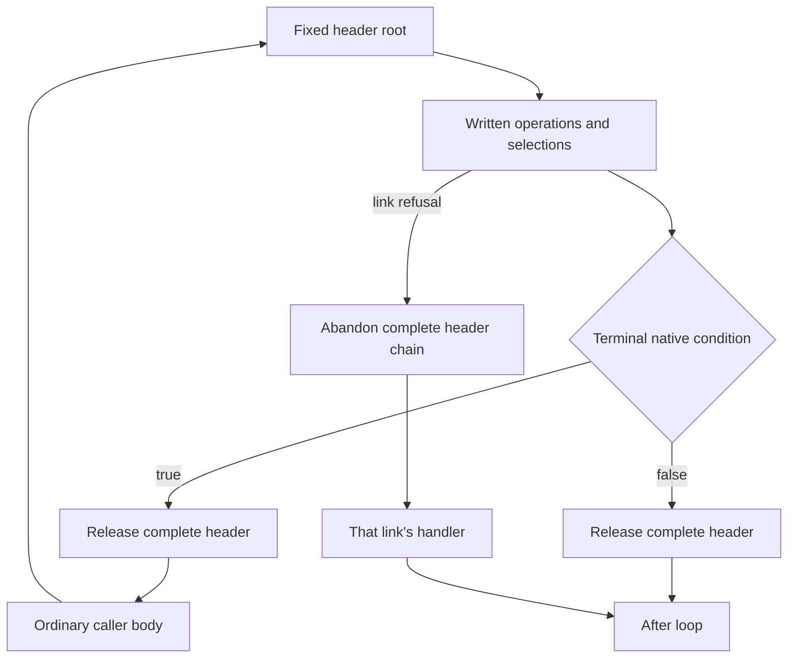

# Structured control and direct-result operation lowering

T044 preserves the complete current statement/control tree in typed IR under
[CALL-09](../../spec/language/calls-and-results.md#call-09),
[FLOW-04](../../spec/language/control-flow.md#flow-04),
[FLOW-05](../../spec/language/lists.md#flow-05) and
[CONT-02](../../spec/language/continuations.md#cont-02).
The [specification](../../spec/README.md) remains authoritative. This chapter
explains the source-to-plan implementation; execution adapters are separate work.

## Compile finite syntax, retain runtime cycles

[The work queue](../../src/lowering/control/blocks.c) contains ordinary-block and
selected-operation tasks. Every task retains its initiating chain, normal
continuation, incoming break target and a stable destination slot owned by the
plan arena. A destination is a field in a planned node/type/loop, never the address
of a compiler C automatic variable that will disappear before the task runs.

Blocks are composed backward so their execution edges retain source order.
[Selected actions](../../src/lowering/calls/tree/actions.c) use the same technique:
an action marker enters the queued child operation and records its normal subtree
completion continuation. Bindings before the child finish first; bindings and
siblings after it wait for the whole child subtree. The compiler schedules finite
owned syntax and patches forward labels afterward. It does not follow runtime
body calls, loop backedges or same-type recursive invocation edges while compiling.

Each [chain record](../../src/planning/plan.h) names its initiating source root,
caller frame and exit after that complete source statement. A selected operation
gets an explicit `CONTROL_SELECT_RESULT` before target acquisition. Its typed
access names the parent's retained result, and its index operands still name the
initiating caller. Selection records the stable checked target/container once;
acquisition consumes that selection without another index conversion. Reference
results acquire their actual referent. No selected name introduces a caller field,
intermediate copy, method instance or guessed dynamic module identity.

After an executed module completes or yields, `CONTROL_RETIRE_RETURN` separates
its completed body connection from the pending output actions and protection.
An unmarked read creates no body connection. The selected module's own yield
returns outputs to the initiating chain normally; it does not suspend that chain.
Each target stays protected until its subtree finishes, then releases before the
next sibling. Parent targets remain protected until their final action ends.

## One refused link ends its initiating chain

[Refusal lowering](../../src/lowering/calls/tree/refusal.c) routes a refused link
through `CONTROL_ABANDON_CHAIN` before its handler. This drops only the initiating
tree's pending grants, staged values and current connections, preserving earlier
committed results and method effects. The refused link's own snapshot/`:` body
then runs in the initiating caller. An ancestor handler cannot catch it. Normal
handler completion reaches the chain's outer exit, skipping unfinished siblings.
An absent handler takes the existing fatal unhandled-refusal path after cleanup.
Technical preparation/index/helper failures retain their separate fatal route.

Handler bodies are ordinary blocks with their original incoming break context;
selected-result lookup does not extend into them. Calls written there start new
root chains. A handler may therefore yield without preserving abandoned grants.
More generally, a standalone `%` occurs in an ordinary body or a handler: its
preceding root operation has completed, or its failed chain has already unwound.
Local transient chain grants are consequently inactive at that yield. Foreach
cursors/cells are the separate resumable control state defined by CONT-04.

## Each loop has its own fixed labels

[Loop identities](../../src/lowering/loops/inventory.c) are allocated for every
source loop before bodies are lowered. A loop records its exact parent, entry,
repeat, body, exit and following continuation. These are compile-time identities,
not a runtime caller-history search or a condition guessed from the last `!`.

A named condition uses its own conversion label as entry/repeat. A linear
condition header gets `CONTROL_HEADER_ENTER` at the first written operation.
For example, assume `.producer` returns `left` with an owned `condition` supporting
native `?`, and that `left` is resumable when the following `%` is attempted:

```text
producer !
 < source
 left %
  condition
  {
   %
  }
```

Every test executes the explicit `producer !` and `left %` again from the same
root. The root's inputs and selected target/index are selected anew. The terminal
condition is read directly from the last operation's protected output frame.
It is neither executed nor copied into an intermediate receiver. An intrinsic
method's owned result can supply the same terminal conversion through its caller
frame without a fabricated result symbol.

The native conversion branches to two explicit `CONTROL_RELEASE_CHAIN` paths.
Both drop the complete header's grants/connections before reaching the loop body
or following statement. A nonempty body's normal edge repeats the root. A
parsed-empty body performs the complete header and one conversion, then exits
for either successful boolean result. A declaration-only body remains syntactically
nonempty even if lowering emits no work for that declaration.



For an empty body, the true release path also reaches the exit. A `^` in a header
link's handler uses the incoming outer loop, because this loop's body has not
begun. A `^` in the body exits this loop. A yield in the body saves its body
continuation; reaching its normal end later repeats only this loop's root.

## Foreach uses a fixed live-boundary frame

[Traversal lowering](../../src/lowering/loops/traversal.c) emits these operations:

| Operation | Contract |
| --- | --- |
| `CONTROL_FOREACH_ENTER` | Resolve/validate the collection once and establish this lexical cursor |
| `CONTROL_FOREACH_NEXT` | Select from the current corrected boundary, skip ineligible memberships/referents, update the exact binding/origin and enter the body; reach leave when exhausted |
| `CONTROL_FOREACH_LEAVE` | Discard this cursor/role and any introduced local whose scope ends, preserving referenced targets and reused ordinary handles |
| `CONTROL_FOREACH_EMPTY` | Validate the collection once and continue without cursor/cell activation or visits |

The source [storage frames](storage-planning.md) already reserve one cursor per
lexical header. Nested reuse shares the same binding cell/origin and does not
save/restore its old handle. No raw list-buffer address or list access grant
survives the body or yield. Target operations using an associated binding retain
FLOW-05's membership-origin checks before their inputs, reset, execution or result
transfers; copying an ordinary handle does not copy that origin association.

Breaks use the innermost loop's explicit exit, so leaving a foreach runs its leave
operation. Early return inside traversal emits `CONTROL_CLEANUP_SCOPES` before
module completion. Fresh entry resets old cursor/cell state through
`CONTROL_RESET_SCOPES`. Yield preserves active traversal state and saves the exact
following body label. A type with lexical traversals gets a separate resume entry:
`CONTROL_VALIDATE_TRAVERSALS` then `CONTROL_RESUME_SAVED`.

Resume validation uses the finite loop/frame table to validate active collections
outermost first. A missing current membership/referent abandons the appropriate
body remainder and nested scopes, selecting that loop's already-corrected repeat
label. Valid state resumes the saved body label. A replaced collection fails at
its header. This is an explicit typed instruction contract for the later cursor
runtime adapter, not an implementation claim for list execution yet.

## Typed intrinsic methods have no fake body

[Method lowering](../../src/lowering/calls/tree/method.c) selects supplied ordinary
sources in caller text order, stages its fixed typed input interface in declaration
order, then emits method preflight, preparation and commit. Omitted inputs select
the fixed input type's default. The staging recipe names the immutable intrinsic
field descriptor and ordinal; no synthetic `SemanticSymbol` or module is created.

Method preflight alone has the method's normal refusal edge. Preparation handles
required allocation/construction before mutation; commit publishes the collection
change and ephemeral results. Technical failures retain fatal cleanup semantics.
Output bindings/selected actions then use the same depth-first caller frames.
A returned element reference can execute immediately, and an owned length result
can be copied or used by a terminal condition while its frame remains live.
No intrinsic method has an Ama body return link or saved resume position.

## Validation, execution boundary and evidence

[Structured validation](../../src/planning/validation/ir/structured/nodes.c)
checks exact loop/chain/frame ownership, source parents, repeat/body/exit labels,
header release paths, resume templates and link-specific refusal cleanup.
[Invocation validation](../../src/planning/validation/ir/invocations.c) checks the
input/reset protocol and source-order actions using each child's explicit completion
edge, never following runtime call/loop cycles. Replacement validation still
checks every recipe's operands and complete commit/release group. Every partial
allocation remains owned by the plan arena until destruction.

Static frontend checking now publishes a complete validated plan for these forms,
including typed self sources. [C generation](../../src/codegen/project/capabilities.c)
rejects unavailable traversal and intrinsic-list execution adapters
before allocating its model or staging any artifact. T063 supplies final-self
sources; T066 supplies [ordinary direct-result execution](direct-result-execution.md),
and T068 supplies [ordinary condition headers](condition-loop-execution.md). This replaces the
old planning-phase execution barriers; it preserves strict artifact correctness
without discarding valid source IR. Existing scalar-call C helpers retain their
supported semantics, including their completed-return retirement marker.

The proof is composition over finite syntax: an ordinary block reaches its given
continuation, a selected child reaches its next action only after its subtree,
and a loop's body reaches that loop's fixed repeat/exit under the specified scope
rules. The two release paths establish that no completed header grant enters the
body. Refusal cleanup before handler entry establishes inactive chain state at
handler yield. Let S count owned source statements/actions, D count declaration/lifecycle
records, and I count interface fields expanded across all ordinary call sites.
Work records and fixed lexical frames are O(S); complete owned planning storage
is O(S + D + I), including the per-site replacement groups. A large interface
called at many sites can make I quadratic in source size. Exact inventory lookups
and protocol validation take at most quadratic time in the produced plan records.
Compiler C call depth is constant with respect to source nesting.

[Structured tests](../../tests/unit/planning/structured/main.c) compose real roots,
interfaces, semantic analysis and complete plans. They cover depth-first owned/
reference targets, caller operands, handler suspension after unwind, intrinsic
outputs/conditions, full-root repeat and empty/declaration-only bodies, incoming
handler breaks, foreach reuse/exits/resume, 128-deep trees/traversals, damaged
metadata and every lowering allocation failure. [Frontend tests](../../tests/unit/compiler/check/main.c)
accept complete IR with intentionally uncompilable native headers. [Assembly tests](../../tests/unit/codegen/assembly/main.c)
prove execution-capability rejection preserves the original source site and
allocates no model/artifacts for the remaining guarded forms. T066 adds compiled
ordinary-tree conformance; T067 accepts local handlers and T068 accepts ordinary
condition headers. Cursor/intrinsic-list execution remains later work.
