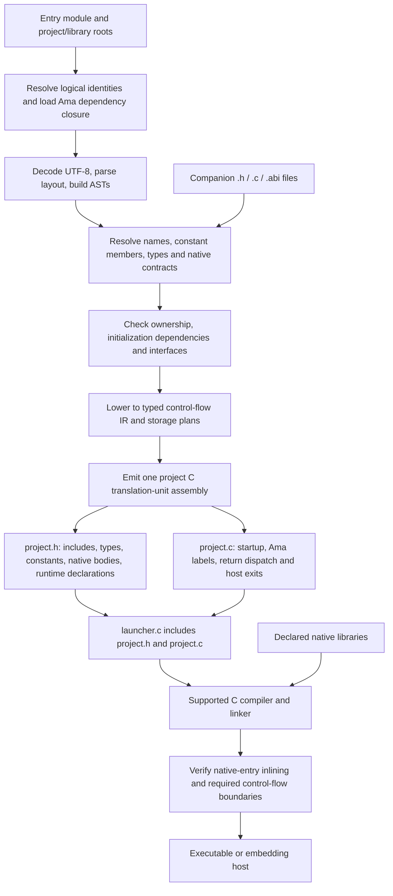

# Compiler architecture and generated code

[Specification index](../README.md)

<!-- chapter-contents -->
In this chapter:

- [Explanation: resolve meaning before generating C](#explanation-resolve-meaning-before-generating-c)
- [Generated names and source maps](#generated-names-and-source-maps)
- [Generated project organization](#generated-project-organization)
- [Overall translation to C](#overall-translation-to-c)
- [Mandatory inlining and verification](#mandatory-inlining-and-verification)
- [Compiler architecture](#compiler-architecture)
- [Connecting dependencies written in Ama](#connecting-dependencies-written-in-ama)
- [Compiler components form a source tree](#compiler-components-form-a-source-tree)
- [Exact algorithms and formal justification](#exact-algorithms-and-formal-justification)

<!-- /chapter-contents -->

## Explanation: resolve meaning before generating C

The compiler connects several different models. Source files provide names and
spans. Parsing establishes structure. Semantic analysis resolves declarations,
types, ownership, and permitted operations. Typed IR records those decisions.
Storage and control-flow plans then describe how the generated C realizes them.

Keeping these stages separate makes a failure understandable: a malformed
indent is a syntax problem, a wrong storage suffix is a semantic problem, and
a missing native clone function is a capability problem. C emission must not
try to rediscover any of them by guessing from a name or by inspecting generated
text.

The generated project shares module code, not instance payloads. Its execution
function operates on an explicit execution context; parallel contexts call the
same generated code with independent mutable runtime state. Native hooks and
linked libraries used concurrently must meet the parallel chapter's reentrancy
requirements.

Here a project assembly means the assembly of one independently compiled Ama
component. A larger C application can link several such components; each keeps
its own generated control flow and explicit context boundaries.

## Generated names and source maps

### Generate names from complete identities

<a id="name-01"></a>

**NAME-01.** Compiler-owned generated C names MUST use deterministic hashes of
complete qualified identities, with separate categories for types, shared constants,
state members, interface members, labels, and runtime metadata. A basename alone is insufficient. Hash inputs
must include the root kind, unambiguous component boundaries, and a versioned
encoding; removing punctuation from component names must not erase root identity.
Handwritten native symbols use the module-prefix facility in NAME-05; they are
not discovered or rewritten by hashing a C source file.

Link-visible names must additionally distinguish independently compiled Ama
components under [EMBED-06](c-library.md#embed-06). Use collision-checked component
qualification or genuine internal C linkage so two libraries can
contain the same Ama module identities and standard-library dependencies without
duplicate definitions or symbol interposition. This qualification changes C
linkage identity, not a module's source-language nominal identity or context-local
instance identities. Public host types and functions use their component's
generated namespace; private native/runtime declarations must not leak a shared
unqualified C type into that public header.
Visibility settings may additionally restrict shared-library exports, but hiding
an externally linked name alone does not make duplicate names safe when static
objects are linked into one program.

### Detect hash collisions exactly

<a id="name-02"></a>

**NAME-02.** The compiler MUST retain the original identity alongside each hash
and reject collisions between distinct identities. A collision must never merge
types, storage, labels, or values. Hash uniqueness does not replace type checks,
instance selection, or reference generation checks.

Use a length-delimited, domain-separated identity encoding. Specify the hash
algorithm, encoding version and output width, and cover them with stable test
vectors, including Unicode names.

### Preserve source mappings

<a id="name-03"></a>

**NAME-03.** Generated code MUST carry `#line` mappings to the original source
paths and lines. Unicode paths must remain recognizable in diagnostics; quoting,
backslashes, and control characters require correct C directive escaping.
Additional metadata SHOULD map hashed entities to source names and spans.
Do not change module identity merely to make it a C identifier.

## Generated project organization

### Emit one assembly per independently compiled component

<a id="gen-01"></a>

**GEN-01.** Generate one C translation unit per independently compiled Ama
component, using either a standalone `.c` or a coordinated `.h`/`.c` pair included
by a launcher. A component is the complete resolved Ama dependency closure of
one compilation, with its selected entry or explicit library exports. Do not
create separate C functions for ordinary Ama modules or compile independent
module C translation units whose boundaries defeat mandatory inlining.

A larger C project may contain many translation units and link one or more
complete Ama components as static or shared libraries under
[EMBED-01](c-library.md#embed-01). That external packaging boundary does not
split a component's internal Ama execution into C calls. A separately compiled
library is accessed through its generated host interface in its own execution
context; it is not an unresolved Ama module body that the caller jumps into.

The required logical order is external declarations and required forward types,
native representation/generated type definitions, shared-constant
declarations/storage, native inline bodies, pool/runtime declarations, and then
the Ama control-flow/runtime body. A possible
include-based organization is:

```c
/* Schematic embedding translation unit; exact ABI names are an engineering choice. */
#include "project.h" /* Dependencies, types, native bodies, pool/runtime declarations. */

static AmaOutcome execute_context(AmaContext *context) {
    #include "project.c" /* Generated statements and labels inside this body. */
}
```

Here `project.c` is a generated include fragment, not another translation unit.
`AmaContext` and `AmaOutcome` illustrate the context and host-outcome roles, not
fixed public C names. A standalone `main` creates one context and calls its
execution function; an explicit embedding host may create several isolated
contexts. File names and launcher customization are engineering choices; the
ordering and single translation-unit execution contract are requirements.

Generated native interface headers and authoring scaffolds under CABI-06 are
additional declaration/authoring artifacts. Checking them independently does not
make native modules separate program translation units. A library's generated
public host header is a different artifact under [EMBED-01](c-library.md#embed-01):
consumers compile it without including the component's execution assembly.

### Lower Ama bodies to labels

<a id="gen-02"></a>

**GEN-02.** Ordinary Ama modules become labeled blocks inside one C execution
function parameterized by the current execution context. Mutable pools,
constants, current-instance selection, caller links, and failure state belong
to that context rather than process-wide globals. Generated code can be shared
by independent contexts; a context has only one active executor. Entry uses
direct jumps; return dispatch uses a validated continuation
selector and standard C `switch`/`goto` branches. Emit each ordinary module body
once. Do not rely on C recursion, computed-goto extensions, an indirect function
pointer dispatcher, or optimizer tail-call elimination to satisfy stacklessness.

### Store values that survive control transfers explicitly

<a id="gen-03"></a>

**GEN-03.** All values needed across control transfers, nested execution, and yield
must occupy instance or explicit runtime control storage; shared `@=` values
occupy separate immutable module storage within each execution context. C automatic temporaries are
allowed only when their lifetime cannot cross a transfer and their addresses
cannot escape. Compiler transformations must preserve source evaluation order
and failure behavior under the observation and resource rules below. Logical
state need not be represented by a separate physical field when RT-02's exact
storage analysis proves an equivalent representation. This permission never
introduces a C activation that must survive an Ama transfer or yield.

#### Why the optimization boundary is explicit

**Explanation.** A simple integer can need fewer control fields than a module
that yields inside a list traversal. Rechecking a protected handle can also be
unnecessary if no intervening operation can invalidate it. Requiring the same
physical records and allocation attempts in both cases would make the general
runtime representation an unavoidable cost of every small value.

The language therefore fixes observable behavior and exact safety predicates,
while permitting representations that establish the same predicates with less
work. An optimization is optional; an unoptimized conforming path remains valid.
Choosing the general path when a proof is unavailable is conservative compilation,
not a heuristic interpretation of source text.

#### Preserve observations, not redundant bookkeeping

An optimization must have a reviewable preservation argument over the resolved
IR and the applicable native contracts. For every input in its declared domain,
preserve application values, retained interface state, checked reference identity
and lifetime, ownership, busy/refusal behavior, saved execution positions, output
action order, and native/external effects. Preserve required diagnostics, including
the original failing operation and active caller path. Host/debugger observations
allowed by the declared generated interface are part of this obligation. Debug
inspection must reconstruct any logically present optimized state accurately;
it must not fabricate an available object or a lost continuation.

Static type, capability, syntax, and source-order checks still apply to the
complete source, including operations later removed from generated code. Do not
accept an otherwise invalid copy, conversion, or declaration because an optimizer
expects it not to run. Inferred persistent fields still have TYPE-02/TYPE-06's
creation-time initialization; their later assignments do not authorize skipping
observable initializers. CALL-08's interface reset and COPY-01's retained-source
value semantics also remain in force.

For implementation, attach explicit facts and preconditions to a proposed IR
transformation, derive them with a terminating exact data-flow or graph algorithm,
then validate the transformed storage/control plan. A fact about an opaque native
hook must follow from its actual supported contract or a verified transformation
by the C toolchain. A type name, example execution, apparent scalar layout, or
missing observed failure is not evidence that a hook is pure or infallible.
No additional native trait or implicit byte-copy capability is introduced here.

#### Reuse a check only while its guarantee remains true

A handle check or acquisition step may be removed only when its full success
predicate is already established for every execution reaching that point.
Protection must prevent destruction, generation reuse, conflicting replacement,
and other relevant mutation throughout the proven region. Preserve any still
needed acquisition/release effects even when their validation branch is redundant.
Reference formation alone does not establish this protection under REF-07.

For example, after acquiring an owned target, generated code may reuse its
validated typed access within that protected operation if none of the intervening
actions can invalidate the relevant field. It may not reuse an indexed selection
across an earlier output action that changes its index or list membership. A
control transfer, native call, or yield is a proof boundary unless the analysis
establishes exactly which guarantees survive it. A `%` suspension never carries
an acquisition grant into its later resumption.

#### Internal allocation counts are not observable behavior

The number, size, addresses, and timing of internal compiler/runtime allocations
are representation choices, except where an explicit ABI or valid borrow makes
them observable. An allowed optimization may remove an internal allocation and
therefore remove an out-of-memory failure that could arise only from that
allocation. Different conforming layouts need not fail at the same memory limit
or on the same numbered allocation attempt.

Every allocation that remains must use checked arithmetic, report actual failure,
and satisfy the specified preparation/cleanup guarantees. A native constructor,
clone, conversion, or destructor's declared effects and reported status are not
mere internal allocation bookkeeping. Do not skip or defer such an operation
unless its complete observable behavior is proven preserved. In particular,
there is no automatic move of a retained result and no general copy-on-write
permission for mutable native state.

Failure-injection tests identify an allocation or preparation transition in the
implementation being tested. They must not require optimized and general layouts
to make an identical sequence of allocation attempts. Equivalence tests compare
values, effects, identity/refusal/control transitions, and source diagnostics;
separate allocation/operation counters demonstrate the claimed reduction.

## Overall translation to C

The implementation must preserve the following separation between compile-time
work, generated project contents, C toolchain work, and runtime execution:



`project.h`/`project.c` name the include-based organization in GEN-01. A standalone
output `.c` may combine those roles. Extra handwritten/native source inputs are
included into this generated assembly where required; they do not turn Ama
modules into separately called C translation units. Dependency declarations must
be available before their uses. The build invokes the C compiler for the launcher
translation unit, not once for each Ama module or again for the project fragment.
Declared external native libraries may be linked normally under the native C
execution boundary. The Ama compiler parses `.abi` metadata and tracks companion
files; it does not need a C parser for handwritten `.h`/`.c` contents. Their
signatures/declarations are checked through generated uses by the C compiler.

| Ama construct | Generated C representation |
|---|---|
| Module type and fields | Collision-checked generated types/layouts and source metadata |
| Shared `@=` value | Once-initialized value storage per execution context, outside instance pools |
| Owned instance | Checked pool slot and its in-place data |
| Reference | Typed slot/generation handle, resolved under acquisition |
| List | Contiguous membership-identifier order, checked membership records, length/capacity, and protected service state |
| Literal initializer | Immutable UTF-8 bytes/length passed to the type's native constructor |
| Qualified constant source | Statically resolved typed value copy into existing destination storage |
| `instance !` | Validate/acquire, protect input sources, construct the interface from supplied/default values under CALL-08, set return metadata, jump to module entry |
| `instance %` | Validate/acquire and jump to stored position without input reset/binding |
| Instance `>>` | Copy stored results without body execution |
| Direct result operation | Resolve declared result storage in place, retain enclosing targets, and dispatch through explicit chain-action continuations without a clone |
| Path `>>` | Copy statically resolved shared constant values |
| Nested invocation/return | Change selected instance and dispatch labels using explicit return links |
| `%` statement | Record next position, release invocation connection, return to caller/host |
| Native `@C` body | Required-inline entry with ordinary C helpers allowed inside |
| Refusal and `:` | Save caller status and select the local alternative before target entry |

### Emit from resolved IR

<a id="gen-04"></a>

**GEN-04.** Code generation follows the resolved IR, not the text order of module
loading. Emit each shared Ama module body once, even when many source modules
depend on its type. Generate unique call-site continuations and instance selection;
code reuse must not imply shared mutable state or a singleton object. Includes
only assemble C declarations/definitions; labels and return dispatch implement
Ama invocation. Preserve `#line` paths and operation/source maps through all stages.

A schematic generated execution fragment illustrates the control structure:

```c
/* Conceptual labels/fields only: not a public runtime API or runnable fixture. */
ama_root_entry:
    /* Acquire child; prepare inputs/interface under CALL-08; record return site. */
    /* Mark root waiting, select child; neither payload is moved. */
    goto ama_child_entry;

ama_child_entry:
    /* Operate on the selected child's fields; inline native entry bodies. */
    goto ama_return_dispatch;

ama_return_dispatch:
    /* Transfer results while acquired; recover caller and its return selector. */
    switch (runtime_return_selector) {
        case RETURN_TO_ROOT_AFTER_CHILD:
            goto ama_root_after_child;
        default:
            goto ama_runtime_failure;
    }

ama_root_after_child:
    /* Continue with the selected root's in-place state. */
    goto ama_host_completed;
```

Actual emission supplies initialization, validation, failure edges, multiple
instances/callers, suspension labels, cleanup, and host outcomes. The schematic
must not be implemented as a hidden C call per Ama invocation.

## Mandatory inlining and verification

### Avoid C activations for Ama calls

<a id="stack-01"></a>

**STACK-01.** Ama-to-Ama execution inside one compiled component MUST NOT use the
C function-call stack.
The generated entry body for an `@C` module MUST be inlined into generated
execution. Plain `inline`, `static inline`, or LTO alone are not proof that this
entry boundary has disappeared. The backend must enforce that boundary under
the supported toolchain and reject unsupported entry implementations. An explicit
call through a separately compiled library's generated host API is a component
boundary governed by [EMBED-08](c-library.md#embed-08), not an internal Ama call
or permission to generate one C function per module.

### Allow ordinary native helper calls

<a id="stack-02"></a>

**STACK-02.** Inside native C code, ordinary C rules apply. Native helpers may
call functions, use recursion and automatic storage, and invoke external libraries.
Allocation, I/O, and native lifecycle callbacks may use the C stack. They are
not required to inline transitively. Native code must still obey Ama's ownership,
reference-lifetime, acquisition, and interface contracts.

A synchronous native helper may act as the host of a separately compiled Ama
library through its generated API, using a distinct isolated context under
[EMBED-08](c-library.md#embed-08). The child API returns normally with its admission
result and, when execution started, completed, yielded, or failed. All helper
activations must return before the outer Ama body continues or yields. The helper may
not enter its current or any active ancestor context. Retained native callbacks
remain subject to [ASYNC-05](../language/async-and-parallelism.md#async-05) and
cannot use this host boundary to execute Ama.

### Never yield across an unfinished native call

<a id="stack-03"></a>

**STACK-03.** Native C calls must complete normally before control returns to
their calling Ama component. A native helper or callback must not become an
alternative C-call dispatcher for that component's Ama modules. An Ama yield
saves only explicit Ama state, not an active C stack; yielding through an
unfinished native call is unsupported. Native nonlocal exits must not bypass
runtime cleanup or leave instances busy.

When an explicit native host calls a separate library context, the child's `%`
returns `yielded` normally through that child's generated API. The helper then
returns normally to its own native entry. Only afterwards may the outer Ama
component itself yield. No helper frame remains attached to either continuation,
and no automatic resume loop is introduced; see
[EMBED-08](c-library.md#embed-08).

### Verify the generated control-flow property

<a id="stack-04"></a>

**STACK-04.** Stacklessness is a property of Ama module control flow, not a
promise of zero hardware-stack usage throughout the executable. Native calls,
compiler spills, generated helpers, and platform startup may use the stack.
Verification must distinguish the inlined native entry boundary from permitted
calls inside that native implementation.

## Compiler architecture

The compiler itself may use ordinary C functions and explicit object ownership.
The generated program's stackless constraints do not prohibit compiler call stacks.

| Component | Responsibility | Output |
|---|---|---|
| Source manager | Paths, UTF-8 bytes, line tables, source lifetime | Stable source spans |
| Layout/lexical reader | Indentation, comments, literal boundaries, annotations | Tokens or logical lines |
| Parser | Syntax recognition independent of declared-name lookup | AST with spans |
| Namespace resolver | Module loading, qualified identities, name binding | Resolved symbols |
| Type/lifecycle checker | Types, storage kinds, copy/default contracts | Validated typed nodes |
| Control-flow lowering | Entry, calls, refusal branches, loops, yield positions | Typed control-flow IR |
| Storage planner | Owned layout, stable-address pool blocks, instance access, service metadata | Explicit storage plan |
| C backend | Types, includes, native bodies, labels, dispatch, mappings | Project C artifacts |
| Toolchain verifier | Required inlining and target constraints | Conformance result |

### Parse before resolving names

<a id="comp-01"></a>

**COMP-01.** Parse syntax before resolving names. The parser must distinguish
assignment, declaration, entry call, resume, and retained read by their structure;
it must not use implicit numeric-variable creation or alias lookup to guess syntax.
An owned condition line followed by a same-level `:` selects a negative branch.
A `:` following an entry/resume call, or an unmarked read with its required
indented output actions, is instead that operation's acquisition-refusal handler.
Do not reinterpret either form based on whether a name or truth conversion exists.
Parse assignments and output bindings uniformly; classify their simple receivers
as inferred declarations or ordinary uses by TYPE-06's source-order rule after
parsing, then resolve types. An inferred assignment remains an assignment node
with an executable source transfer, not an explicit declaration initializer.
Do not use the symbol table to choose different grammar productions for the
same assignment or output-binding text.
Recognize FLOW-05 foreach by a reference-name binding inside its header brackets.
`items[index]` remains indexed access; `items[item&]` followed by `{` is foreach
before lookup. Represent foreach as its own ordinary statement, never as a
truth-conditioned loop or recursive link of a FLOW-04 header. Resolve its
lexical binding after parsing; name availability may choose reuse versus a new
binding, but never the construct's syntactic kind. Preserve local binding scope
and active cursor state explicitly in typed IR and storage/control plans.
Recognize nested result-operation nodes by their position in the output phase;
their selector names are resolved against the enclosing result interface, while
their ordinary operands retain the initiating caller's namespace under CALL-09.
Recognize FLOW-04 condition chains as complete loop statements with a single
terminal owned condition and no sibling output actions. Record their root and
terminal marker spans during parsing and combine recursive header links into
one loop node, then assign fixed repeat labels during lowering. Do not derive
a repeat boundary from name lookup, target identity,
runtime call history, or the nearest explicit execution suffix. Header-link
handlers use the incoming loop context; only the terminal loop body adds this
loop as a break target.

### Separate AST from typed IR

<a id="comp-02"></a>

**COMP-02.** The AST represents source constructs and spans. Lowered IR represents
resolved types, explicit copies/moves, acquisition, failure edges, continuation
selectors, result routing, and control-flow blocks. Do not use generated C strings
as the semantic intermediate representation or reparse source during emission.

### Separate kinds of dependency

<a id="comp-03"></a>

**COMP-03.** Model layout dependencies separately from execution dependencies.
Reject infinite eager ownership layout and invalid initialization ordering.
Do not reject every module dependency cycle: different available instances of the
same module can execute, while busy-instance cycles are refused dynamically.

### Report precise failures and respect output ownership

<a id="comp-04"></a>

**COMP-04.** Diagnostics identify file, line, column, operation, and relevant type
or declaration. Include both source names for duplicate identities/collisions.
Malformed input must fail without partial output masquerading as a usable build.
Generated files must have designated ownership and must not overwrite handwritten
native companions unless a separately requested stub-generation command does so.
Source lines and columns are one-based; columns count UTF-8 bytes from the
physical line start, not display cells or Unicode scalars. Spans use half-open
byte ranges in the original source. EOF is a valid diagnostic position; virtual
line boundaries do not add bytes or a fabricated source line.

### Generate deterministic results

<a id="comp-05"></a>

**COMP-05.** Repeated compilation of unchanged input must produce deterministic
identities and generated output. Resource limits, allocation arithmetic, output
errors, and malformed paths must be checked. The compiler must clean up its own
resources on supported error paths.

## Connecting dependencies written in Ama

### Resolve dependencies through configured roots

<a id="dep-01"></a>

**DEP-01.** An Ama dependency is another module resolved through the configured
roots selected by its explicit `.` or `..` prefix and the logical-path mapping
in SRC-01 through SRC-05. `.` uses project/import roots; `..` uses only the
standard-library root, regardless of which module contains the reference.
Dependencies arise from declared types in constants/interfaces/body state,
qualified constant sources and explicit constant-read namespaces, plus their
transitive type/native/initialization dependencies. Calling a variable resolves
through its declared type; it does not dynamically import a source file.
There is no source-text `include`, hidden wildcard import, or implicit parent
inheritance. A reusable Ama library supplies modules in the same source/interface
format as project modules.

For example:

```text
project/main                 -> .main
    declares .shop.item      -> library/shop/item
        declares ..index     -> standard-library/index
        native companions    -> library/shop/item.h, item.c, item.abi

project .main also uses a qualified constant from .shop.item;
both references resolve to the same module record and shared constant table.
```

Directories above are illustrative configured roots. `name+/` submodules use
the agreed physical mapping; importing a child does not implicitly import its
parent declarations. Paths in code stay logical, and include/debug paths are
physical. Neither filesystem proximity nor source loading instantiates a module.

### Build one exact module registry

<a id="dep-02"></a>

**DEP-02.** Build one project-level module registry keyed by full logical identity,
including the root kind and exact component sequence. Index roots in their
declared families, reject duplicate identities and ambiguous filesystem aliases
under SRC-02/SRC-03, and never retry another family when a path is missing.
Load and parse each required active module once; share its resolved
symbols, AST and typed representation across users. Discover transitive dependencies
until the required closure is complete. Unused drafts do not require full parsing;
a required draft is an error with the requesting source span. Report the chain
of module references for missing/invalid dependencies.

The loader must distinguish loading/in-progress records from fully resolved ones
so a dependency cycle cannot trigger unbounded reloading. A loading cycle is not
by itself a recursive-layout or execution error. Validate eager ownership layout
and constant-initialization graphs separately; references and initially empty lists
may break eager layout cycles, and busy-instance checks govern active reentry.

### Track the complete dependency closure

<a id="dep-03"></a>

**DEP-03.** The closure contributes layouts, constants, code, source maps and native
companions to one generated project assembly. Referencing the same dependency
from two modules never duplicates its type, shared constant storage or Ama code
body. Each owned declaration still creates its own instance as specified; a loader
cache does not cache executable objects or share their state. Constants-only
dependencies contribute shared data, not executable pools/labels.

Ama modules are parsed and translated into the common IR; their original source
files are not passed to the C preprocessor and are not linked as C functions.
Native `.h`/`.c` companions are included once in dependency-correct order, `.abi`
files are consumed by the compiler, and external C libraries use explicit linker
inputs. The build tracks every contributing Ama/native/ABI file for invalidation;
changing a dependency must rebuild the affected generated project rather than
silently reuse stale layouts or interfaces. Reproducible output must not depend
on directory traversal or parallel discovery order.

## Compiler components form a source tree

### Decompose the compiler by responsibility

<a id="arch-01"></a>

**ARCH-01.** Each major compiler component MUST be decomposed into smaller,
cohesive subcomponents stored in nested directories. The implementation must
form a navigable tree of responsibilities, not accumulate lexer, parser, binder,
planner, or emitter logic in one large source file. Directory levels explain
progressively narrower operations; file and function names explain their roles.
This is a requirement on compiler source organization, not an instruction to
rewrite Ama modules as C function calls.

A target tree may look like this; names are illustrative rather than a claim
that the current repository already has this organization:

```text
src/
    project/
        project.c
        project.h
        dependencies/
            registry.c
            load.c
            closure.c
            invalidation.c
    source/
        source.c
        source.h
        paths/
            logical.c
            submodules.c
        utf8/
            decode.c
            identifiers.c
    lexer/
        lexer.c
        lexer.h
        layout/
            indentation.c
            comments.c
        literals/
            payload.c
    parser/
        parser.c
        parser.h
        module/
            sections.c
            declarations.c
        body/
            statements.c
            calls/
                targets.c
                arguments.c
                placeholders.c
    semantic/
        semantic.c
        semantic.h
        names/
            scope.c
            constants.c
        types/
            compatibility.c
            ownership.c
        initialization/
            dependencies.c
            cycles.c
    lowering/
        lowering.c
        lowering.h
        calls/
            entry.c
            resume.c
            results.c
        control/
            branches.c
            loops.c
            suspension.c
    codegen/
        codegen.c
        codegen.h
        types/
            layouts.c
            declarations.c
        native/
            includes.c
            protocols.c
        execution/
            labels.c
            returns.c
        diagnostics/
            source_map.c
    runtime/
        pools/
        references/
        lifecycle/
        lists/
        diagnostics/
```

Runtime directories contain implementation/support or emission inputs as appropriate;
they must obey the generated runtime contract. Production boundaries follow the
pipeline's responsibilities, not test fixture convenience. Shared foundational
code may live in a focused common subtree; it must not become an unrestricted
collection of unrelated helpers.

### Keep each operation at one abstraction level

<a id="arch-02"></a>

**ARCH-02.** A function performs one named operation at one level of abstraction.
Parent-level orchestration should read as short calls to child operations;
validation, state changes, diagnostics and cleanup must not be interleaved in a
long sequence of unrelated responsibilities. Split a function when understanding
it requires following several independent phases or deeply nested control flow.
Normal functions should fit on roughly one editor screen; longer ones require
reviewed justification or decomposition, not a universal exception for parser
or code-generator code. Generated tables and mechanical data definitions are
not an excuse for long handwritten algorithms.

### Expose narrow component contracts

<a id="arch-03"></a>

**ARCH-03.** Each subtree exposes a small explicit interface. Public headers
compile independently; an internal header exposes only sibling implementation
contracts. Keep private helpers private, pass narrow contexts/dependencies
explicitly, and make ownership of compiler allocations clear. Do not introduce
mutable global compiler state or a project-wide context parameter where a source
view, symbol table, or emitter is sufficient. Child components must be directly
testable without invoking the entire compiler or constructing unrelated state.

Directory trees organize responsibilities, not implicit C visibility. Compile
ordinary `.c` units with declared interfaces; header inline helpers and LTO follow
contributor guidance. The compiler may use ordinary functions and the C stack.
Mandatory native-entry inlining and label-based execution apply to generated Ama
programs, not to every helper of the compiler itself.

### Test components and their compositions

<a id="arch-04"></a>

**ARCH-04.** Every extracted meaningful component and every composite component
must have acceptance tests under TEST-06/TEST-07. Creating more folders without
narrowing functions or exposing testable contracts does not satisfy decomposition.
Refactoring must preserve source diagnostics, ownership/failure behavior and
generated program semantics; it is complete only with corresponding tests and
passing required checks.

## Exact algorithms and formal justification

### Use exact algorithms

<a id="arch-05"></a>

**ARCH-05.** Compiler, runtime and project-owned library implementations MUST use
explicit, exact algorithms. Heuristics are forbidden: no guessed source meaning,
probabilistic acceptance, best-effort type or identity matching, fallback syntax,
input-shape shortcuts, or special cases chosen to make particular examples pass.
For every supported input, the applicable rule and outcome must follow from the
specified contract. Invalid inputs produce the specified diagnostic or refusal;
resource exhaustion follows the explicit failure contract. Resource policies use
specified formulas and preserve the same invariants for every permitted size.

This applies to implementation decisions as well as semantic recognition.
Optimizations require a semantics-preservation argument; observed success on a
collection of programs is insufficient. External C toolchain behavior is governed
by the documented toolchain contract and verification requirements; it cannot
justify heuristic decisions in Ama's own implementation.

### Explain the general correctness argument

<a id="arch-06"></a>

**ARCH-06.** Each substantive component MUST have a general mathematically or
algebraically justified solution, covering its complete declared domain rather
than enumerating observed cases. State its inputs, outputs, preconditions,
postconditions, invariants, failure effects, and termination/complexity bounds.
Provide a reviewable derivation or proof argument at the component boundary;
use induction, algebraic laws, or a transition-system argument as appropriate.
Nontermination permitted by a user program must be distinguished from termination
of compiler algorithms and bounded runtime service operations.

In particular:

- Name resolution is a function of complete qualified identity. Identity encoding
  is unambiguous; collision detection rejects unequal identities with equal hashes.
- Dependency ordering respects the declared dependency relation and detects cycles
  under the rules for each kind of dependency, without guessing a usable order.
- Handle validity follows exactly from type, live-slot and generation predicates;
  allocation, retirement and reclamation preserve stale-reference invalidity.
- Ownership cloning establishes an injective source-to-destination mapping over
  the copy boundary. Owned edges and internal references follow that mapping;
  external references retain their targets. Failure preserves the stated lifecycle
  and replacement invariants.
- Invocation, suspension, return and cleanup are explicit state transitions whose
  preconditions and effects preserve acquisition, ownership and control invariants.
- Lowering and C emission preserve the meaning of resolved IR, including failure
  paths and source locations, under explicit native/toolchain assumptions.

Keep the argument close to the component's contract or design documentation.
Tests check the laws and implementation; they do not replace the justification.
No new syntax, protocol or semantic exception may be invented to avoid solving a
case within the existing contract.

Compiler source explanations must make this reasoning traceable to the canonical
requirements. Each maintained compiler file's Doxygen purpose/contract comment,
and each nontrivial rule-implementing function or algorithm explanation, must
contain clickable links to the relevant files in `spec/` and their stable rule
anchors. The visible link text includes the requirement ID; a bare code such as
`RT-13` or an unlinked filename is insufficient. Explain how the implementation
maintains that rule, rather than substituting a link for the explanation. Generic
helpers may refer to their documented parent contract when no narrower language
rule applies; do not invent an unrelated rule citation.

For example, for a source file at `src/runtime/pool/reclaim.c`, its comment can
state:

```c
/**
 * @brief Releases an empty pool block without reviving an issued identity.
 *
 * Remove its free-list entries before releasing storage, and retain generation
 * history in the directory so a later allocation cannot validate an old handle.
 * @see [RT-13: safe pool reclamation](../../../spec/implementation/runtime.md#rt-13)
 */
```

Source links are relative to the containing source file, with exact case and
the canonical rule anchor. Generated Doxygen documentation must preserve a
clickable destination for the same rule. Its build must include the specification
or apply a deterministic read-only link/anchor mapping to generated specification
pages; it must not modify `spec/` to make documentation links work. Validate both
source link resolution and rendered HTML destinations/anchors. The concrete
generation workflow is described in [CONTRIBUTORS.md](../../CONTRIBUTORS.md).
