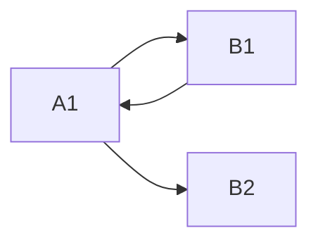

# Executable templates and static type composition

[Specification index](../README.md)

<!-- chapter-contents -->
In this chapter:

- [Explanation: two kinds of work](#explanation-two-kinds-of-work)
- [Placeholder spelling](#placeholder-spelling)
- [Parameters and their scope](#parameters-and-their-scope)
- [Type expressions in ordinary declarations](#type-expressions-in-ordinary-declarations)
- [Inferring types from typed connections](#inferring-types-from-typed-connections)
- [Nested template instances](#nested-template-instances)
- [Specialization identity and independent state](#specialization-identity-and-independent-state)
- [Checking a specialization before execution](#checking-a-specialization-before-execution)
- [Concrete native modules and template source distribution](#concrete-native-modules-and-template-source-distribution)
- [Type parameters and template parameters](#type-parameters-and-template-parameters)
- [Partial substitution and composition](#partial-substitution-and-composition)
- [Static result interfaces](#static-result-interfaces)
- [Templates and Ama's own lists](#templates-and-amas-own-lists)
- [Compiler obligations and design gates](#compiler-obligations-and-design-gates)
- [Finite composition and specialization creation](#finite-composition-and-specialization-creation)

<!-- /chapter-contents -->

## Explanation: two kinds of work

An executable template describes ordinary variables and operations whose types
are supplied by its users. For example, a forwarding module copies a value
without choosing in advance whether it is an integer, text or a user-defined
record. Its interface still reads as pairs: a variable name, then its type.

A **static producer**, marked `@...` with a nonempty graph, describes equations
between types and partially filled constructors. It has no runtime instance.
It can receive a constructor, fix some of its arguments, combine it with other
constructors and expose several named results. The compiler solves this finite
structural description; it does not run arbitrary Ama or C code to discover a
new type. [TPL-12](static-results.md#tpl-12) defines that separate source form.
A file with only `@...` and layout instead declares a nominal static type
marker under [TPL-14](static-results.md#tpl-14).

**Design rationale.** This division keeps code that manipulates values easy to
read. An ordinary declaration remains a name/type pair, even when its type
expression assembles or selects a Type. Standalone equations and public static
results have an explicit home in `@...`; they are not hidden among runtime
inputs. Ordinary templates infer Types through normal calls, results and other
typed connections. Declaration expressions add explicit composition without
runtime template objects, a general compile-time interpreter or dependent types.

The purpose of this machinery is to generate the concrete ordinary modules an
algorithm needs, so the programmer does not handwrite a source module for every
combination of types. It checks that the composition is well defined and safe
to represent and execute. Algorithmic laws and application-specific behavioral
invariants belong to module contracts and their tests under
[CORE-06](../introduction.md#core-06); static composition is not a second program
that inspects runtime data or proves those laws.

**Design status.** This chapter defines target behavior, not an implementation
claim. The [decision registry](../../AMBIGUITIES.md#open-template-design-questions)
records decisions and the implementation queue records remaining work. The list
foundation remains intrinsic under TPL-09; static natural numbers, value-indexed
lengths and provably decreasing type recursion remain deferred. Relative module
paths are outside this change: existing absolute logical roots remain governed
by [SRC-01](source-and-names.md#src-01).

## Placeholder spelling

<a id="tpl-01"></a>

**TPL-01.** A static name starts with exactly three adjoining ASCII dots followed
by one or more complete name components separated by single adjoining dots.
Each component obeys [SRC-03](source-and-names.md#src-03), including Unicode,
underscores, isolated internal ASCII hyphens and single internal spaces. There
is no terminating dot.

The complete spelling is one name. In `...data.element type`, `data` is not a
namespace object and `element type` is not a selected member. The components
explain the name's purpose; they do not locate files or inherit parameters from
another module. Identical spelling in different definitions does not bind them.

Recognize `...` before `..` and `.` at a type start. The prefix adjoins the first
component and every internal dot adjoins both components. Bare `...`, empty
components, four leading dots, doubled internal dots, a terminating dot and
spaces adjoining dots are invalid. There is no positional static marker.
Structural indentation and operand separators remain outside the name.

Static names occur only in the roles defined by TPL-02, TPL-08, TPL-12 and TPL-15, and
as an already scoped Type namespace under [CONST-03](declarations.md#const-03).
They are not runtime value sources, variables, indices, entry/resume targets,
literals or dotted member accesses. A normal variable's type line may use one
bare Type name or the declaration expression of TPL-15; neither makes the
declared field an ordinary first-class static value.

**Examples: spellings, not complete modules.**

| Spelling | Meaning |
|---|---|
| `...data.element type` | One descriptive static name |
| `...data.key type` | A different complete name |
| `...имя типа.назначение` | The same rules with international words |
| `...data.key-2 type` | Valid isolated internal hyphen |
| `...data.key--type` | Invalid adjacent hyphens |
| `...data .element` | Invalid space beside a separator |
| `...data.element.` | Invalid terminating dot |

## Parameters and their scope

<a id="tpl-02"></a>

**TPL-02.** In an ordinary executable module, each declaration in `@<` and `@>`
is a name/type pair under [TYPE-01](declarations.md#type-01). An eligible local
`...name` in such a declaration's type expression introduces one Type parameter
of that module. Eligible occurrences are the entire bare
type expression and the local source operands of its structural bindings under
TPL-15. A foreign input label, a selected export label and a module-path
component never introduce a local parameter. An already scoped name is reused,
not redeclared.

Collect introductions from both complete interface sections before checking
uses. Repeated eligible occurrences of the same complete name denote the same
parameter; different names denote independent parameters until a typed
connection equates them. New parameters may be introduced in results as well
as inputs. Each ordinary interface declaration retains its declared runtime
storage form. A bare parameter used as the whole Type of a field must resolve
to an ordinary storable Type under TYPE-01; substituting a static marker cannot
erase that field or remove an input or result position.

An ordinary interface cannot contain a standalone static formal, a static
result-pair definition, a public static output alias or a constructor signature.
Type expressions may contain the structural bindings and named selection of
TPL-15. They do not turn the enclosing module into an `@...` producer or create
an independently executable graph of static statements. Ordinary initializers,
defaults, constant reads and executable statements do not acquire static
`<`/`>` bindings merely because a declaration's type admits them.

A body or `@=` type expression may reuse any Type parameter collected from the
whole ordinary interface. It cannot introduce another free parameter. This
remains true in unreachable branches and empty loops. Shared declarations may
reuse parameters even though `@=` precedes the interface in source order. A
constant namespace may reuse a collected Type, not introduce one.

The parameter identity is the original defining module identity plus the complete
static name. Physical submodule nesting does not inherit parameters. Canonical
formal order is first introduction in `@<`, then first introduction in `@>`, in
each section's textual declaration order, traversing each expression in source
order and excluding foreign labels and selectors. This order supports
deterministic metadata; it introduces no positional static source interface.

A parameter's Type is separate from the variable's storage form. The same ordinary
Type can describe an owned value, a reference target, an owning list's element or
a reference list's target. Substitution never adds/removes `&`, `[]` or `&[]`.
An open constructor or static marker is not a valid runtime field type.
Static-module free inputs, public definitions and scopes follow TPL-12 instead
of these interface rules.

**Example: ordinary interface fragment.**

```text
@<
key
...data.key type

value
...data.value type

other value
...data.value type

@>
result
...data.result type
```

`value` and `other value` have the same Type. The key and result Types may differ.
Every declaration remains a name/type pair; no declaration supplies a separate
compile-time object as a runtime input.

**Example: complete `.default result`.** Assume the selected result Type supports
ordinary default construction:

```text
@>
result
...result type

@!
```

An explicitly typed receiver or another permitted typed connection can determine
this result-only parameter. A static assembly can also apply `.default result`
by its named Type formal. Every invocation of one declared concrete producer
still has the same fixed result Type.

## Type expressions in ordinary declarations

**Explanation.** A library may construct a dictionary Type from key and value
Types without requiring the programmer to create a separate assembly file for
every combination. The declaration still says which field is being declared
and then describes its one Type. A generic definition can describe that Type
symbolically; every concrete specialization must settle it before execution.

<a id="tpl-15"></a>

**TPL-15.** An explicit declaration in an ordinary module's interface, body or
shared section may use a structural type expression. A native module remains
concrete under TPL-13; this rule does not add an Ama body to `@C`. Its head is a
concrete module path or an
already scoped static Type name. Explicit constructor inputs use the named
`...formal < expression` form of TPL-08, one level below their expression head.
Their right-hand expressions may nest further applications. All labels are
resolved in the actual callee; local operands use the enclosing ordinary
module's static scope under TPL-02. There are no positional static bindings,
implicit name matching or textual substitutions. Own ordinary-module parameters
remain Type parameters; a free Template-valued constructor input belongs to a
static module under TPL-07/TPL-12.

For a static producer head, supply zero or more named inputs followed by exactly
one bare named export selector at the same child indentation. The selector names
the selected producer's export, not a new local name; it has no children or
storage suffix. It is mandatory even for a single-output producer. Ordinary
initializers follow the completed type expression at their usual depth. Source
structure distinguishes named input bindings, the bare export selector and
ordinary initializer lines before module lookup; an unknown or inappropriate
callee cannot change that parse. No static `...output > ...receiver` alias or
result-pair definition occurs in an ordinary type expression.

The expression must yield exactly one fully determined Type for each required
concrete specialization of its enclosing module before executable admission,
layout or construction. An open generic definition may retain symbolic
expressions and constraints. At the declaration's final ordinary-constructor
head, an omitted formal contributes the field inference variable specified by
TPL-04. Nested argument expressions retain TPL-08's distinction between complete
Type and partially applied Template; an argument's actual formal determines
which category is accepted. An omitted producer input contributes the
application-local variable specified by TPL-12. These omissions do not introduce
another free parameter of the owner. Explicit arguments and all permitted typed
connections contribute simultaneous equalities under TPL-03/TPL-10. The final
declared Type has no residual formals, and all inputs of every required static
producer must be fully determined, including inputs not reflected in the chosen
result.

One uniquely determined Type is a necessary condition, not an exemption from
the rest of the language. A runtime declaration must produce an ordinary
storable Type under TYPE-01. A marker cannot type runtime storage directly.
A returned Template may be an intermediate static argument where its actual
formal category permits it; it cannot remain the declared field's final Type.
Every ordinary declaration keeps its written runtime storage and interface
position. Structural solving does not add, remove or reclassify fields to make
a call fit. An unresolved expression remains an obligation until actual type
evidence determines it or the required specialization is rejected.

Solve only the structural equations of TPL-10 from independently identified
constructor/producer origins. Never search candidate modules, enumerate
possible arguments, invent an inverse for a noninjective producer output or
choose among multiple possible Types. Contradiction, missing evidence and a
required undetermined input are errors, including in unused branches of a used
specialization. Source loading, static-definition cycles, specialization
creation under TPL-11, eager ownership, constant dependencies, capabilities and
native-boundary checks remain separate obligations. A pending recursive key
cannot justify speculative expansion or successful admission.

Only `@...` contains standalone static equations, result-pair declarations and
public static outputs. Declaration expressions inspect no runtime value and
execute no body, initializer, native hook or arbitrary type-level program.
They provide structural assembly at a declaration site, not another module
kind or a runtime means of passing constructors.

**Example: concrete construction in an ordinary body.** Assume `.dictionary`
introduces `...key type` and `...value type` in its ordinary interface:

```text
@!
items
.dictionary
 ...key type < ..text
 ...value type < ..integer
```

The owned `items` field has `Dictionary(Text, Integer)` Type. Its Type is
assembled during compilation; normal owned construction happens separately.

**Example: finite nested construction.** Assume `.box` has the ordinary Type
formal `...element type`. A complete ordinary module can contain:

```text
@!
boxed items
.box
 ...element type < .dictionary
  ...key type < ..text
  ...value type < ..integer
```

The inner bindings belong to `.dictionary`; the outer binding belongs to `.box`.
The result is one concrete `Box(Dictionary(Text, Integer))` Type. Indentation
expresses structural arguments, not runtime execution or an ownership edge by
itself; the resulting definitions still determine construction under TYPE-04.

**Example: a generic interface expression.** With the same dictionary:

```text
@<
items
.dictionary
 ...key type < ...key
 ...value type < ...value

@!
```

The local parameters are `...key` and `...value`, in that order. The callee
labels `...key type` and `...value type` are not parameters of this module.
An actual dictionary's full nominal specialization metadata can determine the
two inputs by TPL-10's exact decomposition. A type with a different original
constructor cannot match by layout or supported operations.

## Inferring types from typed connections

<a id="tpl-03"></a>

**TPL-03.** An ordinary entry call keeps the existing named/positional argument
syntax. The caller passes values, references or lists under
[CALL-01/CALL-02](calls-and-results.md#call-01). Generate scoped type-equality
constraints from every statically checked connection below. Information may
propagate in either direction; the written direction of runtime value transfer
does not limit static type inference.

| Connection | Required type constraint |
|---|---|
| Ordinary input binding | Actual source module type equals the selected input's declared type expression |
| Entry, resume or retained-result transfer | Selected result type expression equals the receiver's module type |
| Declaration initializer or input/result default with a typed source | Declared type expression equals that source's type |
| Owned assignment, including a receiver-inferred field | Source type equals receiver type |
| Reference formation, copying or rebinding | Declared target types agree; a self-reference contributes its enclosing specialization's nominal type |
| Whole-list transfer or element transfer | Corresponding element module types agree, with the written scalar/list operation retained |

Each source/receiver keeps its ordinary lexical environment and lookup rules,
including selected result operations under CALL-09. Typed constants contribute
their declared type under the ordinary constant rules, including dependent
declarations in [CONST-06](declarations.md#const-06). The namespace of a constant
read must first resolve under [CONST-03](declarations.md#const-03); requested
member names and receiver types cannot choose an otherwise open namespace.
Reference and list types contribute their statically known
target/element type even without live values. Ownership, reference/value and
scalar/list compatibility are checked separately under
[TYPE-05](declarations.md#type-05); an equality never inserts a conversion,
reference acquisition, dereference or storage suffix.

A known symbolic type contributes structure and equations, not necessarily a
concrete answer. For example, connecting two independently open fields equates
their type variables; a later concrete source or typed receiver may determine
both. Ordinary aliases and references to the same declared field constrain the
same specialization variables, not new variables per alias or call.

Repeated uses of one placeholder require one identical nominal type, including
any specialization bindings. Distinct placeholders are independent until an
explicit program connection imposes equality. There is no implicit conversion,
common-supertype choice, filesystem search, name matching between templates,
or runtime dispatch on the supplied value's contents.

The compiler must satisfy all applicable static constraints together. It must
not select the first executed call, prefer an earlier branch, ignore a conflicting
call in a mutually exclusive branch, or make specialization depend on reachability
at runtime. Input/output binding modes, omission, default evaluation, busy checks
and result transfer retain their ordinary rules after specialization.
All declared typed defaults constrain their fields even when a call supplies an
argument. A supplied input still suppresses the default's runtime construction
under CALL-08. Static checking does not execute a default or a module body.

**Example: a typed default.** If an input typed by `...value type` has a default
copied from an existing text constant, that source constrains the parameter to
text. Supplying an integer at a call conflicts with that constraint even though
the default would not execute there. A literal default `|0` alone does not impose
integer: it is checked against the type determined by other constraints.

Known types are evidence even when a list is empty or a reference has no live
target. Their contents/liveness still follow the ordinary runtime rules. Literal
bytes such as `|0` have no intrinsic module type and cannot select one by their
spelling. A discarded result, an untyped receiver introduced by TYPE-06, or an
equation between unknown types alone supplies no concrete type identity. Literal,
copy, condition, index and callable capabilities are checked after the relevant
type is known; they do not select a type by searching for a supporting module.

An explicitly typed output receiver can determine a producer's result-only Type
parameter or parameters of a returned template specialization. A first-occurring
receiver introduced by TYPE-06 instead gets a type equation from that selected
result. It supplies no independent concrete type merely by being introduced.
Later permitted typed connections may solve that equation.

Receiver declaration identities and name availability remain source ordered
under [TYPE-06](declarations.md#type-06). A symbolic type may be refined after
processing later constructs; this does not make a later inferred declaration
visible at an earlier use, change a receiver's declaration site, permit a
self-dependent new receiver, or remove storage suffix checks. Type constraints
do not reorder value initialization: every initializer source must still be
initialized when its value is read, and persistent fields are still constructed
before the body under TYPE-02/TYPE-04.

Required concrete bindings must ultimately be unique under TPL-10. Missing
evidence cannot be repaired with a default type, implicit instance, runtime
reachability choice, body inspection of a native implementation, or search for
an unknown callee whose result would match. If a target's nominal type/interface
is not known yet, retain its constraint until another typed connection determines
it; report underdetermination if no such evidence exists.

### Examples: expected result types and later information

**Example: caller fragment using `.default result` above.**

```text
integer result
..integer

text result
..text

integer producer
.default result

text producer
.default result

integer producer !
 > integer result

text producer !
 > text result
```

The predeclared receiving types determine two owner specializations: one with
`...result type` equal to integer and one equal to text. Sending both outputs of
the same producer declaration to those incompatible receivers is a type error,
including when its calls appear in mutually exclusive branches.

**Example: a caller fragment using TPL-04's `.forward`.**

```text
known
..integer
 |7

worker
.forward

worker !
 < |0
 > inferred

inferred
 known
```

The first `> inferred` introduces a persistent field whose type is initially
equated to `.forward`'s result parameter. The later assignment equates it to the
known integer type. That fixes the worker specialization and permits checking
the literal `|0` against the integer constructor. It does not execute the later
assignment early. The worker and inferred field have their final concrete types
and ordinary default construction before the body executes.

With the later assignment removed and no other type evidence, this example is
underdetermined: `|0` and the new receiver do not choose a type. An explicitly
typed receiver would supply the same integer constraint directly at the call.

## Nested template instances

<a id="tpl-04"></a>

**TPL-04.** A template may explicitly declare fields whose type path names
another executable template. No special nested-call syntax is required.
The nested
template introduces its parameters in its own interface; those declarations do not
introduce names into the enclosing template's scope. Explicitly passing an
outer value to a nested input relates their module types under TPL-03, even
when their placeholder names differ.

Each field declaration has one fixed specialization within each concrete
specialization of its declaring module. The inference identity is the declaring
owner specialization plus the field declaration, not a runtime object address,
call site, alias, or textual access path. Different field declarations can have
different bindings. All runtime instances of one concrete owner type use the
same specialized type for the same field declaration. Do not silently add a
parameter to an ordinary owner to accommodate incompatible field uses.

An outer template's field can remain symbolically dependent on an outer
parameter while the outer definition is open. Before a concrete owner instance
is constructed, every required nested type must be concrete. TYPE-02/STATE-01
still construct persistent fields at owner creation, including fields written
inside branches and loops. The first runtime call does not allocate a hidden
specialization or change the type of existing state.

**Example: complete module `.forward`.** Assume each chosen type supports the
ordinary default construction and owned copying used here.

```text
@<
value
...inner.value type

@>
result
...inner.value type

@!
result
 value
```

**Example: complete module `.processor`.**

```text
@<
input
...outer.data type

@>
output
...outer.data type

@!
step
.forward

step !
 < input
 > output
```

The `< input` connection requires the inner value type to equal the outer data
type. An integer specialization of `.processor` contains an integer
specialization of `.forward`; a text specialization contains a text one.
The original placeholder names remain local and do not have to match.

**Example: complete caller module.** The standard types are assumed to support
the literals and copying shown; `.processor` is the preceding definition.

```text
@!
number
..integer
 |42

text
..text
 |Ama

number processor
.processor

text processor
.processor

number processor !
 < number
 > number result

text processor !
 < text
 > text result
```

The two explicitly declared processors receive independent specializations.
Their `step` fields specialize in turn. TYPE-06 introduces the two result fields
from the already determined selected result types. No placeholder occurs in
this caller and no type arguments are written at either call.

**Example: complete module with two independently specialized fields.**

```text
@<
first
...data.first type

second
...data.second type

@!
first step
.forward

second step
.forward

first step !
 < first

second step !
 < second
```

Passing an integer and text makes the two fields different specializations.
Calling `first step` with both inputs instead requires equal types and rejects
that integer/text application. If two instances have the same concrete owner
type, their corresponding `first step` fields cannot independently choose
different types. For a third nesting level the same explicit-connection rule
applies again; there is no implicit inheritance down the ownership tree.

## Specialization identity and independent state

<a id="tpl-05"></a>

**TPL-05.** A specialization's nominal identity consists of the original full
logical module identity and its complete normalized static input bindings.
Preserve root kind, original parameter identities, categories and every binding,
including bindings unused by the body. A Type binding uses its full nominal
identity, including a marker's original identity under
[TPL-14](static-results.md#tpl-14). A Template binding retains its original
constructor, fixed captures and full residual signature, not merely its arity
or the minimum requirements of its current user. Derived outputs and local
aliases are not extra inputs.

Normalize bindings by the original formal identities in their canonical order.
Named argument order, staging of partial application, aliases, equal layouts and
physical filenames do not change identity. Reordering independent named inputs
to the same constructor preserves the result. Renaming or reordering formal
introductions in a definition changes that definition's metadata and is a
separate operation. Distinct source constructors remain nominally distinct.
[NAME-01/NAME-02](../implementation/compiler.md#name-01) require exact identity
encoding and collision checks, including for virtual modules that have no file.

Static definitions forward a Type's original identity; they do not wrap it in the
producer's namespace. Two static producers can expose the same Type. Their own
specializations still retain their complete inputs and checking obligations.

One specialization identity shares checked type metadata and generated code,
never mutable object state. Two owned declarations still have independent fields,
busy flags, results, continuations and lifetimes. Only ordinary explicit references
alias instances. Shared `@=` values belong once to each concrete specialization
in each execution context under STATE-03. Reference compatibility and homogeneous
list element compatibility compare the whole specialization identity.

## Checking a specialization before execution

<a id="tpl-06"></a>

**TPL-06.** Every used executable specialization and required dependency must be
fully concrete and pass ordinary Ama checks before code generation or runtime
construction. An open definition or partial constructor is compiler metadata,
not an executable value or an incompletely initialized runtime instance. Every
runtime field, reference target and list element has one concrete ordinary
nominal Type. Static markers remain compile-time metadata under
[TPL-14](static-results.md#tpl-14); belonging to Type does not make a marker
instantiable.

Check source syntax, lexical scope and resolvable names at definition time.
After substitution, check every required operation, storage form, input/result
interface, default, literal/copy/condition/index capability, ownership graph,
lifecycle and constant initializer. Runtime reachability does not excuse invalid
operations. A provided argument does not excuse a statically invalid default;
CALL-08 still avoids executing that default when the input is supplied.

There is no implicit conversion, common supertype, structural subtyping or
capability-based search for a Type. A concrete module passed as an ordinary
value or reference may provide methods used by an algorithm, but every call must
match that actual module's ordinary interface. Type checking does not prove
ordering, hashing or other algebraic laws that the library algorithm requires.
Document these as module contracts and verify them with module and composition
tests under [CORE-06](../introduction.md#core-06). No runtime type reflection or
type-directed branch is introduced to select behavior from a marker or alias.

An output-only Type parameter is allowed under TPL-02, but an actual declared
producer's result cannot change Type between invocations. A field inference
variable under TPL-04 does not silently become another parameter of its owner.
An empty generic container needs determining Type evidence; lack of elements
provides none. Static modules must determine every producer input before
publishing outputs under TPL-12. A returned Template may retain its own bound
residual parameters without leaving a producer input unknown.

Closed nominal identities can be registered and referred to while their finite
mutually dependent group is still being checked under TPL-11. Registration is
not admission and does not waive any checks. In particular, an ordinary type
expression may contribute structural equations while its enclosing definition
is open under TPL-15. A complete identity can participate in checking before
every mutually referencing body has finished validation; every required producer
input and actual definition obligation must nevertheless close before admission.

## Concrete native modules and template source distribution

**Design rationale.** Native modules supply checked concrete implementation
boundaries. Keeping them concrete avoids a second generic system for authored C
layouts, generated headers and lifecycle hooks. An Ama template may still use a
native integer or text Type without modifying that Type's C implementation.

<a id="tpl-13"></a>

**TPL-13.** A module implemented by `@C` must have no own Type parameters.
Collect its entire ordinary input/result interface under TPL-02 before accepting
it or generating native authoring headers. A parameter introduced only by a
result, or unused by the native body, still violates this restriction. Supplying
concrete arguments at every use does not make a generic native definition valid.
Report the implementation marker and offending introduction; do not synthesize
a default specialization, erase it through `void *` or generate a generic C
companion as a fallback. `@...` is a separate module kind, never a native body.

Concrete Types produced by static assemblies may type native fields/interfaces
through TPL-12's named export selection. A selected name does not introduce a
free parameter. All native runtime storage must be uniquely concrete before
layout/header generation under CABI-06. Persistent Ama references remain in
compiler-managed typed storage, not hidden in native payloads. Static inputs,
partial constructors and static outputs add no C ABI arguments or runtime slots.

An ordinary native module remains a valid concrete Type argument. Its nominal
identity, representation, capabilities and lifecycle follow its original native
contract. Applying an Ama template does not add operations to that module.
For example, TPL-04's `.forward` can specialize to `..integer`; changing its own
`@!` to `@C` remains invalid because `.forward` itself introduces a Type formal.

### Source delivery and the concrete C boundary

Distribute open executable templates and static modules as Ama source. A consumer
loads the definitions and configured dependencies, solves the applicable static
bindings and checks every required concrete specialization. This introduces no
serialized open-template ABI, binary-only constructor format or runtime type
generation. Required concrete native modules keep their normal interfaces,
companions and external C dependencies.

The exact root and source conflict rules in SRC-01/SRC-02 and DEP-01 through
DEP-03 still apply. Packaging adds no implicit imports, alternate namespace or
version-based identity. Equal original definitions and complete bindings retain
one identity under TPL-05; missing/conflicting sources remain errors.

A C application exports a concrete ordinary root under
[EMBED-01](../implementation/c-library.md#embed-01). An ordinary facade may select
ready concrete Types from a static assembly and expose ordinary concrete runtime
inputs/results. Neither an open constructor nor a static module itself is a C
runtime object or export root. Selecting a template specialization by new export
configuration syntax is outside the current sprint.

## Type parameters and template parameters

<a id="tpl-07"></a>

**TPL-07.** Distinguish these two categories of structural static value:

| Category | Meaning |
|---|---|
| Type | One ordinary module Type or closed static marker under [TPL-14](static-results.md#tpl-14), possibly symbolic before its enclosing inputs close |
| Template | An ordinary type constructor with at least one residual named formal and any prior fixed captures |

An unapplied nongeneric ordinary module denotes Type. An executable template's
path denotes Template until its residual formals are bound; complete application
produces Type. A marker path denotes its closed Type and accepts no bindings.
A nonempty static module is a producer of named static values under TPL-12,
not an ordinary Type, Template, runtime value or third first-class static
function category. Its named outputs
may themselves be ordinary Types, markers or Templates. All Types use exact
nominal equality; ordinary runtime storage separately requires an ordinary
Type under TYPE-01/TPL-14.

A constructor's actual signature is its complete set of residual original formal
names with their categories and applicable nested requirements. Its fixed map
retains all captures. In an executable template all own formals are Type under
TPL-02. Static-module inputs may receive either category according to their
actual supplied metadata and their uses; there is no standalone signature tree
to declare in an ordinary input section.

### Requirements inferred from all uses

For each free static-module input, collect every structural operation imposed
by its uses, including all named applications and forwarding paths. These are
minimum requirements, not a closed list of allowed formals. An applied input
must be Template, have every supplied name in its actual residual signature and
accept the category of each supplied expression. Operations on results impose
further requirements on those results. Repeated requirements must agree.

Do not reject an actual constructor merely because it has additional residual
formals. Preserve them in every partial result. The category of a result may
therefore depend on the supplied constructor's full metadata: binding two names
may produce Type for a two-slot constructor and Template for a constructor with
a third residual slot. A forwarded-only input retains its eventual actual
category and metadata; no signature or default category is invented for it.

Requirements are derived from the whole definition before admitting actual
specializations, not from the first actual encountered. At a particular complete
producer specialization, every input has uniquely determined actual metadata.
Check that actual metadata against every use. A previously successful actual
cannot establish a closed contract that excludes a later valid constructor.
No name-based capture, formal renaming, structural layout match or filesystem
search supplies a missing constructor origin.

**Example: complete static module `.bind key`.**

```text
@...
...with key
...family
 ...key type < ...key
```

The free inputs are `...family` and `...key`. The first must be a constructor
whose residual formals include `...key type`, accepting the supplied key value.
It may also have value, comparator or allocator formals. The result preserves
all such residuals and the original captures. This example does not promise any
runtime dictionary method merely because a formal is called `...key type`.

Each application is independent. Binding a key in one result and a value in
another does not mutate the incoming family or combine those two partial maps.
To complete one partial result, explicitly apply that result under TPL-08.

### Type arguments are not numeric values

A number held in `..integer`, including a list position or length, is an ordinary
value, not a third static argument category. Distinct numeric contents do not
produce different nominal Types. Reading a constant's contents does not turn
them into a type expression. Static natural numbers, value-indexed vectors,
type-level arithmetic and provably decreasing recursion are deferred together
with dependent types. Ordinary list bounds and availability checks remain
mandatory under the existing list contract.

## Partial substitution and composition

<a id="tpl-08"></a>

**TPL-08.** Static substitution acts on resolved structure and scoped formal
identities, never source text. Resolve a concrete value-expression path to its
exact original ordinary module definition or static marker, or a static name
to its supplying static environment. A nonempty static producer path is used
only through named output selection under TPL-12.
Capture neither unrelated names in another module nor a foreign binding label.
TPL-12 defines the separate graph syntax and visibility rules.

A static value expression has an ordinary path, marker path or visible
Type/Template name as head. A named input is `...formal < expression`, indented
one level below that head, with one separator on each side of `<`. Its complete
left name belongs to the selected constructor. Its right side belongs to the
supplying module and may have its own deeper named input block. Deeper bindings
apply only to their immediate expression. At one level all inputs use the same supplying scope;
a foreign label does not define a source for another binding.

Unknown names, duplicate inputs at one application, category conflicts and
binding an already fixed formal are errors. Rebinding a fixed slot fails even
if its proposed value is equal. Applying inputs to Type fails; no implicit
reopening converts Type back into Template. An open Template cannot occupy a
runtime Type slot. Actual category requirements follow TPL-07 rather than exact
closed-signature comparison or ordinal matching.

Bind the explicitly named residual subset and normalize to the original origin,
fixed binding map and remaining original signature. Preserve every capture,
including unused and symbolically dependent bindings. Remaining formals stay
locally bound constructor parameters, not unknown producer inputs or generated
runtime field variables. If none remain, the result is Type; otherwise it is
Template. Surrounding free dependencies must still close when their producer
is specialized. Partial application itself executes no body, initializer,
default, literal constructor, copy or native hook.

### Defining and reusing results

A static pair names the expression's own value:

```text
...text dictionaries
.dictionary
 ...key type < ..text
```

Assume `.dictionary` has Type formals `...key type` and `...value type`. This
pair defines a Template with key fixed to text and value still residual. It
does not select an output named by the dictionary, instantiate dictionary
storage or implicitly receive output position one.

A later pair in the same static module can complete it:

```text
...integer dictionary
...text dictionaries
 ...value type < ..integer
```

The final Type equals direct application of both named arguments to `.dictionary`.
A second pair can forward the partial family unchanged:

```text
...forwarded family
...text dictionaries
```

A static producer with several outputs is not a value-expression head. Select
its actual named outputs in a graph statement under TPL-12; those receiver
aliases can then be expression heads. Neither `... >`, bare `>` nor a reserved
`...result` keyword captures an expression's own value. Static interfaces have
no positional bindings, skips or implicit first-output fallback.

### Nested structural composition

**Example: complete static assembly `.nested types`.** Assume `.box` is the
one-Type executable template defined in TPL-11:

```text
@...
...inner box
.box
 ...element type < ..integer

...nested box
.box
 ...element type < ...inner box
```

The same nested Type can be written with finite inline arguments:

```text
...same nested box
.box
 ...element type < .box
  ...element type < ..integer
```

Both uses retain the original Box identity and bindings. A nested expression can
apply or forward an incoming ordinary constructor; a multioutput static producer
must first expose its selected output through an explicit graph receiver.
TPL-11 assigns every written application to its lexical owner rather than
inventing an outer-to-inner creation edge from indentation alone.

### Ordinary declarations produce one Type

Declaration expressions follow TPL-15. A simple path or bare placeholder remains
the shortest form. Named arguments can assemble a Type directly, and a static
producer head selects exactly one named output. An assembly without inputs
keeps the concise ready-Type form:

```text
nested
.nested types
 ...nested box
```

At an ordinary field whose known type origin names an open executable template,
preserve TPL-04's field inference for omitted Type formals. Its variables are
keyed by concrete owner, lexical field and original residual formal. Normal
typed connections may solve them. Explicit named arguments add equations to
that same specialization; they do not create a second independent field type.
Different fields remain independent, and one field keeps one specialization.
This is compiler inference, not runtime partial storage or another owner
parameter. The result must close under TPL-15 before executable admission.

A constant namespace is a read expression rather than a declaration. It
receives no fresh field inference variables or inline constructor bindings;
its Type must be known independently under CONST-03.

Runtime `<`, `>`, empty positional bindings and literal inputs retain their
ordinary call/default meanings. They are not compile-time partial application.
A Template cannot be stored in a variable, checked reference, list or runtime
result; an instance of a concrete ordinary Type built from it is an Ama value.

## Static result interfaces

[TPL-12](static-results.md#tpl-12) defines the exclusive `@...` source form,
public result pairs, multiple named results, free input collection, exact graph
dependencies and named export selection. TPL-15 integrates that selection with
ordinary declaration expressions.
It separates static result-definition dependencies from equalities and from
specialization creation. The examples show how to pass partial constructors
between producers without introducing runtime objects or implicit type lookup.

## Templates and Ama's own lists

<a id="tpl-09"></a>

**TPL-09.** Templates may implement reusable algorithms and containers over the
existing list primitives. They may also factor the typed implementation of the
language's own lists, provided every existing collection, lifecycle, identity,
continuation, failure and complexity contract remains satisfied. A wrapper over
a built-in list is not evidence that the list's primitive foundation is itself
implemented in Ama.

A language-list declaration supplies its element type statically even when the
list is empty and no method ever runs. An implementation must not require a
runtime sample element, first insertion or hidden default instance to discover
that type. TPL-08 now provides named static application of an ordinary template's
Type formal without a runtime sample. It does not choose the list foundation's
template, formal names, compiler-recognized service lowering or primitive storage
interface. That concrete bridge remains
[AMB-006](../../AMBIGUITIES.md#amb-006).

Compiler/runtime primitives remain responsible for every mechanism not expressible
through an agreed ordinary module interface. In particular, any templated list
implementation must preserve the six intrinsic service identities and ephemeral
results in LIST-04, exact acquisition/preflight/refusal in LIST-10, membership and
saved-cursor behavior in LIST-13, and representation/complexity in LIST-03/LIST-05.
An ordinary method body does not automatically provide those service semantics.
Persistent Ama references must remain visible in compiler-managed typed storage;
an opaque native payload must not hide them.

Moving the foundation into Ama requires a lower-level typed storage/lifecycle
interface whose implementation terminates in primitives rather than recursively
depending on the very list it implements. No new allocator interface, unchecked
memory operation, native-template ABI, or replacement of intrinsic list services
with ordinary module instances is introduced here. Such a change requires its
own agreed contract and preservation evidence. See the
[list implementation explanation](lists.md#explanation-templates-and-the-list-implementation)
for the division of responsibilities.

## Compiler obligations and design gates

<a id="tpl-10"></a>

**TPL-10.** Keep parsed definitions immutable. Resolve lexical names and formal
identities before structural substitution. Retain definition/application source
spans and construct checked static/type information before layout or control-flow
lowering. Explain conflicting, unknown, wrong-category or unresolved bindings
using both their definition and application chain. Parsing never depends on a
successful lookup, supplied actual or runtime execution.

Keep complete nominal origins, fixed maps and residual signatures available even
when an application has become Type. Metadata may be interned; information needed
for identity, minimum usage checks and structural inference must not be erased.
Keep type equalities, source loading, static definitions, specialization creation,
eager ownership, capability and constant-value graphs separate under COMP-03.
A specialization cache replaces neither path checks nor ordinary validation.

### Exact structural constraints

Use these deterministic operations on the finite constraint graph of a supported
specialization. The symbols below are explanatory metanotation, not new syntax.

1. Normalize applications whose origins are known under TPL-08. Compare nominal
   origins exactly. Equal origins decompose into corresponding complete original
   binding equations; unequal origins conflict regardless of layout/capabilities.
   A marker is a closed Type leaf with no bindings under TPL-14; compare its
   original identity without inventing constructor formals or runtime structure.
2. Merge unknowns or equate them with structural static expressions. Preserve
   all earlier equations and inferred category/usage obligations. Reject wrong
   categories, inconsistent bindings and infinite substitution terms with an
   occurs check. A returned constructor's bound residual formals are distinct
   from unresolved free inputs. Finite nominal reference cycles do not themselves
   create infinite substitution terms.
3. For an unknown constructor application `F[P]` equated to known nominal
   metadata `R = (D, B, S)`, P is its written set of applied names, B the actual
   fixed map and S the actual residual signature. Every name in P must be fixed
   in B. Recover F uniquely as original D with map `B minus P` and residuals
   `S union P`, using D's original formal categories. Equate each removed B entry
   with its written right-hand expression; retain every other capture/residual.
   Check the recovered metadata against all inferred minimum requirements on F,
   not a guessed exact signature. If F was already bound, check that same binding
   rather than replacing it. A requested name not fixed in B cannot be recovered
   by inventing a value or choosing another partition.
4. Ordinary field inference under TPL-04 adds deterministic variables only for
   residual formals of its known ordinary template origin. Typed inputs/results,
   defaults, copies and references generate TPL-03 equalities. A bare ordinary
   Type parameter receives a complete nominal Type, not an implicitly extracted
   family. Declaration expressions under TPL-15 contribute explicit structural
   application patterns; their origins and foreign labels must already resolve.
5. Static graph definitions and selected outputs contribute TPL-12 equations.
   Inspect only independently known producer origins and their finite structural
   definitions, retaining all actual definition/application obligations. Never
   search implementations by requested output, try candidate constructors,
   enumerate parameter partitions or invent an inverse for a noninjective result.
   Knowing an output does not determine an unused/discarded input. All producer
   inputs must close before publishing its outputs.
6. Retain a constraint while genuine independent evidence may determine its
   origin, category or binding. After exact refinements are exhausted, reject
   every unresolved required input, runtime Type or usage obligation. Unknown
   equated to unknown supplies no origin. Resolve constant namespaces independently
   under CONST-03/CONST-06; member names, literal bytes and capabilities do not
   discover a missing namespace or select a Type.

A supplied concrete Type is not reopened into a Template merely because its
origin metadata is retained. Step 3 solves an explicitly written application
whose head is unknown; it is not an implicit conversion of a Type argument to a
constructor. Direct inputs and inferred equations have equal authority: neither
wins over a conflict. Reordering independent equations must yield the same
normalized solution or rejection, with static definition roles fixed by TPL-12.

**Why recovery is unique.** D supplies the actual original formal identities; P
supplies exactly the entries to remove from B. The remaining map, removed-entry
equations and new residual set are therefore fixed. No choice is made by name
resemblance, ordinal, layout, first successful actual or filesystem search. If
these finite operations do not determine a unique required result, the program
is outside the accepted inference class. This is not arbitrary higher-order
unification or type-level program execution.

### Termination and implementation evidence

Represent finite equations with shared terms and a worklist. Refinement merges
unknowns, adds a justified kind/usage obligation or decomposes known finite
structure; it never reopens solved variables or repeatedly creates equivalent
nodes. Occurs checking rejects infinite terms. An unresolved sweep without new
information terminates as underdetermination. Provide the actual algorithm's
invariants and progress/cost argument under ARCH-05/ARCH-06. No fixed number of
compiler passes is prescribed.

Before expanding another specialization, apply TPL-11's separate creation check.
A cache and occurs check alone cannot stop infinitely many different keys. Keep
unknown repeated-origin keys pending instead of assuming equality or expanding
speculative copies. Static value definitions and eager ownership retain their
separate cycle checks. Extra passes, depth limits, timeouts and heuristics do not
replace these contracts.

An ordinary type expression can now contain an explicit constructor application
or named producer projection under TPL-15. This does not authorize the circular
interface preview discussed in [AMB-013](../../AMBIGUITIES.md#amb-013). Retain
its equations without admitting an incomplete recursive specialization. Only
actual structural evidence may determine a pending key; declaration context is
one permitted source of those equations, not permission to guess a producer's
inputs, assume a pending key equal or ignore a definition cycle. Extra compiler
passes do not weaken these checks.

Supported implementations need component and composition evidence for the
canonical acceptance scenarios. Earlier mixed-interface or pre-template tests
are historical evidence, not acceptance of this source model. The implementation
queue must retain alignment prerequisites and incomplete work accurately. No
unsupported feature becomes implemented by changing documentation or evidence
fingerprints.

## Finite composition and specialization creation

**Explanation.** A finite written type expression may use one constructor twice:
a box of boxes has a definite Type. A node referencing the same node Type can
also form a finite nominal graph. The problem is a definition that repeatedly
requires its own constructor with changing arguments, creating endlessly many
new Types. Ama distinguishes these cases instead of forbidding every repeated
printed template name or trying to prove termination of arbitrary type programs.

**Design rationale.** Ama supports automatic development and improvement of
algorithms from descriptions and examples in other languages. Nested containers,
indexes and linked structures are useful for this work. Allowing finite written
composition and exactly repeated closed keys supports them without requiring a
particular model of the algorithm-development polygon. Changing-key recursive
generation, even some finite permutations, stays outside the accepted class.
Provably decreasing recursion is deferred with dependent types.

**Example: complete ordinary `.box`.** Assume each supplied Type supports ordinary
default construction:

```text
@<
value
...element type

@!
```

**Example: complete static `.nest types`.**

```text
@...
...nested type
.box
 ...element type < .box
  ...element type < ...element
```

Both Box applications are written in `.nest types`. When its input is integer,
its concrete owner has two outgoing creation edges, one to each Box Type. The
outer Box's mere use of its supplied element Type adds no outer-to-inner edge.

**Example: invalid complete ordinary `.grow`.**

```text
@<
value
...element type

@!
wrapped
.box

wrapped !
 < value

next&
.grow

next& !
 < wrapped
```

Normal calls determine `wrapped` as Box(T) and the next reference as Grow(Box(T)).
That creates a path to a different specialization of Grow. The initially empty
reference makes the runtime call unavailable; it does not remove static typing
or creation obligations. The definition is rejected before execution.

<a id="tpl-11"></a>

**TPL-11.** Permit finite written repeated constructor nesting and creation cycles
returning to exactly the same fully determined specialization. In the required
specialization-creation graph, reject a directed path from a concrete vertex to
a *different* concrete vertex of the same original template definition. A return
to the same canonical vertex is permitted, subject to every separate check.
Apply this rule before code generation/runtime construction, including to static
producer specializations that themselves have no runtime representation.

Compare complete normalized identities under TPL-05: origin/root kind, all
bindings, unused arguments, fixed captures and actual residual constructor
signatures. Similar names, equal layouts and equal generated code do not prove
key equality. Distinct unknowns cannot be equated just to close a cycle.

### Construction provenance

For every required closed owner, retain the applications originating in its
instantiated source definition. A concrete ordinary nongeneric owner has its
ordinary identity, not an invented default specialization. A closed static
producer also has a compiler identity even though it is not an ordinary Type.

Record an edge from that owner to each required closed constructor application
or static producer use. Include static result pairs and producer statements,
finite inline argument applications, shared/body/runtime-result field inference
and all applications completed by permitted equations. Ordinary runtime branch
reachability does not remove a static application. Retain original definition,
expression and application spans, including for edges obtained from caches.

Every inline application belongs to its lexical definition owner. Mere argument
nesting does not create an edge from the outer result to the inner result. If
owner O writes `Box(Box(Integer))`, record O's edges to both Box specializations;
add an outer-to-inner edge only if the Box definition itself writes a required
application that establishes it. Supplied argument metadata is not such an edge.

Merely using or forwarding a supplied Type, decomposing known nominal metadata,
or forwarding an unapplied/partial constructor creates no new specialization of
that head. Fully applying it does, with its actual origin and all captures.
Closed applications inside written arguments still count even when their outer
head remains partial. Validate all supplied metadata and required Type definitions;
reuse is not permission to skip their real outgoing applications or ordinary
checks. No unrelated origin may be invented as an inference result.

A fixed nongeneric ordinary constant namespace also reuses its Type without a
creation edge, for both explicit CONST-03 reads and direct CONST-05 sources.
Its independently required definition, actual outgoing applications and value
initialization dependencies remain checked. A named ready-Type selector depends
on its actual static producer; retain that producer requirement and provenance
rather than treating the export as an unchecked filesystem Type. A selected
Type keeps its own origin instead of a new producer-qualified wrapper.

Initial roots and written expressions are finite. Every further required
specialization must be attributable to a root or a recorded application.
Inference, aliases and constant namespace reuse cannot introduce arbitrary new
roots or suppress an implicit field application's provenance.

### Closed cycles and pending keys

Register a fully known nominal identity before following its required outgoing
dependencies. Returning to that exact identity closes a graph; it does not
request another copy of the same expansion. Registration is not completed
validation. Every local check and outgoing application must still pass.

A finite mutually dependent nominal group may finish checking together when its
local obligations and external dependencies pass. No member must be treated as
valid merely because it is active; no member must demand completed validation
of another before referring to its already closed identity. Reference fields
and initially empty lists can make eager construction finite under TYPE-04.
They do not waive this creation-path check or admit changing-key recurrence.

If following a dependency would revisit an original template while comparison
keys remain unknown, retain its scoped occurrence and suspend further expansion
along that path. Use only actual new TPL-10/TPL-12 evidence to close the keys.
Do not assume equality, reject from the source name alone or expand speculative
copies while waiting. Exhausted refinements with a required unresolved key mean
underdetermination; a proven unequal repeated key means a creation-path error.
This does not authorize a static-definition cycle or an infinite substitution.

### Canonical caching and every reachable path

Different concrete keys are distinct vertices, even for the same source origin.
Check exact reachability, including paths through ordinary modules, closed cycles
and already cached specializations. Independent sibling applications may use
different bindings when neither is reachable from the other. Combining them
into one source-name vertex would reject valid compositions.

Retain every actual incoming/outgoing application even if its target is already
interned, pending or checked. A new edge must be checked against all relevant
existing paths, including paths through a closed cycle. Cached subgraphs or exact
summaries must preserve these facts and diagnostic provenance. Warm/cold caches,
root discovery order and independent binding permutations must yield equivalent
acceptance. The cache's first visit cannot choose a specialization's meaning.

**Explanation: an exact finite graph check.** Maintain reflexive transitive
reachability. Adding `u -> v` creates only pairs between predecessors of u and
successors of v, including the endpoints. Reject any such pair with equal origin
and unequal full keys, then retain the edge and new reachability facts. This
works when closing a cycle as well. A reachability matrix uses quadratic space
and each insertion examines at most quadratically many pairs; exact alternative
algorithms are permitted. Identity normalization and diagnostic paths have their
own costs and evidence under ARCH-05/ARCH-06.

**Example: a closed cycle does not conceal another branch.** B1 and B2 below
are different specializations of the same B constructor:



The graph contains `B1 -> A1 -> B2`, so it is rejected despite the equal-key A
closure. A root with independent outgoing edges to B1 and B2 and no return path
is permitted. Report the rejected path, both full keys, their common origin and
creating definition/use spans.

### Relationship to the other checks

Specialization creation is separate from source loading, finite substitution
terms, static value definitions, eager ownership, constant initialization and
runtime call availability. A permitted nominal cycle can still fail any of
those checks. A static definition depending on its own value is rejected under
TPL-12 even if its producer key repeats exactly. An equality cycle can be solved
from an independent concrete anchor without becoming a definition cycle.

**Examples: metanotation, not additional Ama syntax.**

| Case | Required result |
|---|---|
| `Box(Box(Integer))`, where Box only reuses its element Type | Permitted finite written composition |
| `Pair(Box(Integer), Box(Text))` | Permitted independent branches |
| `A(T) -> A(T)` | Permitted exact-key closure, subject to separate checks |
| `A(T) -> B(T) -> A(T)` | Permitted mutual closure with the identical complete A key |
| `Grow(T) -> Grow(Box(T))` | Rejected changing-key recurrence |
| `A(X,Y) -> A(Y,X)` with unequal X/Y | Rejected, even when this permutation would terminate |
| The same permutation with equal X/Y | Permitted identical-key closure |
| A captured constructor is never applied | No application edge for the capture; validate its finite metadata |
| A returned constructor is subsequently applied | Use its actual original identity and captures, not its alias |

**Example: complete recursive ordinary `.node`.**

```text
@<
value
...element type

@!
next&
.node

next& !
 < value
```

For integer values, the ordinary input equation determines the reference target
as exactly Node(Integer), closing one nominal vertex. The reference starts
empty, so this call performs no action at runtime. An available target can later
be supplied through ordinary operations. There is no hidden instance or skipped
static call check. Replacing `next&` with an owned scalar `next` would fail
TYPE-04: construction would immediately require another node forever.

**Example: fixed namespace reuse, with `.a` and `.b` as separate files.**

File `.a`:

```text
@<
unused
...type

@!
copied
..integer
 .b.constant
```

File `.b`:

```text
@=
constant
..integer
 |0

@!
number
..integer
 |0

back&
.a

back& !
 < number
```

A root may use A(Text). Reading `.b.constant` requires B's definition, but adds
no A(Text)-to-B application edge merely for namespace reuse. Checking B requires
A(Integer) for its reference field. Both A keys are permitted because neither
is reachable from the other in the creation graph. The unused parameter still
distinguishes their identities. B's own definition and constant dependencies
must pass; no implicit instance of B is created by the read.

**Why checking terminates.** Source definitions and roots are finite and each
instantiated definition has finitely many application occurrences. A simple
creation path contains neither a repeated canonical vertex nor two different
keys of the same original template. Its length is therefore bounded by the
finite set of source origins; nongeneric ordinary origins have one identity.
Finite branching and bounded simple paths yield finitely many required vertices.
An equal-key return adds an edge rather than another vertex; unresolved repeated
origins cannot generate speculative copies. Reusing fixed namespaces or supplied
finite nominal metadata adds no fresh origin or unbounded family of roots.
Finite substitution terms and static-definition graphs keep their separate
termination checks. No depth budget, timeout or heuristic replaces this argument.
